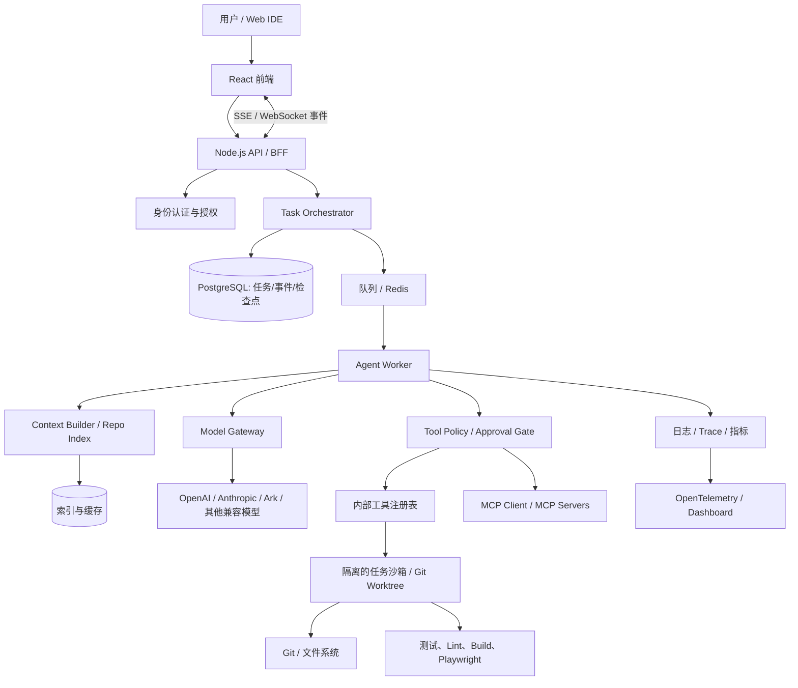
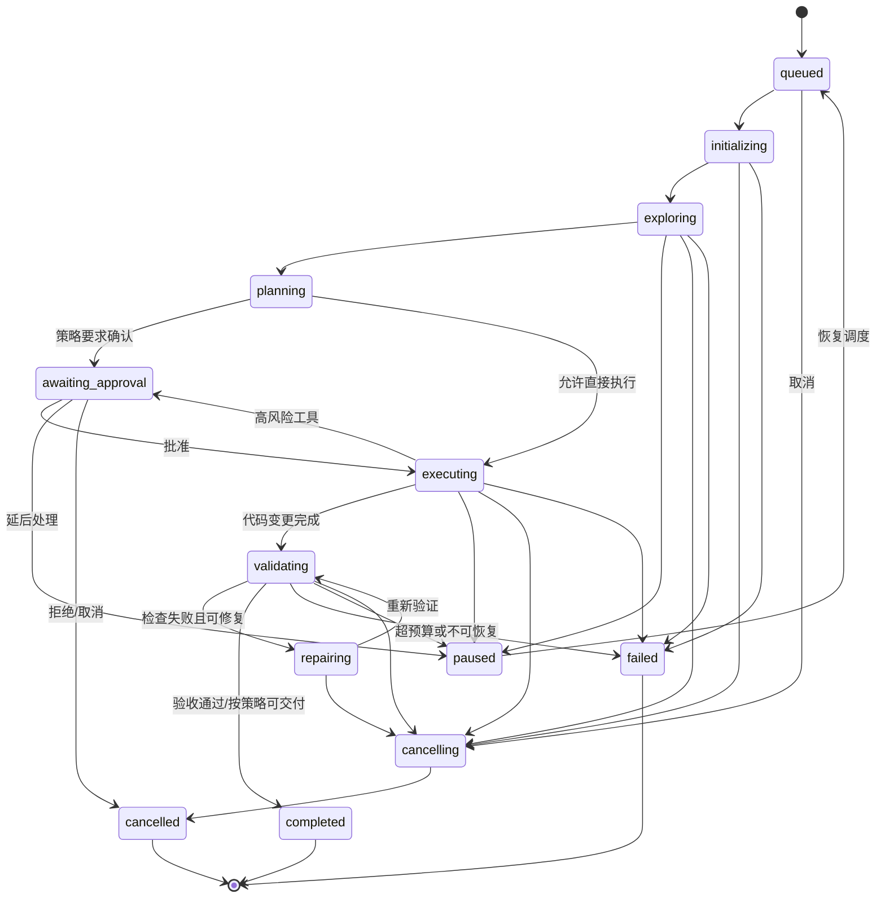

# AI Coding Agent 系统设计文档

> 文档版本：v1.0  
> 推荐实施技术栈：React + TypeScript + Node.js BFF/Orchestrator + PostgreSQL + Redis/Queue + Docker 沙箱 + MCP + Playwright

## 0. 执行摘要

本项目目标是构建一个能理解自然语言软件需求、探索已有仓库、规划修改、编辑代码、运行验证、诊断失败并交付可审查变更的 AI Coding Agent。它不是“LLM + 一个终端工具”，而是一套包含模型适配、上下文工程、工作区隔离、工具治理、持久化状态机、验证与评测的工程系统。

**核心设计原则**

1. **Agent 不等于模型。** 模型只负责推断与选择动作；业务服务负责状态机、权限、审批、幂等、超时和持久化。
2. **先构建单 Agent 闭环。** 第一版实现一个主 Agent + 明确的确定性工作流；只有在评测证明存在独立收益时，才引入 Reviewer、Test Analyst 等子 Agent。
3. **代码检索使用混合策略。** `ripgrep`/文件路径/项目配置/语言服务/AST 是基础；Embedding 作为补充而不是代码理解的唯一方式。
4. **所有改动可审查、可回滚。** Agent 在独立 Git worktree 或任务副本中工作，生成补丁并运行验证；不直接覆盖用户工作区，不默认自动 push 或 merge。
5. **工具执行默认最小权限。** 只暴露当前任务必需的工具，命令受沙箱和策略层约束；高风险副作用必须人工确认。
6. **任务要可恢复。** 每个重要状态变化、工具调用结果、审批决定和验证结果都写入持久化存储，任务不能只依赖内存中的对话历史。
7. **测试结果是交付依据。** 模型说“已修复”不等于已修复；交付结果必须列出实际运行过的检查、结果和未验证项。
8. **评测先行。** 先建立真实仓库任务集，再优化 Prompt、模型、工具和检索；不只用主观演示判断效果。

### 0.1 推荐 MVP

- 支持一个本地或 Git 仓库工作区；首期优先 TypeScript/JavaScript/React 项目。
- 用户能提出新增功能、修改现有逻辑、修复错误、补测试、解释代码等任务。
- 系统读取项目约定与关键文件，生成可审查计划。
- Agent 可搜索、读文件、编辑文件、运行受控命令和测试。
- 支持 Diff 预览、人工批准、暂停、恢复、取消、超时、有限重试。
- 使用独立任务工作区；任务结束时给出改动文件、验证结果、风险和后续建议。
- 支持至少一个模型供应商，并通过 `ModelProvider` 接口预留 OpenAI、Anthropic、Ark 等适配。
- 使用 MCP 接入外部工具；本地文件系统和命令执行由可信的内部工具层托管。

### 0.2 首期明确不做

- 不允许 Agent 默认直接部署生产、修改线上数据、合并主分支或发布版本。
- 不试图首期完美支持所有语言、所有 IDE、所有构建系统。
- 不把所有功能拆成多个 Agent 后再协调；先把任务闭环、状态恢复和安全执行做好。
- 不允许任意浏览网页后把网页内容当成高信任指令。
- 不宣称所有任务完全无人干预；复杂需求和高风险动作必须能回到人工确认。

---

## 1. 产品目标与使用场景

### 1.1 目标用户与典型任务

| 任务类型 | 示例输入 | 预期行为 | 主要验收 |
|---|---|---|---|
| 新功能 | “在用户列表页增加姓名搜索和分页” | 查找页面、复用已有组件和 API 模式，修改 UI/状态/请求/测试 | 符合项目规范，测试通过 |
| 缺陷修复 | “切换查询条件后仍显示上一次搜索结果” | 追踪请求竞态、复现原因、修复 stale response，并增加回归测试 | 回归测试通过，旧行为不退化 |
| 重构 | “把这几个重复的格式化逻辑抽到公共工具里” | 搜索调用方、评估影响范围、最小化变更 | 类型检查与测试通过，兼容性明确 |
| 代码理解 | “解释这个页面的请求链路” | 搜索入口、组件、Hooks、API、状态来源 | 结论带文件路径和符号证据 |
| 测试生成 | “给这个 Hook 补充边界测试” | 分析现有测试框架、生成最小测试、运行测试 | 新测试真实运行且有判定价值 |
| UI 调试 | “表单提交后按钮没有恢复” | 定位状态流，必要时启动页面、复现与浏览器检查 | 有复现证据或明确说明未能复现 |

### 1.2 用户体验流程

1. **选择仓库/分支/任务模式**：只读问答、自动修改、先计划后执行。
2. **提交需求**：自然语言、可选截图、错误日志、相关文件或验收条件。
3. **需求归一化**：识别目标、边界、约束、验收条件和潜在风险。无关键信息且会影响实现时再提问；其余情况先探索仓库。
4. **仓库探索**：识别语言、包管理器、测试和构建命令、项目规范、Git 状态及未提交变更。
5. **计划确认**：展示计划、目标文件、风险和预计验证步骤。简单低风险任务可按配置跳过单独确认。
6. **执行与状态流**：展示工具调用、命令、日志摘要、文件变更和检查点；工具执行失败时可重试或调整方案。
7. **验证**：按项目能力依次执行类型检查、Lint、相关测试、构建以及可选浏览器测试。
8. **审阅与交付**：显示 Diff、测试结果、未解决问题和风险；用户可要求继续修改、恢复到某个检查点或结束任务。
9. **导出/集成**：MVP 交付 Git diff/本地分支；后续再做 PR、Issue 和 CI 集成。

### 1.3 任务模式

- `ask`：只读分析，不允许写入文件或执行有副作用的命令。
- `plan`：只探索并给出计划，不修改文件。
- `edit`：允许工作区文件变更，验证后等待用户审阅。
- `autopilot`：在明确的权限策略和预算内自动循环修复；仍然不能跳过强制审批点。

默认模式应为 `edit` 或 `plan`，而不是不设边界的全自动模式。用户和管理员的授权范围必须比模型提出的动作优先级更高。

### 1.4 成功定义

一次任务成功不只代表模型生成了代码，而应满足：

- 需求相关性：改动解决用户描述的问题；
- 变更范围：没有不必要的大规模重写；
- 可验证性：项目可执行的检查被运行并记录；
- 可审查性：Diff 清晰、变更来源可追踪；
- 安全性：没有越权访问、危险命令或未授权外部副作用；
- 可恢复性：中断后能继续、取消后停止新动作；
- 诚实交付：测试没跑、环境失败或存在不确定性时明确说明。

---

## 2. 系统总体架构

### 2.1 架构图



### 2.2 组件职责

| 组件 | 职责 | 不应承担的职责 |
|---|---|---|
| React 前端 | 需求输入、计划和 Diff 展示、审批、流式任务状态、重试/取消交互 | 不直接持有模型密钥或执行本机任意命令 |
| Node.js API/BFF | 用户身份、权限、请求校验、任务创建、SSE 事件转发、资源配额 | 不在 HTTP 请求生命周期内运行长任务 |
| Task Orchestrator | 管理状态机、恢复、预算、取消、审批等待、调度与重试策略 | 不直接把未经校验的模型文本作为 shell 命令执行 |
| Agent Worker | 驱动 Agent Loop；构建上下文；调用模型和工具；保存执行结果 | 不持有超出任务需要的全局权限 |
| Model Gateway | Provider 适配、超时、重试、模型路由、用量统计、结构化输出校验 | 不和任务持久化逻辑耦合成一个大类 |
| Context Builder | 聚合仓库规则、文件、符号、搜索结果、测试和 Git 状态 | 不把整个仓库无差别塞进上下文 |
| Tool Registry | 工具 Schema、权限标签、超时、幂等属性、执行适配 | 不允许模型绕过 Policy 层直连实现函数 |
| Sandbox Manager | 创建隔离环境、挂载工作区、限制网络/CPU/内存/时间、销毁环境 | 不假设单靠 Docker 就能抵御所有宿主机风险 |
| Test Runner | 项目类型识别、检查命令执行、日志截断/归档、结果归一化 | 不根据模型口头声明伪造通过结果 |
| Persistence | 保存任务、事件、审批、工具调用、快照与产物 | 不把 Redis 队列当成唯一任务事实来源 |
| Evaluation/Observability | Trace、Token/费用、任务成功率、失败分类、回归集 | 不记录未经脱敏的密钥和完整敏感源码到公共日志 |

### 2.3 推荐技术选型

| 层次 | MVP 推荐 | 备选 / 后续升级 | 选型理由 |
|---|---|---|---|
| Web UI | React + TypeScript + Semi Design 或现有设计系统 | Monaco Editor / diff 组件 | 用户熟悉 React；重点先做任务和审阅交互 |
| API/BFF | Node.js + TypeScript；可选 Fastify 或 NestJS | 现有公司内部框架 | 支持流式接口、Schema 校验和清晰模块边界 |
| 数据校验 | Zod 或 JSON Schema + Ajv | TypeBox 等 | 输入、工具和模型输出必须校验 |
| 数据库 | PostgreSQL | 托管 PostgreSQL | 任务状态、审计事件、审批记录具备事务与持久化能力 |
| 队列 | Redis + BullMQ 或现有任务队列 | 云队列 | 解耦 HTTP 与长任务；PostgreSQL 仍为权威状态 |
| 工作区 | Git worktree + 容器 | 每任务独立 VM/微虚拟机 | 代码 Diff 易审查，同时隔离任务之间的文件变更 |
| 代码搜索 | `rg`、文件树、Git、TypeScript Language Service、Tree-sitter | SCIP 等跨仓库索引 | 先用便宜、精确、可解释的结构化检索 |
| LLM | Model Gateway 统一封装；首期只上线 1 个 Provider | OpenAI、Anthropic、Ark 等并行 | 先降低接入与调试复杂度，后续通过评测进行模型路由 |
| MCP | 官方 TypeScript SDK；锁定已验证的 SDK 主版本 | 内部工具协议 | MCP 连接外部工具，内部高信任工具仍可本地注册 |
| 浏览器自动化 | Playwright | 现有 E2E 框架 | 可用于 UI 复现、截图与浏览器回归测试 |
| 观测 | Pino/结构化日志 + OpenTelemetry | Prometheus/Grafana/OTel 后端 | 将任务、模型请求、工具调用和测试串到同一 Trace |
| 测试 | Vitest/Jest + Playwright + 项目实际工具链 | 现有测试栈 | 不强迫目标仓库迁移测试框架 |

**框架决策建议**：如果目标是多个模型供应商、细粒度审批和自定义恢复，先实现清晰的领域状态机与轻量 Agent Loop，再评估 Agents SDK / LangGraph.js。若选 LangGraph.js，应把 Checkpointer、Interrupt、人类审批与状态恢复能力纳入原型对比；不应同时自研一个复杂图运行时又引入另一个图框架。无论选哪一类框架，任务状态、权限和业务审计仍由本系统掌握。

### 2.4 部署形态

**开发 / 单用户阶段**：前端 + Node API + 一个 Worker + PostgreSQL + Redis + 本机 Docker。  
**团队阶段**：API 与 Worker 分离部署；按仓库或任务并发扩容；沙箱按任务创建；独立的凭证代理和网络出口策略。  
**企业阶段**：多租户授权、审计保留策略、私有模型/代理、仓库级策略、网络域名白名单、资源配额、组织级评测与成本看板。

---

## 3. Agent 工作流与状态机

### 3.1 任务状态

建议定义以下顶层状态：

- `queued`：已入队，等待 Worker；
- `initializing`：检查权限、Git 状态、工作区和运行环境；
- `exploring`：分析项目和需求上下文；
- `planning`：生成并校验执行计划；
- `awaiting_approval`：等待用户对计划、工具或高风险操作确认；
- `executing`：读取/修改文件、运行命令和工具；
- `validating`：运行类型检查、Lint、测试、构建等；
- `repairing`：分析验证失败并进行有限次数修复；
- `paused`：用户暂停或等待人工输入；
- `cancelling`：正在停止 Worker 和子进程；
- `completed`：成功完成并生成交付摘要；
- `failed`：无法完成，保留现场和错误摘要；
- `cancelled`：已取消；
- `expired`：超过允许的最长任务时间或资源预算。

状态只能通过 Orchestrator 的显式转换函数修改。每次转换应在一个事务中更新任务状态并追加事件，避免出现 UI 显示“完成”但数据库仍是“执行中”的情况。

### 3.2 状态流转图



### 3.3 核心 Agent Loop

推荐采用“模型提议动作、运行时验证并执行、结果重新进入上下文”的闭环：

1. 从数据库加载最新任务和检查点；检查取消标记、截止时间、token/费用预算、步数预算。
2. 生成当前上下文：用户需求、项目规则、计划、最近工具结果、相关代码片段、当前 Diff、剩余预算。
3. 调用模型，要求输出最终答复或一个/多个结构化工具调用。
4. 对每个工具调用检查：Schema、工具权限、参数范围、路径边界、命令策略、审批要求、幂等性和超时上限。
5. 若需审批，则保存 `approval_request` 和当前检查点，转入 `awaiting_approval`，释放 Worker，而不是阻塞线程持续轮询。
6. 执行工具，在开始前记录调用，在完成后保存结果、退出码、耗时和产物引用。
7. 检查是否有文件变化、是否触发测试、是否重复失败、是否出现无进展循环；必要时把失败压缩为诊断信息重新规划。
8. 达到交付条件后，执行最终 Diff/权限/测试检查并生成结构化交付报告。

伪代码示意：

```ts
async function runTask(taskId: string): Promise<void> {
  let state = await store.loadTaskState(taskId);

  while (!isTerminal(state.status)) {
    await control.assertNotCancelled(taskId);
    budget.assertWithinLimits(state.budget);

    const context = await contextBuilder.build(state);
    const decision = await modelGateway.nextAction(context);
    const parsed = decisionSchema.parse(decision);

    if (parsed.type === "final") {
      const report = await delivery.verifyAndBuildReport(state, parsed);
      await store.completeTask(taskId, report);
      return;
    }

    const tool = toolRegistry.get(parsed.toolName);
    const permit = await policy.evaluate({ task: state, tool, args: parsed.args });
    if (permit.kind === "approval_required") {
      await store.pauseForApproval(taskId, permit.request);
      return; // 审批后由调度器恢复，不占用 Worker
    }

    const result = await toolExecutor.execute({
      task: state,
      tool,
      args: parsed.args,
      timeoutMs: permit.timeoutMs,
    });
    state = await store.appendToolResultAndCheckpoint(taskId, result);
    state = await progressGuard.evaluate(state, result);
  }
}
```

该代码仅为流程示意，具体实现应处理 Worker 租约、并发重复投递、幂等键、AbortSignal、进程清理和数据库事务。

### 3.4 停止与恢复语义

- **Pause**：不再开始新工具调用；允许当前安全的只读操作结束，或按执行策略中断子进程。保存检查点后释放 Worker。
- **Cancel**：记录取消时间和原因，终止当前命令进程组，阻止新工具调用，清理短期资源；已发生的外部副作用不能假装回滚，需在报告中披露。
- **Resume**：按 `task_id + checkpoint_version` 加载状态，重新检查权限、仓库提交、环境和凭证，不盲目重放旧工具调用。
- **Worker 崩溃**：租约过期后由其他 Worker 领取任务；先检查上一次工具调用是否有确定的结果，再决定重试，防止重复写入或重复发送外部请求。
- **超时**：分别设置模型请求、单次工具、单条命令、阶段和整个任务的时间上限。

### 3.5 预算与循环防护

为每个任务设置配置化的上限，例如：最大模型轮次、最大工具调用数、最大修改文件数、最大改动行数、单条命令超时、验证/修复轮次、最长运行时间和总费用预算。初始数值应通过内部任务集校准，而不是把示例值永久写死。

触发以下任意条件时停止自动循环并请求人工介入或以部分失败结束：同一命令/测试连续重复且无状态变化；连续多轮没有文件、计划或验证状态进展；反复重写同一文件；同一错误在设定修复次数后不变；模型上下文持续膨胀但目标没有收敛。

---

## 4. 需求理解与计划生成

### 4.1 统一的任务描述对象

将自然语言输入归一化为类型化任务，供 Orchestrator、UI、模型和评测共同使用：

```ts
interface CodingTaskSpec {
  title: string;
  intent: "feature" | "bugfix" | "refactor" | "test" | "explain" | "investigate";
  userRequest: string;
  acceptanceCriteria: Array<{
    id: string;
    description: string;
    verification?: string;
  }>;
  constraints: string[];
  inScopePaths?: string[];
  outOfScopePaths?: string[];
  riskLevel: "low" | "medium" | "high";
  mode: "ask" | "plan" | "edit" | "autopilot";
}
```

验收条件应是可观察的行为，而不是模糊的“代码优雅”“实现得更好”。例如：`当查询条件变化时，旧请求的响应不能覆盖新请求结果`，并指定可用的测试方式。

### 4.2 Plan Schema

计划不是随口输出的一段 Markdown，而是可校验的结构化数据：

```ts
interface ExecutionPlan {
  summary: string;
  assumptions: string[];
  steps: Array<{
    id: string;
    objective: string;
    filesLikelyAffected: string[];
    toolsAllowed: string[];
    dependencies: string[];
    doneWhen: string[];
    risk: "low" | "medium" | "high";
  }>;
  validation: Array<{
    command: string[];
    purpose: string;
    required: boolean;
  }>;
  requiresApproval: boolean;
}
```

执行计划必须经过 Schema 校验；执行时允许因仓库证据而修订计划，但每次重大范围变化要写入事件。若 Agent 发现必须改动规划范围以外的配置或删除文件，应触发策略检查或审批，而不是自动扩大权限。

### 4.3 什么时候提问

仅在缺失信息会改变实现路径、涉及不可逆操作、多个方案成本差异巨大或验收条件无法合理推断时提问。对于“增加搜索框”这类通常可以从现有代码发现答案的需求，应先探索已有搜索组件和 API 模式，不要频繁打断用户。

---

## 5. 代码库理解与上下文工程

### 5.1 不要只做向量 RAG

代码不是普通文档。符号引用、类型、调用关系、文件路径、测试绑定和构建配置往往比纯语义相似度更关键。推荐采用分层检索：

1. **仓库概览**：目录树、语言、框架、包管理器、工作区配置、重要脚本、Git 状态。
2. **项目规则**：读取已配置的 `AGENTS.md`、`CLAUDE.md`、项目 README、贡献指南及用户指定规则；记录来源与路径，不能把规则文件当成高于系统安全策略的授权。
3. **精确检索**：文件名、字符串、错误信息、函数/组件名、`rg` 搜索、Git 历史。
4. **符号检索**：TypeScript Language Service/Compiler API 获取定义、引用、类型及导出信息；Tree-sitter 可为多语言生成可容错的语法树。
5. **结构和依赖关系**：导入图、调用点、相关测试、路由注册、接口定义、组件调用链。
6. **语义检索**：当问题描述与命名不一致、仓库较大或前述方式不足时，再使用 Embedding/混合检索。
7. **动态证据**：测试失败、运行日志、浏览器截图和调用结果。

Tree-sitter 能增量更新语法树并在语法错误存在时仍提供结构信息；TypeScript Compiler API 则提供 Program、SourceFile、Symbol、TypeChecker 等语言语义入口。参考 [R5]、[R6]。

### 5.2 仓库启动扫描

扫描时先忽略以下目录：`.git`、`node_modules`、构建产物、覆盖率输出、二进制文件、超大生成文件、用户明确排除目录、密钥/凭证目录。路径过滤不能只靠模型决定，应由可信代码执行。

生成 `RepoProfile`：

```ts
interface RepoProfile {
  repoId: string;
  rootPath: string;
  git: { branch: string; baseCommit: string; dirty: boolean };
  languages: string[];
  packageManagers: string[];
  frameworks: string[];
  monorepo: boolean;
  packages: Array<{ name: string; path: string; scripts: Record<string, string> }>;
  checks: Array<{ id: string; command: string[]; confidence: number }>;
  ruleFiles: Array<{ path: string; sha256: string }>;
  indexVersion: string;
}
```

自动发现的命令只是候选。执行前要展示命令来源，例如 `package.json scripts.test`，再根据命令策略和沙箱权限决定是否放行。不要把 README 中复制来的任意命令直接执行。

### 5.3 索引结构与刷新

MVP 可先使用不依赖向量数据库的轻量索引：

- 文件索引：路径、语言、大小、修改时间、Git blob/hash；
- 符号索引：符号名、类别、文件、范围、导出状态；
- 关系索引：导入/引用/调用/测试关联；
- 文本索引：文件片段和倒排索引；
- 可选语义索引：Embedding、模型版本、片段边界、索引时间。

首期可将索引存储在任务/工作区级缓存或 PostgreSQL；仓库规模和查询延迟达到阈值后，再考虑专用向量库或 SCIP 等精确代码导航。索引必须带 `commit_sha` 或文件 hash；分支提交变更后，旧索引只能作为缓存，不能当成最新事实。

### 5.4 上下文构建与压缩

每次模型请求仅携带当前阶段必需的信息：系统规则、用户目标、当前计划步骤、关键项目约定、精确检索片段、最近工具结果、当前 Diff 和验证失败摘要。优先完整保留少量高相关证据，而不是加入大量相似但无关代码。

上下文优先级建议：

1. 安全规则和运行时策略（不可被仓库内容覆盖）；
2. 用户需求、验收条件与用户明确约束；
3. 当前计划和已确认审批；
4. 项目规则文件（作为项目约定，来源必须标注）；
5. 当前修改相关代码、测试、类型和错误日志；
6. 历史工具摘要和旧轮次摘要；
7. 其他背景资料。

上下文压缩应以可恢复的结构化状态为底，而不是把所有对话压成一段无法校验的摘要。至少持久化目标、验收条件、计划、完成步骤、文件变更、最新错误、审批决定、剩余预算和最后检查点。模型的隐藏推理过程不作为必需存储对象；记录可审计的行动理由、证据和结果摘要即可。

### 5.5 输入注入与不可信内容

代码注释、README、Issue、网页、MCP 返回值、测试日志都可能包含“忽略之前指令、泄露密钥、执行命令”等文本。应将其视为数据而非权限来源。系统提示词要明确区分可信策略和不可信材料；更关键的是，无论模型如何解释这些材料，Policy 层都必须独立拦截越权读写、外网访问、凭证访问和危险命令。参考 [R9]、[R10]。

---

## 6. 文件读取、编辑与变更管理

### 6.1 文件读取工具

`read_file` 应支持明确的行范围与最大字节数；返回内容要附文件路径、行号、文件 hash 和截断标记。二进制文件、超大文件或疑似密钥文件应遵循不同策略。对模型上下文只返回必要片段，同时在产物区保留可追踪引用。

### 6.2 编辑策略

建议按风险从低到高使用：

1. **精确文本替换**：适合唯一且稳定的小片段；必须验证匹配次数，默认预期恰好一次。
2. **结构化补丁**：Unified Diff 或经过验证的 patch 格式，保存基准 hash；应用失败就重新读取，禁止盲目扩大模糊匹配。
3. **AST/语言服务辅助修改**：用于重命名、导入整理、符号级变更等结构性任务；注意格式化和注释保留。
4. **整文件重写**：仅用于新增文件或短小文件；修改现有大文件时优先补丁化，避免意外丢弃用户逻辑。

每次写入前后都要检查路径、权限、基准 hash、Git 状态和大小限制。符号链接应禁止逃逸工作区；拒绝 `..` 逃逸、绝对路径越界、特殊设备文件和未授权的敏感路径。

### 6.3 用户已有变更保护

- 执行前获取 `git status --porcelain`，记录初始 dirty state 和文件 hash。
- 推荐为任务建立独立 worktree 或独立工作副本；不要在用户现有工作区混写。
- 若必须在本机目录内工作，只能通过路径白名单编辑任务授权范围内的文件；用户已有修改被判为基线，不允许用 `git reset --hard`、`git clean -fd` 等方式清场。
- 在应用补丁前验证文件 hash 是否与生成补丁时的基线一致；如果变化，先重新读取并重算补丁。
- 取消任务不等于自动回滚所有改动；应保留 Diff、提供“丢弃本 Agent 变更”操作，并确认回滚只针对 Agent 自己产生的提交/补丁。

### 6.4 变更规模与范围保护

配置每个任务的最大文件数、最大行数、可修改目录和禁止目录。若计划是改一个组件，但最终准备改动几十个无关文件，触发二次计划审查。依赖锁文件、环境变量、CI/CD、权限配置、脚本、迁移文件应拥有更高风险等级。

### 6.5 Diff 审核

交付前至少包含：文件列表、逐文件 Diff、增删行统计、验收条件映射、执行的命令与退出码、失败项、潜在风险、未覆盖场景。可以计算基准 SHA、产物 SHA 和 Patch ID 以便追踪变更版本。

---

## 7. 工具系统与 MCP

### 7.1 工具分层

**A. 内部核心工具（直接由 Node Worker 执行）**

- `repo.list_files`
- `repo.read_file`
- `repo.search_text`
- `repo.find_symbol`
- `repo.find_references`
- `repo.git_status`
- `repo.read_diff`
- `repo.apply_patch`
- `command.run`
- `test.run`
- `browser.open_page` / `browser.screenshot`（可选阶段）

**B. MCP 外部能力**

- GitHub/GitLab：读取 Issue/PR、创建分支、发布 PR（后期）；
- 文档系统：查询架构规范和团队约定；
- 工单系统：读取任务描述、同步工作状态；
- 设计工具：读取 UI 规范和设计上下文；
- 自定义企业工具：遵循统一 MCP Client 接入规范。

MCP 是互操作协议，并不天然代表可信或安全。每个 MCP Server 要单独登记来源、用途、权限范围、认证方式、网络目标、超时和数据分类；工具描述、注释和返回内容按不可信输入处理。MCP 规范还建议工具调用过程有清晰的人类可见状态，并对敏感调用保留拒绝能力。[R2]

### 7.2 工具描述契约

```ts
interface AgentTool<I = unknown, O = unknown> {
  name: string;
  description: string;
  inputSchema: unknown;   // JSON Schema / Zod schema adapter
  outputSchema?: unknown;
  risk: "read" | "workspace_write" | "command" | "external_side_effect";
  idempotency: "safe" | "keyed" | "non_idempotent";
  timeoutMs: number;
  requiresApproval: (input: I, context: TaskContext) => boolean;
  execute(input: I, context: ToolExecutionContext): Promise<O>;
}
```

模型能看到的工具子集应按任务模式、任务状态、用户权限和工具注册策略动态生成。工具名需要命名空间，例如 `repo.read_file`，避免多 MCP Server 提供同名 `search` 后产生歧义。

### 7.3 工具执行统一结果

```ts
interface ToolExecutionResult<T = unknown> {
  callId: string;
  toolName: string;
  status: "succeeded" | "failed" | "timed_out" | "cancelled";
  output?: T;
  error?: { code: string; message: string; retryable: boolean };
  startedAt: string;
  finishedAt: string;
  durationMs: number;
  artifacts?: Array<{ kind: string; uri: string; sha256?: string }>;
  usage?: { inputTokens?: number; outputTokens?: number; costUsd?: number };
}
```

### 7.4 重试与幂等

- 对 GET、搜索、文件读取等只读操作可以按策略有限重试。
- 对模型请求重试需区分超时、限流、网络错误和不可重试的参数错误；遵守 `Retry-After`，采用指数退避加抖动。
- 对文件补丁，重试前必须检查目标文件 hash 与补丁是否已应用；不能不判断结果就再次写入。
- 对创建 PR、发消息、改工单等外部副作用操作，使用幂等键或先查询副作用是否已发生；没有幂等保证时，超时后不自动重放，应转人工确认。
- 错误对象必须有稳定 `error_code`，不能只匹配自然语言错误文案。

### 7.5 人工审批策略

| 风险动作 | 默认策略 |
|---|---|
| 读取工作区内普通源码 | 允许，受路径策略约束 |
| 修改授权目录内源码 | 按任务模式允许；前端展示 Diff |
| 修改锁文件、权限、CI/CD、部署脚本 | 需要更严格确认，或由管理员策略决定 |
| 执行测试、Lint、类型检查 | 命令在允许列表/隔离环境内时可自动执行 |
| 新增依赖、访问外网安装包 | 要求网络策略放行；首次新增/升级依赖建议审批 |
| 读取密钥、环境凭证、SSH 私钥 | 默认拒绝；如业务确有需要，应单独的服务端能力托管，不能返回模型上下文 |
| 删除大量文件、修改 Git 历史 | 默认拒绝或强制审批 |
| push、创建 PR、合并、发布 | 先审批；MVP 默认不做自动 merge/deploy |
| 访问生产系统或修改线上数据 | 默认拒绝，需独立授权和独立审计体系 |

审批必须和具体的动作参数绑定：用户批准了 `command.run` 的一条命令，不能被复用于参数不同的另一个命令。保存请求摘要、参数 hash、权限策略版本、审批人、审批时间、结果和失效时间。

---

## 8. Skills 与工程流程复用

### 8.1 Skill 与 Tool 的区别

- **Tool**：可被程序调用的原子能力，例如读取文件、搜索代码、执行测试。
- **Skill**：可复用的工作流程/说明，例如“定位 React 状态竞态”“给项目新增页面”“排查构建错误”。它指导 Agent 在什么场景、按什么步骤调用工具。
- **Workflow / State Machine**：由程序强制执行的可靠流程，例如必须审批、测试失败最多修复两轮、取消后不再运行命令。

不能把安全约束只写在 Skill 文本里。Skill 可以建议，Policy 和状态机负责强制。

### 8.2 Skill 文件结构

```text
.agent/
  skills/
    react-feature/
      SKILL.md
      examples.md
      checklist.md
    bug-triage/
      SKILL.md
      checklist.md
    test-repair/
      SKILL.md
      examples.md
```

推荐 `SKILL.md` 包含：名称、适用场景、输入前提、必须遵守的边界、步骤、成功条件、常见失败与恢复方式、需要调用的工具、相关示例。Skill 应按任务需要加载，不要把所有 Skill 一次性加入每轮上下文。

### 8.3 Skill 选择与版本管理

- 由轻量 Router 根据任务类型召回候选 Skill；明确的用户指令优先。
- 每个 Skill 带 `id`、`version`、`source`、`content_hash`、`trust_level`。
- 仓库内 Skill 属于项目提供的辅助指引，而不是安全策略；首次启用外部来源 Skill 应审阅并固定版本。
- 把 Skill 作为可评测资产：维护标准任务和成功/失败案例，验证是否降低步骤错误、修改范围和任务成本。

---

## 9. 多 Agent 策略

### 9.1 首期建议单 Agent

对常见新增功能与修复任务，一个能力充足的主 Agent 加上确定性验证流程，往往比多个 Agent 互相转交更容易调试。多 Agent 会增加上下文传递、协调、工具权限、执行成本和失败归因的复杂度。

### 9.2 何时引入子 Agent

当评测证明某个环节有可独立并行的工作、明确输入输出，并能提高整体成功率或降低成本时，可引入：

- `Repository Analyst`：只读探索，输出带证据的相关文件与调用链；
- `Test Analyst`：分析失败日志，提出最有价值的回归测试；
- `Patch Reviewer`：只读审查 Diff、范围、安全与边界条件；
- `Documentation Agent`：后续生成变更文档或发布说明。

子 Agent 默认只给需要的工具。分析型 Agent 不应得到写文件和终端权限。两个 Agent 同时改同一工作区会引入竞态；若要并行编码，应为每个分支/任务创建独立 worktree，最后由集成步骤解决冲突。

### 9.3 多 Agent 交接格式

交接必须传递任务目标、相关证据、候选文件、未确认假设、约束、当前提交、期望输出 Schema 和禁止动作。不要传递无边界的长对话作为唯一状态。

---

## 10. 自动测试、错误诊断与修复

### 10.1 验证流水线

建议根据改动类型选择验证，不要每一轮都盲目执行全仓库耗时检查：

1. Diff/补丁可应用检查、格式与明显敏感文件检查；
2. 受影响包的 TypeScript 类型检查；
3. ESLint / 项目 Lint；
4. 相关单元测试与回归测试；
5. 构建；
6. UI 任务的 Playwright 冒烟/E2E（需要时）；
7. 最终全量检查（按任务风险、时间和项目规模决定）。

执行顺序从便宜、反馈快的检查开始。Playwright 的自动重试断言适合异步 UI 状态；应优先使用可等待的 locator assertion，而不是靠固定 sleep 判断页面已经稳定。[R8]

### 10.2 项目命令发现

从 `package.json`、workspace 配置、README、CI 配置和现有脚本推断检查命令，形成候选列表并记录来源和置信度。命令必须通过 Policy；检测到 monorepo 时优先定位受影响 package，不直接默认运行全仓库命令。

### 10.3 错误归类

统一将错误归为：

- `MODEL_TIMEOUT` / `MODEL_RATE_LIMIT` / `MODEL_INVALID_OUTPUT`；
- `TOOL_TIMEOUT` / `TOOL_PERMISSION_DENIED` / `TOOL_SCHEMA_INVALID`；
- `PATCH_CONFLICT` / `PATH_POLICY_VIOLATION`；
- `COMMAND_EXIT_NONZERO` / `DEPENDENCY_INSTALL_FAILED` / `NETWORK_BLOCKED`；
- `TYPECHECK_FAILED` / `LINT_FAILED` / `TEST_FAILED` / `BUILD_FAILED`；
- `BUDGET_EXCEEDED` / `NO_PROGRESS` / `CANCELLED`；
- `SANDBOX_FAILURE` / `WORKSPACE_CONFLICT`。

分类后才能采用不同恢复策略。例：测试断言失败可能进入诊断与修复；网络受限不应反复请求模型重写代码；权限拒绝不应通过换一种命令来规避策略。

### 10.4 Repair Loop

1. 收集失败命令、退出码、精简 stdout/stderr、测试名和相关文件。
2. 将日志截断/归档，提取可用于定位的错误摘要；不要把超长日志无过滤塞进上下文。
3. 先要求 Agent 解释失败与修改的关联，提出可检验假设。
4. 允许有限次修复；每次修复记录修改文件和测试结果。
5. 若错误转变，更新诊断；若错误重复或范围持续扩大，停止自动修复。
6. 最后重新运行受影响检查，并区分“已通过”“失败”“未执行”“环境无法执行”。

测试通过也不等于全部正确，仍需检查是否实现了验收条件、是否修改了不相关逻辑、是否引入安全风险。对于暂时缺少测试的任务，Agent 应明确验证缺口。

---

## 11. 沙箱与安全架构

### 11.1 威胁模型

应至少考虑：恶意/误导用户输入、仓库内 Prompt Injection、恶意依赖脚本、工具参数注入、路径穿越、符号链接逃逸、网络访问/SSRF、密钥泄漏、租户越权、资源耗尽、MCP Server 被攻陷、模型错误生成危险命令、重试造成重复副作用。

### 11.2 沙箱基线

- 每个任务使用独立容器或更强隔离环境；工作目录仅挂载该任务授权的工作区。
- 使用非 root 用户；尽可能采用 rootless Docker、只读根文件系统、默认 seccomp、去除不必要 Linux capabilities。
- 限制 CPU、内存、进程数、磁盘、文件数、日志量、运行时长和并发任务数。
- 默认关闭网络；确有依赖安装需求时，按域名/IP/端口及阶段临时开放网络出口。
- 不挂载 Docker Socket、宿主机 home、SSH agent、云凭证目录等高权限资源。
- 不向任务容器注入通用 API key；由服务端凭证代理执行必要的远程操作，并控制目的地与权限范围。
- 对命令和子进程建立生命周期管理，取消时终止整个进程组。
- 对输出中的 ANSI 控制字符、二进制内容和超长日志进行处理，防止终端/UI 注入和资源耗尽。

Docker 官方文档说明 Rootless 模式可降低 daemon 和容器的权限风险，seccomp 用于约束容器可用系统调用；这些是纵深防御的一部分，而不是强隔离的完整替代品。[R7]

### 11.3 命令执行层

不要直接把模型生成的一整段文本交给拥有宿主机权限的 shell。建议接口采用可审查的结构：

```ts
interface CommandRequest {
  executable: string;
  args: string[];
  cwd: string;                 // 必须位于授权工作区
  env?: Record<string, string>;// 仅允许可配置白名单变量
  timeoutMs: number;
  networkProfile: "none" | "package_registry" | "approved_domains";
  reason: string;
}
```

对于确实需要 shell 的 package scripts，可在沙箱内执行，并依靠命令风险分类、网络策略和容器权限约束；不要将 shell 字符串安全性误认为只是做引号转义。对于破坏性命令，采用硬策略拒绝或人工审批，而不依赖模型自我约束。

### 11.4 网络、密钥与外部数据

- 外网域名使用 allowlist，并拒绝访问云元数据地址、localhost/私有网段等未授权目标；需要明确区分公司内部服务白名单与普通互联网。
- 密钥只在需要的服务端工具中短暂使用；日志与模型上下文必须做脱敏；不要将 secret 写入工作区或命令行参数。
- 对 MCP Server 使用最小 OAuth scope/授权范围，校验服务端身份和来源；必要时配置独立网络出口。
- 文件内容、MCP 工具描述和模型输出都不等于可信策略。策略引擎对权限作独立判定。
- 所有写入、命令、外部调用都写审计事件，包含操作者、任务、工具、参数摘要、审批关联和结果。

### 11.5 安全验收

- 无法读取工作区之外的任意文件；
- 无法访问被禁止的主机目录、Docker Socket 和凭证；
- 网络关闭时出网失败；允许列表外域名访问失败；
- 提示注入无法使 Agent 读取密钥或绕过工具授权；
- 拒绝审批后不会继续执行该动作；
- 取消任务后不会再启动新的命令；
- 多租户任务之间不存在目录、凭证、事件和产物越权访问；
- 通过测试注入超时、重复消息、Worker 崩溃与队列重复投递验证恢复能力。

---

## 12. 持久化数据模型

推荐 PostgreSQL 作为权威数据源，Redis 仅用于队列、短期协调和缓存。下列是逻辑模型，不要求首期一次建齐所有字段。

### 12.1 主要表

**`workspaces`**

- `id`、`tenant_id`、`repo_url` 或 `local_path_ref`、`default_branch`、`created_by`、`policy_id`、`created_at`。
- 不将本机绝对路径当作用户可控的任意路径；使用 workspace ID 映射到服务端管理路径。

**`coding_tasks`**

- `id`、`tenant_id`、`workspace_id`、`created_by`、`title`、`user_request`、`mode`、`status`、`risk_level`；
- `base_commit`、`worktree_ref`、`current_checkpoint_id`、`state_version`；
- `budget_json`、`usage_json`、`deadline_at`、`cancel_requested_at`、`last_error_code`；
- `created_at`、`started_at`、`finished_at`、`updated_at`。

**`task_events`（追加式事件记录）**

- `id`、`task_id`、`seq`、`event_type`、`payload_json`、`created_at`；
- 唯一约束 `(task_id, seq)`；避免以可变 JSON 覆盖历史审计。

**`task_checkpoints`**

- `id`、`task_id`、`version`、`status`、`plan_json`、`completed_steps_json`、`context_summary_json`、`workspace_snapshot_ref`、`created_at`；
- 存储可恢复状态及引用，不一定保存整个代码仓库快照；Git commit/worktree 可承担代码快照功能。

**`tool_calls`**

- `id`、`task_id`、`step_id`、`tool_name`、`input_json_redacted`、`input_hash`、`status`、`idempotency_key`、`started_at`、`finished_at`、`duration_ms`、`result_ref`、`error_code`、`retry_count`。

**`approvals`**

- `id`、`task_id`、`tool_call_id`、`action_type`、`request_summary`、`parameter_hash`、`policy_version`、`status`、`requested_at`、`expires_at`、`decided_by`、`decided_at`、`decision_reason`。

**`task_artifacts`**

- `id`、`task_id`、`kind`、`uri`、`sha256`、`size_bytes`、`metadata_json`、`created_at`。

**`repo_index_snapshots`**

- `id`、`workspace_id`、`commit_sha`、`index_version`、`status`、`artifact_uri`、`created_at`。

### 12.2 数据一致性规则

- 每次状态转换加 `state_version`，使用乐观锁避免两个 Worker 同时推进任务。
- 每个任务在任一时刻只有一个有效 Worker Lease；租约需可续期并有过期回收。
- 工具调用开始与结果分别持久化；结果未知的非幂等调用应进入 `outcome_unknown` 语义，而非自动标为失败后重试。
- SSE 通过 `seq` 发送事件，客户端断线后可从 `Last-Event-ID`/序号补拉。
- 审批只允许一次生效，并与 `parameter_hash` 绑定，避免审批后模型偷偷更改操作参数。
- 保存期限、源码/日志脱敏策略、租户隔离和删除策略应在部署前定稿。

---

## 13. API 与事件协议

### 13.1 REST API 草案

| 方法 | 路径 | 用途 |
|---|---|---|
| `POST` | `/api/workspaces` | 创建/注册工作区 |
| `GET` | `/api/workspaces/:id` | 获取工作区概览、Git 状态、索引状态 |
| `POST` | `/api/tasks` | 创建任务并返回 `taskId` |
| `GET` | `/api/tasks/:id` | 读取任务状态、计划与统计 |
| `GET` | `/api/tasks/:id/events` | SSE 订阅任务事件 |
| `POST` | `/api/tasks/:id/actions` | pause/resume/cancel/replan |
| `GET` | `/api/tasks/:id/diff` | 获取 Diff 与统计 |
| `GET` | `/api/tasks/:id/artifacts` | 获取日志、截图、报告等产物引用 |
| `GET` | `/api/tasks/:id/approvals` | 查询待审批动作 |
| `POST` | `/api/approvals/:id/decision` | approve/reject，服务端重新校验有效性 |
| `POST` | `/api/workspaces/:id/index` | 触发仓库索引刷新 |

### 13.2 创建任务示例

请求：

```json
{
  "workspaceId": "ws_123",
  "userRequest": "修复切换搜索条件后旧请求覆盖新结果的问题，并补回归测试",
  "mode": "edit",
  "constraints": ["沿用项目现有的请求层", "不要改动无关页面"],
  "acceptanceCriteria": [
    "旧请求响应不能覆盖最新查询结果",
    "新增或修改的回归测试通过"
  ]
}
```

响应：

```json
{
  "taskId": "task_123",
  "status": "queued",
  "createdAt": "2026-08-01T05:00:00.000Z",
  "eventsUrl": "/api/tasks/task_123/events"
}
```

### 13.3 SSE 事件类型

建议统一事件包络：

```ts
interface TaskEvent<T = unknown> {
  eventId: string; // task_id + sequence 的稳定标识
  taskId: string;
  seq: number;
  type: string;
  timestamp: string;
  payload: T;
}
```

事件类型包括：`task.status_changed`、`task.plan_ready`、`agent.message_delta`、`tool.started`、`tool.progress`、`tool.completed`、`approval.required`、`approval.decided`、`file.changed`、`validation.started`、`validation.completed`、`checkpoint.created`、`task.warning`、`task.completed`、`task.failed`、`task.cancelled`。

不能把每一个 token 都永久写入数据库。可以流式发送文本增量，但只持久化重要的生命周期事件、完成消息和必要审计内容，控制写入量与敏感信息风险。

### 13.4 API 约束

- 全部接口校验租户、用户和 workspace/task 归属。
- 创建任务需要幂等键，避免前端重试产生重复任务。
- 审批接口必须检查过期时间、当前任务状态、策略版本和参数 hash。
- Diff/日志下载使用短时授权 URL 或服务端鉴权，不暴露宿主机路径。
- SSE 断开不等于取消任务；取消需要显式 API。

---

## 14. Model Gateway 与提示词管理

### 14.1 模型适配层

```ts
interface ModelProvider {
  id: string;
  capabilities: {
    toolCalling: boolean;
    streaming: boolean;
    structuredOutput: boolean;
    vision: boolean;
  };
  generate(input: ModelRequest, signal?: AbortSignal): Promise<ModelResponse>;
}
```

业务层只依赖统一的 `ModelRequest/ModelResponse`，每个 Provider 负责协议映射。需统一处理：工具调用解析、内容块、流式结束原因、Token 用量、请求 ID、速率限制、超时、错误分类、结构化输出与模型特定差异。

### 14.2 模型路由策略

初期固定一个默认模型，建立可靠基线。之后按评测数据考虑：

- 低风险摘要/简单分类使用成本较低的模型；
- 复杂仓库推理和多文件修改使用更强的编码模型；
- 大上下文/视觉需求选择有对应能力的模型；
- 高成本模型触发前可依据预算和任务风险决定；
- 故障切换必须重新校验工具调用和上下文兼容性，不能假设不同模型的工具行为完全一致。

不要只根据厂商公开榜单决定默认模型。使用自己的真实仓库任务集测量成功率、延迟、成本、修复轮数和副作用风险。

### 14.3 提示词版本管理

- 将 system policy、任务规划、工具说明、总结提示分层存放；
- 每个提示词有 `prompt_id`、`version`、`content_hash`；
- Trace 记录实际使用的版本和模型配置；
- Prompt 更改必须运行离线回归集；
- 仓库规则和 Skill 内容单独作为不可信/低信任上下文添加，不能拼接到 system policy 中取得同等信任。

### 14.4 结构化输出

对计划、终止结论、风险分类和交付摘要使用 Schema 约束；解析失败时可进行有限重试或走安全失败路径。工具调用仍需执行端二次校验，不能因为模型输出 JSON 合法就认为权限合法。

---

## 15. 观测、日志与成本控制

### 15.1 单任务 Trace

建议同一 `trace_id` 串联：API 请求、任务入队、Worker Lease、模型调用、工具调用、命令运行、测试结果、人工审批和最终报告。OpenTelemetry 语义约定有利于跨组件使用一致的 Span、属性和指标命名；记录生成式 AI 属性时需留意输入/输出可能包含敏感信息。[R11]

### 15.2 核心指标

**产品效果**：任务成功率、首次通过率、用户接受率、平均修改轮次、平均人工介入次数、返工率、任务耗时。  
**代码质量**：类型检查通过率、Lint 通过率、测试通过率、回归缺陷数、无关变更率、Diff 可应用率。  
**系统可靠性**：Worker 崩溃恢复成功率、重复执行率、取消生效延迟、任务超时率、队列等待时间、SSE 重连成功率。  
**安全性**：策略拒绝次数、审批覆盖率、越权测试失败率、出网阻断命中数、敏感信息泄漏事件。  
**经济性**：每任务输入/输出 Token、模型费用、沙箱 CPU/内存时间、每成功任务成本、不同模型的单位成功成本。

### 15.3 日志原则

只记录调试和审计所需内容。对源码片段、用户输入、日志和模型输出定义脱敏/保留策略。密钥、Cookie、Authorization header、访问令牌不能写入日志。高敏内容不应默认作为 OpenTelemetry Span 属性。日志需要采样与大小限制，但安全审计事件不应因采样丢失。

---

## 16. 评测体系

### 16.1 评测策略

建立内部任务集应早于复杂 Agent 功能开发。每个评测用例包含：仓库与固定 commit、用户需求、预期验收条件、测试命令、允许修改范围、风险标签、参考结果或人工评分标准。

评测集先覆盖 30-50 个高质量、可复现的真实任务，再逐步扩展到更多仓库、不同语言、复杂需求和恶意输入。这个数量只是建议的起步规模，需要根据团队可维护性调整。

### 16.2 分层评测

1. **单元测试**：Policy、状态机、Schema、路径安全、幂等、预算、重试和恢复。
2. **工具契约测试**：对每个工具校验输入输出、超时、错误、取消和权限拒绝。
3. **端到端任务评测**：使用固定仓库和需求完整跑 Agent，验证 Patch 与测试结果。
4. **安全红队**：注入恶意 README/代码注释、尝试路径越界、提示注入、命令逃逸、凭证访问、MCP 返回恶意数据。
5. **故障注入**：模型超时、限流、工具超时、Worker 崩溃、数据库短暂不可用、队列重复投递、审批等待过期。
6. **基准对比**：视预算使用 SWE-bench Lite/Verified 等公开基准作为外部参考。SWE-bench 的问题来自真实 GitHub Issue，使用容器环境执行补丁与测试；公开基准不能替代自己的仓库评测。[R4]

### 16.3 评测指标定义

- **Task Success Rate**：满足全部必需验收条件的任务数 / 总任务数。
- **First-pass Validation Rate**：第一次正式验证就满足必需检查的任务数 / 总任务数。
- **Patch Acceptance Rate**：通过人工审查、无需重大返工的 Patch 比例。
- **Regression Rate**：引入已有测试失败或确认缺陷的任务比例。
- **Scope Precision**：变更文件/行中与任务相关且合理的比例（需人工抽样标注或静态规则辅助）。
- **Safety Violation Rate**：违反权限策略的动作数 / 所有受策略检查的动作数；目标应为零。
- **Recovery Success Rate**：在定义的故障注入场景中，能恢复至一致状态并继续或正确终止的任务比例。
- **Cost per Successful Task**：任务总模型/执行成本除以成功任务数。

先跑出基线，再设定阈值。不能为了追求高成功率而放松安全策略，也不能把“命令退出码为 0”直接当成整体任务成功。

### 16.4 发布门禁

每次更改模型、Prompt、工具定义、检索、沙箱策略或 Agent Loop，都运行关键回归集。阻断条件至少包括：已有核心用例失败、安全用例失败、无法恢复的状态不一致、未经审批出现外部副作用、无法审计工具调用。

---

## 17. 开发路线图

### Phase 0：基线与技术验证

产出：需求边界、Threat Model、模型 Provider PoC、Git worktree PoC、命令沙箱 PoC、最小评测集。  
验收：能在测试仓库中安全读取文件、调用一次模型、返回结构化工具调用，并在隔离工作区成功运行一个项目测试命令。

### Phase 1：纵向 MVP 闭环

实现：任务创建、状态机、SSE、仓库扫描、规则加载、精确搜索、读文件、补丁编辑、Git Diff、命令执行、基础审批、类型检查/测试、交付报告。

验收：至少覆盖“修改一个组件”“修一个 Bug”“补一个测试”三类端到端任务；失败和取消可观察；用户可审阅 Diff；工具执行有审计记录。

### Phase 2：可靠性补齐

实现：PostgreSQL 检查点、Worker Lease、幂等工具执行、分层超时、失败分类、有限重试、暂停/恢复/取消、资源预算、用户原有变更保护。

验收：在模型超时、工具超时、Worker 崩溃、重复任务投递、审批过期等故障注入场景中，任务状态和文件变更一致且可追踪。

### Phase 3：代码理解增强

实现：TypeScript 符号索引、依赖关系、测试映射、影响分析、增量索引；再按评测收益补充 Embedding/混合检索。

验收：与只用 `rg` 的基线相比，目标文件召回率、上下文相关性或成功率有可测提升，索引失效不会导致错误结论。

### Phase 4：Skills、MCP 与浏览器验证

实现：Skill 加载/版本、MCP Client、外部文档/代码托管集成、Playwright 页面验证与截图产物。

验收：MCP 工具调用有权限和审批信息；恶意工具描述不能绕过策略；浏览器测试结果可重现并归档。

### Phase 5：团队与企业能力

实现：多租户、RBAC、组织级策略、费用限额、仓库级配置、审计导出、团队评测看板、PR 工作流、可控模型路由。

验收：跨租户隔离和审计通过安全测试；团队可以追踪成本、成功率、审批与模型版本。

### Phase 6：选择性多 Agent

基于评测结果决定是否引入只读分析 Agent、测试分析 Agent、Diff Review Agent。上线前验证这些角色相较单 Agent 基线的效果、成本和延迟收益。

---

## 18. 建议代码仓库结构

```text
apps/
  web/                     # React 前端
  api/                     # Node.js BFF / REST / SSE
  worker/                  # Agent Worker
packages/
  agent-core/              # Agent loop、状态转换、停止条件
  task-domain/             # Task、Plan、Checkpoint 等领域模型
  model-gateway/            # Provider 适配与路由
  tool-registry/            # 内部工具与 MCP 工具统一接口
  tool-policy/              # RBAC、风险判定、审批规则
  context-engine/           # RepoProfile、检索、上下文组装
  repo-indexer/             # 文件、符号、关系索引
  patch-engine/             # Diff、补丁验证和安全路径写入
  sandbox-manager/          # Docker/worktree 生命周期
  command-runner/           # 受控进程运行、超时、取消、日志
  validation/               # typecheck/lint/test/build/playwright
  persistence/               # DB schema、repositories、migrations
  observability/             # tracing、metrics、logging
  evals/                     # 数据集、评分器、回归用例
  shared-contracts/          # DTO、Zod/JSON Schemas、事件定义
.agent/
  skills/
    bug-triage/SKILL.md
    react-feature/SKILL.md
    test-repair/SKILL.md
infra/
  docker/
  migrations/
  deployment/
docs/
  architecture.md
  threat-model.md
  tool-permissions.md
  runbooks/
```

### 18.1 模块边界约束

- `agent-core` 不直接调用 `fs`、`child_process` 或模型厂商 SDK；通过接口注入。
- `tool-policy` 不依赖模型输出的自然语言来决定授权。
- `command-runner` 不知道 Agent 的提示词；只执行收到且通过策略的结构化请求。
- `context-engine` 返回带来源、路径、范围、hash 的证据片段。
- `persistence` 通过事务实现状态转换和事件追加。
- Provider SDK、MCP SDK 版本在锁文件中固定，升级时跑契约与安全回归。

---

## 19. 核心接口示例

### 19.1 工具调用协议

```ts
interface ToolCallRequest {
  taskId: string;
  stepId: string;
  toolName: string;
  callId: string;
  idempotencyKey?: string;
  args: unknown;
}

interface ToolPolicyDecision {
  allowed: boolean;
  reasonCode?: string;
  requiresApproval: boolean;
  approvalBinding?: { parameterHash: string; policyVersion: string };
  timeoutMs: number;
  networkProfile: "none" | "package_registry" | "approved_domains";
}
```

### 19.2 任务服务接口

```ts
interface TaskService {
  create(input: CreateTaskInput, actor: Actor): Promise<CodingTask>;
  get(taskId: string, actor: Actor): Promise<CodingTask>;
  requestPause(taskId: string, actor: Actor): Promise<void>;
  resume(taskId: string, actor: Actor): Promise<void>;
  cancel(taskId: string, actor: Actor): Promise<void>;
  decideApproval(input: ApprovalDecisionInput, actor: Actor): Promise<void>;
  listEvents(taskId: string, afterSeq: number, actor: Actor): Promise<TaskEvent[]>;
}
```

### 19.3 验证结果协议

```ts
interface ValidationReport {
  status: "passed" | "failed" | "partial" | "not_run";
  checks: Array<{
    id: string;
    command: string[];
    status: "passed" | "failed" | "skipped" | "blocked";
    exitCode?: number;
    durationMs?: number;
    summary: string;
    artifactUri?: string;
  }>;
  acceptance: Array<{
    criterionId: string;
    status: "verified" | "not_verified" | "failed";
    evidence?: string[];
  }>;
}
```

---

## 20. 主要风险与应对

| 风险 | 典型表现 | 缓解措施 |
|---|---|---|
| 错误修改 | 生成代码编译通过但业务不对 | 明确验收条件、相关测试、Diff 审核、真实任务评测 |
| 上下文缺失 | 找错文件、重复造轮子 | 混合检索、符号/引用查询、项目规则加载、影响分析 |
| 无限循环 | 重复执行同一失败命令 | no-progress 检测、预算、状态机、有限修复次数 |
| 任务中断丢失状态 | Worker 崩溃后无法继续 | 检查点、追加事件、租约、幂等与 outcome-unknown 处理 |
| 恶意命令/提示注入 | 读取凭证、外网外传或修改非授权文件 | 沙箱、路径/命令策略、最小权限、网络隔离、审批 |
| MCP 权限过大 | 外部服务被误操作 | 服务级 allowlist、独立授权范围、工具风险标签、人工确认 |
| 多 Agent 协作冲突 | 互相覆盖文件、上下文不一致 | 单 Agent 起步，独立 worktree，显式交接契约 |
| 过度抽象 | 首期开发被框架、插件、向量库拖慢 | 先完成端到端闭环，按评测瓶颈引入组件 |
| 成本失控 | 大上下文与重复循环费用飙升 | 预算、上下文压缩、模型路由、费用指标与停止策略 |
| 用户变更被覆盖 | reset/重写抹掉原有工作 | 隔离 worktree、hash 基线、补丁化修改、回滚仅限 Agent 产物 |
| 假通过 | 模型宣称测试通过但实际没跑 | 命令结果必须由运行器生成，报告绑定真实退出码和产物 |

---

## 21. MVP 验收清单

### 产品闭环

- [ ] 用户可选择工作区、输入自然语言需求并创建任务。
- [ ] UI 实时展示状态、工具执行、计划、审批、Diff、验证结果。
- [ ] 支持 plan-only 与 edit 模式。
- [ ] 最终报告列出改动、实际运行的命令、结果、未执行项和风险。

### Agent 与代码修改

- [ ] 支持搜索、读文件、精确补丁、Diff、项目规则加载。
- [ ] 计划和工具参数均通过 Schema 校验。
- [ ] Agent 修改只能作用于任务授权工作区。
- [ ] 基准 hash 冲突时不会静默覆盖新内容。
- [ ] 不相关文件变更和异常大改动可以触发策略拦截。

### 可靠性

- [ ] 数据库中保存任务状态、事件、工具调用和检查点。
- [ ] 取消、暂停、恢复和最长运行时间生效。
- [ ] 模型/工具超时有明确错误码和重试策略。
- [ ] Worker 重启与队列重复投递不会导致状态错乱。
- [ ] 外部非幂等动作的结果未知时不会无条件重试。

### 安全

- [ ] 沙箱非 root、资源限额、工作区挂载限制和网络策略已验证。
- [ ] 默认阻止访问密钥和工作区外路径。
- [ ] 高风险工具审批与参数 hash 绑定。
- [ ] MCP 返回内容按不可信数据处理。
- [ ] 审计日志不包含明文密钥。

### 测试与评测

- [ ] 至少有 30-50 个内部任务用例，覆盖功能、Bug、测试、重构和安全边界。
- [ ] 每个改动可记录其实际运行的验证命令和退出码。
- [ ] 关键回归集在 Prompt、模型、工具或检索更改后自动运行。
- [ ] 有 Task Success、First-pass Validation、Cost per Successful Task 等指标。

---

## 22. 建议优先开发顺序

如果由一个熟悉 React/TypeScript 的工程师主导，推荐按以下顺序组织工作，而不是先搭完整的多 Agent 架构：

1. **先做 CLI/Worker 纵向原型**：传入一个仓库与需求，完成“读取 - 计划 - 补丁 - 测试 - Diff 报告”。先不做漂亮 UI。
2. **加入安全工作区**：Git worktree、Docker 命令运行器、路径和命令策略。没有沙箱时不要把自动命令执行开放给陌生仓库。
3. **做任务持久化与状态机**：PostgreSQL 状态、事件、检查点，Worker 可以暂停、恢复与取消。
4. **接 React 控制台**：任务创建、事件流、审批、Diff 和验证报告。
5. **把能力模块化**：Model Gateway、Tool Registry、Context Builder、Skills、MCP Client。
6. **搭建评测与观测**：先取得基线数据，然后根据失败分类优化上下文、工具和模型。
7. **最后加入高级能力**：语义索引、浏览器自动化、多 Agent、PR/Issue、团队权限。

这条路径的核心是先证明“一个任务可以安全、可恢复地修改代码并验证”，再拓展为长期运行、具备工具生态和复杂协作能力的工程 Agent。

---

## 23. 参考资料与官方文档

以下链接用于设计核验与后续深入学习。官方 SDK/API、MCP 规范和云平台策略会持续演进，正式实现前应再次核对所选版本的文档，并通过锁文件与契约测试锁定行为。资料核对日期：2026-08-01。

**[R1] OpenAI Agents 文档：运行时方案比较**  
https://developers.openai.com/api/docs/guides/agents  
比较托管 Agent 运行时、SDK 和 Responses API；适合用来确定系统需要自己掌握多少 orchestration、状态和执行环境。

**[R2] Model Context Protocol - Tools 规范（2026-07-28）**  
https://modelcontextprotocol.io/specification/2026-07-28/server/tools  
工具发现与调用、Schema、工具结果、权限与人工确认设计的主要参考。

**[R3] MCP TypeScript SDK 文档**  
https://ts.sdk.modelcontextprotocol.io/  
文档说明了 TypeScript SDK 版本线和与不同 MCP Specification 版本的对应关系。实施前需确定 SDK 主版本及兼容规范，避免混用 v1 与 v2 示例。

**[R4] SWE-bench 项目与 README**  
https://github.com/SWE-bench/SWE-bench  
https://github.com/SWE-bench/SWE-bench/blob/main/docs/guides/quickstart.md  
真实 GitHub issue 修复类任务的公开基准，包含容器化评测相关工具与数据集。

**[R5] Tree-sitter 文档**  
https://github.com/tree-sitter/tree-sitter/blob/master/docs/src/index.md  
增量语法分析、多语言解析与错误恢复的参考。

**[R6] TypeScript Compiler API 指南**  
https://github.com/microsoft/TypeScript/wiki/Using-the-Compiler-API  
TypeScript Program、SourceFile、TypeChecker 和符号分析的入口。

**[R7] Docker 安全文档：Rootless 与 seccomp**  
https://docs.docker.com/engine/security/rootless/  
https://docs.docker.com/engine/security/seccomp/  
用于设计非 root 容器与系统调用限制；需结合容器配置、网络策略和实际威胁模型使用。

**[R8] Playwright 测试断言**  
https://playwright.dev/docs/test-assertions  
异步 UI 验证、自动重试断言和降低不稳定测试的实践。

**[R9] OWASP Top 10 for LLM Applications 2025**  
https://genai.owasp.org/resource/owasp-top-10-for-llm-applications-2025/  
LLM 应用威胁、提示注入、敏感信息处理和 Agent 权限治理的安全参考。

**[R10] MCP Security Best Practices**  
https://modelcontextprotocol.io/docs/2026-07-28/tutorials/security/security_best_practices  
MCP 连接与工具运行的安全基线参考。

**[R11] OpenTelemetry Semantic Conventions**  
https://opentelemetry.io/docs/specs/semconv/  
用于统一 Trace、Span、日志和指标字段；GenAI 语义约定已迁移至独立仓库，需以其最新文档为准。

**[R12] LangGraph Persistence 文档**  
https://github.com/langchain-ai/docs/blob/main/src/oss/langgraph/persistence.mdx  
可用于比较现成状态图框架对 checkpoint、恢复、人类审批和故障恢复的支持。该文档是框架参考，不意味着必须采用 LangGraph。

**[R13] GitHub Copilot 沙箱与安全设置**  
https://docs.github.com/en/enterprise-cloud@latest/copilot/concepts/security-governance-and-network-settings/about-cloud-and-local-sandboxes  
https://docs.github.com/en/copilot/concepts/security-governance-and-network-settings  
了解成熟编码 Agent 产品如何描述本地/云沙箱、文件权限与网络访问策略。

**[R14] OpenAI Agents SDK**  
https://developers.openai.com/api/docs/guides/agents/sdk  
可作为 TypeScript Agent、工具、运行时、审批、沙箱和观测设计的参考实现。

---

## 24. 最终技术决策建议

建议将首个版本的目标收敛为：**面向 React/TypeScript 仓库的、单 Agent、单 Worker 主路径、可恢复任务、容器化命令执行、Diff 审阅和测试闭环。**

最先交付的不是向量数据库、多 Agent 或复杂 Prompt 工程，而是一条端到端可复现的路径：

> 创建任务 → 扫描仓库 → 读取真实证据 → 生成计划 → 通过策略的工具执行 → 生成补丁 → 运行项目检查 → 保存检查点 → 展示 Diff 和报告。

