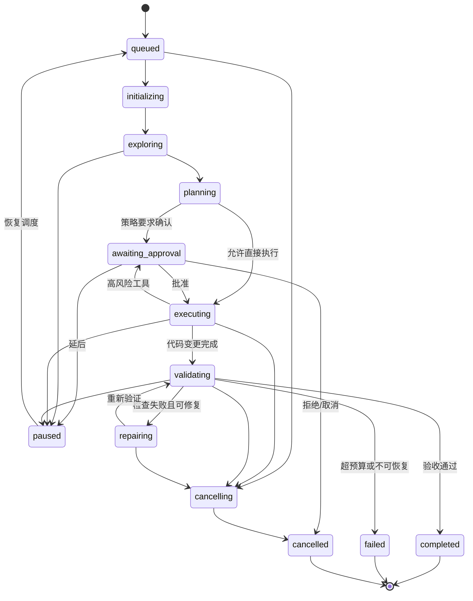

# Agent Loop · 运行时与状态机

> Agent Runtime 是整个系统的心脏。本文定义任务状态机、核心循环、停止 / 恢复语义与预算防护。

## 1. 任务状态机

顶层状态：

- `queued` 已入队等待执行；
- `initializing` 检查权限、Git 状态、工作区与运行环境；
- `exploring` 分析项目与需求上下文；
- `planning` 生成并校验执行计划；
- `awaiting_approval` 等待人对计划 / 工具 / 高风险操作确认；
- `executing` 读 / 改文件、跑命令与工具；
- `validating` 运行类型检查、lint、测试、构建；
- `repairing` 分析验证失败并进行有限次数修复；
- `paused` 用户暂停或等待人工输入；
- `cancelling` 正在停止 Worker 与子进程；
- `completed` 成功完成并生成交付摘要；
- `failed` 无法完成，保留现场与错误摘要；
- `cancelled` 已取消；
- `expired` 超过最长任务时间或资源预算。

状态只能通过 Orchestrator 的显式转换函数修改；**每次转换在一个事务里同时更新状态并追加事件**，避免 UI 显示「完成」而库里仍是「执行中」。



## 2. 核心 Agent Loop

闭环：**模型提议动作 → 运行时校验并执行 → 结果重新进入上下文 → 判断是否完成**。

```ts
async function runTask(taskId: string): Promise<void> {
  let state = await store.loadTaskState(taskId);

  while (!isTerminal(state.status)) {
    await control.assertNotCancelled(taskId);
    budget.assertWithinLimits(state.budget);

    const context = await contextBuilder.build(state);
    const decision = await modelGateway.nextAction(context);
    const parsed = decisionSchema.parse(decision);   // Zod 校验

    if (parsed.type === "final") {
      const report = await delivery.verifyAndBuildReport(state, parsed);
      await store.completeTask(taskId, report);
      return;
    }

    const tool = toolRegistry.get(parsed.toolName);
    const permit = await policy.evaluate({ task: state, tool, args: parsed.args });
    if (permit.kind === "approval_required") {
      await store.pauseForApproval(taskId, permit.request);
      return; // 审批后由调度恢复，不阻塞等待
    }

    const result = await toolExecutor.execute({
      task: state, tool, args: parsed.args,
      timeoutMs: permit.timeoutMs,
    });
    state = await store.appendToolResultAndCheckpoint(taskId, result);
    state = await progressGuard.evaluate(state, result);
  }
}
```

循环要点：

1. 每轮从持久层加载最新状态与检查点，检查取消标记、截止时间、token / 费用 / 步数预算；
2. 上下文 = 用户需求 + 项目规则 + 当前计划 + 最近工具结果 + 相关代码片段 + 当前 diff + 剩余预算；
3. 每个工具调用依次过：Schema → 权限 → 参数范围 → 路径边界 → 命令策略 → 审批 → 幂等 → 超时；
4. 需审批时**保存审批请求与检查点后释放执行**，而不是阻塞线程轮询；
5. 执行前记录调用、完成后保存结果 / 退出码 / 耗时 / 产物引用；
6. 检测文件变化、重复失败、无进展循环；必要时把失败压缩为诊断信息重新规划；
7. 达到交付条件后，做最终 diff / 权限 / 测试检查，生成结构化交付报告。

该伪代码需补充：Worker 租约、并发重复投递、幂等键、AbortSignal、子进程清理、数据库事务。

## 3. 分层循环

- **主循环（任务级）**：上面的 `runTask`，负责中断 / 恢复 / 预算；
- **子循环（步骤级）**：如「改文件 → 跑测试 → 修复」的 Repair Loop，见 [verification-and-multiagent.md](./verification-and-multiagent.md)；
- **工具循环**：单个工具调用内部的重试 / 幂等处理。

## 4. 端到端时序

```mermaid
sequenceDiagram
    actor User as 用户
    participant CLI as CLI/TUI
    participant Plan as Planner
    participant Loop as Agent Loop
    participant Tool as 工具层
    participant Sand as 沙箱
    participant Mem as 记忆层
    User->>CLI: 提交需求 / issue
    CLI->>Plan: 请求澄清与计划
    Plan->>Mem: 读 repo map 与 AGENTS.md
    Plan-->>CLI: TaskPlan
    CLI->>User: 请求确认计划
    User-->>CLI: 确认
    loop Agent 核心循环
        Loop->>Tool: 发 Action 读文件 / 改代码
        Tool->>Sand: 沙箱内执行
        Sand-->>Tool: 裁剪后 Observation
        Tool-->>Loop: 回灌 Observation
        Loop->>Mem: 装配上下文并按需压缩
    end
    Loop->>Sand: 跑测试与 lint
    Sand-->>Loop: VerificationResult
    Loop->>CLI: blocker 或完成请求评审
    CLI->>User: Diff 与交付报告
```

三个关键边：① Planner 出计划前先取 repo map / AGENTS.md，保证 `filesLikelyAffected` 有依据；② 每次工具调用都经「工具层 → 沙箱 → 裁剪 observation → 回灌」，observation 经 ACI 裁剪而非原始输出塞回模型；③ 每轮都申请上下文装配（含压缩），这是长任务不跑偏的关键。

## 5. 停止与恢复语义

- **Pause**：不再开始新工具调用；允许当前安全的只读操作结束，或按策略中断子进程。保存检查点后退出循环。
- **Cancel**：记录取消原因，终止当前命令进程组，阻止新工具调用，清理短期资源。**已发生的外部副作用不能假装回滚，须在报告中披露。**
- **Resume**：按 `task_id + checkpoint_version` 加载状态，重新校验权限、仓库提交、环境与凭证，**不盲目重放旧工具调用**。
- **崩溃恢复**：重启后先查上一次工具调用是否已有确定结果，再决定重试，防止重复写入或重复发送外部请求。
- **超时**：分别设置模型请求、单次工具、单条命令、阶段与整个任务的时间上限。

## 6. 预算与循环防护

每个任务配置化上限：最大模型轮次、最大工具调用数、最大修改文件数、最大改动行数、单命令超时、验证 / 修复轮次、最长运行时间、总费用。初始值由内部任务集校准，不写死示例值。

出现以下任一情况即停止自动循环并请求人工介入或以部分失败结束：

- 同一命令 / 测试连续重复且无状态变化；
- 连续多轮文件 / 计划 / 验证都无进展；
- 反复重写同一文件；
- 同一错误在设定修复次数后不变；
- 上下文持续膨胀但目标不收敛。
