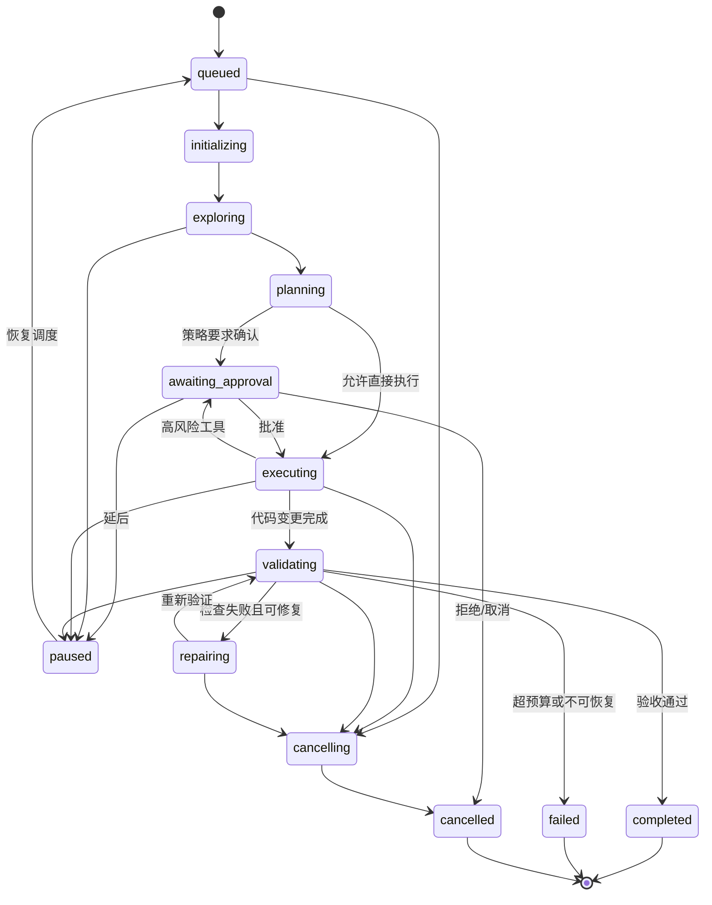
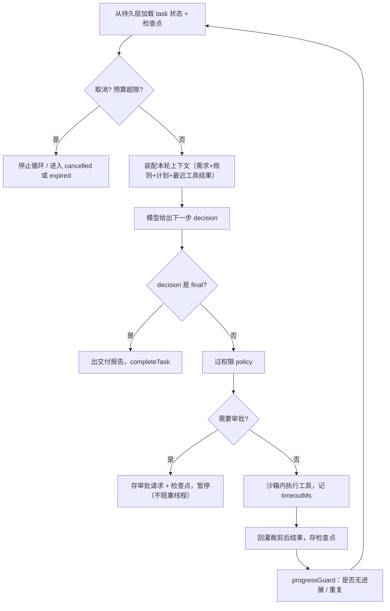
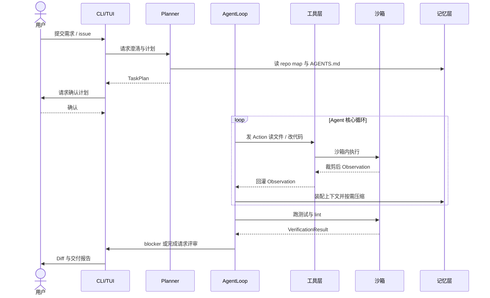

# Agent Loop · 运行时与状态机

> Agent Runtime 负责驱动整个系统。这篇定义任务状态机、核心循环、停止 / 恢复语义与预算防护。

这篇是整个 mod-agent 的「发动机舱」。用一句大白话讲：agent 不是一次性把活干完，而是像请了个装修工——他看一眼图纸、动手改一处、瞅一眼现场、再决定下一步，如此循环，直到你喊停或活干完。读完这篇你会知道：任务在哪些状态之间切换、每一轮循环里模型到底经过了几道关卡、什么时候该停下来叫人、崩了之后怎么接着干。术语首次出现时会用括号补一句解释。

## 1. 任务状态机

顶层状态：

- `queued` 已入队等待执行；
- `initializing` 检查权限、Git 状态、工作区与运行环境；
- `exploring` 分析项目与需求上下文；
- `planning` 生成并校验执行计划；
- `awaiting_approval` 等待人对计划 / 工具 / 高风险操作确认；
- `executing` 读 / 改文件、跑命令与工具；
- `validating` 运行类型检查、lint、测试、构建；
- `repairing` 分析验证失败并进行有限次数修复；
- `paused` 用户暂停或等待人工输入；
- `cancelling` 正在停止 Worker 与子进程；
- `completed` 成功完成并生成交付摘要；
- `failed` 无法完成，保留现场与错误摘要；
- `cancelled` 已取消；
- `expired` 超过最长任务时间或资源预算。

状态只能通过 Orchestrator 的显式转换函数修改；每次转换在一个事务里同时更新状态并追加事件，避免 UI 显示「完成」而库里仍是「执行中」。



## 2. 核心 Agent Loop

闭环：**模型提议动作 → 运行时校验并执行 → 结果重新进入上下文 → 判断是否完成**。

```ts
async function runTask(taskId: string): Promise<void> {
  let state = await store.loadTaskState(taskId);

  while (!isTerminal(state.status)) {
    await control.assertNotCancelled(taskId);
    budget.assertWithinLimits(state.budget);

    const context = await contextBuilder.build(state);
    const decision = await modelGateway.nextAction(context);
    const parsed = decisionSchema.parse(decision);   // Zod 校验

    if (parsed.type === "final") {
      const report = await delivery.verifyAndBuildReport(state, parsed);
      await store.completeTask(taskId, report);
      return;
    }

    const tool = toolRegistry.get(parsed.toolName);
    const permit = await policy.evaluate({ task: state, tool, args: parsed.args });
    if (permit.kind === "approval_required") {
      await store.pauseForApproval(taskId, permit.request);
      return; // 审批后由调度恢复，不阻塞等待
    }

    const result = await toolExecutor.execute({
      task: state, tool, args: parsed.args,
      timeoutMs: permit.timeoutMs,
    });
    state = await store.appendToolResultAndCheckpoint(taskId, result);
    state = await progressGuard.evaluate(state, result);
  }
}
```

循环要点：

1. 每轮从持久层加载最新状态与检查点，检查取消标记、截止时间、token / 费用 / 步数预算；
2. 上下文 = 用户需求 + 项目规则 + 当前计划 + 最近工具结果 + 相关代码片段 + 当前 diff + 剩余预算；
3. 每个工具调用依次过：Schema → 权限 → 参数范围 → 路径边界 → 命令策略 → 审批 → 幂等 → 超时；
4. 需审批时保存审批请求与检查点后释放执行，而不是阻塞线程轮询；
5. 执行前记录调用，完成后保存结果 / 退出码 / 耗时 / 产物引用；
6. 检测文件变化、重复失败、无进展循环；必要时把失败压缩为诊断信息重新规划；
7. 达到交付条件后，做最终 diff / 权限 / 测试检查，生成结构化交付报告。

上面的伪代码还需要补：Worker 租约、并发重复投递、幂等键、AbortSignal、子进程清理、数据库事务。

为了把上面这段伪代码「看」出来，下图是一轮循环的真实走向：



这张图在说什么：每一轮都不是模型直接动手，而是「先查还能不能干 → 再攒上下文 → 模型拿主意 → 过权限关 → 能自动跑就跑、要问人就先存盘」。任何一步都可能被叫停，且叫停的地方已经存了检查点，下次能从原地接着来。

举个例子（示意）：任务是「给登录接口加超时处理」。模型第一轮读完 auth.ts，想直接 `sed` 改文件——但这属于写操作，policy 判 `approval_required`，于是循环存下审批请求、把任务挂在 `awaiting_approval` 就退出了，而不是傻等你点确认。你批准后，调度器从同一检查点恢复，模型带着「已读 auth.ts」的上下文继续，不用从头再读一遍。

### 2.1 「继续还是停」不止一条判断

最小实现里，循环的判断只有一条：模型这一轮返回了工具调用就继续，没有就结束。但生产级运行时要处理的「为什么还要再转一圈」远不止此。逆向 Claude Code 的运行时可见其把继续循环分成约七类（参考 [claude-code-from-scratch · Agent Loop](https://diwang.info/claude-code-from-scratch/#/docs/01-agent-loop)）：

| # | 继续原因 | 触发情形 | 处理 |
| --- | --- | --- | --- |
| 1 | 模型调用了工具 | 响应含 tool_use | 执行工具、回灌结果、继续 |
| 2 | 折叠后重试 | 上下文超限且暂存了可折叠的旧操作 | 提交折叠腾空间后重试 |
| 3 | 强制压缩后重试 | 折叠空间仍不够 | 触发全量摘要压缩后重试 |
| 4 | 输出截断升级 | 到达输出 token 上限（第一次） | 升到更高输出上限（如 16K→64K）重试 |
| 5 | 截断续写 | 升级已用尽仍被截断 | 注入续写提示，最多重试约 3 次 |
| 6 | Stop Hook 拦截 | 模型认为做完了，但 Stop Hook 要求继续 | 执行 Hook 后继续循环 |
| 7 | 预算续跑 | 服务端侧生成预算耗尽但任务未竟 | 续接生成 |

这些大多是**可恢复的边界情况**。成熟运行时的做法是先把这类错误「扣留」在循环内部、尝试自恢复，成功则用户无感，失败才最终抛出——而不是一遇到截断或超长就把错误甩到界面上。

### 2.2 两层循环与异步背压

对应上表，成熟运行时倾向把一层 while 拆成两层：

- **外层（任务 / 查询生命周期）**：管用户输入、token 与费用预算、会话恢复；
- **内层（单次查询）**：管上下文压缩、模型调用、工具执行、错误恢复。

内层常实现为**异步生成器（`async function*`）**：一是天然背压——消费端（TUI）没处理完，生产端就不继续产生事件，不会堆积；二是让所有分支都能用普通的 `continue` / `break` 表达，不必手写状态机。中断用一个贯穿全程的 `AbortController`（`abort()` 后在检查点退出，连在飞的网络请求一并取消）。

### 2.3 工具错误是「数据」，不是异常：最轻的自修复

工具层的任何失败——模型幻觉出一个不存在的工具名、`edit_file` 的待替换串没找到、命令退出码非零、权限被拒——都**不要抛异常中断循环**，而是转成一条带 `is_error: true` 的 `tool_result` 正常回喂给模型：

```text
{ role: "user", content: [{ type: "tool_result", tool_use_id: "...", is_error: true,
  content: "Error: old_string not found in auth.ts. Re-read the file first." }] }
```

模型看到错误后通常会自己纠正：重新读文件、修正参数、换一条命令。这是成本最低的「自修复」——**默认分支返回 `Unknown tool: xxx` 而不是抛错，就是让模型能纠正自己幻觉的工具名**。

要把它和 [verification-and-multiagent.md](./verification-and-multiagent.md) 的 Repair Loop 区分开：

- **错误回喂（本篇）**：单步、即时——工具一报错，模型下一轮顺手改对；
- **Repair Loop**：多步、跨阶段——验证流水线跑完测试失败后，带错误分类与诊断重新规划、改完再验。

权限被拒也同理：把 `User denied this action.` 作为工具结果返回，模型会换方案，而不是崩溃或反复硬闯。

### 2.4 流式窗口里提前执行工具

一次模型响应通常有 5–30 秒的流式生成窗口。运行时不必等整段响应结束才执行工具：当某个 `tool_use` 的参数 JSON 在流中拼完整（Anthropic 的 `content_block_stop` 事件）时，若该工具是**只读、并发安全**且权限已放行，就立刻启动执行，把工具耗时「藏进」模型继续生成后续内容的窗口里；多个只读工具自然并行。写操作和命令执行不在此列，必须等响应完整、权限确认后再跑。具体事件与双后端差异见 [tools-and-extensions.md §并行执行](./tools-and-extensions.md) 与 [model-gateway.md](./model-gateway.md)。

## 3. 分层循环

- **主循环（任务级）**：上面的 `runTask`，负责中断 / 恢复 / 预算；
- **子循环（步骤级）**：如「改文件 → 跑测试 → 修复」的 Repair Loop，见 [verification-and-multiagent.md](./verification-and-multiagent.md)；
- **工具循环**：单个工具调用内部的重试 / 幂等处理。

### 3.1 规划与执行的双循环（业界实证）

长任务里「想长远」和「干眼前」是两件事，成熟产品普遍拆成两个循环：

- **Cline 的 Plan / Act 双模式**（出处：https://docs.cline.bot/core-workflows/plan-and-act ）：Plan 模式物理上拿不到写工具（只能读 / 搜索 / 讨论），**切换 Act 模式时对话上下文完整继承**，不用重述；规划与执行可绑不同模型（规划用强推理模型、执行用低成本快模型）；
- **Windsurf 的后台规划 agent**（出处：https://docs.windsurf.com/windsurf/cascade/cascade ）：一个专职规划 agent 在后台持续修订长期计划，当前模型只按计划做短动作，执行中发现新信息自动回写计划，并维护可人工查看 / 修改的 Todo 列表——计划不是开跑前写死的；
- **Factory `--use-spec` / Replit Plan mode**（出处：https://docs.factory.ai/droid-cli/cli-reference.md 、https://docs.replit.com/replitai/agent ）：复杂任务先进 spec / 任务清单模式产出计划供人确认，再进入执行。

对 mod-agent：任务分级建议——小任务直接执行；中任务 plan → edit；大任务走「后台规划 agent + 可人工编辑的计划产物 + 动态 replan」结构，规划产物随上下文推进动态调整。

### 3.2 Plan Mode 的落地：只读契约 + 计划文件 + 审批四选项

规划模式不是「在提示词里叮嘱模型先别动手」，而是**在运行时物理上收回写权限**，其机制由四部分组成：

1. **一对进入 / 退出工具**：`enter_plan_mode`、`exit_plan_mode`。这两个工具不常用，做**延迟加载**（平时不占 schema，需要时再激活，见 [tools-and-extensions.md](./tools-and-extensions.md)）；
2. **只读契约**：进入规划模式后，权限层对所有写 / 编辑 / shell 工具一律返回 `deny`，模型只能读、搜索、分析；
3. **唯一可写的计划文件**：进入时生成一个计划文件（如 `plans/plan-<sessionId>.md`），它是规划模式下**唯一**被加入写白名单的路径——模型把计划写进这个文件，而不是直接改源码。这复用了 [security.md](./security.md) 的权限判定：规划模式的硬拦截在规则之后、放行之前，优先级高于普通 allow；
4. **退出时的审批四选项**。模型调用 `exit_plan_mode` 提交计划后，由用户决定：

| 选项 | 含义 | 之后的动作 |
| --- | --- | --- |
| 清空计划并执行 | 放弃这份计划、按新的理解直接执行 | 退出规划，重新开工 |
| 按计划执行 | 认可计划 | 退出规划，按计划逐步执行 |
| 我来手动处理 | 不交给 agent | 结束，用户自己改 |
| 继续规划 | 计划还不成熟 | 留在规划模式，继续打磨 |

计划文件是**持久化、可人工编辑**的产物（对齐 Windsurf 可查看 / 修改的 Todo），退出规划模式进入执行后它仍作为上下文锚点；执行中发现计划需要调整，可重新进入规划模式 replan，而不是闷头执行一份过期计划。

## 4. 端到端时序



三处容易出问题的地方：① Planner 出计划前先取 repo map / AGENTS.md，保证 `filesLikelyAffected` 有依据；② 每次工具调用都经「工具层 → 沙箱 → 裁剪 observation → 回灌」，observation 经 ACI 裁剪而非原始输出塞回模型；③ 每轮都申请上下文装配（含压缩），这是长任务不跑偏的关键。

## 5. 停止与恢复语义

- **Pause**：不再开始新工具调用；允许当前安全的只读操作结束，或按策略中断子进程。保存检查点后退出循环。
- **Cancel**：记录取消原因，终止当前命令进程组，阻止新工具调用，清理短期资源。已发生的外部副作用不能假装回滚，须在报告中披露。
- **Resume**：按 `task_id + checkpoint_version` 加载状态，重新校验权限、仓库提交、环境与凭证，不盲目重放旧工具调用。
- **崩溃恢复**：重启后先查上一次工具调用是否已有确定结果，再决定重试，防止重复写入或重复发送外部请求。
- **超时**：分别设置模型请求、单次工具、单条命令、阶段与整个任务的时间上限。

### 5.1 会话（Session）语义：挂起 / 恢复的持久化基准（OpenAI Agents SDK 实证）

对话历史应由**会话层统一接管**，而非在主循环里手动拼 list（出处：https://openai.github.io/openai-agents-python/sessions/ ）：

- **run 前**：自动检索该 session 的历史并前置拼入输入；**run 后**：本轮新产生的条目（用户输入、模型回复、工具调用等）自动落回 session；
- **人审暂停后必须能用同一 session 原地恢复**——审批通过时从 `interruptions` + 状态对象继续，恢复的是同一份存储的对话历史；
- 历史太长可自动压缩（官方提供 compaction session）；存储后端可插拔（本地 SQLite / 远程 Redis / MongoDB / 加密包装）。

对 mod-agent：`awaiting_approval` / `paused` 状态恢复时，除 `task_id + checkpoint_version` 外，还应校验「同一会话历史被完整恢复、审批与参数 hash 绑定」，避免恢复后上下文漂移。

## 6. 预算与循环防护

每个任务配置化上限：最大模型轮次、最大工具调用数、最大修改文件数、最大改动行数、单命令超时、验证 / 修复轮次、最长运行时间、总费用。初始值由内部任务集校准，不写死示例值。

出现以下任一情况即停止自动循环并请求人工介入或以部分失败结束：

- 同一命令 / 测试连续重复且无状态变化；
- 连续多轮文件 / 计划 / 验证都无进展；
- 反复重写同一文件；
- 同一错误在设定修复次数后不变；
- 上下文持续膨胀但目标不收敛。

举个例子（示意）：模型连着 4 轮跑同一条 `npm test`，退出码都是 1，报错行几乎没变——这就是「同一命令连续重复且无状态变化」。系统不再让模型继续瞎试，而是把这几轮失败压成一段诊断（「报错集中在 token 过期，可能不是测试本身的问题」）重新规划，而不是放任它在原地空转烧 token。

> 术语备注：**检查点（checkpoint）** = 每轮工具执行后把「当前干到哪、改了哪些文件、还剩多少预算」落一次盘；**Observation（观测）** = 工具跑完回给模型的那段裁剪过的输出；**ACI** = 给模型看的「操作界面」的设计规范（详见 [context-engineering.md](./context-engineering.md) §1.1）；**compaction（压缩）** = 上下文快满时把长历史总结成摘要。

### 6.1 三层 Guardrail（输入 / 输出 / 工具）（OpenAI Agents SDK 实证）

把「安全检查」做成与业务 agent 并列的第二套轻量模型，卡三个位置（出处：https://openai.github.io/openai-agents-python/guardrails/ ）：

| 护栏层 | 卡在哪 | 触发动作 |
| --- | --- | --- |
| Input guardrail | 链上第一个 agent 收到用户输入时 | tripwire 触发即抛异常中止，agent 不执行 |
| Output guardrail | 产生最终输出的 agent 收尾后 | 拒绝候选输出，已完成的工具调用存入 session 待回放 |
| Tool guardrail | 每个工具调用前 / 后 | 可跳过调用、替换输出、或抛 tripwire |

- 执行模式分**并行**（快但可能已烧 token）与**阻塞**（先检查再跑，最省钱）；
- 对 mod-agent：写操作 / 危险命令默认**阻塞式先确认**；只读 / 可回滚操作可用并行快检。

### 6.2 写操作的确定性护栏（SWE-agent / Kilo 实证）

- **写前校验**：编辑命令触发时先跑 linter，语法不通过则不放行、把错误退给模型（SWE-agent，出处：https://swe-agent.com/latest/background/aci/ ）——把「修正语法」从靠模型自觉变成系统强制的前置关卡，更省 token、更少产生脏状态；
- **写后诊断延迟**：一次写操作后、继续下一步前，按可配置延迟（默认 1000ms）等类型检查 / lint 诊断落定再继续（Kilo Code，出处：https://kilo.ai/docs/features/auto-approving-actions ）；复杂项目建议 2000ms+，关键代码不建议设为 0——让「边改边自修」有可靠依据而非凭猜测。

### 6.3 Headless 事件流输出（Claude Code / Gemini CLI 实证）

非交互模式输出三档（出处：https://code.claude.com/docs/en/headless 、https://google-gemini.github.io/gemini-cli/docs/cli/headless.html ）：

| 模式 | 用途 |
| --- | --- |
| text | 默认，人读 |
| json | 一次返回 result + session_id + usage + total_cost_usd，可 `--json-schema` 约束结构 |
| stream-json | NDJSON，逐事件实时吐，末行是 result 汇总 |

- 退出码即成败：0 成功、非 0 失败，脚本可直接分支；
- Gemini 的 headless JSON 还带一份「账」：`stats.models[].tokens`（prompt / candidates / total / cached / tool）、`stats.tools`（totalCalls / totalSuccess / totalFail / totalDurationMs / totalDecisions: accept | reject | modify | auto_accept）、`stats.files`（totalLinesAdded / totalLinesRemoved）——用量记账与工具成功率分析直接可做；
- **`--bare` 模式**（CI / 脚本默认推荐，出处同 Claude headless）：跳过一切自动发现（hooks / skills / MCP / 记忆 / 规则文件），不读本机 OAuth 与钥匙串，保证每台机器结果可复现。

与 [data-and-events.md](./data-and-events.md) 的事件序列天然对应：事件流直接序列化成 stream-json，供 GitHub Action / git hook / 定时任务消费。
