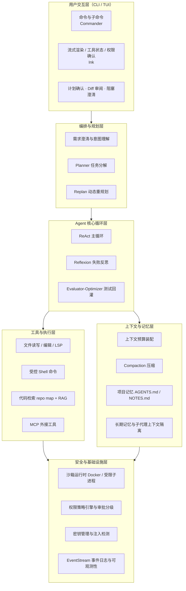
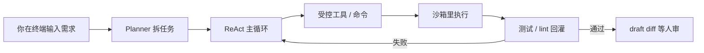

# Architecture · 总体架构

> 这篇讲分层架构、关键架构决策（ADR）、技术选型与代码仓库结构。单模块行为见后续各专题文档。

> 通俗说：这篇是「这栋楼的楼层图」。六层不是六个文件，而是六条职责边界——上层负责听懂你，中间层负责想办法和动手，底层负责隔离、记日志和兜底。任何一层想干别的层的活，都算越界。

## 1. 分层架构



六层切法的要点：

- **L1** 对接终端三种交互：任务输入、进度与审批展示、最终 diff 审阅；
- **L2** 负责「想清楚做哪几步」，并在执行中动态重规划；
- **L3** 是自由 ReAct 主循环，叠加 Reflexion 与 evaluator-optimizer 两个固化子流程；
- **L4** 是被 ACI 反向定制过的工具表面（输出裁剪、结构化报错）；
- **L5 独立成层**——长时程 coding 的成败主要由上下文工程决定；
- **L6 是横切关注点**——沙箱、权限、密钥、事件日志贯穿所有下层，不是某模块私有职责。

一次请求从进来到落盘，大致是这条线：



这张图在说什么：中间那圈「主循环 → 工具 → 沙箱 → 验证 → 再回主循环」会反复转，直到测试通过或卡住等人；出了任何岔子，L6 的事件日志都在旁边全程记录。

## 2. 架构决策记录（ADR）

| #     | 决策                                                        | 理由                                                                 |
| ----- | ----------------------------------------------------------- | -------------------------------------------------------------------- |
| ADR-1 | 单 Agent 主循环 + 受控子任务派生，不做对等 Multi-Agent 编排 | 单循环可解释、可恢复、成本可控；多 Agent 失败约 44% 源于跨文件不一致 |
| ADR-2 | 扁平消息 / 事件日志为唯一事实源                             | 匹配 LLM 无状态回放，最大化 prompt cache 命中，简化调试与审计        |
| ADR-3 | 结构化专用工具为主、通用 Shell 为辅                         | 结构化工具返回确定性输出；Shell 只保留给构建 / 测试 / 安装           |
| ADR-4 | 混合检索（词法 + 符号 + 关系），不纯靠向量 RAG              | 编码任务锚定精确标识符，纯语义召回不足                               |
| ADR-5 | 任务状态外置持久化（TaskState + Checkpoint）                | 对抗目标漂移，压缩 / 重启后不丢失原始目标与约束                      |
| ADR-6 | LLM 网关统一封装（多模型路由 / 缓存 / 限流 / 重试）         | 隔离 provider 差异，成本与质量的关键杠杆                             |
| ADR-7 | CLI-first（Commander + Ink + SQLite），不先做 Web 平台      | 纵向闭环最快；Web/BFF/PostgreSQL 留到团队阶段                        |
| ADR-8 | 工具经 Zod schema 校验入参、Policy 层独立判定权限           | 权限判定不依赖模型自然语言自述，安全可独立测试                       |

这 8 条 ADR 用大白话再注解一遍（上表决策与理由保持原样，这里只加解释）：

- **ADR-1**：宁可一个主循环加可控的小助手，也不上一堆「平级同事」互相传话——多 agent 拉通文件、改出不一致的前科太多。
- **ADR-2**：走过的步骤只往一个事件日志里追加，不搞第二份「运行内存账本」，重启能原样回放。
- **ADR-3**：能用结构化工具说清楚的（读哪个文件、改哪几行）就不用通用 shell；shell 只留给构建、测试、装依赖这种没有固定形状的活。
- **ADR-8**：「能不能干这件事」由独立的 Policy 层说了算，不听模型自己拍胸脯——模型说「我知道我在干嘛」不算数。

举个例子（示意）：agent 想执行 `rm -rf node_modules`，Policy 层按风险标签判定这是高风险命令，先弹出确认；你点了同意，它才在沙箱里执行，并把这一步写进事件日志。

### 2.1 关键 ADR 的业界依据（2026-08 核实）

| ADR                       | 业界实证来源（已 fetch）                                                                                                                                                                                                                                                             | 要点                                                                                                                     |
| ------------------------- | ------------------------------------------------------------------------------------------------------------------------------------------------------------------------------------------------------------------------------------------------------------------------------------ | ------------------------------------------------------------------------------------------------------------------------ |
| ADR-1 单主循环 + 受控委托 | OpenAI Agents SDK：极小原语 `Agent` + `Handoffs / Agents-as-tools`（https://openai.github.io/openai-agents-python/ ）；A2A 明确「不是子代理 / 工具调用协议」（https://a2a-protocol.org/latest/ ）                                                                                    | 委托是「主 agent 调子工具 / 把会话交给另一 agent」两个明确语义，二者不可混用；内部编排不引入 A2A，A2A 留作未来对外扩展点 |
| ADR-2 事件日志唯一事实源  | OpenHands SDK：events 是一等公民，conversation / workspace / events 由 SDK 显式拥有（https://github.com/OpenHands/software-agent-sdk ）                                                                                                                                              | append-only 事件 + replay / audit 是开源平台验证过的做法                                                                 |
| ADR-8 Policy 独立判定     | MCP 规范：协议不 enforce 安全，「Tools represent arbitrary code execution」，consent / 授权流必须实现者自己做（https://modelcontextprotocol.io/specification/ ）                                                                                                                     | 权限判定天然不能信任工具描述 / 模型自述，必须框架层独立                                                                  |
| 沙箱 / 运行时抽象         | OpenAI Agents SDK SandboxAgent：manifest 声明工作区 + 沙箱后端可切换（本地 Unix / Docker）+ 会话可恢复（https://openai.github.io/openai-agents-python/ ）；OpenHands：内核（Agent Server）与界面（Canvas）分离，控制端可连多后端（https://github.com/OpenHands/software-agent-sdk ） | 单进程 CLI 也先把「执行内核」与「交互界面」用清晰边界隔开，未来加远程 agent / 云端长任务不改内核                         |

### 4.1 协议层边界（MCP / A2A / ACP / AGENTS.md）

| 协议      | 解决谁和谁的通信         | mod-agent 的角色                                                               |
| --------- | ------------------------ | ------------------------------------------------------------------------------ |
| MCP       | agent ↔ 工具 / 数据      | 作为 Host 消费工具（[tools-and-extensions.md](./tools-and-extensions.md) §1）  |
| A2A       | agent ↔ 外部 agent       | 未来可被发现 / 可调用的 remote agent（可选）；**不是内部编排协议**             |
| ACP       | agent ↔ 编辑器客户端     | 未来被 Zed 等编辑器当作外部 agent 挂入（可选）                                 |
| AGENTS.md | 项目 ↔ 任何 coding agent | 仓库根放一份给所有 agent 读（[data-and-events.md](./data-and-events.md) §4.1） |

边界原则：日常默认只做 MCP；A2A 官方明确「不是框架、不是子代理协议」——内部多步 / 子任务编排用单主循环 + 子工具委托（ADR-1），不在主线里把 A2A 当工具调用协议用（出处：https://a2a-protocol.org/latest/ ）。

## 3. 组件职责边界

| 组件               | 职责                                          | 不应承担                           |
| ------------------ | --------------------------------------------- | ---------------------------------- |
| CLI / TUI          | 命令解析、流式渲染、Diff 展示、审批交互       | 不持有模型密钥、不直接执行任意命令 |
| Agent Runtime      | 驱动主循环、状态转换、停止条件、预算控制      | 不把未校验的模型文本直接喂 shell   |
| Planner            | 需求归一化、计划生成、动态重规划              | 不在阻塞性澄清未解决前进入执行     |
| Context Builder    | 聚合规则、文件、符号、搜索结果、Git 状态      | 不把整个仓库无差别塞进上下文       |
| Tool Registry      | 工具 Schema、风险标签、超时、幂等属性         | 不允许模型绕过 Policy 直连实现函数 |
| Tool Policy        | 风险判定、审批分级、注入检测                  | 不依赖模型输出来决定授权           |
| Sandbox / Worktree | 隔离工作区、命令生命周期、资源限制            | 不假设 Docker 能抵御所有宿主机风险 |
| Validation Runner  | 类型检查 / lint / 测试 / 构建，结果归一化     | 不根据模型口头声明伪造通过结果     |
| Persistence        | 任务、事件、检查点、审批、工具调用持久化      | 不把内存队列当唯一事实来源         |
| Model Gateway      | Provider 适配、路由、用量统计、结构化输出校验 | 不与任务持久化耦合成一个大类       |

## 4. 技术选型

| 层次          | MVP 选型                                        | 备选 / 升级            | 理由                                     |
| ------------- | ----------------------------------------------- | ---------------------- | ---------------------------------------- |
| 语言 / 运行时 | TypeScript + Node.js                            | —                      | 流式原生、生态成熟                       |
| CLI 框架      | Commander                                       | —                      | 子命令组合标准方案                       |
| 终端渲染      | Ink                                             | —                      | React 风格流式 TUI、工具状态组件         |
| 数据校验      | Zod                                             | TypeBox                | 入参 / 计划 / 模型输出统一校验           |
| 本地存储      | SQLite（better-sqlite3）                        | PostgreSQL（团队阶段） | 零运维本地持久化                         |
| 代码解析      | TypeScript Compiler API / ts-morph；tree-sitter | SCIP                   | 符号定义 / 引用 / 类型；多语言容错语法树 |
| 词法检索      | ripgrep                                         | —                      | 事实标准、性能极佳                       |
| 向量检索      | 本地嵌入式（可选）                              | LanceDB                | 项目级无需独立向量服务                   |
| 沙箱          | Docker（默认）+ 受限子进程（降级）              | OS 级沙箱              | 命令隔离、网络默认关闭                   |
| 协议扩展      | MCP 官方 TypeScript SDK                         | —                      | 外部工具生态事实标准                     |
| 工作区隔离    | Git Worktree + shadow commit                    | 每任务副本             | diff 易审查、任务间不污染                |
| 观测          | 结构化日志（pino）+ trace                       | OpenTelemetry          | 串联任务 / 模型 / 工具 / 审批            |
| 浏览器验证    | Playwright（后期）                              | —                      | UI 复现、截图、E2E                       |

> 框架取舍：先实现清晰的领域状态机与轻量 Agent Loop，再按需评估 Agents SDK / LangGraph.js。无论是否引入图框架，任务状态、权限与业务审计都要留在本系统手里。

## 5. 建议代码仓库结构

```text
src/
  cli/                  # Commander 入口、子命令
  tui/                  # Ink 组件：流式输出、工具状态、Diff、审批
  runtime/              # Agent loop、状态转换、停止条件、预算防护
  planner/              # 需求归一化、计划生成与校验、replan
  context/              # RepoProfile、检索、上下文装配与压缩
  tools/                # 内部工具：file/search/patch/command/test
  mcp/                  # MCP Client
  skills/               # Skill 加载、选择与版本
  policy/               # 风险判定、审批规则、注入检测
  sandbox/              # Docker / 受限子进程、命令生命周期
  patch/                # Diff、补丁校验、安全路径写入
  validation/           # typecheck / lint / test / build
  model/                # Model Gateway、Provider、路由、提示词
  store/                # SQLite schema、repositories、事件追加
  observability/        # trace、metrics、logging
  evals/                # 数据集、评分器、回归用例
  shared/               # DTO、Zod schemas、事件类型定义
.agent/
  skills/
    bug-triage/SKILL.md
    react-feature/SKILL.md
    test-repair/SKILL.md
infra/
  docker/
  migrations/
docs/
```

**模块边界约束**：

- `runtime` 不直接 `import fs` / `child_process` / 模型厂商 SDK，一律通过接口注入；
- `policy` 不依赖模型输出的自然语言来决定授权；
- `sandbox/command` 不知道 Agent 的提示词，只执行收到且通过策略的结构化请求；
- `context` 返回的每个证据片段都带来源、路径、行范围、hash；
- `store` 通过事务同时做状态转换与事件追加；
- Provider SDK、MCP SDK 版本在锁文件中固定，升级时跑契约与安全回归。
