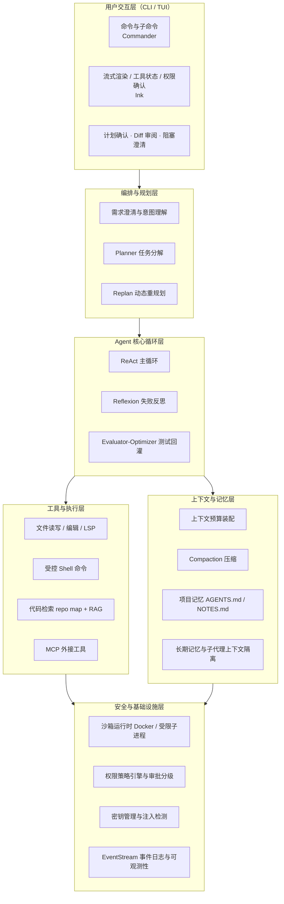
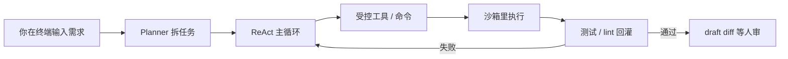
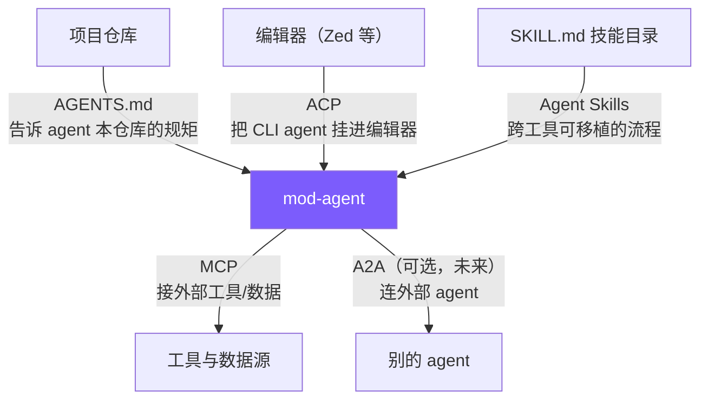

# Architecture · 总体架构

> 这篇先把系统的骨架讲清楚：一次任务由谁推进、谁负责放行、谁负责保存证据。读完后，你应该能判断一个新模块该放在哪里，以及它不该越过哪条边界。单个机制的运行细节放在后续专题中。

> 这里的“六层”说的是职责，不是将来必须创建六个目录。Runtime 推进任务；Policy、Store 与日志横向约束并记录整个过程；其余模块围绕它提供计划、上下文、模型与执行能力。

## 阅读方式

准备开始编码时，先看“组件职责边界”和“建议代码仓库结构”，再读 [development-guide.md](./development-guide.md) 的实现顺序。ADR 记录的是已作出的取舍；出现新证据或新需求时可以复议，但不要在普通实现任务里悄悄改变它。

## 1. 分层架构



各层的职责如下：

- **L1** 对接终端三种交互：任务输入、进度与审批展示、最终 diff 审阅；
- **L2** 负责想清楚做哪几步，并在执行中动态重规划；
- **L3** 是自由 ReAct 主循环，叠加 Reflexion 与 evaluator-optimizer 两个固化子流程；
- **L4** 是被 ACI 反向定制过的工具表面（输出裁剪、结构化报错）；
- **L5** 单独成一层：长时程 coding 的成败主要由上下文工程决定；
- **L6** 是横切关注点：沙箱、权限、密钥、事件日志贯穿所有下层，不是某模块私有职责。

一次请求从输入到交付大致经过这条路径：



主循环会在“工具执行 → 隔离环境 → 验证”之间有限次迭代，直到检查通过、达到预算或需要人工处理。事件日志记录每一步，供恢复、审计和排障使用。

## 2. 架构决策记录（ADR）

| #      | 决策                                                                                      | 理由                                                                                                                    |
| ------ | ----------------------------------------------------------------------------------------- | ----------------------------------------------------------------------------------------------------------------------- |
| ADR-1  | 单 Agent 主循环 + 受控子任务派生，不做对等 Multi-Agent 编排                               | 单循环更容易解释、恢复和控制成本；先证明单任务闭环，再评估长期协作是否值得引入                                          |
| ADR-2  | 任务状态、检查点与追加式事件记录分别持久化                                                | 状态用于调度，检查点用于恢复，事件用于追溯；三者可关联，但不能混成一个“唯一事实源”                                      |
| ADR-3  | 结构化专用工具为主、通用 Shell 为辅                                                       | 结构化工具返回确定性输出；Shell 只保留给构建 / 测试 / 安装                                                              |
| ADR-4  | 混合检索（词法 + 符号 + 关系），不纯靠向量 RAG                                            | 编码任务锚定精确标识符，纯语义召回不足                                                                                  |
| ADR-5  | 任务状态外置持久化（TaskState + Checkpoint）                                              | 对抗目标漂移，压缩 / 重启后不丢失原始目标与约束                                                                         |
| ADR-6  | LLM 网关统一封装（多模型路由 / 缓存 / 限流 / 重试）                                       | 隔离 provider 差异，成本与质量的关键杠杆                                                                                |
| ADR-7  | CLI-first（Commander + Ink + SQLite），不先做 Web 平台                                    | 纵向闭环最快；Web/BFF/PostgreSQL 留到团队阶段                                                                           |
| ADR-8  | 工具经 Zod schema 校验入参、Policy 层独立判定权限                                         | 权限判定不依赖模型自然语言自述，安全可独立测试                                                                          |
| ADR-9  | 分层配置合并语义按键类型区分：数组取并集、标量按最 specific 层替换                        | 与 Claude Code 一致（`permissions.allow` 数组跨层合并、`model` 标量取最高层），避免"更具体的规则赢"这类直觉写错方向     |
| ADR-10 | CLI 与 Agent SDK 共用同一 runtime 内核，两前端只是入参/输出适配                           | 防止同一 loop 因入口不同行为漂移；SDK 用 `query()` 起子进程复用 CLI 的事件流、权限、hooks、MCP 加载                     |
| ADR-11 | 辅助模型（advisor / evaluator / classifier）在 Model Gateway 层统一封装，不散在各模块自造 | 三种角色本质都是"独立裁判 + 主模型 prompt cache 复用"，一处封装三处受益；见 [model-gateway.md §2.3](./model-gateway.md) |

下面补充几条容易被误解的 ADR；表中的决策与理由仍是权威定义：

- **ADR-1**：默认只保留一个能写入的主循环。子任务只有在输入、输出和责任边界明确时才创建，避免并行修改产生不一致。
- **ADR-2**：状态告诉调度器任务现在在哪一步；检查点保存可恢复的执行现场；事件保留发生过什么。三者同事务更新并相互关联，避免界面与持久化记录不一致。
- **ADR-3**：优先提供结构化工具，例如读取文件或精确编辑。Shell 保留给构建、测试、安装等难以固定为单一工具形状的任务。
- **ADR-8**：动作是否允许由独立的 Policy 层判断，而不是由模型在文本中承诺自己会谨慎执行。

比如，agent 想执行 `rm -rf node_modules`，Policy 层按风险标签判定这是高风险命令，先弹出确认；你点了同意，它才在沙箱里执行，并把这一步写进事件日志。

### 2.1 关键 ADR 的业界依据（2026-08 核实）

| ADR                               | 业界实证来源（已 fetch）                                                                                                                                                                                                                                                             | 要点                                                                                                                                                                                                   |
| --------------------------------- | ------------------------------------------------------------------------------------------------------------------------------------------------------------------------------------------------------------------------------------------------------------------------------------ | ------------------------------------------------------------------------------------------------------------------------------------------------------------------------------------------------------ |
| ADR-1 单主循环 + 受控委托         | OpenAI Agents SDK：极小原语 `Agent` + `Handoffs / Agents-as-tools`（https://openai.github.io/openai-agents-python/ ）；A2A 明确「不是子代理 / 工具调用协议」（https://a2a-protocol.org/latest/ ）                                                                                    | 委托是「主 agent 调子工具 / 把会话交给另一 agent」两个明确语义，二者不可混用；内部编排不引入 A2A，A2A 留作未来对外扩展点                                                                               |
| ADR-2 事件、状态与检查点分工      | OpenHands SDK：events 是一等公民，conversation / workspace / events 由 SDK 显式拥有（https://github.com/OpenHands/software-agent-sdk ）                                                                                                                                              | 追加事件适合回放与审计；任务状态、会话历史和检查点仍要承担各自职责                                                                                                                                     |
| ADR-8 Policy 独立判定             | MCP 规范：协议不 enforce 安全，「Tools represent arbitrary code execution」，consent / 授权流必须实现者自己做（https://modelcontextprotocol.io/specification/ ）                                                                                                                     | 权限判定天然不能信任工具描述 / 模型自述，必须框架层独立                                                                                                                                                |
| 沙箱 / 运行时抽象                 | OpenAI Agents SDK SandboxAgent：manifest 声明工作区 + 沙箱后端可切换（本地 Unix / Docker）+ 会话可恢复（https://openai.github.io/openai-agents-python/ ）；OpenHands：内核（Agent Server）与界面（Canvas）分离，控制端可连多后端（https://github.com/OpenHands/software-agent-sdk ） | 单进程 CLI 也先把「执行内核」与「交互界面」用清晰边界隔开，未来加远程 agent / 云端长任务不改内核                                                                                                       |
| ADR-9 分层合并语义                | Claude Code `settings-reference` 245 键：数组类（`permissions.allow`/`claudeMdExcludes`/`mcpServers`）跨层取并集，标量类（`model`/`defaultMode`）取最 specific 层，`permissions.deny` 全局优先且不可被任何 allow 翻案（https://code.claude.com/docs/en/settings ）                   | 分层配置的核心决策，不写清 = policy 合并一定写错方向；见 [security.md §4.1](./security.md#_4-1-配置优先级与权限规则合并-claude-code-settings-实证-出处-https-code-claude-com-docs-en-settings)         |
| ADR-10 CLI 与 SDK 同内核          | Claude Code Agent SDK 通过 `query()` 起子进程复用同一 CLI 内核，hooks / MCP / skills / plugins / permission 全部按 CLI 契约加载（https://code.claude.com/docs/en/agent-sdk/overview ）                                                                                               | 同一份规则在两入口下语义一致，避免 SDK 用户与 CLI 用户行为漂移                                                                                                                                         |
| 沙箱只覆盖 Bash，不覆盖工具执行层 | Claude Code 官方"沙箱不覆盖清单"：内置 Read/Edit/Write/WebFetch/WebSearch 走权限规则、hooks/本地 MCP/statusline 在沙箱外执行（https://code.claude.com/docs/en/sandboxing ）                                                                                                          | 沙箱覆盖率必须显式声明；mod-agent 的工具执行层必须独立受策略引擎约束，见 [security.md §3.3](./security.md#_3-3-沙箱不覆盖清单-claude-code-v2-1-300-实证-出处-https-code-claude-com-docs-en-sandboxing) |

### 4.1 协议层边界（MCP / A2A / ACP / AGENTS.md / Skills）

2026 年这一层已经基本定型，四个协议各管一段、互补而不竞争。分清谁管什么，能避免把一个协议硬塞进它不该管的场景：

| 协议 / 规范      | 解决谁和谁的通信            | mod-agent 的角色                                                                                                                              |
| ---------------- | --------------------------- | --------------------------------------------------------------------------------------------------------------------------------------------- |
| **MCP**          | agent ↔ 工具 / 数据         | 作为 Host 消费工具（[tools-and-extensions.md §1](./tools-and-extensions.md#_1-工具分层)）                                                     |
| **A2A**          | agent ↔ 外部 agent          | 未来可被发现 / 可调用的 remote agent（可选）；**不是内部编排协议**                                                                            |
| **ACP**          | agent ↔ 编辑器客户端        | 未来被 Zed 等编辑器当作外部 agent 挂入（可选）                                                                                                |
| **AGENTS.md**    | 项目 ↔ 任何 coding agent    | 仓库根放一份给所有 agent 读（[data-and-events.md §4.1](./data-and-events.md#_4-1-为什么直接采用-agents-md-开放标准实证)）                     |
| **Agent Skills** | 人 ↔ 任何 agent（流程复用） | 技能目录 + `SKILL.md`，跨工具可移植（[tools-and-extensions.md §6.0](./tools-and-extensions.md#_6-0-agent-skills-已是一个开放标准-2026-核实)） |



紫色那个是我们的位置，其余四个是外部定义的开放标准。首版先读取仓库规则并提供基础 Skill；内部工具契约稳定后再接 MCP；ACP 与 A2A 由真实的编辑器或跨 Agent 需求驱动，不为“兼容性”抢跑。

边界原则：日常默认只做 MCP；A2A 官方明确"不是框架、不是子代理协议"，内部多步 / 子任务编排用单主循环 + 子工具委托（ADR-1），不在主线里把 A2A 当工具调用协议用（出处：https://a2a-protocol.org/latest/ ）。

两个影响选型的近期变化（2026）：

1. **MCP 治理归属变了**：Anthropic 已于 2025-12-09 将 MCP 捐给 Linux 基金会旗下的 Agentic AI Foundation（AAIF），创始成员含 AWS、Anthropic、Block、Bloomberg、Cloudflare、Google、Microsoft、OpenAI；基金会明确不干预技术方向，日常仍走 SEP 流程。这意味着 MCP 不再是单一厂商的赌注，长期协议废弃风险下降。选型评审再被问到这协议谁说了算，答案是基金会，不是某家厂商。
2. **MCP 现行规范是 2026-07-28**（替代 2025-11-25），握手与会话已移除、改无状态内核。这是自发布以来最大的一次改版，实现细节见 [tools-and-extensions.md §1.2](./tools-and-extensions.md#_1-2-2026-07-28-规范改了什么-必读-影响所有-mcp-代码)。

## 3. 组件职责边界

| 组件               | 职责                                                                                                              | 不应承担                             |
| ------------------ | ----------------------------------------------------------------------------------------------------------------- | ------------------------------------ |
| CLI / TUI          | 命令解析、流式渲染、Diff 展示、审批交互                                                                           | 不持有模型密钥、不直接执行任意命令   |
| Agent Runtime      | 驱动主循环、状态转换、停止条件、预算控制                                                                          | 不把未校验的模型文本直接喂 shell     |
| Planner            | 需求归一化、计划生成、动态重规划                                                                                  | 不在阻塞性澄清未解决前进入执行       |
| Context Builder    | 聚合规则、文件、符号、搜索结果、Git 状态                                                                          | 不把整个仓库无差别塞进上下文         |
| Tool Registry      | 工具 Schema、风险标签、超时、幂等属性                                                                             | 不允许模型绕过 Policy 直连实现函数   |
| Tool Policy        | 风险判定、审批分级、注入检测                                                                                      | 不依赖模型输出来决定授权             |
| Sandbox / Worktree | 隔离工作区、命令生命周期、资源限制                                                                                | 不假设 Docker 能抵御所有宿主机风险   |
| Validation Runner  | 类型检查 / lint / 测试 / 构建，结果归一化                                                                         | 不根据模型口头声明伪造通过结果       |
| Persistence        | 任务、事件、检查点、审批、工具调用持久化                                                                          | 不把内存队列当唯一事实来源           |
| Session Manager    | 会话命名、fork / branch / resume / export，管理 transcript 与 worktree 的绑定                                     | 不接管工具执行、不判定权限           |
| Model Gateway      | Provider 适配、路由、用量统计、结构化输出校验                                                                     | 不与任务持久化耦合成一个大类         |
| Plugin Loader      | 声明式 plugin 与函数级 mod 的加载、审计与信任分级（详见 [tools-and-extensions.md §7](./tools-and-extensions.md)） | 不越 Policy 授权、不静默改写引擎事件 |

## 4. 技术选型

| 层次          | MVP 选型                                        | 备选 / 升级            | 理由                                     |
| ------------- | ----------------------------------------------- | ---------------------- | ---------------------------------------- |
| 语言 / 运行时 | TypeScript + Node.js                            | —                      | 流式原生、生态成熟                       |
| CLI 框架      | Commander                                       | —                      | 子命令组合标准方案                       |
| 终端渲染      | Ink                                             | —                      | React 风格流式 TUI、工具状态组件         |
| 数据校验      | Zod                                             | TypeBox                | 入参 / 计划 / 模型输出统一校验           |
| 本地存储      | SQLite（better-sqlite3）                        | PostgreSQL（团队阶段） | 零运维本地持久化                         |
| 代码解析      | TypeScript Compiler API / ts-morph；tree-sitter | SCIP                   | 符号定义 / 引用 / 类型；多语言容错语法树 |
| 词法检索      | ripgrep                                         | —                      | 事实标准、性能极佳                       |
| 向量检索      | 本地嵌入式（可选）                              | LanceDB                | 项目级无需独立向量服务                   |
| 沙箱          | Docker（默认）+ 受限子进程（降级）              | OS 级沙箱              | 命令隔离、网络默认关闭                   |
| 协议扩展      | MCP 官方 TypeScript SDK                         | —                      | 外部工具生态事实标准                     |
| 工作区隔离    | Git Worktree + shadow commit                    | 每任务副本             | diff 易审查、任务间不污染                |
| 观测          | 结构化日志（pino）+ trace                       | OpenTelemetry          | 串联任务 / 模型 / 工具 / 审批            |
| 浏览器验证    | Playwright（后期）                              | —                      | UI 复现、截图、E2E                       |

> 框架取舍：先实现清晰的领域状态机与轻量 Agent Loop，再按需评估 Agents SDK / LangGraph.js。无论是否引入图框架，任务状态、权限与业务审计都要留在本系统手里。

## 5. 建议代码仓库结构

```text
src/
  cli/                  # Commander 入口、子命令
  tui/                  # Ink 组件：流式输出、工具状态、Diff、审批
  runtime/              # Agent loop、状态转换、停止条件、预算防护
  planner/              # 需求归一化、计划生成与校验、replan
  context/              # RepoProfile、检索、上下文装配与压缩
  tools/                # 内部工具：file/search/patch/command/test
  mcp/                  # MCP Client
  skills/               # Skill 加载、选择与版本
  policy/               # 风险判定、审批规则、注入检测
  sandbox/              # Docker / 受限子进程、命令生命周期
  patch/                # Diff、补丁校验、安全路径写入
  validation/           # typecheck / lint / test / build
  model/                # Model Gateway、Provider、路由、提示词
  store/                # SQLite schema、repositories、事件追加
  observability/        # trace、metrics、logging
  evals/                # 数据集、评分器、回归用例
  plugins/              # Plugin Loader：清单解析、marketplace 校验、mod 沙箱装载
  shared/               # DTO、Zod schemas、事件类型定义
.agent/
  skills/
    bug-triage/SKILL.md
    react-feature/SKILL.md
    test-repair/SKILL.md
  plugins/              # 项目级声明式插件（与 skills 同目录约定，可提交）
  mods/                 # 项目级函数级 mod（Phase 6+ 生效；须逐个显式批准）
infra/
  docker/
  migrations/
docs/
```

模块边界约束：

- `runtime` 不直接 `import fs` / `child_process` / 模型厂商 SDK，一律通过接口注入；
- `policy` 不依赖模型输出的自然语言来决定授权；
- `sandbox/command` 不知道 Agent 的提示词，只执行收到且通过策略的结构化请求；
- `context` 返回的每个证据片段都带来源、路径、行范围、hash；
- `store` 通过事务同时做状态转换与事件追加；
- Provider SDK、MCP SDK 版本在锁文件中固定，升级时跑契约与安全回归。
