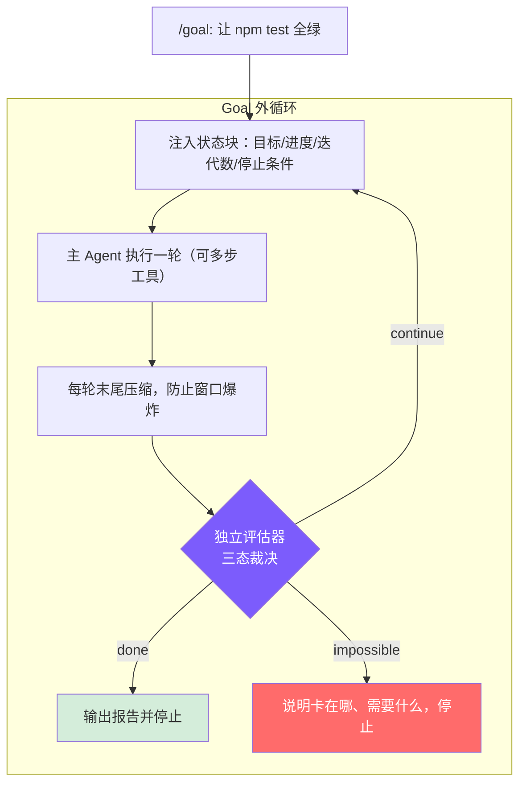
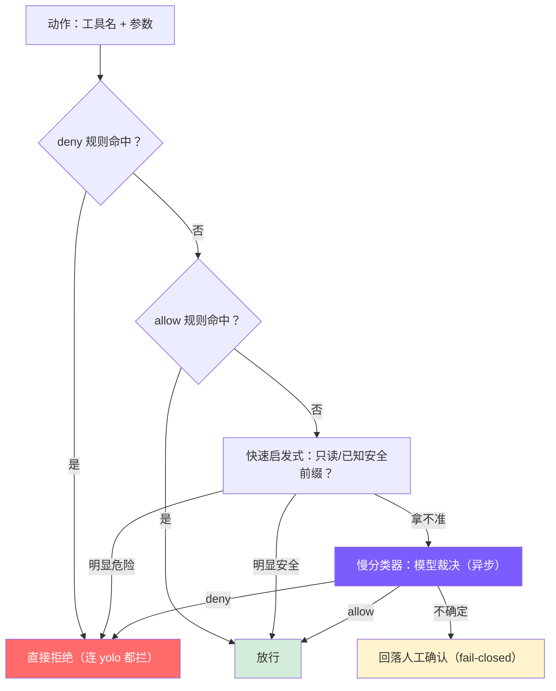

# Autonomy · 自治与续跑（目标追达 / 自排程 / 动作自动批准）

> 「每一步都按回车」到「给个目标，它自己跑到底」之间，隔着三套机制：谁来判断做完了、谁来决定下一轮何时跑、谁来批准每一个动作。

前面几篇的运行时默认是「人在回路里」：模型每要写文件、跑命令，都可能弹一次确认；一轮结束就停下等下一句。这对交互式开发很稳，但有三类任务吃不消：**「把这个测试修到全绿」**这类要反复试几十轮的目标、**「盯着 CI，红了就修」**这类要隔段时间回来再看的任务、以及**「别再让我一个个按 y」**的批量操作。自治与续跑就是为这三类任务准备的。

这三件事是**三个正交的能力**，很多人会把它们混成一个「全自动开关」，但它们的风险来源和实现方式完全不同：

| 能力 | 命令形态 | 回答的问题 | 核心风险 |
| --- | --- | --- | --- |
| **目标追达** | `/goal <目标>` | 「怎么知道做完了？」 | 目标漂移、在错误方向上空转烧钱 |
| **定时 / 自排程续跑** | `/loop [interval/dynamic] <任务>` | 「下一轮什么时候再跑？」 | 无人值守下重复执行、失控堆积 |
| **动作自动批准** | 权限模式 `auto`（Auto Mode） | 「这个动作要不要先问人？」 | 把危险动作放过去 |

> 与 [security.md §3](./security.md) 的关系：那一篇讲的是**静态放权档位**（`--auto low/medium/high` 把哪些操作预批为 allow）和**黑白名单**；本篇讲的是**动态自治**——目标级的停止判断、循环的时间调度、以及对「规则没命中、本该弹框」的动作由分类器实时裁决。静态档位决定「哪些不用问」，Auto Mode 决定「剩下那些要问的，能不能不问人也放行」。

## 1. 目标追达：/goal

普通一轮对话是「用户给一句 → 模型干到不再调工具就停」。`/goal` 则是给一个**可判定的目标**，让 agent 自己跑「执行 → 评估 → 再执行」的外循环，直到目标达成或确认不可能。

### 1.1 为什么必须有独立评估器

最容易踩的坑是让主模型自己判断「我做完了吗」——它有强烈的「乐观汇报」倾向：跑了几次测试、改了几处代码，就倾向于宣布成功。**执行的人不能给自己当裁判**。因此引入一个独立的评估回路（evaluator），用独立的提示词和对话历史，站在第三方视角核对。



### 1.2 停止条件回灌：每轮都把「终点线」念给模型

每一轮开始前，往消息里注入一段固定的**状态块**，让主循环始终看得见终点线和自己的进度：

```text
【目标】让 npm test 全部通过
【停止条件】运行 npm test 退出码为 0
【当前进度】第 7 轮；还剩 2 个失败用例：auth.test.ts、billing.test.ts
【预算】最多 30 轮 / 最多 $2.0；超限即停止并汇报
```

如果不显式回灌，模型跑十几轮后会「忘了自己要干嘛」，被中途的报错和新发现带偏（目标漂移）。

### 1.3 评估器的三态裁决

每轮执行完，把**目标、停止条件、这一轮的客观证据**（测试输出、退出码、变更摘要）交给评估器，它只返回三态之一：

| 裁决 | 含义 | 触发条件 |
| --- | --- | --- |
| `done` | 目标已达成 | 停止条件被客观证据满足（如退出码 0） |
| `impossible` | 目标在当前约束下达不到 | 连续多轮无进展、缺少权限 / 凭证 / 外部依赖、目标本身矛盾 |
| `continue` | 还没完成，继续 | 其余情况，可附「下一步建议」 |

两个关键工程点：

- **`impossible` 是必须有的刹车**。没有它，agent 会在一个死路上反复试到预算耗尽。判定「不可能」要给证据：卡在什么错误上、已经尝试了什么、需要人提供什么；
- **评估器对话不进主历史**。评估是「旁路调用」，它的推理过程不污染主 agent 的上下文，主循环只拿到三态结论与必要的下一步建议。

### 1.4 护栏：迭代 / 成本上限与每轮压缩

- **硬性双上限**：最大迭代数（如 30）与最大花费（如 $2），任一触顶即停并汇报，防止空转烧钱；
- **每轮末尾做一次压缩**：goal 循环轮次多，不压缩必爆上下文窗口（压缩机制见 [context-engineering.md §5](./context-engineering.md#5-压缩compaction与外置记忆)）；
- **无进展检测**：连续 N 轮关键指标（失败用例数、报错内容）没有变化，提前收敛为 `impossible` 或请求人工介入。

## 2. 定时与自排程续跑：/loop

`/loop` 让 agent 处理「现在条件还不满足，过一会儿再来看」的任务，例如「盯到 CI 结束就汇报」「每 10 分钟检查一次部署状态」。它有两种节奏：

| 模式 | 触发方式 | 适用 |
| --- | --- | --- |
| **interval（固定间隔）** | `/loop 10m 检查 CI 状态` | 固定频率的轮询 |
| **dynamic（自定节奏）** | 模型在执行中调用 `schedule_wakeup(seconds)` 自己决定何时醒来 | 「等构建大概 5 分钟后好，那就 5 分钟后再来」，避免无意义的高频轮询 |

### 2.1 自排程：把「何时再跑」的决定权也交给模型

dynamic 模式临时给 agent 挂上一个 `schedule_wakeup` 工具，它只在 /loop 期间存在。模型根据任务语义估计等待时间——跑测试要 30 秒就睡 30 秒，等 CI 要 8 分钟就睡 8 分钟。相比固定间隔，它**不会在构建还要 8 分钟时每 10 秒吵醒一次**，省调用、省钱。

### 2.2 退出条件与幂等

无人值守循环必须有明确的「不再继续」判定，否则会永远跑下去：

- **任务完成**（CI 已结束、目标状态出现）；
- **没有新变化**：连续若干轮工作区 / 监控对象无变化，自动休眠或停止，避免空转；
- **达到最大轮数 / 最大时长 / 预算**；
- 每轮动作应尽量**幂等**：重复执行同一轮检查不会产生重复的副作用（例如不重复提交、不重复发通知）。

### 2.3 headless 运行与退出报告

/loop 通常无人盯着，因此：

- 以 **headless 模式**运行，把每轮的关键动作、裁决、等待时间写进结构化日志（见 [observability-evaluation.md](./observability-evaluation.md)），而不是只打到终端；
- 结束时产出一份**退出报告**：跑了几轮、每轮做了什么、最终状态、是否达成、花了多少；
- 无人值守场景应套用 [security.md §3](./security.md) 的最小面原则（参考 Claude Code `--bare`）：不静默加载仓库自带的 MCP / hooks / skills，收窄凭证面。

## 3. 动作自动批准：Auto Mode

前两个能力解决「跑多久」，Auto Mode 解决「每个动作要不要按 y」。它是除 `default / plan / acceptEdits / bypassPermissions / dontAsk` 之外的第 6 种权限模式（前五种见 [security.md](./security.md)），核心是：**用一个分类器代替人的确认框，对「规则没命中、默认要问」的动作实时裁决**。

### 3.1 为什么不能简单「全自动放行」

`bypassPermissions`（--yolo）是「全部放行」，风险不可控。Auto Mode 的目标是**自动放行真正安全的动作，同时保留对危险动作的拦截**，并且关键在于它必须 **fail-closed**——宁可多问、不可错放。

### 3.2 两段式裁决：快路径 + 慢分类器

每个动作进来，先走零成本的快速判断，拿不准才调模型分类器：



注意：**deny 规则永远最先，Auto Mode 不能越过它**；分类器只负责裁决「黑白名单之间、本该 ask」的灰色地带。

### 3.3 脱敏投影：别把整份代码和密钥发给分类器

分类器判断「这条命令 / 这次写操作危不危险」时，**不需要看到完整代码和敏感参数**。发给它之前先做脱敏投影：

- shell 命令只保留命令结构与子命令，抹掉具体参数值、URL、token、路径中的私有内容；
- 文件写入只给「工具名 + 文件路径 + 操作类型」，不给完整 diff；
- 命中密钥 / 凭证模式的内容一律打码。

这样既降低了「分类请求本身泄露私有代码」的风险，也让分类器更快、更聚焦于动作的危险度而非内容。

### 3.4 fail-closed 与拒绝上限

- **拿不准就回落确认或拒绝**，分类器异常、超时、返回无法解析时，默认按「需要确认」处理，绝不默认放行；
- **拒绝计数与降级**：连续被拒（如 3 次）就从 Auto Mode 回落到交互式确认；累计拒绝达上限（如 20 次）直接中止 agent——防止模型陷入「反复尝试被拦动作」的死循环；
- **仅在有 TTY（可交互）的环境启用**：纯 CI / 无回落通道时不能用「不确定就问」，此时应直接走 `dontAsk` 或静态档位，避免无人应答时挂死；
- **启动信任门槛**：当前项目未通过信任确认时不启用 Auto Mode（防止恶意项目诱导自动执行）。

### 3.5 权限必须传播给子代理

主代理处于 Auto Mode 时，它派生的子代理**必须继承同一套权限裁决**，不能通过「把危险动作派给一个子代理去做」绕过自动批准的边界（子代理的工具过滤与权限继承见 [verification-and-multiagent.md](./verification-and-multiagent.md)）。同理，`plan` 与 `auto` 互斥：规划模式只读、自动模式可执行，二者不能叠加出「在规划名义下自动改东西」的模糊状态。

### 3.6 人永远可以抢回控制权

分类器是「人没表态时的替身」，不是「人的上级」。一旦用户在确认框上操作，分类器的结论立即作废，以人的选择为准（业界做法是 UI 对话框、权限 Hook、分类器三者竞速，由首个决定生效、人类意图优先，并设防误触宽限期）。

## 4. 三种自治能力的护栏总表

| 护栏 | /goal | /loop | Auto Mode |
| --- | --- | --- | --- |
| 独立裁判 | 独立评估器三态 | 退出条件判定 | 分类器（与执行分离） |
| 硬上限 | 迭代数 + 花费 | 轮数 + 时长 + 预算 | 连续拒绝数 + 总拒绝数 |
| 防漂移 / 防空转 | 停止条件回灌、无进展检测 | 无变化自动休眠 | fail-closed 回落确认 |
| 上下文保护 | 每轮压缩 | 每轮压缩 + 结构化日志 | 脱敏投影 |
| 安全基线 | 继承沙箱与权限规则 | headless 最小面 / 幂等 | deny 优先、权限传子代理、人可抢回 |
| 无人值守适配 | 需可客观判定 | 一等公民 | 仅 TTY 环境；CI 走 bare/dontAsk |

## 5. 设计决策（ADR）

| 决策 | 选择 | 理由 / 对立面 |
| --- | --- | --- |
| 目标是否由主模型自评 | **独立评估器**，评估对话不进主历史 | 主模型自评倾向乐观宣布成功；裁判必须与执行分离 |
| 完不成时怎么办 | 显式 `impossible` 三态 + 证据 | 对立面：只有「继续/完成」——会在死路上烧完预算 |
| 循环节奏 | 固定间隔 + 模型自排程两种 | 固定间隔高频轮询浪费；自排程需 `schedule_wakeup` 临时工具 |
| 动作自动批准 | 两段式 + 脱敏 + fail-closed | 对立面：全放行（--yolo）——危险不可控；或全问——回到起点 |
| 分类器拿不准 | 回落人工确认 | 对立面：默认放行——违背安全默认值 |
| 子代理权限 | 强制继承主代理模式 | 防止「派子代理绕过审批」提权 |
| 无人值守 | 最小面 + 日志 + 退出报告 | 无人盯时最怕静默加载不可信扩展、失控无记录 |

## 6. 与真实 Claude Code 的差距（本篇范围）

| 维度 | 真实 Claude Code | mod-agent 目标 |
| --- | --- | --- |
| 续跑 | 有后台任务 / 定时唤醒一类能力 | interval + dynamic 两种 /loop，`schedule_wakeup` 临时挂载 |
| 自动批准 | 内部 ML 分类器，与 Hook / 确认框竞速 | 两段式：启发式 + 模型分类器，fail-closed 回落确认 |
| 目标达成 | 内嵌在任务流与多代理编排中 | 独立评估器 + 三态 + 停止条件回灌的显式 /goal |
| 共享范围 | 内部缓存 / 分类器为全局能力 | 公开 API 实现，分类器复用当前模型，控制脱敏与调用成本 |

> 自治不是「加一个全自动开关」，而是把「何时停、何时跑、谁放行」这三个原本由人承担的判断，分别用**可审计、可兜底、默认安全**的机制接过去。任何一极做过头——不会刹车、不会停手、或把危险动作轻易放行——都会让「省心」变成「闯祸」。
