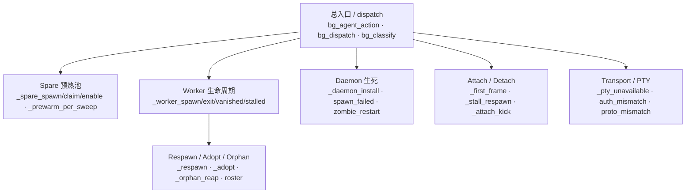
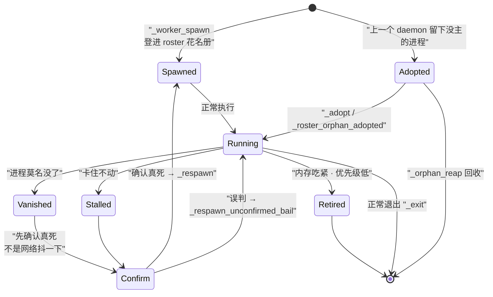

# Background Fleet · 脱终端常驻与 Daemon 监管

> /loop 让会话在时间上续着跑，Workflow 让会话在空间上并行铺开；但这两样都还绑在终端上。这一篇讲怎么把会话从终端上解绑。

前面两篇给了两根轴上的自治：

- [autonomy.md](./autonomy.md) 的 `/loop` 走的是时间轴：同一个会话隔一阵回来再干一轮；
- [dynamic-workflows.md](./dynamic-workflows.md) 的 Workflow 走的是空间轴：一段脚本一次把几十上百个子 agent 铺出去。

但它们还有一个前提没打破：会话跟终端绑在一起。你的 shell 在，会话就在；shell 一退，进程组收到信号，会话跟着走。长任务往往要跑几十分钟到几小时，启动它的人早就该去忙别的，这根绑定就很碍事。后台舰队引入第三个动作：脱离。

- **`/bg`** 把当前会话从终端上摘下来、丢到后台常驻，终端立刻腾出来；
- **`claude agents`** 把多个后台会话汇成一张表，当一支舰队照看。

三样叠起来，才凑齐"无人值守"的全部含义：既不用你守着看，也不用你守着连。

## 1. 脱终端：第三根轴

| 轴     | 能力     | 解决什么                       |
| ------ | -------- | ------------------------------ |
| 时间轴 | `/loop`  | 会话内部怎么跨时间续跑         |
| 空间轴 | Workflow | 会话内部怎么并行铺开           |
| 脱离轴 | `/bg`    | 会话本身怎么脱离终端、关掉也活 |

字符串里把这层意思说得最直白的一句是："Sessions keep running if you close the terminal." 会话不再是终端的附属物。脱终端是发射后改成异步照看，不是发射后不管：会话继续跑，需要你的时候（比如一个只有你能拍板的问题）在表里亮个状态，你有空再回去。

## 2. /bg：把会话从终端上摘下来

`/bg` 的自我介绍一句话："/bg detaches this session to run in the background"。配套引导更直白："/bg this session, then run `claude agents` in a new terminal"。一个动作把会话推到后台，另一个动作在别的终端把它捞回来。

摘下来之后会话不会变哑：它还在跑、还可能需要你，只是你此刻不在面前。这与本地脱离、手机 attach 回来、进程始终由后台守着的跨端体验是同一个底座：会话在本地、手机、常驻三处之间倒手，靠的就是会话不绑终端这一条。

## 3. claude agents：一张表管所有后台会话

- `/bg` 解决"一个会话怎么活下去"；`claude agents` 解决"好几个会话怎么一起看"。

`claude agents` 是一个正经的 Commander 子命令（描述："Manage background agents"），带一小组动作：

| 命令                 | 干什么                                                   |
| -------------------- | -------------------------------------------------------- |
| `claude agents`      | 列出所有后台会话，每行带**状态色**，扫一眼知道哪个在等你 |
| `claude attach <id>` | 在当前终端把某一个打开接管                               |
| `claude logs <id>`   | 翻它最近的输出                                           |

那张表的关键是**状态色**：把"哪个会话需要你介入"压缩成一列一眼扫过的信号，不必挨个 attach 进去看。列表里可直接**空格回一句、回车进去接管**。

### 3.1 一条会咬人的规则：attach 与 resume 互斥

一个会话如果已经作为后台 agent 在跑，你没法在别处直接 `--resume` 它。它现在是个后台 agent，去 `claude agents` 里 attach 上它，或先在那儿把它停掉，才能在这边 resume。

**同一个会话不允许被两处同时接管。** 后台会话不是可随便复制的一份状态，它有唯一归属、必须被独占接管，它是个活进程。

## 4. 表面之下：一台本地进程舰队监管器

撑起"关了终端也不掉、崩了还能回来"的，是二进制字符串里那近 80 个 `tengu_bg_*` 事件名拼出来的一台监管器。

> 证据口径要先讲明：这些事件名是二进制里逐字读到的，实打实；但每个事件在什么条件下发、彼此怎么串成状态机，没有对应源码可查（快照里 `grep -rlF 'tengu_bg_'` 命中 0 个文件），只能从事件名加周边压缩代码往里推。下面"它在干什么"，名字是硬的、逻辑是推的。

把事件按名字聚一下，浮出五六个子系统，各管一摊，像一台小号进程主管（量级接近 systemd / pm2 的一个子集）：

### 4.1 各子系统在干什么

| 子系统                       | 代表事件                                                                                                                                                                                                    | 推断职责                                                             |
| ---------------------------- | ----------------------------------------------------------------------------------------------------------------------------------------------------------------------------------------------------------- | -------------------------------------------------------------------- |
| **总入口 / dispatch**        | `bg_agent_action` / `bg_dispatch` / `bg_classify`；兜底 `_dispatch_rescued` / `_stale_drop` / `_sigkill_escalate` / `_low_mem` / `_fallback`                                                                | 派任务前先分类，派的路上有救回、丢弃、一路升级到 SIGKILL、低内存降级 |
| **Daemon 生死**              | `_daemon_install` / `_daemon_spawn_failed` / `_daemon_zombie_restart` / `_zombie_false_positive` / `_daemon_cold_start_ask`；平台分支 `_daemon_wmi_fallback`（Windows）、`_daemon_macos_aqua_wrap`（macOS） | 装服务、起不来报错、僵死重启、不误杀假僵死、冷启动先问               |
| **Spare 预热池**             | `_spare_spawn` / `_spare_claim` / `_spare_enable` / `_prewarm_per_sweep`                                                                                                                                    | 任务还没来就先把几个进程热在那儿，任务一到直接认领，省掉冷启动几秒   |
| **Worker 起落**              | `_worker_spawn` / `_exit` / `_vanished` / `_stalled`；`_low_mem_mb` / `_retire_pinned_low_mem`                                                                                                              | 生、正常退、莫名消失、卡住；内存紧张时退休不紧要的 worker            |
| **Respawn / Adopt / Orphan** | `_respawn` / `_respawn_unconfirmed_bail` / `_adopt` / `_adopt_token_lost_respawn` / `_orphan_reap` / `_roster_orphan_adopted` / `_roster_parse_failed`                                                      | 崩了重生（先确认真死防重复）、没主进程收养、孤儿回收、花名册登记     |
| **Attach / Detach**          | `_first_frame` / `_stall_respawn` / `_attach_kick`                                                                                                                                                          | 接管首帧、卡住重生、踢一脚                                           |
| **Transport / PTY**          | `_pty_unavailable` / `_pty_auth_mismatch` / `_proto_mismatch` / `_bridge_flush_truncated`                                                                                                                   | PTY 拿不到、认证不对、协议不匹配、桥接截断                           |

### 4.2 一个 worker 的一生

拿一个 worker 走一遍，能感到这套东西的密度：

1. 由 `_worker_spawn` 诞生，登进那本叫 **roster** 的花名册；
2. 跑着跑着莫名没了记 `_vanished`、卡住不动记 `_stalled`；
3. 监管器不会当没看见，从 `_respawn` / `_respawn_unconfirmed_bail` 推，它判要不要重生，且重生前先确认是真死、不是网络抖一下，免得同一个活起两份；
4. 内存吃紧时，退休占内存又不紧要的 worker，给要紧的腾地方；
5. 刚接手发现一堆没主的进程（上一个 daemon 没干净退），用 `_adopt` / `_orphan_reap` / `_roster_orphan_adopted` 认领回来，而不是放任它们变成僵尸。

把这一生按时间画出来，能看清"监管器在哪些点上插了手"：

有两个点最值得抄。一是 `Vanished`/`Stalled` 之后不直接重生，而是先插入一个确认步骤，否则网络抖一下就会让同一个活起两份。二是孤儿进程不放任变僵尸，而是先认领、认领不了才回收。

监管器的职责说到底就几件：记录状态、查活、崩溃后补跑、拥堵时退让、收编失去主进程的任务。

## 5. 按需起、闲了退、可一键关

这台监管器不是开机常驻、一直吃内存的守护进程。它的定位是 on-demand：

- 没有活吊着时，它说自己"nothing holding this daemon open"，随即 idle-exit 退掉；下一次 `claude agents` 或 `claude --bg` 再拉起新的；
- **让位规则**："an on-demand daemon never displaces a running one"。已经在正经看着一批会话的 daemon 有优先权，刚按需起来的不许把它挤掉，只有 transient（临时）才允许被顶掉；避免两台监管器打架、把账记乱。

总闸也留了：设置里有一条"Disable agent view（`claude agents`、`--bg`、`/background`、on-demand daemon 一起关）"，等价于 `CLAUDE_CODE_DISABLE_AGENT_VIEW=1`，通常在托管设置里下发。对不希望员工机器上冒出后台常驻进程的组织，这是一条能从上面统一关死的路。

## 6. 同一片版图：子 agent 默认后台

`/bg` 出去的是整会话；而在一个会话内部，主会话派出去的子 agent 默认也跑在后台。这层底座在快照源码里就能逐行读：

- Agent 工具描述："Subagents run in the background by default，跑完会通知你"；schema 里 `run_in_background` 默认就是 true；只有往下走之前非拿到结果不可时，才传 `run_in_background: false` 让它同步跑；
- 同一份 `run_in_background` 出现在 Agent、Bash、PowerShell 等多个工具里；schema 还带 `isolation: 'worktree'` 管文件系统隔离。

### 6.1 完工用 task-notification 回来，不是塞回当前那句话

后台子 agent 完工时，结果作为一条 `<task-notification>` 重新进入主循环。它带着 `promptOrigin: { kind: "task-notification" }` 标记，被当一条元消息进专门的命令队列模式，而不是硬塞成一句伪装的用户消息。主循环把人的输入和后台回报分成两种来源各自处理。

配套有一句很重的行为约束（最狠版本逐字）：

> 当一个 agent 在后台跑、完工时你会被自动通知：**do NOT sleep, poll, or proactively check on its progress.** 别睡、别轮询、别主动去戳它。

这把异步从建议钉成纪律：派出去就该松手，等通知，而不是守着反复查。

> 注意后台其实是两层：一层是你手动 `/bg` 出去、由 [§4](#_4-表面之下-一台本地进程舰队监管器) 那套 daemon 照看的脱终端会话；另一层是主会话在会话内派出、默认后台、完工用 task-notification 叫你回来的子 agent。后一层由源码坐实，前一层只有 strings；子 agent 到底是不是由那台 daemon 监管，现有证据打不通这道边界，不把它当实锤。

## 7. 干完活自己收尾：commit / push / draft PR

一个能脱终端、几小时无人值守的后台任务，还差最后一环：活干完了得替你把结果落下来，而不是把一堆改动晾在那儿等你回来手动收。收尾指令的行为要点：

- 改完代码就 commit，push 那个分支，然后开一个 draft PR（`gh pr create --draft`），别停下来问；
- 不许用"say the word and I'll open the PR"这种话把活撂在没提交的状态里结束；
- 红线同时钉死：**Never push to main/master, force-push, or merge**。绝不直推主干、绝不 force-push、绝不 merge；
- 退路：万一没能隔离出 worktree（EnterWorktree 失败，或当前目录本来就是用户自己的 checkout），收尾换一种更保守的走法。

这与 Auto Mode 的 Git 规则同向（[autonomy.md §3](./autonomy.md#_3-动作自动批准-auto-mode)）：推到自己的功能分支放行，直推默认分支和改写历史拦下。commit 和开 PR 属于替你把活收好（可自动），push 到主干、merge 属于替你拍板发布（必须留给人）。

## 8. 对 mod-agent 的落地

后台能力是 [roadmap.md](./roadmap.md) 里相对靠后的能力，两层的实现难度差别很大：

- **会话内子 agent 后台**（[§6](#_6-同一片版图-子-agent-默认后台)）相对简单，是 Phase 6 多 Agent 的一部分，子 agent 派生 + 一个异步队列 + task-notification 事件即可；
- **脱终端 daemon 监管**（[§4](#_4-表面之下-一台本地进程舰队监管器)、[§5](#_5-按需起、闲了退、可一键关)）最重，它本质是一台进程主管，跨平台（Windows 服务 / macOS launchd）、有健康检查/重生/孤儿收养，建议放到 Phase 7 或更后，且要先确认真有关掉终端还在跑的需求。

### 8.1 最小版本

1. **先做会话内后台**：子 agent 派生成后台任务（一个 task 表 + 状态），跑完发 task-notification 事件进主循环；不做 sleep-poll；
2. **再做 `/bg` 脱离**：最简实现是让会话进程脱离终端的进程组（POSIX `setsid` / Windows 独立进程），先不做完整 daemon，日志写文件、状态写一个 JSON，`claude agents` 读它列一张表；
3. **健康检查/重生/孤儿收养后补**：这些是真跑了很久、真崩过才需要的能力，别提前造；
4. **收尾动作随后台一起做**：后台任务默认 commit + push 功能分支 + draft PR，且硬禁主干/force-push/merge，这是后台任务真正闭环的关键，且不依赖 daemon。

### 8.2 什么时候才需要脱终端

- 真有任务要跑超过你愿意开着终端的时间，且你无法用一个常驻服务器/CI 跑它；
- 只是不想等结果，会话内后台子 agent + 通知就够，不必脱离；
- 能在 CI / 云端跑的长任务，优先放 CI（[security.md §3](./security.md#_3-沙箱基线) 的 bare 模式），比在本机维护 daemon 更省心。

## 9. 设计决策（ADR）

| 决策           | 选择                                       | 理由 / 对立面                                                     |
| -------------- | ------------------------------------------ | ----------------------------------------------------------------- |
| 后台会话怎么活 | 脱离终端进程组 + 独立状态                  | 对立面：绑终端，关终端就没，长任务不成立                          |
| 监管器形态     | on-demand，闲了 idle-exit                  | 对立面：开机常驻，白吃内存；让位规则防多 daemon 打架              |
| Worker 崩溃    | 先确认真死再 respawn                       | 对立面：立刻重生，网络抖动会起两份；`_unconfirmed_bail` 防重复    |
| 没主进程       | adopt + orphan reap + roster 登记          | 对立面：放任变僵尸，上个 daemon 没退干净就丢进程                  |
| 会话内子 agent | 默认后台，task-notification 回来           | 对立面：同步阻塞，主会话干等；通知不伪装成用户消息；禁 sleep-poll |
| 后台收尾       | commit + push 功能分支 + draft PR          | 对立面：晾着等用户，脱终端就没闭环；硬禁主干/force-push/merge     |
| 总开关         | `CLAUDE_CODE_DISABLE_AGENT_VIEW` 整体关    | 组织要能统一禁止后台常驻进程                                      |
| mod-agent 顺序 | 先会话内后台，再 /bg 脱离，daemon 监管最后 | 脱终端/跨平台最重；收尾不依赖 daemon，随后台一起做                |

> 后台舰队的本质，是让会话脱离了你的在场、甚至脱离了终端之后，仍有一台东西替你盯着它的死活，并要求它在无人值守时自己把活收好。会话可以脱离你，但安全边界和交付闭环不能脱离。
