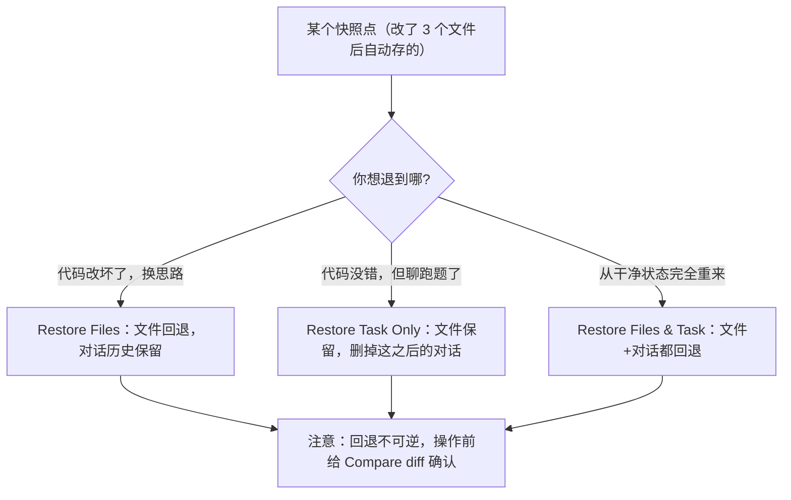

# Code Editing · 文件读写、变更管理与 Diff 审核

> Agent 改代码属于高风险动作，这篇讲读取、编辑策略、工作区隔离与变更保护。

改代码是 agent 最容易「闯祸」的环节。这篇的核心思路可以用一句话概括：**动手之前先留底，动手之后随时能退**。就像装修前先把每件家具拍个照，改坏了能退回到刚拍的那一刻。读完你会知道：mod-agent 为什么不在你真正的 git 历史里乱 commit、为什么改文件前要先看你有没有没提交的改动、以及「回退」其实分了三种意思。

## 1. 文件读取工具

`read_file` 支持明确行范围与最大字节数；返回附文件路径、行号、文件 hash 与截断标记。二进制文件、超大文件、疑似密钥文件走不同策略。对模型上下文只返回必要片段，同时在产物区保留可追踪引用。

## 2. 编辑策略（按风险从低到高）

1. **精确文本替换**：适合唯一且稳定的小片段；必须校验匹配次数，默认预期恰好一次；
2. **结构化补丁**：Unified Diff 或经过验证的 patch 格式，保存基准 hash；应用失败就重新读取，禁止盲目扩大模糊匹配；
3. **AST / 语言服务辅助修改**：用于重命名、导入整理、符号级变更；注意格式化与注释保留；
4. **整文件重写**：仅用于新建文件或短小文件；改现有大文件优先补丁化，避免意外丢弃用户逻辑。

至少实现两种格式：`whole`（fallback，弱模型 / 小文件 / 新文件）+ `search/replace`（默认，强模型省 token）。解析失败时不写盘，把 parse_error 回喂模型重试。

每次写入前后检查路径、权限、基准 hash、Git 状态与大小限制。禁止符号链接逃逸工作区；拒绝 `..` 逃逸、绝对路径越界、特殊设备文件与未授权敏感路径。

举个例子（示意）：模型想用「精确文本替换」把 `timeout = 5` 改成 `timeout = 10`，但这个文件里有 3 处 `timeout = 5`。系统发现「预期恰好一次、实际匹配 3 次」，拒绝这次替换并把情况回喂模型——让它先想清楚要改哪一处，而不是盲目挑一个改掉。这就是「必须校验匹配次数」的意义。

## 3. 工作区隔离与用户变更保护

- 执行前取 `git status --porcelain`，记录初始 dirty state 与文件 hash；
- 为任务建独立 Git Worktree / 工作副本，不在用户现有工作区混写；
- 若必须在本机目录内工作，只按路径白名单改任务授权文件；用户已有修改是基线，不允许 `git reset --hard` / `git clean -fd` 清场；
- 应用补丁前校验文件 hash 是否与生成补丁时一致；变了就重读并重算补丁；
- 取消任务不等于自动回滚所有改动：保留 diff，提供「丢弃本 Agent 变更」操作，且回滚只针对 Agent 自己产生的提交 / 补丁。

### 3.1 影子仓库快照（Shadow Git，Cline 实证，出处：https://docs.cline.bot/core-workflows/checkpoints ）

Cline 不在用户真实 git 仓库里 commit，而是维护一个独立的「影子 git 仓库」：

1. **快照粒度 = 每次工具调用**，而非每个任务：连续改 3 个文件就产生 3 个可独立回退的点；每次工具使用（文件编辑、命令等）后自动把当前文件状态提交到影子仓库；
2. 主仓库 `git log` 始终干净；**连 git 未跟踪的临时文件也一并快照**，避免临时文件丢失；
3. 大仓库可关闭（快照占存储、拖慢每次提交）；
4. 官方注记：**没有 checkpoint 时 auto-approve 显得很冒险；有了 checkpoint 才敢让 agent 连续自主干活，错了回退到上一个良好快照**——「高自治 + 可回退」是捆绑设计。

**恢复必须拆成三个维度，不能只做「整体撤销」（出处同上）**：

| 操作 | 文件 | 对话历史 | 典型场景 |
| --- | --- | --- | --- |
| Restore Files | 回退到快照 | 保留 | 代码改坏，换个实现思路 |
| Restore Task Only | 保留 | 删掉该点之后的消息 | 代码没错，但聊跑题了 |
| Restore Files & Task | 回退 | 删掉该点之后的消息 | 从已知良好状态完全重来 |

三种回退不是一回事，画出来看：

这张图在说什么：「撤销」不是只有一个按钮。代码、对话历史、快照点三者要分开退——很多时候只是聊偏了，代码没必要跟着回滚。

配套交互：每个快照旁给 Compare（diff 视图看本次改动）与 Restore 按钮；**回退不可逆**——Windsurf 同样在文档中明确警示「Reverts are currently irreversible, so be careful!」（出处：https://docs.windsurf.com/windsurf/cascade/cascade ），并支持手动创建**命名 checkpoint** 随时跳回。

### 3.2 自动 commit 与分支护栏（Aider / v0 / Copilot 实证）

- **改动即 commit（Aider，出处：https://aider.chat/docs/git.html ）**：每次编辑完成后自动提交，commit message 由低成本的 weak-model 生成（主模型只做编码）；动手前先检查脏文件——用户未提交的改动**先单独提交**，隔离「用户改动」与「AI 改动」；
- **自动分支 + 永不直接推 main（v0，出处：https://v0.dev/faq ）**：每个会话自动开分支（如 `v0/main-abc123`），每次改动自动 commit，PR 在产品内创建 / 合并，**绝不直接 push main**——Git 卫生做成默认行为，仓库历史干净；
- **draft PR + 发起者不可自批（GitHub Copilot cloud agent，出处：https://docs.github.com/en/copilot/how-tos/use-copilot-agents/cloud-agent/use-cloud-agent-on-github ）**：agent 的产物一律以 draft PR 呈现、合入前必须人工批准；**发起任务者不能审批自己委派产生的 PR**，保留仓库「required reviews」规则，确保独立评审。

对 mod-agent：MVP 先拿 Aider 档（改动即 commit，零成本审计与回滚）；worktree 阶段拿 v0 / Copilot 档（分支命名规则 + 禁推 main + draft PR + 不自批）。

## 4. 变更规模与范围保护

- 配置每任务最大文件数、最大行数、可改目录与禁止目录；
- 计划改一个组件，最终却准备动几十个无关文件时，触发二次计划审查；
- 依赖锁文件、环境变量、CI/CD、权限配置、脚本、迁移文件拥有更高风险等级；
- Agent 发现必须改动计划外配置或删除文件时，触发策略检查 / 审批，而不是自动扩大权限。

## 5. Diff 审核

交付前至少包含：文件列表、逐文件 diff、增删行统计、验收条件映射、执行过的命令与退出码、失败项、潜在风险、未覆盖场景。可计算基准 SHA、产物 SHA 与 Patch ID 追踪变更版本。

## 6. 边界与禁区

- 禁止用相对路径，一律绝对路径；
- 禁止让模型直接改测试文件来让测试变绿——测试文件改动单独标记并在验证层告警；
- search 锚不唯一时拒绝应用并回喂；
- 测试通过也不等于全部正确：仍需检查是否真的实现了验收条件、是否动了无关逻辑、是否引入安全风险；缺测试时明确标注验证缺口。
