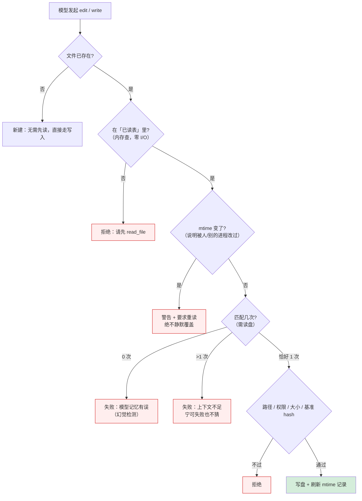
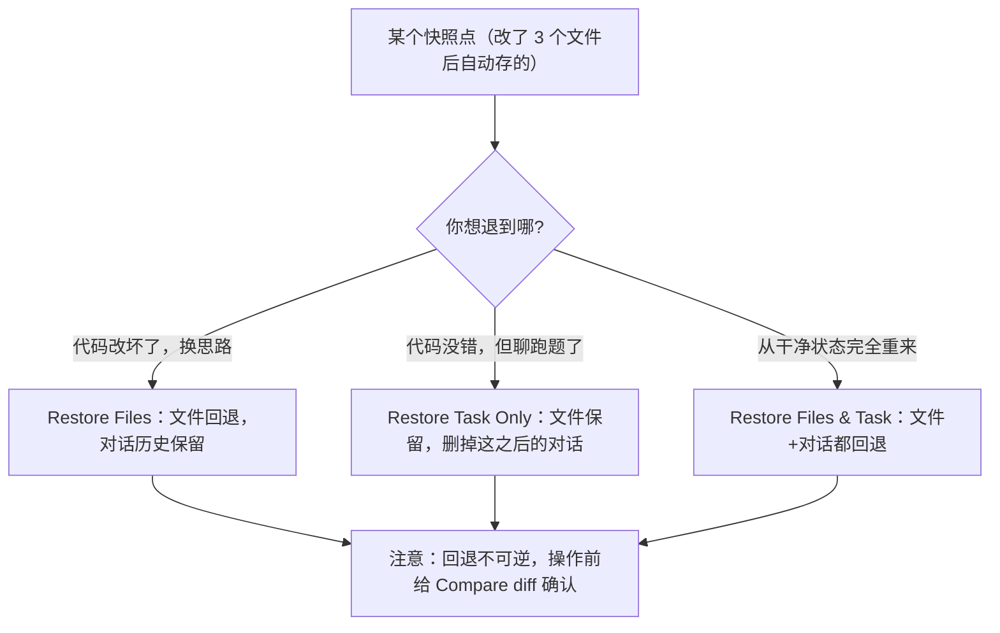

# Code Editing · 文件读写、变更管理与 Diff 审核

> Agent 改代码属于高风险动作，这篇讲读取、编辑策略、工作区隔离与变更保护。

改代码是 agent 最容易闯祸的环节。这篇的核心思路一句话：动手之前先留底，动手之后随时能退。读完你会知道三件事：mod-agent 为什么不在你真正的 git 历史里乱 commit、为什么改文件前要先看你有没有没提交的改动、以及回退其实分了哪三种。

## 1. 文件读取工具

`read_file` 支持明确行范围与最大字节数；返回附文件路径、行号、文件 hash 与截断标记。二进制文件、超大文件、疑似密钥文件走不同策略。对模型上下文只返回必要片段，同时在产物区保留可追踪引用。

## 2. 编辑策略（按风险从低到高）

1. **精确文本替换**：适合唯一且稳定的小片段；必须校验匹配次数，默认预期恰好一次；
2. **结构化补丁**：Unified Diff 或经过验证的 patch 格式，保存基准 hash；应用失败就重新读取，禁止盲目扩大模糊匹配；
3. **AST / 语言服务辅助修改**：用于重命名、导入整理、符号级变更；注意格式化与注释保留；
4. **整文件重写**：仅用于新建文件或短小文件；改现有大文件优先补丁化，避免意外丢弃用户逻辑。

至少实现两种格式：`whole`（fallback，弱模型 / 小文件 / 新文件）+ `search/replace`（默认，强模型省 token）。解析失败时不写盘，把 parse_error 回喂模型重试。

每次写入前后检查路径、权限、基准 hash、Git 状态与大小限制。禁止符号链接逃逸工作区；拒绝 `..` 逃逸、绝对路径越界、特殊设备文件与未授权敏感路径。

比如，模型想用精确文本替换把 `timeout = 5` 改成 `timeout = 10`，但这个文件里有 3 处 `timeout = 5`。系统发现预期恰好一次、实际却匹配 3 次，拒绝这次替换并把情况回喂模型，让它先想清楚要改哪一处，而不是盲目挑一个改掉。这就是必须校验匹配次数的意义。

### 2.1 编辑安全：read-before-edit 与 mtime 防护

编辑类工具最危险的是凭过时记忆盲写。下列机制必须在**代码层强制**，而不是只在系统提示词里请求模型配合：

- **编辑前必须先读取（read-before-edit）**：运行时维护一张本会话已读文件表（key 为绝对路径）。对已存在的文件执行 `edit` / `write` 前，若它不在已读表中，直接拒绝并提示"请先 read_file"；新建文件例外（文件不存在时无需先读）。这保证模型基于文件当前内容、而非想象中的内容来改；
- **mtime 外部修改检测**：读取文件时记录它的修改时间（`mtimeMs`）；写入前再取一次当前 mtime 比较。若不一致，说明文件在模型读取后被用户在 IDE 里手动改过或被其他进程改过，此时返回警告、要求重新读取，而不是静默覆盖掉用户的手动修改。写成功后刷新该文件的 mtime 记录；
- **唯一匹配是底线**：匹配 0 次意味着模型对文件内容的记忆有误（幻觉检测），匹配多于 1 次意味着上下文不足。两种情况都宁可失败也不猜测，把信息回喂模型让它重读或补充上下文。静默替换第一个匹配远比显式失败危险；
- **替换实现避免特殊字符陷阱**：用 `split(old).join(new)` 而非 `String.replace`（后者对 `$&`、`$1` 等有特殊替换语义），保证 `new_string` 里的 `$` 原样写入；
- **引号容错**：LLM 的 token 化有时会把直引号映射成弯引号（`"` → `“ ”`、`'` → `‘ ’`），导致编辑百分百失败。匹配时先把弯引号规范化为直引号再比对；但命中后要替换回文件里的原始字符串，只在其位置写入新内容，保留文件原有的字符风格；
- **配置文件保护**：对 `settings.json` 等结构化配置，编辑后做一次模拟应用 + 格式校验（如 JSON Schema 校验），防止一个看似合理的改动写坏配置。

这些校验按磁盘 I/O 成本从低到高排序：先查内存中的已读 / mtime 状态，再做磁盘读取与匹配，最后才写盘，尽量早失败、少做无用 I/O。把这个顺序画出来：

越靠上的检查越便宜。能靠内存状态否掉的，就别去读盘；能靠匹配次数否掉的，就别去写盘。所有红色出口都不是报错完事，而是把原因回喂给模型，让它重读或补上下文，这才是自修复的关键。

### 2.2 为什么默认是 search-and-replace

四种编辑方案的对比，决定了为何把精确字符串替换作为默认：

| 方案                   | 致命缺陷                                                                           |
| ---------------------- | ---------------------------------------------------------------------------------- |
| 行号编辑               | 位置相关：一次插入若干行后，后续所有行号整体偏移，多步编辑要不断重算               |
| AST 编辑               | 语法错误的文件恰恰最需要编辑，而 AST 解析器遇到语法错误直接报错、无法下手          |
| Unified diff           | 模型生成严格格式（hunk 行号、`+`/`-`/空格前缀）易错，任一不符 patch 就无法应用     |
| 整文件重写             | 大文件浪费 token；模型可能漏掉未要求改的代码；用户无法快速 review                  |
| **search-and-replace** | 无上述缺陷，且**幻觉安全**：模型给出文件中不存在的字符串会直接失败，逼着它重读纠正 |

search-and-replace 最被低估的优势正是**幻觉安全**：全文件重写可能把错误内容静默写入，而字符串替换在待替换串不存在时硬性失败。整文件重写仅保留给新建文件或短小文件（[§2](#_2-编辑策略-按风险从低到高) 第 4 条）。

### 2.3 编辑接口本身就是杠杆：SWE-agent ACI 实证

编辑策略不只是怎么改文件，它属于更大的一层：**ACI（Agent-Computer Interface，agent 与计算机的接口）**。SWE-agent 的核心主张是：LLM 是一类全新的终端用户，它没有眼睛、没有鼠标、对长而嘈杂的上下文表现退化，因此不该直接把人类用的 Unix 工具链丢给它，而要专门为它设计一层薄接口（出处：https://swe-agent.com/latest/background/aci/ ）。

这层的收益有多大？在 300 条 SWE-bench Lite 子集上的消融：完整 ACI 比只用默认 Linux shell 的同构基线多解 10.7 个百分点。

四条设计准则（可直接当评审清单用）：

1. **动作要简单易懂**：命令语义直白，别让模型猜；
2. **动作要紧凑高效**：一次动作完成一件事，不啰嗦；
3. **环境反馈要有信息量但简洁**：不是越多越好；
4. **护栏要能缓解错误传播并加速恢复**。

落到编辑与查看上的具体手段（每一条都很不人性，但都对模型有效）：

| 手段                            | 做法                                                                    | 为什么                                                     |
| ------------------------------- | ----------------------------------------------------------------------- | ---------------------------------------------------------- |
| **编辑即过 lint**               | 提交编辑时先跑语法检查，不合法就**不让这次编辑通过**，并把诊断回给模型  | 让模型在编辑那一刻就知道错了，而不是等到跑测试才发现       |
| **文件查看器每轮只显示 100 行** | 带行号 + 省略标记，并告知上下各省略了多少行                             | 窗口过大会挤占推理 token，实测反而变差                     |
| **文件内搜索 / 滚动**           | 提供 `goto` / `scroll` / 文件内搜索，而不是让模型重读整个文件           | 每次观察都小而形状统一                                     |
| **全目录搜索只列文件名**        | 返回「哪些文件命中 + 命中计数」，**超过 50 条就不给结果**、要求收窄查询 | 给模型看每条匹配的上下文，实测只会让它更糊涂               |
| **空输出也要有固定说法**        | 返回「Your command ran successfully and did not produce any output.」   | 沉默不能是歧义的；模型必须能区分「成功但没输出」和「失败」 |
| **旧观察折叠**                  | 超过最近 5 轮的观察各折叠成一行                                         | 保留轨迹，丢掉过期内容                                     |

最后两条对 mod-agent 尤其有用：空输出是最容易被忽略的失败源。工具返回空字符串时，模型无法判断是命令成功无输出、还是工具崩了、还是权限被拒。给它一句确定的话，成本几乎为零。

> 口径提示：SWE-agent 原项目已进入 maintenance-only，官方建议新项目改用 mini-swe-agent（更简单灵活、性能相当）。上面的 ACI 结论作为设计规范依然成立。

## 3. 工作区隔离与用户变更保护

- 执行前取 `git status --porcelain`，记录初始 dirty state 与文件 hash；
- 为任务建独立 Git Worktree / 工作副本，不在用户现有工作区混写；
- 若必须在本机目录内工作，只按路径白名单改任务授权文件；用户已有修改是基线，不允许 `git reset --hard` / `git clean -fd` 清场；
- 应用补丁前校验文件 hash 是否与生成补丁时一致；变了就重读并重算补丁；
- 取消任务不等于自动回滚所有改动：保留 diff，提供丢弃本 Agent 变更操作，且回滚只针对 Agent 自己产生的提交 / 补丁。

### 3.1 影子仓库快照（Shadow Git，Cline 实证，出处：https://docs.cline.bot/core-workflows/checkpoints ）

Cline 不在用户真实 git 仓库里 commit，而是维护一个独立的影子 git 仓库：

1. **快照粒度 = 每次工具调用**，而非每个任务：连续改 3 个文件就产生 3 个可独立回退的点；每次工具使用（文件编辑、命令等）后自动把当前文件状态提交到影子仓库；
2. 主仓库 `git log` 始终干净；连 git 未跟踪的临时文件也一并快照，避免临时文件丢失；
3. 大仓库可关闭（快照占存储、拖慢每次提交）；
4. 官方注记：没有 checkpoint 时 auto-approve 显得很冒险；有了 checkpoint 才敢让 agent 连续自主干活，错了回退到上一个良好快照。高自治 + 可回退是捆绑设计。

恢复必须拆成三个维度，不能只做整体撤销（出处同上）：

| 操作                 | 文件       | 对话历史           | 典型场景               |
| -------------------- | ---------- | ------------------ | ---------------------- |
| Restore Files        | 回退到快照 | 保留               | 代码改坏，换个实现思路 |
| Restore Task Only    | 保留       | 删掉该点之后的消息 | 代码没错，但聊跑题了   |
| Restore Files & Task | 回退       | 删掉该点之后的消息 | 从已知良好状态完全重来 |

三种回退不是一回事，画出来看：

撤销不是只有一个按钮。代码、对话历史、快照点三者要分开退。很多时候只是聊偏了，代码没必要跟着回滚。

配套交互：每个快照旁给 Compare（diff 视图看本次改动）与 Restore 按钮；**回退不可逆**。Windsurf 同样在文档中明确警示"Reverts are currently irreversible, so be careful!"（出处：https://docs.windsurf.com/windsurf/cascade/cascade ），并支持手动创建命名 checkpoint 随时跳回。

### 3.2 自动 commit 与分支护栏（Aider / v0 / Copilot 实证）

- **改动即 commit（Aider，出处：https://aider.chat/docs/git.html ）**：每次编辑完成后自动提交，commit message 由低成本的 weak-model 生成（主模型只做编码）；动手前先检查脏文件，用户未提交的改动先单独提交，隔离用户改动与 AI 改动；
- **自动分支 + 永不直接推 main（v0，出处：https://v0.dev/faq ）**：每个会话自动开分支（如 `v0/main-abc123`），每次改动自动 commit，PR 在产品内创建 / 合并，绝不直接 push main。Git 卫生做成默认行为，仓库历史干净；
- **draft PR + 发起者不可自批（GitHub Copilot cloud agent，出处：https://docs.github.com/en/copilot/how-tos/use-copilot-agents/cloud-agent/use-cloud-agent-on-github ）**：agent 的产物一律以 draft PR 呈现、合入前必须人工批准；发起任务者不能审批自己委派产生的 PR，保留仓库 required reviews 规则，确保独立评审。

对 mod-agent：MVP 先拿 Aider 档（改动即 commit，零成本审计与回滚）；worktree 阶段拿 v0 / Copilot 档（分支命名规则 + 禁推 main + draft PR + 不自批）。

## 4. 变更规模与范围保护

- 配置每任务最大文件数、最大行数、可改目录与禁止目录；
- 计划改一个组件，最终却准备动几十个无关文件时，触发二次计划审查；
- 依赖锁文件、环境变量、CI/CD、权限配置、脚本、迁移文件拥有更高风险等级；
- Agent 发现必须改动计划外配置或删除文件时，触发策略检查 / 审批，而不是自动扩大权限。

## 5. Diff 审核

交付前至少包含：文件列表、逐文件 diff、增删行统计、验收条件映射、执行过的命令与退出码、失败项、潜在风险、未覆盖场景。可计算基准 SHA、产物 SHA 与 Patch ID 追踪变更版本。

## 6. 边界与禁区

- 禁止用相对路径，一律绝对路径；
- 禁止让模型直接改测试文件来让测试变绿。测试文件改动单独标记并在验证层告警；
- search 锚不唯一时拒绝应用并回喂；
- 测试通过也不等于全部正确：仍需检查是否真的实现了验收条件、是否动了无关逻辑、是否引入安全风险；缺测试时明确标注验证缺口。
