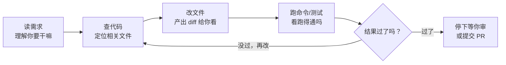
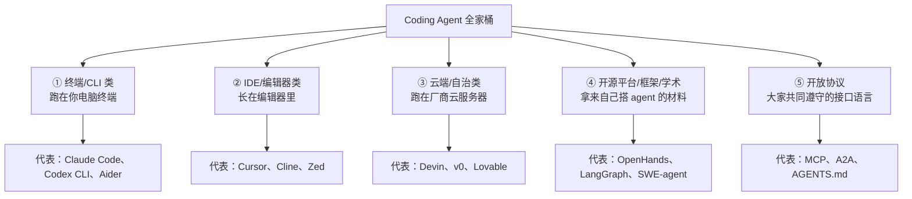
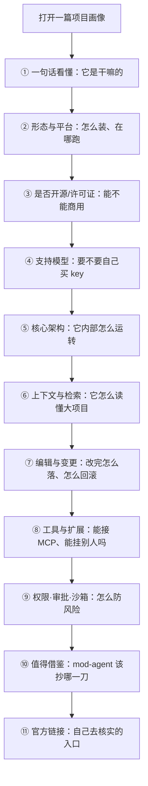

# Coding Agent Landscape · Coding Agent 全景图鉴（对标）

> 这篇把 2026 年市面上能自己动手写代码的 AI（Coding Agent）的主流形态汇总在一起：它们长什么样、开不开源、用什么模型、怎么改代码、怎么防出错，以及哪些机制值得 mod-agent 借鉴。所有链接与许可证均于 2026-08-14 逐个打开核对。项目体量只给规模档位（10万+ / 数万 / 数千 / 数百）不给精确 star 数，因为那是一天就能变的数字，只用来判断「有没有人在用」，不用来排序。

> **没接触过这类工具的话，先看这三句**：
>
> 1. Coding Agent 是用自然语言提需求、由 AI 自己读代码改文件跑测试的编程代理，区别于只按 Tab 补全一行的 Copilot。
> 2. 这篇文章不要求从头读到尾：先看第 0 章的两张速查表和下文的怎么读说明，找到你关心的那一列，再去翻对应项目的小档案。
> 3. 每个项目的小档案都用同一套 11 个固定问题来写（能不能商用、要不要自己买 key、会不会误删文件），照着这 11 个问题读，任何项目都能在三分钟内看懂。

## 0. 怎么读这张图

**Coding Agent（编码代理）**：能在一个循环里连续执行 读代码 → 定计划 → 改文件 → 跑命令 → 看结果 → 继续改 的 AI，区别于只补全一行代码的 Copilot，最后产出人可以审查的 diff / PR。背景概念见 [research.md](./research.md)，mod-agent 的总体设计见 [architecture.md](./architecture.md)。

按运行位置分四大类，加上贯穿所有类别的开放协议：

| 类别                     | 一句话理解                                  | 代表                                        |
| ------------------------ | ------------------------------------------- | ------------------------------------------- |
| ① 终端 / CLI 类          | 在你的终端里敲命令启动，跑在你自己机器上    | Claude Code、Codex CLI、Gemini CLI、Aider   |
| ② IDE / 编辑器类         | 长在编辑器里，或本身就是一个 AI IDE         | Cursor、Cline、Kilo Code、Zed               |
| ③ 云端 / 自治类          | 跑在厂商的云容器里，给个工单就开工，产出 PR | Devin、Copilot 云端代理、Replit Agent       |
| ④ 开源平台 / 框架 / 学术 | 研究系统或可用来搭 agent 的开发框架         | OpenHands、SWE-agent、LangGraph、Agents SDK |
| ⑤ 开放协议               | 大家都遵守的「接口语言」，不是产品          | MCP、A2A、AGENTS.md                         |

> 名词预备：**MCP** = agent 接外部工具的统一插头；**BYOK** = Bring Your Own Key，自带模型 API Key；**ACP** = Agent Client Protocol，编辑器（如 Zed）把外部 CLI agent 挂进来当后端的协议；**沙箱** = 把 agent 关进隔离环境，让它碰不到你的系统和密钥；**worktree** = Git 给同一仓库开多个互不干扰的工作目录。

> 2026-08 扩容后的两点口径说明：分类框架不动（四类加一类协议），表也不重排，但 ④ 与 ⑤ 里新长出三种此前没有的形态：**CLI 转 SDK**（§4.20，SDK 不重写逻辑，只把自家 CLI 当子进程包起来）、**协议与观测语义标准**（§4.24 ACP 管编辑器↔agent，§4.25 OTel GenAI 管 trace 字段命名）、**策略与规约即代码**（§4.26，命令白名单写成可测试文件，规约三件套做成独立工具包），它们分别归进 ④ 与 ⑤。项目总数按画像条目计：Continue 的 CLI 与 IDE 两种形态算 1 个项目、占 2 条画像。

### 0.0 零基础怎么读这张图鉴（先读这节）

**第一步：先搞懂所有 Coding Agent 都在跑同一个循环。** 不管是 CLI、编辑器还是云端产品，内核都是下面五步反复执行，直到任务完成或停下来问人：

先说结论：形态五花八门，循环只有一个。所谓终端类、IDE 类、云端类，差别只是这个循环跑在你电脑上、跑在编辑器里、还是跑在厂商的云服务器上，以及每步要不要问你（自主程度调到哪一档）。看懂这张循环图，后面 63 个项目都是它的变体。

**第二步：四大类（加一类协议）按运行位置划分。**

①②③ 是现成产品，④ 是搭建 agent 用的框架和系统，⑤ 是这些框架共同遵守的协议接口。mod-agent 属于①终端类，读这篇时重点对照①，再看③的安全护栏和④里被反复借鉴的机制。

**第三步：横向对比大表（0.1）一行行怎么读。** 表里每一行是一个项目，从左到右八列回答八个问题：

| 列             | 通俗地说，它在问                   | 你什么时候重点看               |
| -------------- | ---------------------------------- | ------------------------------ |
| 形态           | 它长在哪、怎么启动                 | 想找和 mod-agent 同形态的对标  |
| 开源 · 许可证  | 能不能商用、合不合规               | 要二次开发/商用前必看          |
| 模型 / 供应商  | 要不要自己买 API key、绑不绑死一家 | 关心成本和自由度时             |
| 沙箱 · 审批    | 它会不会乱删你东西、多久问你一次   | 这是安全命脉，每行都值得扫一眼 |
| 子代理 / 并行  | 能不能把大任务拆给「小分身」并行干 | 关心长任务/多工单              |
| MCP            | 能不能接外部工具生态               | 关心扩展性                     |
| 编辑与产物方式 | 改完代码长什么样、怎么回滚         | 关心可审查、可回滚             |

> 表尾图例：✅=已支持 MCP；⚠️=已停更/归档/维护模式，选型时注意；未核实=当时没查到确切说法，不做猜测。

**第四步：每个项目小档案的 11 个格子，分别在问什么。** 翻到任何一个 `#### 1.x / 2.x / 4.x` 小档案，都是这 11 个固定问题，按顺序读：

建议的读法：先看①确定兴趣，再跳到③④⑨判断能不能用、有没有安全风险，最后看⑩，这一栏直接服务于 mod-agent 的设计决策。⑤⑥⑦⑧解释它为什么这么设计，想深入某个对标时再细读。

### 0.1 横向对比总表（跨全部 63 个项目）

> MCP 列：✅=已支持；沙箱 / 审批 列只写最有代表性的设计。标 ⚠️=已停更 / 归档 / 维护模式。
>
> 横向比较全部 63 个项目的八个关键项。不用逐行细读：先扫 沙箱·审批 列看安全设计，再按类别挑几个眼熟的项目，深读它们的小档案。

| 分类          | 项目                         | 形态                                | 开源 · 许可证                                  | 模型 / 供应商                        | 沙箱 · 审批                                                  | 子代理 / 并行                           | MCP                             | 编辑与产物方式                                     |
| ------------- | ---------------------------- | ----------------------------------- | ---------------------------------------------- | ------------------------------------ | ------------------------------------------------------------ | --------------------------------------- | ------------------------------- | -------------------------------------------------- |
| ① CLI         | Claude Code                  | CLI/TUI + IDE 插件 + GitHub         | 源码可见（非 OSI 许可）                        | Claude 为主                          | 六种权限模式 + deny 优先规则引擎 + OS 级沙箱                 | Agent 子代理（v2.1.63 前叫 Task）       | ✅                              | 文件读写 + diff，原生 git commit / 开 PR           |
| ① CLI         | Codex CLI                    | CLI/TUI（Rust 单二进制）            | 开源 · Apache-2.0                              | OpenAI 为主，可配                    | `sandbox_mode` × `approval_policy` 两轴 + Seatbelt/bwrap     | todo 多步规划                           | ✅                              | 补丁 / diff，git worktree                          |
| ① CLI         | Gemini CLI                   | CLI/TUI，支持 headless              | 开源 · Apache-2.0                              | Gemini，OAuth 免费额度               | 审批提示 + 沙箱 + 可信文件夹                                 | subagents / 自定义命令                  | ✅                              | 文件编辑 + shell，JSON 流式输出                    |
| ① CLI         | Aider                        | 终端 REPL（Python）                 | 开源 · Apache-2.0                              | BYOK，任意模型                       | 每步确认，git 兜底                                           | 无（单会话）                            | 未内置                          | whole/diff/search-replace，**每改一次自动 commit** |
| ① CLI         | OpenCode                     | 终端 TUI（+桌面/IDE）               | 开源 · MIT                                     | 任意 provider，可复用订阅            | plan 只读 / build 全权                                       | build/plan/general 子代理               | ✅                              | 文件 + diff，可开分支提 PR                         |
| ① CLI         | Goose                        | CLI + 桌面 App + API                | 开源 · Apache-2.0                              | 15+ provider，ACP 复用订阅           | 会话内审批，新版沙箱                                         | subagents / recipes                     | ✅（70+ 扩展）                  | 文件 + 命令，recipes 工作流                        |
| ① CLI         | Crush                        | CLI/TUI（Go）                       | 源码可见 · FSL-1.1-MIT                         | 任意 provider，会话中热切换          | 逐次审批，`--yolo` 全放                                      | 多会话 / 共享 workspace                 | ✅                              | 文件 + shell，LSP 语义                             |
| ① CLI         | Qwen Code                    | CLI/TUI + 桌面 + SDK                | 开源 · Apache-2.0                              | Qwen 为主，多协议兼容                | Auto 模式 / 沙箱                                             | SubAgents / Agent Teams                 | ✅                              | 文件编辑 + git worktree                            |
| ① CLI         | Amazon Q CLI ⚠️              | CLI（Rust）                         | 开源 · Apache-2.0 / MIT                        | 绑定 AWS（**已停更**，转闭源 Kiro）  | 审批提示                                                     | 有                                      | ✅                              | 文件 + 直接调 AWS API                              |
| ① CLI         | Continue `cn` ⚠️             | TUI + headless                      | 开源 · Apache-2.0（**只读停更**）              | BYOK                                 | 交互审批 / headless 跑到底                                   | 有                                      | ✅                              | 文件编辑（与 IDE 同内核）                          |
| ① CLI         | Pi                           | 终端 CLI/TUI（TS）                  | 开源 · MIT                                     | 未核实                               | 未核实                                                       | Pi Durable 可恢复会话                   | ✅                              | 未核实                                             |
| ① CLI         | Grok Build                   | 终端 CLI/TUI（Rust）                | 开源 · Apache-2.0                              | xAI 为主                             | 网络按域名白名单放行，其余未核实                             | 最多 8 个并行子 agent，各自 worktree    | 未核实                          | 每子 agent 独立 worktree                           |
| ① CLI         | Plandex                      | 终端 CLI（Go 单二进制）             | 开源 · MIT                                     | 多家 BYOK                            | 改动先进 diff 沙箱，批准才落盘                               | 未核实                                  | 未核实                          | 累积 diff 沙箱，按文件审                           |
| ① CLI         | Kimi Code                    | 终端 CLI（TS）                      | 开源 · MIT                                     | Kimi 为主                            | 旧版 Kaos 文件系统沙箱，新版未核实                           | 未核实                                  | 未核实（旧版走 ACP）            | 未核实                                             |
| ① CLI         | MiniMax Code                 | 终端 TUI + exec + acp（TS）         | 开源 · MIT                                     | BYOK，MiniMax 为主                   | 带沙箱，分档未核实                                           | 子 Agent                                | 未核实                          | 未核实                                             |
| ① CLI         | gptme                        | 终端 CLI（Python）                  | 开源 · MIT                                     | 未核实                               | 未核实                                                       | 持久自主 agent（Bob）                   | ✅                              | patch 工具做增量修改                               |
| ① CLI         | ForgeCode                    | 终端 CLI（Rust）                    | 开源 · Apache-2.0                              | 官方称 300+ 模型                     | 未核实                                                       | 未核实                                  | 未核实                          | 计划文件带版本，六步状态机                         |
| ② IDE         | Cursor                       | 独立 AI IDE（fork VS Code）         | 闭源商业                                       | 订阅制多模型                         | 本地命令执行；云端 agent 跑隔离 VM                           | Project 协调 + Cloud Agents 并行开 PR   | ✅                              | Checkpoints 快照 + diff + PR                       |
| ② IDE         | Windsurf                     | AI IDE + JetBrains 插件             | 闭源商业（2025-07 被 Cognition 收购）          | 订阅制多模型                         | Cascade 执行 + checkpoint 回滚                               | Workflows 录制重复轨迹                  | ✅ 原生                         | Checkpoint + diff                                  |
| ② IDE         | Copilot agent mode           | VS Code / JetBrains 扩展            | 闭源（GitHub 订阅）                            | GitHub 选路多模型                    | Plan 全程只读，批准后才执行                                  | Plan agent → 执行 agent                 | ✅                              | Chat 内 diff / 修改预览                            |
| ② IDE         | Cline                        | VS Code 扩展 + SDK + CLI            | 开源 · Apache-2.0                              | BYOK 任意                            | **每步人审**，可配自动批准档                                 | 单 agent 循环                           | ✅                              | 逐文件 diff + **每步 checkpoint 可撤销**           |
| ② IDE         | Roo Code ⚠️                  | VS Code 扩展                        | 开源 · Apache-2.0（**2026-05 停服归档**）      | BYOK                                 | 按角色限制工具权限                                           | Boomerang 子代理派生回收                | ✅                              | diff + 检查点                                      |
| ② IDE         | Kilo Code                    | VS Code/JetBrains 扩展 + CLI        | 开源 · MIT                                     | 500+ 模型 BYOK 零加价                | 权限分级 + 成本护栏 + YOLO                                   | Agent Manager 多会话 + Cloud Agent      | ✅                              | Checkpoint 哈希化，可回退任意步                    |
| ② IDE         | Continue ⚠️                  | IDE 扩展 + CLI                      | 开源 · Apache-2.0（**只读停更**）              | BYOK                                 | 停更未核实                                                   | 未核实                                  | ✅                              | diff 预览                                          |
| ② IDE         | Zed                          | 原生 Rust 编辑器                    | 开源 · GPL-3.0（部分 Apache-2.0）              | 自带 Provider / Key + ACP            | 工具权限三态：自动批准 / 拒绝 / 逐次问                       | **Parallel Agents** 并行 + ACP 外挂     | ✅ 原生                         | 编辑器内就地编辑                                   |
| ② IDE         | Trae                         | AI IDE（VS Code 内核）              | IDE 闭源；研究型 CLI（trae-agent）开源 MIT     | 字节系为主，可接多家                 | SOLO 全自动模式                                              | SOLO 多 agent 协作                      | 未核实                          | 变更管理面板                                       |
| ② IDE         | Void ⚠️                      | AI IDE（fork VS Code）              | 开源 · Apache-2.0（**已弃用归档**）            | BYOK 直连模型方                      | 早期逐步确认                                                 | 无                                      | 未核实                          | checkpoint + 可视化变更                            |
| ② IDE         | Google Antigravity           | 桌面 App + `agy` CLI + SDK + 云沙箱 | 闭源商业                                       | 未核实                               | 长任务下沉云沙箱，细档未核实                                 | 动态子代理 + Scheduled Tasks            | 未核实                          | 未核实                                             |
| ② IDE         | Kiro（AWS）                  | AI IDE + CLI                        | 闭源；前身 CLI 由 Apache-2.0 转 AWS IP License | 未核实                               | 权限配置，细节未核实                                         | 未核实                                  | 未核实                          | 按 tasks.md 逐项推进                               |
| ② IDE         | JetBrains Junie              | IDE 内 agent + CLI（EAP）           | 闭源商业                                       | 多模型，清单未核实                   | 未核实                                                       | 未核实                                  | 未核实                          | 未核实                                             |
| ③ 云端        | Devin                        | 云端 SaaS + 本地 CLI                | 闭源 SaaS                                      | 自研 SWE-2 / Ultra / Fusion          | 隔离 VM + OS 进程沙箱 + 域名网络过滤                         | 并行多张工单，可接管                    | 集成 Slack/Linear/Jira          | draft PR，内嵌 IDE 可实时接管                      |
| ③ 云端        | Copilot 云端代理             | GitHub.com 内                       | 闭源（付费套餐）                               | 任务级可选模型                       | PR 永远 draft、发起者不可自批、Actions 默认不自动跑          | 多 session + Automations 事件触发       | ✅                              | 建分支 + draft PR                                  |
| ③ 云端        | Replit Agent                 | 云 IDE 内                           | 闭源 SaaS                                      | Lite / Economy / Power 档位          | 云容器，职责共担模型                                         | 后台任务 Core 1 个 / Pro 10 个          | Connectors                      | 改云项目 + checkpoint + 发布 URL                   |
| ③ 云端        | Bolt / bolt.diy              | 浏览器内（官方 SaaS + 开源版）      | 开源 MIT（WebContainer 商用另授权）            | 19+ 供应商 BYOK                      | WebContainer：浏览器 WASM 跑真 Node                          | 单会话为主                              | 浏览器终端                      | 实时预览，部署到 Bolt Cloud / Vercel               |
| ③ 云端        | v0（Vercel）                 | 云端 SaaS                           | 闭源 SaaS                                      | 官方选路（未列明）                   | Vercel Sandbox 轻量 VM                                       | 单 chat 对应一 Project                  | 可选 MCP                        | 自动分支 + 自动 commit + PR，**永不推 main**       |
| ③ 云端        | Lovable                      | 云端 SaaS + 托管后端                | 闭源 SaaS                                      | 官方未列明（未核实）                 | 内置 Supabase，SOC 2 / ISO 27001                             | 未核实                                  | Supabase / GitHub               | 代码随时导出 GitHub / Docker 自托管                |
| ③ 云端        | Factory Droid                | CLI + 桌面 + 云 + CI                | 核心闭源；TS SDK 开源（许可证未核实）          | 模型无关，BYOK / 本地端点            | **默认只读，`--auto` 才动手**                                | Mission Control 多 Droid 并行           | ✅                              | `.factory/droids/` Markdown+YAML 定义子代理        |
| ③ 云端        | Jules（Google）              | 云端 SaaS + CLI / API               | 闭源服务                                       | Gemini 为主                          | 一任务一台云端隔离 VM                                        | 任务级并行                              | 官方 MCP server（13 工具）      | 产出 PR，不直接改源仓库                            |
| ④ 学术        | SWE-agent                    | Python CLI + 研究代码               | 开源 · MIT                                     | 任意 LM                              | 容器化执行（研究向）                                         | 单 agent + 工具                         | 无（研究项目）                  | ACI 命令式编辑，产出 patch                         |
| ④ 学术        | OpenHands                    | 平台（自托管 Agent Canvas）         | 开源 · MIT                                     | 任意 LLM（BYOM）                     | 无沙箱 / 单 Docker / 每会话一容器三模式                      | 子代理 + 多会话 + ACP                   | ✅                              | **EventStream 事件溯源**，直接改工作区             |
| ④ 学术        | Agentless                    | Python 固定流水线                   | 开源 · MIT                                     | OpenAI 为主                          | SWE-bench-docker 跑测试                                      | 无（去 agent 化）                       | 无                              | 多候选 patch + 测试重排选最优                      |
| ④ 学术        | Moatless Tools               | Python 包 / 实验                    | 开源 · MIT                                     | LiteLLM 接任意 + Voyage 向量         | Docker 容器                                                  | 单 agent                                | 无                              | search loop 中编辑文件                             |
| ④ 学术        | AutoCodeRover                | Python（Docker/conda）              | **Sonar 源码可用许可（非商业）**               | OpenAI/Claude/Gemini 等              | Docker / conda testbed                                       | 单 agent                                | 无                              | AST 结构检索 → patch JSON                          |
| ④ 学术        | MetaGPT                      | Python 库 / CLI                     | 开源 · MIT                                     | 多 provider 可配                     | Dockerfile 可选                                              | 强（产品/架构/经理/工程师角色）         | 可扩展                          | 产出整套文档 + 代码仓库                            |
| ④ 框架        | AutoGen ⚠️                   | Python/.NET 框架                    | 代码 MIT（**维护模式**，后继 MAF）             | 多 provider                          | 代码执行扩展需自建沙箱                                       | 强（对话组群、AgentTool 嵌套）          | ✅                              | 框架层（不直接管代码）                             |
| ④ 框架        | CrewAI                       | Python 框架                         | 开源 · MIT                                     | OpenAI 默认，可本地                  | 不提供沙箱                                                   | Crews 角色分工 + Flows 事件流           | ✅（含 A2A）                    | 框架层                                             |
| ④ 框架        | LangGraph                    | Python/JS 低层库                    | 开源 · MIT                                     | 任意（经 LangChain）                 | 不提供沙箱，HITL 是一等公民                                  | 子图 / 多 agent（Deep Agents）          | 经生态                          | 框架层（持久化执行可借鉴）                         |
| ④ 框架        | OpenAI Agents SDK            | Python/TS SDK                       | 开源 · MIT                                     | OpenAI + 100+（LiteLLM）             | 自带 SandboxAgent（Unix / Docker）                           | handoff 转交 / agent-as-tool            | ✅ 原生                         | SandboxAgent 查文件 / 跑命令 / 打补丁              |
| ④ 框架        | Google ADK                   | Python/Java/Go/TS                   | 开源 · Apache-2.0                              | Gemini 优化、模型无关                | Tool Confirmation 显式确认                                   | Task API 结构化委托 / 嵌套工作流        | ✅ 原生                         | 框架层（可部署 Cloud Run / Vertex）                |
| ④ 框架        | Pydantic AI                  | Python SDK                          | 开源 · MIT                                     | 几乎所有 provider                    | Monty 沙箱解释器 + allowlist shell                           | sub-agents capability                   | ✅ 原生                         | Harness Coder：工作区文件 + 仓库上下文             |
| ④ 框架        | Mastra                       | TypeScript 框架                     | 双许可（核心 Apache-2.0，`ee/` 企业）          | 40+ provider                         | 不强制代码沙箱                                               | agent + workflow 图编排                 | 可写/可暴露 MCP                 | 框架层（HITL 挂起靠 storage）                      |
| ④ 早期        | gpt-engineer ⚠️              | Python CLI                          | 开源 · MIT（**已归档**）                       | OpenAI / Anthropic / 本地            | Docker 可选                                                  | 单 agent                                | 无                              | 一次性生成整库文件                                 |
| ④ 早期        | smol developer               | Python 库                           | 开源 · MIT                                     | OpenAI Function Calling              | 无（执行交回人类）                                           | 无                                      | 无                              | plan → 列文件 → 逐文件生成                         |
| ④ SDK 引擎    | Claude Agent SDK / Codex SDK | TS SDK，包一层自家 CLI 子进程       | Anthropic 商业条款（非 OSI）/ Apache-2.0       | 各绑自家模型                         | 透传 CLI 的沙箱与审批参数                                    | 未核实                                  | 未核实                          | 由 CLI 出 diff，SDK 出事件流                       |
| ④ 框架        | deepagents                   | Python/JS 库（跑在 LangGraph 上）   | 开源 · MIT                                     | 任意（经 LangChain）                 | 声明式 permissions，first-match-wins；可换 Sandbox 后端      | `task` 工具派生，isolated / fork 两模式 | 未核实                          | 虚拟文件系统 + write_todos 计划状态                |
| ④ 框架        | smolagents                   | Python 库                           | 开源 · Apache-2.0                              | 未核实                               | 官方自认本地执行器非沙箱，须配 E2B / Modal / Docker / Blaxel | 未核实                                  | 未核实                          | 模型写 Python 代码片段执行                         |
| ④ 学术        | mini-SWE-agent / Harbor      | 约 100 行 Python + 评测框架         | MIT（Harbor 未核实）                           | 任意                                 | 容器化测试环境                                               | 无                                      | 无                              | 裸 bash 命令改文件，产出 patch                     |
| ④ 策略 · 规约 | execpolicy / Spec Kit        | Rust 策略库 + Python 规约工具包     | Apache-2.0 / MIT                               | execpolicy 不涉及模型；Spec Kit 多家 | 三态 allow / prompt / forbidden，fail-closed                 | 不适用                                  | 未核实                          | Spec Kit 出 requirements / design / tasks          |
| ⑤ 协议        | MCP                          | 开放协议规范                        | 开源 · MIT                                     | 模型无关                             | 不适用（协议层）                                             | 不适用                                  | 本身就是                        | 定义 tools / resources / prompts 暴露              |
| ⑤ 协议        | A2A                          | 开放协议规范                        | 开源 · Apache-2.0                              | 模型无关                             | 不适用（协议层）                                             | 本身就是 agent 互操作                   | 与 MCP 互补                     | JSON-RPC 2.0：Agent Card + Task                    |
| ⑤ 协议        | AGENTS.md                    | Markdown 约定                       | 开放格式（Linux 基金会 AAIF）                  | 模型无关                             | 不适用                                                       | 不适用                                  | 不适用                          | 仓库根目录的「agent 版 README」                    |
| ⑤ 协议        | ACP                          | 开放协议规范                        | 开源 · Apache-2.0                              | 模型无关                             | `session/request_permission` 是内建反向审批原语              | 不适用（协议层）                        | 与 MCP 互补（管编辑器 ↔ agent） | 不适用（协议层）                                   |
| ⑤ 协议        | OTel GenAI 语义约定          | 开放观测规范（独立 SIG 仓库）       | 开源 · Apache-2.0                              | 模型无关                             | 不适用                                                       | 不适用                                  | 含 MCP 相关约定                 | 不适用（定义 span 与属性命名）                     |

> 注：Continue 是 1 个项目、2 种形态（① 的 `cn` 与 ② 的 IDE 扩展），表里占两行，计数只算 1 个。总数 63 按画像条目口径得：全页 64 条画像，减去 Continue 重复的那 1 条。④ 与 ⑤ 里 Claude Agent SDK / Codex SDK、mini-SWE-agent / Harbor、execpolicy / Spec Kit 各是一行覆盖两个对象；§4.19 Agent Skills 属开放约定，沿用本表原有口径未单列行。

### 0.2 三个一眼看到的趋势

1. **形态收敛**：无论 CLI、IDE 还是云端，核心都是自主循环 + 工具调用 + 人在关键点审批 + 产出可审查的 Git 变更，差异只在运行环境与自主程度的高低。
2. **开源生态默认 BYOK + MCP**：开源项目几乎都不锁模型、不做模型中间商，且把 MCP 作为工具扩展的标准；商业产品则靠订阅、托管环境和协作取胜。
3. **2026 年的洗牌信号**：Roo Code 停服、Continue 只读、Void 弃用、gpt-engineer 归档、AutoGen 进入维护模式、Amazon Q CLI 转闭源。选型时要把 项目活跃度 + 许可证性质 当硬指标，不能只看 star。2026-08 扩容这一批又补进两条同类信号：JetBrains 的 Fleet 于 2025-12-22 关停让位 Air，Kiro 把前身 CLI 的 Apache-2.0 换成 AWS IP License。

---

## 1. 终端 / CLI 类 Coding Agent

> 这一类直接跑在你自己的终端里、操作你本地的文件系统，是与 mod-agent 形态最接近的对标。重点看四件事：审批档位、项目记忆文件、编辑与回滚策略、MCP 接入。

### 1.1 分类速览表

> 终端类十七个项目的开源情况、闭源情况、模型绑定与一句话定位。找 mod-agent 的直接对标，先从这张表挑名字。

| 项目                   | 形态                               | 开源                    | 许可证                                                     | 主要模型                                               | 一句话定位                                         |
| ---------------------- | ---------------------------------- | ----------------------- | ---------------------------------------------------------- | ------------------------------------------------------ | -------------------------------------------------- |
| Claude Code            | 终端 CLI / TUI                     | 源码可见（非 OSI 开源） | 保留所有权利 + Anthropic 商业条款（LICENSE.md 全文仅一句） | 绑定 Anthropic Claude（可配置走其它网关）              | Anthropic 官方旗舰终端编程代理，行业事实标杆       |
| Codex CLI              | 终端 CLI / TUI                     | 开源                    | Apache-2.0                                                 | OpenAI 自研（o 系列 / codex），可配其它 provider       | OpenAI 官方开源终端代理，Rust 实现                 |
| Gemini CLI             | 终端 CLI / TUI                     | 开源                    | Apache-2.0                                                 | Google Gemini（OAuth 免费额度 / API key / Vertex）     | Google 官方开源终端代理，多模态、免费额度友好      |
| Aider                  | 终端 CLI（偏 REPL 对话）           | 开源                    | Apache-2.0                                                 | 任意 LLM（BYOK，多 provider，含本地模型）              | 老牌「结对编程」工具，每改一次自动 git commit      |
| OpenCode               | 终端 TUI（另有桌面/IDE）           | 开源                    | MIT                                                        | 任意 provider（Claude/GPT/Gemini 等，多模型可切）      | 社区高 star 的「终端原生」代理，LSP + 多会话       |
| Goose                  | CLI + 桌面 App + API               | 开源                    | Apache-2.0                                                 | 15+ provider，可借 ACP 复用 Claude/ChatGPT/Gemini 订阅 | Block（现 Linux 基金会 AAIF）出品，通用型本地代理  |
| Crush                  | 终端 CLI / TUI                     | 源码可见                | FSL-1.1-MIT（Fair Source，满期转 MIT）                     | 任意 provider，多模型会话中可切换                      | Charm 出品，体验好、生态广、LSP + MCP 强           |
| Qwen Code              | 终端 CLI / TUI（另有桌面/Web/SDK） | 开源                    | Apache-2.0                                                 | 阿里 Qwen 系列为主，兼容 OpenAI/Anthropic/Gemini 协议  | 阿里通义出品，基于 Gemini CLI 分叉后独立发展       |
| Amazon Q Developer CLI | 终端 CLI                           | 开源                    | Apache-2.0 / MIT 双许可                                    | 绑定 AWS 自研（已停更，转向闭源 Kiro CLI）             | AWS 官方终端代理，深度绑定 AWS 服务                |
| Continue（CLI 形态）   | CLI `cn`：TUI + headless           | 开源                    | Apache-2.0                                                 | 任意 provider（IDE 插件起家）                          | 知名 IDE 插件团队出的终端代理，仓库已只读归档      |
| Pi                     | 终端 CLI（TypeScript）             | 开源                    | MIT                                                        | 未核实                                                 | 刻意做小的终端 harness，让模型写脚本来调工具       |
| Grok Build             | 终端 CLI（Rust）                   | 开源                    | Apache-2.0                                                 | xAI 自家为主，其它 provider 未核实                     | xAI 因仓库泄露事故被动开源的终端 agent             |
| Plandex                | 终端 CLI（Go 单二进制）            | 开源                    | MIT                                                        | Anthropic / OpenAI / Google 等多家 BYOK                | 计划先行，改动先进累积 diff 沙箱再落盘             |
| Kimi Code              | 终端 CLI（TypeScript）             | 开源                    | MIT                                                        | Kimi 系列为主，其它 provider 未核实                    | 月之暗面 kimi-cli 的 TS 重写，模型/OS 抽象分层     |
| MiniMax Code           | 终端 CLI（TUI + exec + acp，TS）   | 开源                    | MIT                                                        | BYOK，MiniMax 自家为主                                 | MiniMax 开源终端代理，一个内核三个入口             |
| gptme                  | 终端 CLI（Python）                 | 开源                    | MIT                                                        | 未核实                                                 | 小核心 + 外挂生态，把纠错沉淀成 Lessons            |
| ForgeCode              | 终端 CLI（Rust）                   | 开源                    | Apache-2.0                                                 | 官方称 300+ 模型                                       | 计划写成磁盘上带版本号的 Markdown 的结对编程 agent |

### 1.2 横向对比

| 项目                   | 形态           | 开源/许可证           | 模型/供应商                | 沙箱与审批                                                                                                             | 子代理                                               | MCP                          | 编辑方式                                                           |
| ---------------------- | -------------- | --------------------- | -------------------------- | ---------------------------------------------------------------------------------------------------------------------- | ---------------------------------------------------- | ---------------------------- | ------------------------------------------------------------------ |
| Claude Code            | CLI/TUI        | 源码可见·保留所有权利 | 绑定 Claude                | 六种权限模式（Manual/acceptEdits/plan/auto/dontAsk/bypass）+ deny 优先规则引擎 + Seatbelt/bwrap，原生 Windows 不跑沙箱 | 有（Agent 工具 / 内置 Explore·Plan·general-purpose） | 有                           | 文件读写 + diff，原生 git 工作流、自动 commit/开 PR                |
| Codex CLI              | CLI/TUI        | 开源·Apache-2.0       | OpenAI 为主，可配          | `sandbox_mode` × `approval_policy` 两轴，Seatbelt/bwrap                                                                | 有（todo/多步）                                      | 有                           | 补丁/diff，可开 git worktree                                       |
| Gemini CLI             | CLI/TUI        | 开源·Apache-2.0       | Google Gemini 为主         | 审批提示 + 沙箱/可信文件夹策略                                                                                         | 有（subagents / 自定义命令）                         | 有                           | 文件编辑 + shell 执行                                              |
| Aider                  | CLI REPL       | 开源·Apache-2.0       | 任意 BYOK                  | 每步改动交你确认                                                                                                       | 无独立子代理（单会话）                               | 未内置（靠包生态）           | 多种 edit format（whole / diff / search-replace），每改自动 commit |
| OpenCode               | TUI            | 开源·MIT              | 任意 provider              | plan 只读档 / build 全档，bash 需授权                                                                                  | 有（build/plan/general，@提及调用）                  | 有                           | 文件写 + diff，可在新分支提交 PR                                   |
| Goose                  | CLI+桌面+API   | 开源·Apache-2.0       | 15+ provider，ACP 复用订阅 | 会话内审批                                                                                                             | 有（subagent / recipes）                             | 有（70+ 扩展）               | 文件编辑 + 命令执行，recipes 编排                                  |
| Crush                  | CLI/TUI        | 源码可见·FSL-1.1-MIT  | 任意 provider，会话中可切  | 默认逐次审批，`--yolo` 全跳过                                                                                          | 有（多会话/workspace）                               | 有（stdio/http/sse + OAuth） | 文件写 + shell，LSP 增强                                           |
| Qwen Code              | CLI/TUI+SDK    | 开源·Apache-2.0       | Qwen 为主，多协议          | Auto 模式 / 沙箱 / git worktree                                                                                        | 有（SubAgents、Agent Teams）                         | 有                           | 文件编辑，plan 模式，git worktree                                  |
| Amazon Q Developer CLI | CLI            | 开源·双许可           | 绑定 AWS                   | 审批提示（已停更）                                                                                                     | 有                                                   | 有                           | 文件编辑 + 调用 AWS API                                            |
| Continue `cn`          | TUI + headless | 开源·Apache-2.0       | 任意 provider              | 交互审批（headless 跑到底）                                                                                            | 有                                                   | 有                           | 文件编辑（与 IDE 插件同一 agent 内核）                             |
| Pi                     | CLI（TS）      | 开源·MIT              | 未核实                     | 未核实                                                                                                                 | 未核实                                               | 有（Codemode 间接调用）      | 未核实                                                             |
| Grok Build             | CLI（Rust）    | 开源·Apache-2.0       | xAI 自家为主，其它未核实   | 网络按域名白名单放行，其余未核实                                                                                       | 最多 8 个并行子 agent，各占独立 worktree             | 未核实                       | 并行子 agent 各自 worktree 隔离                                    |
| Plandex                | CLI（Go）      | 开源·MIT              | 多家 BYOK                  | 改动先进累积 diff 沙箱，批准前不动项目文件                                                                             | 未核实                                               | 未核实                       | 累积 diff 沙箱，按文件审查/回退                                    |
| Kimi Code              | CLI（TS）      | 开源·MIT              | Kimi 为主，其它未核实      | 旧版 Kaos 文件系统沙箱，新版未核实                                                                                     | 未核实                                               | 未核实（旧版走 ACP）         | 未核实                                                             |
| MiniMax Code           | CLI（TS）      | 开源·MIT              | BYOK，MiniMax 为主         | 带沙箱，具体分档未核实                                                                                                 | 有（子 Agent）                                       | 未核实（有 `acp` 入口）      | 未核实                                                             |
| gptme                  | CLI（Python）  | 开源·MIT              | 未核实                     | 未核实                                                                                                                 | 持久自主 agent（Bob）                                | 有（插件体系 + MCP + ACP）   | patch 工具做增量修改                                               |
| ForgeCode              | CLI（Rust）    | 开源·Apache-2.0       | 官方称 300+ 模型           | 未核实                                                                                                                 | 未核实                                               | 未核实                       | 计划文件带版本号，六步状态机推进                                   |

---

### 1.3 逐个画像

#### 1.1 Claude Code（克劳德命令行）

- **一句话看懂**：在项目目录里敲 `claude` 回车，用自然语言提需求，它就能读懂整个代码库、改代码、跑测试、提 PR；终端类编程代理里最出名的一个，也是 mod-agent 的直接对标对象。逐条操作与数值上限见 [claude-code-guide.md](./claude-code-guide.md)。
- **形态与平台**：终端 CLI 为主，另有 IDE 插件（VS Code、JetBrains）、桌面 App、Web 与移动端，以及 GitHub `@claude`。官方推荐原生安装脚本：macOS/Linux/WSL `curl -fsSL https://claude.ai/install.sh | bash`，Windows PowerShell `irm https://claude.ai/install.ps1 | iex`；次选 Homebrew `brew install --cask claude-code`（走 stable 通道，官方自述约落后一周）、WinGet `Anthropic.ClaudeCode`，Linux 另有 apt/dnf/apk。npm 路径已被官方标注 deprecated（README 原话"Installation via npm is deprecated"）但仍在发包，`npm install -g @anthropic-ai/claude-code` 装的是**同一个原生二进制**，运行时不调用本地 Node；`claude update` 手动升级，包管理器装的要自己升。
- **是否开源 / 许可证**：仓库公开，但**不是开源**。根目录 `LICENSE.md` 全文只有一句"© Anthropic PBC. All rights reserved. Use is subject to Anthropic's Commercial Terms of Service."，GitHub 的 license 识别字段为空。**CLI 实现本体不在仓库里**：仓库放的是 CHANGELOG（421 个版本节）、13 个官方插件、四个内建 mods 的源码（1,375 个文件）、示例、issue 治理流水线与 devcontainer。`SECURITY.md` 走 HackerOne。
- **支持模型 / 供应商**：默认 Anthropic Claude 系列，登录走 Claude 订阅账号、Claude Console、`ANTHROPIC_API_KEY`，或 Bedrock、Google Cloud's Agent Platform、Microsoft Foundry、Claude Platform on AWS、自托管 apps gateway。`/model` 接受的是别名（`opus`、`sonnet`、`haiku`、`fable`、`[1m]` 变体、`opusplan`），别名到具体型号的解析结果**按平台与版本不同**，不要抄死；过载时 `--fallback-model sonnet,haiku` 给一条降级链（去重后最多三个型号，只对当轮生效）。
- **核心架构与运行机制**：官方把自己的循环描述成三段：gather context、take action、verify results，并明确称外层这套封装为 **agentic harness**：工具集与模型可见的上下文都由它管。工具按五类分组（文件、搜索、执行、Web、代码智能），`tools-reference` 列出 44 个工具名。子任务派生给 Agent 工具（v2.1.63 前叫 `Task`，旧名仍作别名），内置 Explore、Plan、general-purpose 等子代理。较新的编排层是 dynamic workflows：模型现写一段 JS 脚本，runtime 在后台跑，中间结果留在脚本变量里。
- **上下文与代码检索**：项目记忆是 `CLAUDE.md`，四级（managed policy、用户、项目、`CLAUDE.local.md`）**拼接而非覆盖**，单个文件目标 200 行以内、加载硬上限 4 MiB，`@import` 最多递归四跳且不省上下文；`.claude/rules/` 支持按 `paths` glob 命中时按需加载。另有一层默认开启的 **auto memory**：Claude 自己写 `~/.claude/projects/<project>/memory/`，索引 `MEMORY.md` 只取前 200 行或 25KB。`AGENTS.md` 从 v2.1.277 起支持，默认策略是"没有 `CLAUDE.md` 才读它"。上下文压缩默认贴窗口触发，压缩后有明确的存活清单。
- **编辑与变更策略**：直接读写文件并以 diff 呈现，仓库内自带 `/diff` 面板；git 工作流原生（自动写 commit message、开分支、开 PR，`attribution` 键控制署名）。会话级检查点**默认开启**：每个 turn 建一个、保留最近 100 个快照、约保 30 天，`/rewind` 给出"回退代码 / 回退对话 / 两者都退 / 局部摘要"等六种动作；官方明确它替代不了 git，且 Bash 改的文件与子代理的编辑不在跟踪范围内。
- **工具与扩展**：MCP 三档 scope（`local`、`project` 落 `.mcp.json`、`user`），工具名 `mcp__server__tool`，超过 128 字符的工具直接不发给模型，输出默认懒加载。扩展点分五层：**skills**（`.claude/skills/<name>/SKILL.md`，自定义 commands 已与之合并，靠三层渐进披露控成本）、**subagents**、**hooks**（33 个事件、五种类型，可改工具入参与返回）、**plugins 与 marketplace**（13 类组件打包分发）、以及 v2.1.287 GA 的 **mods**：用 TypeScript 函数挂钩引擎事件、能改写其它扩展点向模型呈现的内容，四个内建 mod 的源码就在仓库 `mods/` 下。
- **权限 · 审批 · 沙箱**：六个权限模式（`default` 在界面里叫 Manual、`acceptEdits`、`plan`、`auto`、`dontAsk`、`bypassPermissions`），`Shift+Tab` 循环；判定顺序固定是 deny、ask、allow，任何一层命中 deny 就无法在别处放行。v2.1.283 起未显式配置的新交互会话**起始就是 `auto`**（独立分类器代审，v2.1.278 起改用服务端分类器），`claude -p` 与 SDK 仍是 `default`。沙箱 macOS 用内置 Seatbelt、Linux 与 WSL2 用 bubblewrap，**原生 Windows 不运行沙箱**、WSL1 不支持，依赖缺失时默认静默回退；它只覆盖 Bash，内置读写与 WebFetch 走权限规则，hooks、本地 MCP、statusline、`apiKeyHelper` 全在沙箱外。企业侧有 managed settings（解析失败即拒绝启动）、MDM 与 GPO 策略样例在仓库 `examples/mdm/`。
- **值得借鉴的具体机制**：
  1. `CLAUDE.md` 项目记忆文件成为行业事实标准，后来者纷纷兼容；它自己反过来兼容 `AGENTS.md`（v2.1.277 起，以 mod 形式实现）。
  2. Skills 的三层渐进披露与"清单预算只给上下文窗口 1%"：扩展数量膨胀时最先劣化的是模型认不认识它们，这一点只有把预算写死才守得住。
  3. 权限与沙箱解耦成两套系统，且都有**显式盲区清单**：allow 可以跨层取并集、deny 一层命中全局失效，是这个产品敢放自治权限的底气。
  4. 声明式扩展（skills、plugins）之外再给一层函数级扩展点（mods），并把它放在**更高的信任级**、用一个用户关不掉的策略 mod 守住组织配置。
  5. 深度 git 工作流与会话级检查点分层：git 管版本，检查点管"这一轮我不想留"，两者边界写得很清楚。
  6. 编排脚本禁 `Date.now()`、禁 `Math.random()`、禁动态 `import()`，用牺牲表达力的代价换取长任务可重放与断点续跑。
- **官方链接**：GitHub: https://github.com/anthropics/claude-code ｜ 官方文档: https://code.claude.com/docs/en/overview ｜ 本仓库的逐条拆解见 [claude-code-guide.md](./claude-code-guide.md)

#### 1.2 OpenAI Codex CLI（Codex 命令行）

- **一句话看懂**：OpenAI 出的、跑在你电脑终端里的编程代理；敲 `codex` 后用自然语言说需求，它自己读代码、改文件、跑命令，最后给你一份可审查的 diff。
- **形态与平台**：终端 CLI（另有 Codex IDE 扩展、桌面 App `codex app`、云端 Codex Web 区分开）。安装：macOS/Linux `curl -fsSL https://chatgpt.com/codex/install.sh | sh`，Windows PowerShell 脚本；`npm i -g @openai/codex`、`brew install --cask codex`，或直接下 GitHub Releases 二进制。跨 macOS / Linux / Windows。底层是 Rust（仓库内 `codex-rs/`），旧版为 JS。
- **是否开源 / 许可证**：开源，Apache-2.0（仓库 LICENSE 明确标注）。
- **支持模型 / 供应商**：主打 OpenAI 自研模型（o 系列 / codex 系列）；推荐用 ChatGPT 订阅（Plus/Pro/Business 等）登录，也支持 API key。
- **核心架构与运行机制**：官方专门发过博客拆解其 agent loop；带 todo 进度清单、Web 搜索、可附加截图做共享上下文；多轮自主执行。
- **上下文与代码检索**：支持图片/线框图作为上下文；有会话与进度追踪；面向大项目可结合代码检索（具体 repo map 细节未逐字核实）。
- **编辑与变更策略**：以补丁 / diff 形式产出变更，可导出成 GitHub PR 或本地测试；支持 git worktree 隔离改动（仓库根有 `.worktreeinclude`）。
- **工具与扩展**：支持 MCP；内置 Web 搜索、shell、文件读写；TUI 对工具调用和 diff 有专门排版。
- **权限 · 审批 · 沙箱**：两个正交开关。`sandbox_mode` 管文件与网络边界（`read-only` / `workspace-write`，CLI 上另有 `--sandbox danger-full-access`）；`approval_policy` 管何时来问人（`on-request` / `never` / 细粒度 `granular`，可分别管沙箱升权、规则、MCP elicitation、权限请求、skill 批准）。旧的 `untrusted` 档已移除、`on-failure` 已弃用。机制上 macOS 走 Seatbelt、Linux 与 WSL2 走 bubblewrap、Windows 在 PowerShell 下用原生沙箱；网络默认关，开 `network_proxy` 后按域名放行。
- **值得借鉴的具体机制**：
  1. **沙箱与审批解耦成两个轴**：能改哪里由 `sandbox_mode` 定，要不要问人由 `approval_policy` 定，两轴各自可配。比把三件事捆成一个「三档旋钮」更细，值得自研产品借鉴（早期版本正是捆成一档，Rust 重写后拆开）。
  2. Rust 重写带来的单二进制、低开销分发。
  3. git worktree 隔离 + diff 可导出 PR 的可审查产出设计。
  4. todo 清单式进度让长任务对用户可见。
- **官方链接**：GitHub: https://github.com/openai/codex ｜ 官方文档: https://developers.openai.com/codex （仓库 README 指向 developers.openai.com/codex；详细配置/高级文档在仓库 `docs/`）

#### 1.3 Gemini CLI（Gemini 命令行）

- **一句话看懂**：Google 出的开源终端代理，用 Google 账号登录就能用免费额度（每分钟 60 次、每天 1000 次），直接在终端里让 Gemini 读你的代码库、改 bug、加功能。
- **形态与平台**：终端 CLI（npm 包 `@google/gemini-cli`，也可 `npx @google/gemini-cli` 免安装）；Homebrew `brew install gemini-cli`、MacPorts、Conda。跨 macOS / Linux / Windows。TypeScript 实现。
- **是否开源 / 许可证**：开源，Apache-2.0（仓库明确标注）。
- **支持模型 / 供应商**：以 Google Gemini 为主（README 强调 Gemini 3、1M token 上下文）；三种鉴权：Google 账号 OAuth（免费额度）、Gemini API key、Vertex AI（企业）。
- **核心架构与运行机制**：官方文档明确说是 **ReAct（推理-行动）循环**；内置 Google Search grounding、文件操作、shell、web fetch；支持非交互 headless 模式（`gemini -p "..."`，`--output-format json / stream-json`）便于脚本/CI。
- **上下文与代码检索**：自定义上下文文件 `GEMINI.md`（仓库自带）；会话 checkpointing（保存/恢复复杂会话）；token 缓存优化；`.geminiignore` 控制忽略范围；`--include-directories` 跨目录。
- **编辑与变更策略**：文件编辑 + shell 执行；多模态（可从 PDF/图片/草图生成新应用）。
- **工具与扩展**：MCP（`~/.gemini/settings.json` 配置，`@github`、`@slack` 式调用）；自定义命令、extensions（`gemini extensions install`）；可接 Imagen/Veo/Lyria 媒体生成；提供 GitHub Action（PR 审查、issue 分诊、`@gemini-cli` 点名）。
- **权限 · 审批 · 沙箱**：文档有专门的 Sandboxing & Security 和 Trusted Folders 章节，按文件夹控制执行策略。
- **值得借鉴的具体机制**：
  1. **免费 OAuth 额度 + 1M 上下文**：显著降低试用门槛。
  2. **headless / stream-json 输出**：天然适合脚本和自动化集成。
  3. **会话 checkpointing**：长会话可存档续跑。
  4. Trusted Folders 按目录定策略的沙箱思路。
- **官方链接**：GitHub: https://github.com/google-gemini/gemini-cli ｜ 官方文档: https://google-gemini.github.io/gemini-cli/ （另见 Google 官方页 https://developers.google.com/gemini-code-assist/docs/gemini-cli 与镜像站 geminicli.com）

#### 1.4 Aider

- **一句话看懂**：最老牌的终端结对编程工具：你用 `@文件` 指定要改的文件，它改完自动 git commit，你随时能用普通 git 命令 diff、回退 AI 的改动。
- **形态与平台**：终端 REPL（Python）；安装 `python -m pip install aider-install` 或直接 `pip install aider-chat`；也可在 IDE 里通过加注释触发。跨 macOS / Linux / Windows。
- **是否开源 / 许可证**：开源，Apache-2.0（仓库与 PyPI 均标注）。
- **支持模型 / 供应商**：完全模型无关（BYOK），官方说与 Claude、DeepSeek、OpenAI o 系列/GPT-4o 配合最好，但能接几乎任何 LLM，含本地模型；通过 `--model xxx --api-key 厂商=<key>` 配置。
- **核心架构与运行机制**：单会话结对模式；自动 lint + 跑测试，发现问题会自己修；带 LLM 排行榜（自家跑 benchmark 推广各家模型适配）。
- **上下文与代码检索**：给整个代码库画 map（repo map），帮助在大项目里定位；`@文件` 显式纳入上下文；支持图片/网页作为上下文、语音输入。
- **编辑与变更策略**：多种 edit format（整文件重写 / diff / search-replace，按模型能力自动选）；每完成一次改动就自动 git commit 并写合理 commit message，这是它最标志性的机制。
- **工具与扩展**：本身不强调 MCP/skills 体系；扩展靠连接任意 LLM、调整配置项、copy/paste 到网页版聊天等方式。
- **权限 · 审批 · 沙箱**：改动在你自己 git 仓库里、每次 commit 可 review/undo；没有强沙箱，靠 git 回退兜底。
- **值得借鉴的具体机制**：
  1. **repo map（代码库地图）**：用索引/拓扑让模型在大 repo 里找得到文件。
  2. 每改一次自动 commit：把 AI 动作切成可回滚的小步，天然安全可审计。
  3. 按模型能力自动选 edit format：不同模型给不同的改代码指令格式。
  4. 自建 LLM 排行榜：用评测建立生态话语权。
- **官方链接**：GitHub: https://github.com/Aider-AI/aider ｜ 官方文档: https://aider.chat/

#### 1.5 OpenCode

- **一句话看懂**：终端原生的开源编程代理 TUI，界面观感和体验对标 Claude Code，但模型可自由选择（Claude/GPT/Gemini 都行，甚至能登录你的 Claude Pro/Max 账号），还能在同一个项目里并行开多个会话。
- **形态与平台**：终端 TUI 为主（另有桌面 App Beta、IDE 扩展）。安装：`curl -fsSL https://opencode.ai/install | bash`、`npm i -g @opencode/cli`、`brew install anomalyco/tap/opencode`、Windows `scoop/choco`、Arch `pacman/paru`、`nix`。跨 macOS / Linux / Windows。
- **是否开源 / 许可证**：开源，MIT。
- **支持模型 / 供应商**：任意 provider，官网明说"Free models included or connect any model from any provider, including Claude, GPT, Gemini"；可登录 Anthropic 账号用 Claude Pro/Max。
- **核心架构与运行机制**：内置两个可用 Tab 切换的 agent：`build`（默认全权开发） 与 `plan`（只读、分析/探索、改文件默认拒绝、跑 bash 前要授权）；另有 `general` 子代理用于复杂检索/多步任务，可 `@general` 调用。支持多会话并行、会话可分享链接调试。
- **上下文与代码检索**：LSP 默认开启：自动为模型加载合适的 LSP 做代码补全/语义上下文；仓库自带 AGENTS.md。
- **编辑与变更策略**：文件写 + diff；可在新分支工作并提交 PR（GitHub 集成，跑在 GitHub runner 里）。
- **工具与扩展**：MCP；自定义 agents（自定义 prompt/模型/工具权限）；`.opencode/` 配置目录。
- **权限 · 审批 · 沙箱**：plan agent 默认只读、bash 前请示；build agent 全权；GitHub 模式跑在隔离 runner。
- **值得借鉴的具体机制**：
  1. build / plan 双 agent 一键 Tab 切换：只读规划与动手实现分离，切换成本低。
  2. 自动接 LSP：用编辑器语言服务器给模型提供精确定义/引用，比纯文本检索更准。
  3. 同项目多会话并行 + 可分享会话链接。
  4. 模型无关 + 可复用订阅账号（不绑死某家云）。
- **官方链接**：GitHub: https://github.com/anomalyco/opencode （原 `sst/opencode` 现已跳转至此）｜ 官方文档: https://opencode.ai/docs/

#### 1.6 Goose

- **一句话看懂**：Block（Square 母公司）开源、现交给 Linux 基金会托管的本地通用 AI 代理；不只写代码，还能做研究、写文档、跑自动化。同一套配置既能开桌面 App，也能敲 `goose session` 进终端。
- **形态与平台**：桌面 App + 完整 CLI + API 三种形态同一内核。CLI 安装：`curl -fsSL https://github.com/aaif-goose/goose/releases/download/stable/download_cli.sh | bash`。Rust 实现，跨 macOS / Linux / Windows。
- **是否开源 / 许可证**：开源，Apache-2.0；现属 Linux 基金会下 Agentic AI Foundation（AAIF）。
- **支持模型 / 供应商**：15+ provider（Anthropic、OpenAI、Google、Ollama、OpenRouter、Azure、Bedrock 等）；可通过 ACP（Agent Client Protocol）直接复用你已有的 Claude / ChatGPT / Gemini 订阅，而不必再买 API key。
- **核心架构与运行机制**：自主执行复杂任务（调试、跑命令）；支持 subagent（文档有 Using Subagents 一节，可用 `goose run -t ... --quiet --no-session --max-turns 1` 起一次性子代理）；有 recipes（可导入的工作流配方，如 Research→Plan→Implement 三段式）与自定义斜杠命令。
- **上下文与代码检索**：记忆文件为 `.goosehints`（仓库自带）、也兼容 AGENTS.md / CLAUDE.md；扩展配置可跨 CLI 与桌面复用。
- **编辑与变更策略**：文件编辑 + 命令执行；recipes 编排多步（研究代码库→出计划→实现→迭代）。
- **工具与扩展**：把 MCP 做成一等公民：70+ 扩展；v1.25 起能把 MCP 扩展配置转换成 Claude Code / Codex / Gemini CLI 的原生格式；可做自定义 distro（预置 provider/扩展/品牌）。
- **权限 · 审批 · 沙箱**：会话内逐步审批；v1.25 主打"Sandboxed, More Secure"。
- **值得借鉴的具体机制**：
  1. ACP 复用已有订阅：不重复造计费，直接接 Claude/ChatGPT/Gemini 账号。
  2. Desktop / CLI / API 同一内核同一配置：一套 agent 多端复用。
  3. Recipes（可导入工作流配方）：把"研究→计划→实现"固化成可分享模板。
  4. 自定义 distro：让企业/团队打包自己的发行版。
- **官方链接**：GitHub: https://github.com/aaif-goose/goose （原 `block/goose` 现已跳转至此）｜ 官方文档: https://block.github.io/goose/ （新镜像 https://goose-docs.ai ）

#### 1.7 Crush

- **一句话看懂**：做 Charm 终端 UI 框架（Bubble Tea）的团队出的终端编程代理，界面观感好；能在同一个会话里随时切换不同模型，自带 LSP 提供语义上下文。
- **形态与平台**：终端 CLI / TUI（Go 实现）。安装：`brew install charmbracelet/tap/crush`、`npm i -g @charmland/crush`、`go install github.com/charmbracelet/crush@latest`、Windows `winget/scoop`，乃至 FreeBSD/OpenBSD/NetBSD/Android。跨平台覆盖极广。
- **是否开源 / 许可证**：源码可见，但许可证是 FSL-1.1-MIT（Fair Source License，源码可见、限期后转 MIT），不是传统 OSI 开源。
- **支持模型 / 供应商**：任意 provider，官方自有订阅制 provider（有免费档、ZDR 零数据保留、GDPR 友好），也接 Anthropic/OpenAI/Gemini/Bedrock/OpenRouter/Vertex/Azure/Moonshot/本地（Ollama、lmstudio、litellm 等可自动发现模型）；会话中可随时按 ctrl+L 切模型且保留上下文。
- **核心架构与运行机制**：基于会话（每个项目可维护多个会话/上下文）；支持多客户端共享同一后端 workspace（两个 TUI 连同一 `crush serve`、同 cwd 即共享会话列表/历史/权限队列/LSP/MCP 状态）。
- **上下文与代码检索**：LSP 增强（`lsp add go --command gopls` 等）；全局上下文文件 `~/.config/crush/CRUSH.md`（Crush 专属）与 `~/.config/AGENTS.md`（通用、给其它工具共用）；默认尊重 `.gitignore`。
- **编辑与变更策略**：文件写 + shell 执行；配置文件 `crushrc` 本身被视为受信代码，会在完整 shell 里跑。
- **工具与扩展**：MCP（stdio / http / sse 三种传输，内置 OAuth 授权码流、支持 sessionless 服务自动识别）；Skills（SKILL.md）、hooks、自定义 provider（OpenAI-compat / Anthropic-compat）、模型价格元数据。
- **权限 · 审批 · 沙箱**：默认每次工具调用前请示；可按工具放开；`--yolo` 一键跳过全部审批（官方反复警告慎用）；workspace 级 `--yolo/--debug` 设置先到先得。
- **值得借鉴的具体机制**：
  1. 会话中热切换模型且保留上下文：对比/选型体验很好。
  2. LSP 即代码语义索引（与 OpenCode 思路一致，值得自研参考）。
  3. 多客户端共享 workspace（crush serve 后端）：agent 可作为被多 TUI/脚本连接的常驻服务。
  4. MCP 传输 + OAuth 全支持（含 sessionless 兼容细节）。
- **官方链接**：GitHub: https://github.com/charmbracelet/crush ｜ 官方文档: https://charm.sh/ （项目页；Mintlify 镜像 https://www.mintlify.com/charmbracelet/crush ）

#### 1.8 Qwen Code（通义灵码命令行 / 千问代码代理）

- **一句话看懂**：阿里通义出的终端编程代理，基于 Google Gemini CLI 分叉后独立发展，主打 Qwen3-Coder 模型，功能刻意对标甚至对齐 Claude Code：子代理、Agent 团队、自动记忆、hooks、plan 模式都有。
- **形态与平台**：终端 CLI / TUI 为主（另有桌面 App、Web UI `qwen serve --open`、VS Code/Zed/JetBrains 插件、TS/Python/Java SDK、乃至 Telegram/钉钉/微信/飞书 IM 通道）。安装：`npm i -g @qwen-code/qwen-code`、`brew install qwen-code`、独立安装脚本。TypeScript 实现，跨 macOS / Linux / Windows。
- **是否开源 / 许可证**：开源，Apache-2.0；框架与 Qwen 模型都开源。
- **支持模型 / 供应商**：以 Qwen 系列（Qwen3-Coder 等）为主，兼容多协议：OpenAI / Anthropic / Gemini / Qwen API，也接任意第三方或本地模型（Ollama / vLLM），运行时可切；会话内 `/auth` 配置 provider/key。
- **核心架构与运行机制**：官方自列功能：Auto-Memory、Auto-Skills、SubAgents、Agent Teams、Dynamic Workflows、Hooks、Plan Mode、LSP、Auto Mode、Sandbox、Git Worktrees、Computer Use；headless `qwen -p "..."` 跑脚本/CI；`qwen serve` 起 daemon（HTTP+SSE/ACP）让多客户端共享 agent；还能通过 Qwen Code Claw 被 Claude/Codex 等其它代理经 ACP 委派编码任务。
- **上下文与代码检索**：自带 AGENTS.md / CLAUDE.md / `.qwen/`；LSP 集成；Auto-Memory 自动沉淀记忆。
- **编辑与变更策略**：文件编辑 + plan 模式；git worktree 隔离；Auto 模式自动执行。
- **工具与扩展**：MCP；内置 skills（`/review`、`/batch`、`/loop`、`/bugfix`）；hooks；SDK 供嵌入。
- **权限 · 审批 · 沙箱**：Auto Mode / Sandbox / Git Worktrees 组合（具体分档文案未逐字核实，以其功能表为准）。
- **值得借鉴的具体机制**：
  1. 公开的功能对照表：逐项列出自己有/没有，是好的竞品分析素材。
  2. Agent Teams + SubAgents + Dynamic Workflows：多代理协作编排。
  3. Daemon 模式（`qwen serve`）+ ACP 委派：把自己当编码后端暴露给别的 agent。
  4. IM 通道（钉钉/飞书/微信）：直接在 IM 里驱动 coding agent，贴合国内团队。
- **官方链接**：GitHub: https://github.com/QwenLM/qwen-code ｜ 官方文档: https://qwenlm.github.io/qwen-code-docs/en/users/overview （官网 https://qwen.ai/qwencode ）

#### 1.9 Amazon Q Developer CLI（亚马逊 Q 命令行）

- **一句话看懂**：AWS 出的终端代理，特色是能直接读写本地文件、调 AWS API、跑 bash；但它的开源仓库现在已经停更，官方让大家转用闭源的 Kiro CLI。
- **形态与平台**：终端 CLI（命令 `q`）。安装：macOS `brew install --cask amazon-q` / DMG，Linux Ubuntu/Debian/AppImage。Rust 实现。
- **是否开源 / 许可证**：开源，Apache-2.0 / MIT 双许可（仓库同时有 LICENSE.APACHE 与 LICENSE.MIT）。
- **支持模型 / 供应商**：绑定 AWS 自研模型，深度对接 AWS 账号与服务。
- **核心架构与运行机制**：官方描述："agent 利用 native 与 MCP 工具的信息，本地读写文件、调 AWS API、跑 bash、写代码，并实时适配你的反馈"。
- **上下文与代码检索**：可在本地与 SSH 终端用；支持调用 AWS 服务作为工具。
- **编辑与变更策略**：文件编辑 + 命令执行 + 直接调 AWS API（具体 diff/commit 策略未逐字核实）。
- **工具与扩展**：支持 MCP（文档有 Using MCP / Setting up MCP servers with the Q CLI 两页）。
- **权限 · 审批 · 沙箱**：常规交互审批（停更后细节未再核实）。
- **值得借鉴的具体机制**：
  1. 终端代理 + 直接调自家云 API：云厂商把 agent 接到自家控制台资源的范式。
  2. 跨 SSH 的终端体验：在远程会话里也能用。
  3. ⚠️ **反面教材/信号**：大厂开源 CLI 也可能停更转闭源（→Kiro CLI），选型时要把项目是否还在活跃维护当硬指标。
- **官方链接**：GitHub: https://github.com/aws/amazon-q-developer-cli （README 顶部已注明"不再积极维护，仅收关键安全修复，转向 Kiro CLI"）｜ 官方文档: https://docs.aws.amazon.com/amazonq/latest/qdeveloper-ug/command-line-installing.html

#### 1.10 Continue（CLI 形态，`cn`）

- **一句话看懂**：Continue 原本是 VS Code / JetBrains 里很有名的 AI 编程插件；它也出了个终端 CLI 叫 `cn`，分交互式 TUI 和一次性 headless 两种跑法。但这个仓库现在已只读归档，只发了最终 2.0.0。
- **形态与平台**：CLI 命令 `cn`（npm 包 `@continuedev/cli`）：TUI 模式（敲 `cn` 起交互会话，用 `@` 引文件、斜杠命令）与 headless 模式（`cn -p "你的提示"` 单次跑到底、结果输出到 stdout，用于脚本/CI/git hook/容器）；`cn --resume` 可续跑上次会话。跨平台。
- **是否开源 / 许可证**：开源，Apache-2.0。
- **支持模型 / 供应商**：模型无关（IDE 插件时代就以多 provider 著称）；CLI 与 IDE 扩展共用同一 agent 内核。
- **核心架构与运行机制**：同一 agent 内核同时供 IDE 扩展与 CLI 使用；headless 即跑一次到结束并打印结果，适合无人值守批处理。
- **上下文与代码检索**：TUI 里 `@文件` 引用；仓库有 `.continue/`、`.continueignore`、`worktree-config.yaml`。
- **编辑与变更策略**：文件编辑（与 IDE 插件同一套工具）。
- **工具与扩展**：MCP；扩展体系（仓库 `extensions/`、`skills/`）。
- **权限 · 审批 · 沙箱**：TUI 内交互审批；headless 跑到底（适合已验证的自动化流程）。
- **值得借鉴的具体机制**：
  1. IDE 扩展 + CLI 同一 agent 内核：一套逻辑多端复用的范式。
  2. headless `-p` + `--resume`：CLI 既能交互也能当脚本原子命令。
  3. ⚠️ 同样是知名开源项目最终归档的信号：评估竞品活跃度时务必看 README 是否写明停更。
- **官方链接**：GitHub: https://github.com/continuedev/continue （README 注明"no longer actively maintained, read-only"，最终 2.0.0）｜ 官方文档: https://docs.continue.dev/ （CLI 快速上手 https://docs.continue.dev/cli/quickstart ）

#### 1.11 Pi（earendil-works/pi）

- **一句话看懂**：刻意做小的终端 agent harness：内核只管循环和工具下发，其余能力靠扩展挂上去；它最出名的主张是「让模型写脚本来调工具」，而不是一个个发 JSON 工具调用。
- **形态与平台**：终端 CLI（TypeScript 实现），2026-08-01 发布 1.0。与 mod-agent 同为 TS 技术栈的终端 agent。
- **是否开源 / 许可证**：开源，MIT。体量：10万+（第三方清单记载，官方仓库页未直接显示该数字，口径按第三方记，2026-08 核实）。
- **支持模型 / 供应商**：未核实。
- **核心架构与运行机制**：三个机制撑起它的差异：**Codemode**（模型写一段脚本，在脚本里批量调用 MCP 工具，一次跑完再回结果）、**deferred tool loading**（工具 schema 平时不进 prompt，模型真要用才下发，官方称约省 40% prompt token）、Pi Durable（可恢复会话）。
- **上下文与代码检索**：未核实。
- **编辑与变更策略**：未核实。
- **工具与扩展**：MCP 工具经 Codemode 间接调用；skills / extensions 体系；Pi Durable 负责会话续跑。
- **权限 · 审批 · 沙箱**：未核实。
- **值得借鉴的具体机制**：
  1. deferred tool loading 是可直接移植到 mod-agent 工具注册层的一刀，正对着 [tools-and-extensions.md §2.3](./tools-and-extensions.md#_2-3-延迟加载-deferred-tools-tool-search) 与 [system-prompt.md §6](./system-prompt.md#_6-工具清单如何呈现给模型)。
  2. Codemode 与 ADR-3（结构化专用工具为主、通用 Shell 为辅）是相反路线，但它要解决的真问题很实在：工具一多就把 prompt 撑爆，多步调用要一步步串起来。值得当反方论点留档。
  3. Pi Durable 的会话恢复对应 [agent-loop.md §5](./agent-loop.md#_5-停止与恢复语义) 与 ADR-5。
- **官方链接**：GitHub: https://github.com/earendil-works/pi

#### 1.12 Grok Build（xai-org/grok-build）

- **一句话看懂**：xAI 把自家终端 agent 开源出来的产物，开源起因是一次事故：整个仓库连 `.env` 一起被上传，属被动开源。
- **形态与平台**：终端 CLI（Rust 实现），2026-07-15 开源。
- **是否开源 / 许可证**：开源，Apache-2.0。体量：数万（2026-08 核实；开源后 9 天即进入该档）。
- **支持模型 / 供应商**：xAI 自家模型为主，其它 provider 的配置细节未核实。
- **核心架构与运行机制**：**Actor 模型 runtime**（每个 agent 是一个消息驱动的 actor）；任务按 Plan / Execute / Verify 三阶段推进；最多 8 个并行子 agent，每个各占一个 git worktree；另有 Arena mode（多个 agent 同题竞跑，横向比产出）。
- **上下文与代码检索**：未核实。
- **编辑与变更策略**：并行子 agent 各自 worktree 隔离，改动天然分岔，合并前可逐支审查。
- **工具与扩展**：`StopCancelled` hook；web 搜索带域名白名单。
- **权限 · 审批 · 沙箱**：网络侧按域名白名单放行；其余分档细节未核实。
- **值得借鉴的具体机制**：
  1. Verify 写进 runtime 而不是事后补救，与 [verification-and-multiagent.md §1](./verification-and-multiagent.md#_1-验证流水线) 同形。
  2. 并行子 agent × 独立 worktree 是 [verification-and-multiagent.md §5.4](./verification-and-multiagent.md#_5-4-交接与隔离) 的物理隔离做法，8 这个并发上限也是一个可直接借的常量。
  3. 这次泄露事故本身是合规与供应链教材：`.env` 进仓库就等于密钥外泄，[security.md §5](./security.md#_5-网络、密钥与外部数据) 的密钥处理与 [architecture.md §5](./architecture.md#_5-建议代码仓库结构) 的仓库结构约束都要把这条当测试用例。
- **官方链接**：GitHub: https://github.com/xai-org/grok-build

#### 1.13 Plandex（plandex-ai/plandex）

- **一句话看懂**：Go 写的「计划先行」终端 agent，为大项目调的：所有改动先进一个可累积的 diff 沙箱，你分几次审，批准之前项目文件一个字节都不动。
- **形态与平台**：终端 CLI（Go 实现，单二进制分发；官方页标注 Windows 走 WSL）；有自托管服务端与本地模式，官方云已停止接收新用户。
- **是否开源 / 许可证**：开源，MIT。体量：未核实。
- **支持模型 / 供应商**：Anthropic / OpenAI / Google / 开源供应商多家，BYOK。
- **核心架构与运行机制**：一次任务 = 一个 plan；改动写进累积 diff 沙箱，可整体或按文件审查、回退；官方称默认模型包下有效上下文可到 2M token 级、单文件约 100k token；自主程度是连续旋钮，从头到尾全自动到逐步确认。
- **上下文与代码检索**：tree-sitter 项目地图 + 全仓库索引，官方称可索引 20M+ token 的项目。
- **编辑与变更策略**：**累积 diff 沙箱**：候选改动与项目文件物理分离，过一批落一批。
- **工具与扩展**：内置终端与自动调试（命令跑失败会自己修），可选浏览器调试；集成 git，可生成 commit message。
- **权限 · 审批 · 沙箱**：审批粒度由自主度档位决定；diff 沙箱本身就是变更隔离层，不依赖模型自觉。
- **值得借鉴的具体机制**：
  1. 「方案 → 审批 → 应用」与 mod-agent 的 [agent-loop.md §3.2](./agent-loop.md#_3-2-plan-mode-的落地-只读契约-计划文件-审批四选项) 同构，差别在于它把待审改动做成了一个可累积的 diff 容器，而不是一段计划文本。
  2. 长上下文靠索引加分批审撑住，不靠把整仓库塞进 prompt，佐证 ADR-4（混合检索，不纯靠向量）与 [context-engineering.md §3](./context-engineering.md#_3-索引结构与刷新)。
  3. Go 单二进制是 Node 方案（ADR-7）的反面对照：省掉运行时依赖，代价是平台矩阵更重。mod-agent 选 Node 换来的是 SDK 可嵌入与 IPC 的 JSON 协议（[architecture.md §4](./architecture.md#_4-技术选型)）。
- **官方链接**：GitHub: https://github.com/plandex-ai/plandex ｜ 官网: https://plandex.ai ｜ 文档: https://docs.plandex.ai/

#### 1.14 Kimi Code（MoonshotAI/kimi-code）

- **一句话看懂**：月之暗面的终端编程代理，是上一代 `kimi-cli`（Python）的下一代 TypeScript 重写：旧仓库已归档，新仓库把模型抽象与 OS 抽象拆成了独立层。
- **形态与平台**：终端 CLI（TypeScript），活跃开发；前身 `MoonshotAI/kimi-cli`（Python，Apache-2.0）已于 2026-09-22 归档。
- **是否开源 / 许可证**：开源，MIT。体量：未核实。
- **支持模型 / 供应商**：Kimi 系列为主；其它 provider 的配置细节未核实。
- **核心架构与运行机制**：三仓分层：`kimi-code`（CLI 与交互层）+ `kosong`（模型抽象层）+ `pykaos`（OS 抽象层，文件与命令的统一入口）。旧 kimi-cli 的特征：shell 双模式、支持 ACP、Kaos 文件系统沙箱、Rust 内核 `kimi-agent-rs`。
- **上下文与代码检索**：未核实。
- **编辑与变更策略**：未核实。
- **工具与扩展**：旧版支持 ACP，可被编辑器挂载为后端；新版细节未核实。
- **权限 · 审批 · 沙箱**：旧版靠 Kaos 做文件系统沙箱；新版细节未核实。
- **值得借鉴的具体机制**：
  1. 模型抽象 / OS 抽象 / CLI 三层分离，与 mod-agent 的 Model Gateway（ADR-6，[model-gateway.md](./model-gateway.md)）+ 沙箱基线（[security.md §3](./security.md#_3-沙箱基线)）+ CLI（ADR-7）几乎一一对应，是最贴近的分层样本。
  2. 换代时自动迁移用户的配置与会话：迁移脚本是开源 CLI 留住老用户成本最低的做法。
  3. 旧仓归档 + 新仓接棒的仓库治理范本，与本页 §5.12 记的一批 slug 迁移问题正好互为对照。
- **官方链接**：GitHub: https://github.com/MoonshotAI/kimi-code ｜ 旧版（已归档）: https://github.com/MoonshotAI/kimi-cli

#### 1.15 MiniMax Code（MiniMax-AI/minimax-code）

- **一句话看懂**：MiniMax 开源的终端编程代理，一个内核三个入口：交互 TUI、headless 的 `mcode exec`、以及作为 ACP agent 被编辑器挂载的 `mcode acp`；桌面端不开源。
- **形态与平台**：终端 CLI（TypeScript），2026-09-18 开源（v0.4.12）。
- **是否开源 / 许可证**：开源，MIT。体量：未核实。
- **支持模型 / 供应商**：BYOK，MiniMax 自家模型为主，其它 provider 细节未核实。
- **核心架构与运行机制**：三入口共享同一 agent 内核：TUI 交互、`mcode exec` 无人值守跑完吐结果、`mcode acp` 让编辑器把第三方 agent 挂进来（与 Goose / Zed 同一条路线）。
- **上下文与代码检索**：未核实。
- **编辑与变更策略**：未核实。
- **工具与扩展**：Skills、子 Agent、ACP 入口。
- **权限 · 审批 · 沙箱**：带沙箱；具体分档未核实。
- **值得借鉴的具体机制**：
  1. 中国模型厂开源 CLI 里架构清单最完整的一份，`exec` 这个 headless 入口与 ADR-7、[agent-loop.md §6.3](./agent-loop.md#_6-3-headless-事件流输出-claude-code-gemini-cli-实证) 的机器可读输出是同一套意图。
  2. `acp` 作为一等入口再次说明 ACP 已是终端 agent 的标配接口，见本页 §4.24。
- **官方链接**：GitHub: https://github.com/MiniMax-AI/minimax-code

#### 1.16 gptme（gptme/gptme）

- **一句话看懂**：2023 年就在跑的终端 agent，比大多数同类活得久，靠的是「小核心 + 外挂生态」：核心只留 shell / patch / browser 三类工具，其余全推给插件。
- **形态与平台**：终端 CLI（Python，pip 安装），仍活跃。
- **是否开源 / 许可证**：开源，MIT。体量：未核实。
- **支持模型 / 供应商**：未核实。
- **核心架构与运行机制**：最小 agent 循环 + shell / patch / browser 三类内置工具；**Lessons**：把失败与用户的纠正沉淀成可复用的经验条目，下次同类任务带上；另有可长期自跑的持久自主 agent（命名为 Bob）。
- **上下文与代码检索**：Lessons 即外置经验存储；无自建代码索引（细节未核实）。
- **编辑与变更策略**：patch 工具做增量修改。
- **工具与扩展**：插件体系 + MCP + ACP。
- **权限 · 审批 · 沙箱**：未核实。
- **值得借鉴的具体机制**：
  1. Lessons 是同类里少见的「把纠错当一等公民」的机制，方向与 mod-agent 的外置记忆一致（[context-engineering.md §5](./context-engineering.md#_5-压缩-compaction-与外置记忆)、[data-and-events.md §4](./data-and-events.md#_4-长期记忆)），差别是 gptme 记「我上次错在哪」，mod-agent 的长期记忆先记「这个项目是什么样」。
  2. 核心越薄，跨模型时代活得越久：这是 ADR-3 工具数量克制路线的长期主义样本。
- **官方链接**：GitHub: https://github.com/gptme/gptme

#### 1.17 ForgeCode（tailcallhq/forgecode，原 antinomyhq/forge）

- **一句话看懂**：Rust 写的结对编程 agent，主打两件事：模型面广（官方称 300+），以及把计划写成磁盘上带版本号的 Markdown 文件，内存里那份清单不算数。
- **形态与平台**：终端 CLI（Rust 实现），活跃；仓库已从 `antinomyhq/forge` 迁到 `tailcallhq/forgecode`（原组织现状未核实）。
- **是否开源 / 许可证**：开源，Apache-2.0。体量：未核实。
- **支持模型 / 供应商**：官方称 300+ 模型，经统一 provider 层；细节未核实。
- **核心架构与运行机制**：内置 execute-plan 技能：任务先落成计划文件 `plans/{日期}-{任务}-{版本}.md`，按六步状态机推进，每步产物写回同一个文件，版本号递增。
- **上下文与代码检索**：未核实。
- **编辑与变更策略**：计划文件即变更账本：可审计、可续跑、可回看是哪一步走偏。
- **工具与扩展**：未核实。
- **权限 · 审批 · 沙箱**：未核实。
- **值得借鉴的具体机制**：
  1. 「计划 = 磁盘上带版本的 Markdown」正是 [agent-loop.md §3.2](./agent-loop.md#_3-2-plan-mode-的落地-只读契约-计划文件-审批四选项) 选的做法：进程死了计划还在，重跑能接上次版本继续，与 ADR-5 的状态外置同一立场。
  2. 把「执行计划」本身做成一个可复用的 Skill，与 [tools-and-extensions.md §6](./tools-and-extensions.md#_6-skills-·-工程流程复用) 的流程包思路一致。
- **官方链接**：GitHub: https://github.com/tailcallhq/forgecode

---

## 2. IDE / 编辑器内 Coding Agent

> 这一类长在编辑器里：闭源 AI IDE（Cursor、Windsurf、Trae）把 AI 做进编辑器内核，开源扩展（Cline、Kilo、Zed）走 BYOK 路线。2026 年开源扩展赛道经历了一轮归档潮，已停更项目单列标注。

### 2.1 分类速览表

> 编辑器类十三个项目的概览。闭源 AI IDE（Cursor/Windsurf/Trae）和开源扩展（Cline/Kilo/Zed）分两排看；带⚠️的三个（Roo/Continue/Void）已停更，只当历史参考，不要照搬现状。

| 项目                         | 形态                                               | 开源                        | 许可证                                           | 主要模型                                    | 一句话定位                                                |
| ---------------------------- | -------------------------------------------------- | --------------------------- | ------------------------------------------------ | ------------------------------------------- | --------------------------------------------------------- |
| Cursor                       | 独立 AI IDE（VS Code fork）                        | 闭源（编辑器本体）          | 专有商业（内含 MIT 的 VS Code 内核）             | 订阅制多模型，含自研/前沿模型               | 把 AI 做进编辑器内核的商业标杆，远程云端 agent 可开 PR    |
| Windsurf                     | 独立 AI IDE（VS Code fork）+ JetBrains 插件        | 闭源                        | 专有商业；2025-07 被 Cognition（Devin 厂商）收购 | 订阅制多模型                                | 最早喊出「agentic IDE」，Cascade 流式 agent               |
| GitHub Copilot（agent mode） | VS Code / JetBrains / Visual Studio 内置扩展       | 闭源                        | 专有（GitHub 订阅）                              | 多模型，由 GitHub 选路                      | 背靠 GitHub 的标配 agent，Plan/Agent/Ask 三模式           |
| Cline                        | VS Code 扩展（+SDK +CLI）                          | 开源                        | Apache-2.0                                       | 自带 Key，任意模型（BYOK）                  | 最流行的开源 agent 扩展，Plan/Act + 逐步检查点            |
| Roo Code                     | VS Code 扩展                                       | 开源（已归档停服）          | Apache-2.0                                       | BYOK 任意模型                               | Cline 的 fork，主打多角色「AI 团队」，2026-05-15 停服     |
| Kilo Code                    | VS Code / JetBrains 扩展 + CLI                     | 开源                        | MIT                                              | 500+ 模型，自带 Key 零加价                  | Roo/Cline 谱系里仍在活跃的全能平台，含云端 agent          |
| Continue                     | VS Code / JetBrains 扩展 + CLI                     | 开源（已停更只读）          | Apache-2.0                                       | BYOK 任意模型                               | 最早的开源 coding agent 之一，2026 年停止维护             |
| Zed                          | 独立高性能编辑器（Rust）                           | 开源                        | GPL-3.0-or-later（部分组件 Apache-2.0）          | 自带 Provider / Key，含 MCP、ACP 外部 agent | 原生 Rust 编辑器，用 ACP 当「外部 agent 宿主」            |
| Trae                         | 独立 AI IDE（VS Code 内核）                        | IDE 闭源；仅 CLI agent 开源 | IDE 专有；开源部分 MIT                           | 绑定字节模型为主，可接多家                  | 字节跳动的 AI IDE，SOLO 全自动模式                        |
| Void                         | 独立 AI IDE（VS Code fork）                        | 开源（已弃用归档）          | Apache-2.0                                       | BYOK，直连模型方                            | YC 孵化的开源 Cursor 平替，已停止维护                     |
| Google Antigravity           | 桌面 App + `agy` CLI + SDK + Managed Agents 云沙箱 | 闭源                        | 专有商业                                         | 未核实                                      | Google agent-first 平台，桌面调度 + CLI 执行 + 云沙箱托管 |
| Kiro（AWS）                  | 独立 AI IDE + CLI                                  | 闭源                        | 专有；前身 CLI 由 Apache-2.0 转 AWS IP License   | 未核实                                      | AWS 的 spec-driven agent，规约三件套驱动开发              |
| JetBrains Junie              | IDE 内 agent + CLI（EAP 预览）                     | 闭源                        | 专有商业                                         | 多模型，具体清单未核实                      | JetBrains 阵营跨自家 IDE 的中立 coding agent              |

---

### 2.2 横向对比

| 项目               | 形态                           | 开源/许可证                                    | 模型/供应商                 | 沙箱与审批                                                 | 子代理/后台任务                                                                             | MCP                    | 编辑方式                                 |
| ------------------ | ------------------------------ | ---------------------------------------------- | --------------------------- | ---------------------------------------------------------- | ------------------------------------------------------------------------------------------- | ---------------------- | ---------------------------------------- |
| Cursor             | AI IDE（VS Code fork）         | 闭源商业                                       | 订阅制多模型                | 云端 agent 跑在隔离 VM；本地 agent 命令执行                | **强**：Project 协调 agent 派生子 agent；Cloud Agents 远程并行、自动开 PR；`/goal`、`/loop` | 支持                   | Checkpoints 快照 + diff 预览             |
| Windsurf           | AI IDE（VS Code fork）         | 闭源商业                                       | 订阅制多模型                | Cascade 命令执行 + checkpoint 回滚                         | Cascade 单 agent 流；Workflows 自动化重复轨迹                                               | 原生 MCP               | Checkpoint + diff                        |
| Copilot agent mode | IDE 扩展                       | 闭源（GitHub 订阅）                            | GitHub 选路多模型           | Plan 模式只读、不改动代码；Agent 模式写改需审阅            | Plan agent → 批准后交给 default agent 执行                                                  | 支持                   | Chat 内 diff / 修改预览                  |
| Cline              | VS Code 扩展 + SDK + CLI       | Apache-2.0                                     | BYOK 任意模型               | **逐步人审**：每步 diff/命令都要点确认，可配置自动批准档位 | 自身单 agent 循环；无原生并行后台                                                           | 支持                   | 逐文件 diff + 每步 checkpoint + 一键撤销 |
| Roo Code           | VS Code 扩展（已停服）         | Apache-2.0（归档）                             | BYOK 任意模型               | 分角色限制工具权限；可调自动批准                           | **Boomerang** 子代理派生回收；多角色模式                                                    | 支持                   | diff + 检查点                            |
| Kilo Code          | 扩展 + CLI                     | MIT                                            | 500+ 模型 BYOK 零加价       | 权限分级（改文件/跑命令/浏览器/MCP）+ YOLO；Cost 控制      | Agent Manager 多会话；Cloud Agent 远程环境                                                  | 支持（权限 Dock）      | Checkpoint `/checkpoint restore` + diff  |
| Continue           | 扩展 + CLI（已停更）           | Apache-2.0（只读）                             | BYOK 任意模型               | 沿用审批模式（停更，细节未核实）                           | 未核实                                                                                      | 支持                   | diff 预览                                |
| Zed                | 原生编辑器（Rust）             | GPL-3.0                                        | 自带 Provider/Key           | 工具权限可配（自动批准/拒绝/逐次确认）                     | **强**：Parallel Agents 多线程并行；ACP 外挂 Claude/Codex/Copilot 等                        | 原生 MCP               | 编辑器内就地编辑 + thread 上下文         |
| Trae               | AI IDE（VS Code 内核）         | IDE 闭源；CLI agent 开源 MIT                   | 字节系模型为主，可接多家    | SOLO 模式自动规划+执行+改管                                | SOLO 全自动长任务；多 agent 协作                                                            | 未在 IDE 文档核实      | diff / 变更管理面板                      |
| Void               | AI IDE（VS Code fork，已弃用） | Apache-2.0（归档）                             | BYOK 直连模型方，不经中间商 | 早期逐步确认（细节随停更未核实）                           | 无                                                                                          | 早期版本支持（未核实） | checkpoint + 可视化变更                  |
| Google Antigravity | 桌面 App + CLI + SDK           | 闭源商业                                       | 未核实                      | 长任务可下沉到 Managed Agents 云沙箱，细档未核实           | 动态子代理 + Scheduled Tasks（按时间自开工）                                                | 未核实                 | 未核实                                   |
| Kiro（AWS）        | AI IDE + CLI                   | 闭源；前身 CLI 由 Apache-2.0 转 AWS IP License | 未核实                      | 有权限配置项，分档细节未核实                               | 未核实                                                                                      | 未核实                 | 按 `tasks.md` 逐项推进                   |
| JetBrains Junie    | IDE 内 agent + CLI（EAP）      | 闭源商业                                       | 多模型，具体清单未核实      | 未核实                                                     | 未核实                                                                                      | 未核实                 | 未核实                                   |

---

### 2.3 逐个画像

#### 2.1 Cursor（光标）

- **一句话看懂**：Anysphere 公司的产品，在微软开源的 VS Code 内核上重写，把 AI 补全、对话、改代码直接做进编辑器底层，是目前商业 AI IDE 的标杆。
- **形态与平台**：独立 AI IDE，基于 VS Code（MIT 内核）fork；Windows / macOS / Linux。
- **是否开源 / 许可证**：闭源商业。编辑器本体是专有软件（Anysphere Inc.，2022 年创立，投资方含 a16z、Nvidia、Google 等）；底层用到的 VS Code 代码仍是 MIT。官方只有开源声明页（cursor.com/licenses）列明第三方开源组件，没有编辑器本体的公开源码仓库。
- **支持模型 / 供应商**：订阅制（Pro 约 $20/月档），内置多前沿模型，按任务自动/手动选；不是纯自带 Key。
- **核心架构与运行机制**：侧边 Agent（`Cmd/Ctrl+I`）独立完成复杂任务、跑终端、改代码；大任务可建 Project：一个协调型 agent 先规划，再把子任务派发给其它子 agent；工具调用次数不设上限。另提供 `/goal`（给一个长期目标，持续执行到完成）和 `/loop`（按固定或自定周期重复跑某个 skill/指令）。
- **上下文与代码检索**：靠 Agent 工具做 codebase 搜索；规则体系分 Team Rules → Project Rules → User Rules 三级，合并时前者优先；规则可捆绑 prompt、脚本，团队共享。
- **编辑与变更策略**：每次大改前自动给被改文件拍快照（Checkpoints），可回退。
- **工具与扩展**：兼容 VS Code 扩展；支持 MCP；自定义 Mode（playbook）。
- **权限 · 审批 · 沙箱**：Cloud Agents（旧称 Background Agents）在云端隔离的 Ubuntu VM 里跑完整开发环境（clone 仓库、装依赖、跑测试），完成后自动开 PR；可查看状态、追问、随时接管；支持订阅事件源（线程/对话）触发 agent。
- **值得借鉴的具体机制**：
  1. Project 协调 agent + 子 agent 派发：把大功能拆成多 agent 并行子任务；
  2. Cloud Agents 远程隔离 VM + 自动开 PR：长任务搬到云端，本地不卡；
  3. 三级规则体系（Team/Project/User）带明确优先级；
  4. `/goal`、`/loop` 这类长期目标 / 周期循环指令原语。
- **官方链接**：GitHub: 无公开开源仓库（仅 VS Code MIT 内核） ｜ 官方文档: https://cursor.com/docs/agent （规则 https://cursor.com/docs/rules ；云 agent https://cursor.com/docs/cloud-agent ）

#### 2.2 Windsurf（风帆，前身 Codeium）

- **一句话看懂**：最早自称"第一个 agentic IDE"的产品，agent 叫 Cascade（瀑布）；前身是补全工具 Codeium，2025-07 被做出 Devin 的 Cognition 公司收购。
- **形态与平台**：独立 AI IDE（fork VS Code）；另有 Cascade 登陆 JetBrains；Windows / macOS / Linux。
- **是否开源 / 许可证**：闭源商业。以官方 blog "The Next Chapter" (2025-07-14) 为准：被 Cognition 收购，团队并入 Cognition。无编辑器本体开源仓库（旧 Codeium 组织 Exafunction 下的 neovim 等零散插件仍在）。
- **支持模型 / 供应商**：订阅制多模型。
- **核心架构与运行机制**：Cascade 是 agentic 助手，带 Code / Chat 双模式、工具调用、语音输入；强调"你在 flow 里，AI 跟着改"。产品侧后续变化：2026-06-02 已改名 Devin Desktop，Cascade 于 2025-09-08 移除、由 Rust 重写为 Devin Local，并引入 ACP 接纳第三方 agent。
- **上下文与代码检索**：Memories & Rules 可定制行为；规则现改为仓库根目录 `.windsurf/rules/*.md` 文件定义，带 Activation Mode（何时生效）；另有全局 memory 文件（`~/.codeium/windsurf/memories/global_rules.md`，限 6000 字符）。
- **编辑与变更策略**：Checkpoints（可回退到之前状态）+ 实时 linter 感知。
- **工具与扩展**：原生 MCP（企业版需手动开启）；Workflows（把重复出现的任务轨迹自动化成模板）；增强终端。
- **权限 · 审批 · 沙箱**：以 Cascade 的 checkpoint 回退为安全网；细沙箱细节未核实。
- **值得借鉴的具体机制**：
  1. 文件化规则 `.windsurf/rules/*.md` + Activation Mode：规则不只写死，还能定义何时触发；
  2. Workflows 把重复轨迹沉淀成模板；
  3. Memory 分层（全局/项目）。
- **官方链接**：GitHub: 无公开编辑器仓库（旧组织 https://github.com/Exafunction 有零散插件） ｜ 官方文档: https://docs.windsurf.com/windsurf/cascade/cascade （MCP https://docs.windsurf.com/windsurf/cascade/mcp ；收购公告 https://windsurf.com/blog/windsurfs-next-chapter ）

#### 2.3 GitHub Copilot 的 agent mode

- **一句话看懂**：GitHub 官方在 VS Code / JetBrains / Visual Studio 里内置的 AI，从代码补全扩展为能自主执行任务的 agent。
- **形态与平台**：VS Code / JetBrains / Visual Studio（及 Eclipse、Xcode 等）内的 Copilot Chat 扩展；非独立 IDE。
- **是否开源 / 许可证**：闭源商业（GitHub Copilot 订阅）。仓库 `github/github` 与本产品无关，以官方文档为准。
- **支持模型 / 供应商**：由 GitHub 侧选路多模型（订阅内含）。
- **核心架构与运行机制**：Copilot Chat 下拉里三模式：Agent（自主完成既定任务）/ Plan（先出实现计划）/ Ask（只问答）。其中 Plan agent 只读：用只读工具和 codebase 分析做调研，在你批准前不改任何代码；批准后点 Start Implementation 再切到 Agent 模式执行，或存成计划团队讨论。
- **上下文与代码检索**：Agent 用只读工具做 codebase 分析（索引细节未核实）。
- **编辑与变更策略**：Chat 里给 diff / 修改预览再落盘。
- **工具与扩展**：支持 MCP（官方文档）；随 GitHub 生态（PR、issue）联动。
- **权限 · 审批 · 沙箱**：Plan 模式天然先想后做；Agent 模式改动前可审阅。
- **值得借鉴的具体机制**：
  1. Plan / Agent / Ask 三模式显式分离：把先规划做成一等公民；
  2. Plan agent 全程只读、批准才执行的安全范式。
- **官方链接**：GitHub: 无独立开源仓库 ｜ 官方文档: https://docs.github.com/en/copilot/how-tos/chat-with-copilot/chat-in-ide

#### 2.4 Cline

- **一句话看懂**：开源圈最流行的 VS Code agent 扩展，前身叫 Claude-dev，理念是"你的 Key、你的模型、每一步都经你确认"。
- **形态与平台**：VS Code 侧边栏扩展；同时提供 SDK、IDE 扩展、Headless CLI（CI/CD 可用）；CLI 2.0 起通过 ACP 可进 JetBrains、Zed、Neovim 等。
- **是否开源 / 许可证**：开源，Apache-2.0。仓库 https://github.com/cline/cline （体量：数万，2026-08 核实）；创始人为 Saoud Rizwan，扩展 ID 仍带 `claude-dev`。
- **支持模型 / 供应商**：BYOK，自带 Anthropic / OpenAI / Google / Mistral 等 Key，或 Ollama 本地模型；不锁定厂商。
- **核心架构与运行机制**：Plan-and-Act 两阶段：Plan 模式只推理不动文件，Act 模式才自主改文件、跑终端、操作浏览器；执行中监听 linter/编译器报错并自修（补 import、修类型）。
- **上下文与代码检索**：读项目结构、理解文件关系做跨文件协调（索引方案细节未核实）。
- **编辑与变更策略**：每个改动出 diff 供你审阅修改；每步都有 checkpoint，可一键撤销（对每一步操作可 undo）。
- **工具与扩展**：支持 MCP；可跑 bash 命令、开浏览器。
- **权限 · 审批 · 沙箱**：人在环上逐点审批，每个文件写、每条命令默认要你确认，可配自动批准档位。
- **值得借鉴的具体机制**：
  1. Plan/Act 双阶段：先想清楚再动手；
  2. 逐步 checkpoint + 一键撤销：每一步都可回退，出错成本极低；
  3. BYOK + 不做模型中间商的开源中立路线；
  4. 一套代码同时出 SDK / IDE 扩展 / Headless CLI。
- **官方链接**：GitHub: https://github.com/cline/cline ｜ 官方文档: https://cline.bot

#### 2.5 Roo Code（已停服）

- **一句话看懂**：从 Cline fork 出来的 AI 开发团队扩展，主打多种角色 agent；但 2026-05-15 已正式停服、仓库归档。
- **形态与平台**：VS Code 扩展（兼容 Cursor / Windsurf 等所有 VS Code fork）。
- **是否开源 / 许可证**：开源，Apache-2.0。仓库 https://github.com/RooCodeInc/Roo-Code （体量：数万，2026-08 核实），仓库顶部明确标注 Public archive，并声明"The Roo Code Extension was shut down on May 15th"，引导用户转社区 fork ZooCode 或回 Cline；付费用户 billing@roocode.com。
- **支持模型 / 供应商**：BYOK，Claude / GPT / Gemini / Ollama 本地模型均可。
- **核心架构与运行机制**：多角色模式：Architect（规划设计，只读+仅改 md）/ Code（实现，全权文件+终端）/ Debug（诊断）/ Ask（只问答不改文件）/ Orchestrator（跨模式派发任务）；另有 Boomerang 编排：派生子 agent 做隔离子任务，结果回收。
- **上下文与代码检索**：随角色注入不同系统提示与工具集。
- **编辑与变更策略**：内联 diff + 终端访问 + 检查点。
- **工具与扩展**：MCP 客户端；可把 MCP 工具按场景分配给不同模式。
- **权限 · 审批 · 沙箱**：按角色限制工具权限；可配置读/写/命令的自动批准档位；按任务统计成本。
- **值得借鉴的具体机制**：
  1. 多角色模式 + 每角色独立系统提示与工具白名单：权限即人设；
  2. Boomerang 子代理派生-回收；
  3. 自定义 Mode（自己造 agent 人设）。
- **官方链接**：GitHub: https://github.com/RooCodeInc/Roo-Code （已归档停服；社区延续 fork 为 ZooCode） ｜ 官方文档: https://roocode.com

#### 2.6 Kilo Code

- **一句话看懂**：Roo/Cline 谱系里仍在活跃的全能 agent 平台，500+ 模型可随时切换、零加价，还自带云端 agent。
- **形态与平台**：VS Code 扩展、JetBrains 插件、CLI 三栖。
- **是否开源 / 许可证**：开源，MIT。仓库 https://github.com/Kilo-Org/kilocode （体量：数万，2026-08 核实）。
- **支持模型 / 供应商**：500+ 模型、任务中途可切换，按模型方原价零加价；注册即用、无需先有 Key。
- **核心架构与运行机制**：Agent Manager 管理多会话，每个会话有独立 worktree 目录下的专属终端；Cloud Agent 在远程开发环境里读写 GitHub/GitLab/Bitbucket 仓库、跑命令、可提交推送；支持远程连接（本地算力、云端窗口）。
- **上下文与代码检索**：skill 文件夹（`kilocode/skills/`）自动可用。
- **编辑与变更策略**：Checkpoint：CLI 里 `/checkpoint list` 看时间戳+哈希，`/checkpoint restore <hash>` 回退到任意历史步骤。
- **工具与扩展**：MCP（调用时 Permission Dock 弹批准，可选 Approve Always 存白名单写进 `kilo.jsonc`）；CLI 里 `/mcps` 开关。
- **权限 · 审批 · 沙箱**：权限分级（改文件=高风险 / 跑白名单命令=高 / 浏览器=中 / MCP=中高），逐档可设 ask/auto-approve；另有 Cost 控制（`task`、`webfetch`、`websearch`、`doom_loop` 重复失败检测默认 ask）。
- **值得借鉴的具体机制**：
  1. 粒度很细的权限分级 + 成本护栏：连重复失败死循环都单独一档；
  2. Checkpoint 哈希化、可命令行回退任意步；
  3. 三栖（IDE×2 + CLI）一套核心；
  4. 云端远程环境直连 GitHub/GitLab/Bitbucket。
- **官方链接**：GitHub: https://github.com/Kilo-Org/kilocode ｜ 官方文档: https://kilo.ai

#### 2.7 Continue（已停更）

- **一句话看懂**：最早的开源 coding agent 之一，CLI + VS Code 扩展 + JetBrains 插件三栖；现已停止维护、仓库只读。
- **形态与平台**：VS Code 扩展、JetBrains 插件、CLI。
- **是否开源 / 许可证**：开源，Apache-2.0。仓库 https://github.com/continuedev/continue （体量：数万，2026-08 核实），README 顶部明确"`continuedev/continue` 仓库不再活跃维护、对所有人只读"；发布了收尾的 2.0.0（移除匿名遥测、拆出鉴权、修 bug），并建议 JetBrains 用户改用 CLI。2026-06-16 被 Cursor 母公司收编（团队并入），仓库转为只读，最终版仍是 2.0.0。
- **支持模型 / 供应商**：BYOK，可接任意模型（历史定位即模型无关）。
- **核心架构与运行机制**：历史上主打 chat / autocomplete / agent；2026 停更后新机制未核实。
- **上下文与代码检索**：历史上有 codebase 索引 / @-引用（停更后细节未核实）。
- **编辑与变更策略**：diff 预览（细节未核实）。
- **工具与扩展**：历史上支持 MCP。配置格式方向：当前主推 `config.yaml`，`config.json` 已弃用但仍向后兼容加载。
- **权限 · 审批 · 沙箱**：未核实。
- **值得借鉴的具体机制**：作为先驱标本，它验证了开源、BYOK、模型无关这条路线；但不建议在 2026 年新项目里照搬其现状。
- **官方链接**：GitHub: https://github.com/continuedev/continue （已只读停更） ｜ 官方文档: https://continue.dev

#### 2.8 Zed

- **一句话看懂**：Atom / Tree-sitter 原班人马用 Rust 写的高性能多人协作编辑器；它的 AI 特色是自己有 agent，还能当别人 agent 的宿主。
- **形态与平台**：独立原生编辑器（Rust，自研 GPU 渲染 GPUI）；macOS / Linux / Windows。
- **是否开源 / 许可证**：开源，主要 GPL-3.0-or-later（标注为 Apache-2.0 的组件除外）。仓库 https://github.com/zed-industries/zed （体量：数万，2026-08 核实）；开发方 Zed Industries, Inc. 为营利公司。
- **支持模型 / 供应商**：自带配置各 Provider / Key；并通过 **ACP（Agent Client Protocol）** 接入外部 agent。
- **核心架构与运行机制**：三条 agent 路径：Zed Agent（原生，带内置工具/Profile/skills/instructions/MCP）；External Agents（经 ACP 接入 Claude、Codex、OpenCode、Copilot、Cursor 等第三方 agent，各自带自己的运行时与鉴权）；Terminal Threads（在 Zed 里直接跑某个 agent CLI/TUI）。
- **上下文与代码检索**：Agent Panel 里内置 read/search/edit 工具；Parallel Agents 从 Threads 侧栏同时跑多个 agent 线程 + 终端线程，每个线程独立上下文窗口与对话历史。
- **编辑与变更策略**：就地编辑；工具权限可配。
- **工具与扩展**：原生 MCP；Agent Profile / skills / instructions 自定义。
- **权限 · 审批 · 沙箱**：工具权限可逐项设为自动批准 / 自动拒绝 / 逐次确认。
- **值得借鉴的具体机制**：
  1. ACP：把编辑器做成外部 agent 的统一宿主（Claude/Codex/Copilot 都能在 Zed 的 Agent Panel 里跑）；
  2. Parallel Agents 多线程并行 + 每个线程独立上下文；
  3. Terminal Threads：把 CLI agent 当成编辑器里的一等公民线程；
  4. 工具级权限三态（auto/deny/ask）。
- **官方链接**：GitHub: https://github.com/zed-industries/zed ｜ 官方文档: https://zed.dev/docs/ai/agent-panel （并行 agent https://zed.dev/docs/ai/parallel-agents ；agent 路径 https://zed.dev/docs/ai/agents ）

#### 2.9 Trae（字节跳动）

- **一句话看懂**：字节做的 AI 原生 IDE，VS Code 内核，主打 Chat → Builder → SOLO 从提问到交付的三段式；国内版 trae.com.cn、国际版 trae.ai。
- **形态与平台**：独立 AI IDE（VS Code 内核）；Windows / macOS。
- **是否开源 / 许可证**：IDE 本体闭源商业；仅其研究型 CLI agent 开源，仓库 https://github.com/bytedance/trae-agent （体量：数万，2026-08 核实，MIT），定位"面向软件工程的 LLM agent，研究友好、模块化"。IDE 本身无公开源码仓库。
- **支持模型 / 供应商**：以字节系模型为主；开源 CLI agent 支持 OpenAI / Anthropic / Doubao / Azure / OpenRouter / Ollama / Gemini。
- **核心架构与运行机制**：IDE 内 Chat / Builder / SOLO 三模式：Chat（问）、Builder（搭原型/结构）、SOLO（内置专职 coding agent，理解目标→规划任务→编排工具→自主推进各阶段）；官方博客提过 Trae Agent 2.0（统一 agent 模式、工具编排、长期记忆）。
- **上下文与代码检索**：agent 可理解需求、搜索 codebase、制定多步计划（索引细节未核实）。
- **编辑与变更策略**：内置变更管理面板（diff 细节未核实）。
- **工具与扩展**：CUE 智能补全/多行修改；自定义智能体体系（自定义工具、技能、任务逻辑）。IDE 内 MCP 支持情况未在官方文档核实。
- **权限 · 审批 · 沙箱**：SOLO 自动规划 + 执行 + 变更管理；审批细节未核实。
- **值得借鉴的具体机制**：
  1. Chat/Builder/SOLO 三段式：按自主程度把任务分层，从人工主导到全自动；
  2. 长期记忆 + 可自定义智能体体系；
  3. 把 agent 框架开源（trae-agent MIT）做研究生态，IDE 本体商业。
- **官方链接**：GitHub（仅 CLI agent）: https://github.com/bytedance/trae-agent ｜ 官方文档: https://docs.trae.ai/ide/what-is-trae （国内站 https://www.trae.com.cn ；国际站 https://www.trae.ai ）

#### 2.10 Void（已弃用）

- **一句话看懂**：YC 孵化的开源 Cursor 平替，VS Code fork，强调代码直连你选的模型方、不经中间商、数据全归你；现已弃用、仓库归档。
- **形态与平台**：独立 AI IDE（fork VS Code）；macOS / Windows / Linux。
- **是否开源 / 许可证**：开源，Apache-2.0。仓库 https://github.com/voideditor/void （体量：数万，2026-08 核实），标注 Public archive，README 写明"Void is now deprecated，不再接收贡献"；2025-01 起由 MIT 切换到 Apache-2.0。
- **支持模型 / 供应商**：BYOK 直连：OpenAI / Anthropic / Google / Groq / Ollama / LM Studio / 任意 OpenAI 兼容端点，消息直接发给模型方，不经 Void 后端留存数据。
- **核心架构与运行机制**：在 codebase 上跑 AI agent、checkpoint、可视化变更。
- **上下文与代码检索**：本地直连模式（细节未核实）。
- **编辑与变更策略**：checkpoint + 可视化变更（把 LLM 流式改动可视化进 VS Code）。
- **工具与扩展**：早期支持多 Provider；MCP 支持未核实。
- **权限 · 审批 · 沙箱**：早期逐步确认（细节随停更未核实）。
- **值得借鉴的具体机制**：
  1. 零中间商直连 Provider + 本地模型的隐私优先范式（在 Cursor/Windsurf 都走自家后端的年代很差异化）；
  2. 作为如何 fork VS Code 做 AI IDE 的代码级参考（官方 README 自述仍是 fork VS Code 的最佳参照之一，含 VOID_CODEBASE_GUIDE）。
- **官方链接**：GitHub: https://github.com/voideditor/void （已归档弃用） ｜ 官方文档: https://voideditor.com

#### 2.11 Google Antigravity

- **一句话看懂**：Google 的 agent-first 开发平台：桌面端管调度与审查，CLI 管执行，云端沙箱托管长跑任务。2025-11 发布，2026-05-19 Google I/O 升到 2.0。
- **形态与平台**：独立桌面 App + `agy` CLI（Go）+ SDK + Managed Agents 云沙箱；CLI 与 GUI 共享认证、技能与配置。
- **是否开源 / 许可证**：闭源商业。
- **支持模型 / 供应商**：未核实。
- **核心架构与运行机制**：任务在 GUI 里编排、在 CLI 与云沙箱里执行；支持动态子代理与 Scheduled Tasks（按时间自己开工）。原生读 `AGENTS.md` 与 `SKILL.md`。
- **上下文与代码检索**：以 `AGENTS.md` 作为仓库级指令来源；`SKILL.md` 作为流程包来源。
- **编辑与变更策略**：未核实。
- **工具与扩展**：SDK、SKILL.md 技能包、Managed Agents 云沙箱。
- **权限 · 审批 · 沙箱**：长任务可下沉到云沙箱执行；细档未核实。
- **值得借鉴的具体机制**：
  1. 「CLI 是执行器、GUI 是调度与审查台」的双形态分工，正是 mod-agent 从 CLI 扩到控制台时（[roadmap.md](./roadmap.md) 后段阶段）该抄的架构：一份内核两个入口，而不是两个产品。
  2. CLI 与 GUI 共享认证、技能与配置：配置归属必须在同一份文件里，否则两端行为分叉，这条直接约束 [data-and-events.md](./data-and-events.md) 的配置表设计。
  3. 原生支持 AGENTS.md + SKILL.md 两个开放约定，佐证 [data-and-events.md §4.1](./data-and-events.md#_4-1-为什么直接采用-agents-md-开放标准实证) 不自造格式的判断。
- **官方链接**：官网: https://antigravity.google

#### 2.12 Kiro（AWS）

- **一句话看懂**：AWS 的 spec-driven（规约驱动）agent 产品：先把需求、设计、任务写成三份 Markdown，agent 按这三份干活。前身链路是 CodeWhisperer → Amazon Q Developer CLI → 2025-11-17 更名 Kiro CLI，IDE 于 2026-05 GA。
- **形态与平台**：独立 AI IDE + CLI；积分制计费。
- **是否开源 / 许可证**：闭源商业。许可注意点：CLI 前身曾按 Apache-2.0 开源，转成 Kiro 后改为 AWS IP License，属许可收紧。
- **支持模型 / 供应商**：未核实。
- **核心架构与运行机制**：规约三件套 `requirements.md` / `design.md` / `tasks.md`；`.kiro` 目录下的 `steering/` 放项目级规范；hooks 在编辑、保存等事件上挂自动化；权限配置控制 agent 可动范围。
- **上下文与代码检索**：steering 文档 + 规约文件即主要上下文来源。
- **编辑与变更策略**：按 `tasks.md` 的任务清单逐项推进，勾选项就是进度账本（diff 落盘细节未核实）。
- **工具与扩展**：hooks；MCP 支持情况未核实。
- **权限 · 审批 · 沙箱**：有权限配置项，分档细节未核实。
- **值得借鉴的具体机制**：
  1. 规约驱动的最正统产品化：把 [agent-loop.md §3.2](./agent-loop.md#_3-2-plan-mode-的落地-只读契约-计划文件-审批四选项) 的「计划」拆成需求 / 设计 / 任务三份，验收标准从「改得像不像」变成「任务勾完没有」。
  2. `steering/` 与本页 §4.18 的 AGENTS.md 是同一层的竞品：项目规范目录自成一家、不跨工具，这是 mod-agent 坚持用开放标准的理由（[data-and-events.md §4.1](./data-and-events.md#_4-1-为什么直接采用-agents-md-开放标准实证)）。
  3. 「开源 CLI 换成专有许可」是许可证审计的活教材，与本页 §5.12 的 Amazon Q CLI 条目配成一对：依赖前除了看活跃度，还要看许可变更历史。
- **官方链接**：官网: https://kiro.dev

#### 2.13 JetBrains Junie（与 Fleet → Air）

- **一句话看懂**：JetBrains 阵营的两个方向：Junie 是跨自家 IDE 的中立 coding agent（IDE 侧 + CLI），Fleet 已被砍掉、让位给新的 agentic 产品 Air。
- **形态与平台**：IDE 内 agent + CLI（CLI 处 EAP 预览阶段）；Fleet 已于 2025-12-22 关停。
- **是否开源 / 许可证**：闭源商业。
- **支持模型 / 供应商**：多模型，具体清单未核实。
- **核心架构与运行机制**：plan mode 先出方案再执行；CLI 可 headless 跑在 CI 里。
- **上下文与代码检索**：未核实。
- **编辑与变更策略**：未核实。
- **工具与扩展**：未核实。
- **权限 · 审批 · 沙箱**：未核实。
- **值得借鉴的具体机制**：
  1. 传统 IDE 阵营的 agent 化路径：不重做编辑器，把 agent 做成跨全家桶的一等公民。mod-agent 下的是反方向注：终端优先，编辑器经 ACP 外挂（见 §4.24、[architecture.md](./architecture.md) ADR-7）。
  2. 大厂也会砍线：Fleet 从主推产品到 2025-12-22 关停。产品形态不是资产，可迁移的机制才是。这条与本页 §5.12 的结论一致。
- **官方链接**：官网: https://www.jetbrains.com/

---

## 3. 云端 / 自治 Coding Agent

> 这一类运行在厂商的云容器或 VM 里，输入是工单 / 一句话需求，输出是 PR、可访问的 URL 或可导出的代码。重点看云端沙箱、人机交接点与 Git 护栏。

### 3.1 分类速览表

> 云端类八个项目的概览。共同点是给工单、出 PR/可访问 URL，重点看云端沙箱怎么做、Git 护栏怎么设，这些安全设计 mod-agent 的本地 CLI 也能借鉴。

| 项目                       | 形态                                    | 开源                 | 许可证                                                                  | 主要模型                                             | 一句话定位                                                 |
| -------------------------- | --------------------------------------- | -------------------- | ----------------------------------------------------------------------- | ---------------------------------------------------- | ---------------------------------------------------------- |
| Devin (Cognition)          | 云端自治软件工程师（SaaS + CLI）        | 闭源                 | 闭源 SaaS，订阅制（Individual / Teams）                                 | 自家 SWE-2，另有 Ultra / Fusion 档位                 | 给它工单，它在自带沙箱里写、跑、测代码并开 draft PR        |
| GitHub Copilot cloud agent | 跑在 GitHub.com 内的云端代理            | 闭源                 | 闭源，含在付费 Copilot 套餐内                                           | 可在任务里下拉选择模型 + 推理强度                    | 把 issue 指派给 Copilot，它建分支、改代码、开 draft PR     |
| Replit Agent               | 云 IDE 内的对话式建站代理               | 闭源                 | 闭源 SaaS，按算力计费（Core / Pro）                                     | 多档位（Lite/Economy/Power），具体供应商未在首页列明 | 用大白话描述，就在浏览器云环境里把应用建好并部署上线       |
| Bolt.new / bolt.diy        | 浏览器内全栈建站（官方托管 + 开源版）   | 开源（bolt.diy）     | 源码 MIT；WebContainer 商用需 StackBlitz 授权                           | 自带 19+ 家模型供应商，自带 Key 任选                 | 全程在浏览器 WebContainer 沙箱里跑、改、部署全栈应用       |
| v0 (Vercel)                | 对话式全栈建站平台                      | 闭源                 | 闭源 SaaS（Free / Premium $20 / Team $30 / Business $100 / Enterprise） | 未在 FAQ 列明具体模型；深度绑定 Vercel / AI SDK      | 从 prompt 到生产：Next.js 应用一键发布到 Vercel            |
| Lovable                    | 全栈 AI 开发平台（含托管后端）          | 闭源                 | 闭源 SaaS（含 Lovable Cloud 后端）                                      | 本次 fetch 的页面未列明具体模型                      | 自然语言生成含前端/后端/数据库/认证的可运行 Web 应用       |
| Factory / Droid            | 终端/桌面/云端/CI 多形态编码代理        | 核心闭源；有开源 SDK | Droid 闭源；Factory-AI/droid-sdk-typescript 开源（具体 license 未核实） | 模型无关，支持自带 Key / 开源模型 / 本地端点         | 「Mission Control」：一次规划多步任务，多个 Droid 并行干活 |
| Jules（Google）            | 云端异步 coding agent（SaaS + CLI/API） | 闭源                 | 闭源服务                                                                | Gemini 系列为主，档位未核实                          | issue 进、PR 出，一个任务一台云端隔离 VM                   |

### 3.2 横向对比

| 项目                | 形态                 | 开源/许可证                                | 模型/供应商                                                              | 运行环境/沙箱                                                               | 后台/并行任务                                            | MCP/集成                                                                 | 产物与变更方式                                                          |
| ------------------- | -------------------- | ------------------------------------------ | ------------------------------------------------------------------------ | --------------------------------------------------------------------------- | -------------------------------------------------------- | ------------------------------------------------------------------------ | ----------------------------------------------------------------------- |
| Devin               | 云端 SaaS + 本地 CLI | 闭源                                       | 自家 SWE-2（研究预览）、Ultra、Fusion                                    | 云端隔离 VM，OS 级进程沙箱 + 域名网络过滤代理；工作区每次会话重置到已存镜像 | 擅长并行处理多张工单                                     | Slack/Teams、Linear/Jira、GitHub；Devin API                              | 产出 draft PR；人可在内嵌 IDE 实时接管                                  |
| Copilot cloud agent | GitHub.com 内代理    | 闭源（付费套餐）                           | 任务级可选模型 + 推理强度                                                | 跑在 GitHub 托管的云端执行环境（GitHub Actions 基础设施）                   | 多 session；Automations 可按计划/事件自动触发            | GitHub 原生、custom agents、第三方 agent apps                            | 新建分支 + draft PR；不自动跑 Actions，需「Approve and run workflows」  |
| Replit Agent        | 云 IDE               | 闭源                                       | Lite/Economy/Power 多档位（供应商未列明）                                | Replit 云容器（server 跑在云上），预览即真实运行                            | 后台任务数：Core 1 个 / Pro 10 个；Task 系统 Kanban 规划 | Connectors：BigQuery、Linear、Slack、Notion；可在 ChatGPT 里唤起         | 直接改云项目代码，检查点可回滚；Publish 到活 URL                        |
| Bolt / bolt.diy     | 浏览器内运行         | bolt.diy 源码 MIT；WebContainer 商用另授权 | 19+ 供应商自带 Key（OpenAI/Anthropic/DeepSeek/Ollama/Gemini/Mistral 等） | WebContainer：WASM 里跑真 Node.js + npm + Vite dev server                   | 单会话为主                                               | 浏览器内终端/文件系统；可部署                                            | 浏览器内实时预览；可部署到 Bolt Cloud / Vercel                          |
| v0                  | 云端平台             | 闭源                                       | 未列明；用 AI SDK v6                                                     | Vercel Sandbox：轻量 VM，预览跑完整服务端应用                               | 单 chat 对应一 Project                                   | MCP server 可选；GitHub 双向 Git；Figma 导入                             | 自动建分支 `v0/main-xxx`、自动 commit、PR 在 v0 内合并；永不直接推 main |
| Lovable             | 云端平台 + 托管后端  | 闭源                                       | 本次页面未列明                                                           | Lovable Cloud 内置 Supabase 后端（DB/实时/认证/存储）                       | 未核实                                                   | Supabase（内置/自连）、GitHub 同步、Stripe 类集成                        | 代码随时同步/导出到 GitHub；可 Docker 自托管                            |
| Factory / Droid     | CLI + 桌面 + 云 + CI | 核心闭源；TS SDK 开源                      | 模型无关，BYOK/开源模型/本地端点                                         | Droid Computers 持久本地或云机器；Cloud Templates                           | Missions：多个 Droid 并行执行                            | MCP、GitHub App、Slack、Linear、IDE 插件；AGENTS.md/Skills/Hooks/Plugins | `droid exec` 无头跑在 CI；无 `--auto` 时只读出方案                      |
| Jules               | 云端 SaaS + CLI/API  | 闭源服务                                   | Gemini 系列为主                                                          | 一个任务对应一台云端隔离 VM；per-task token 预算（免费档约 15k）            | 任务级异步并行                                           | 官方 MCP server（13 工具）；CLI 与 API                                   | 产出 PR，不直接改动源仓库；改动过程在云端 VM 内完成                     |

---

### 3.3 逐个画像

#### 3.1 Devin（Cognition AI 出品的「AI 软件工程师」）

- **一句话看懂**：定位是招进来的 AI 软件工程师：你在 Slack 里 @ 它或贴一个 Linear/Jira 工单，它在自己的隔离环境里写代码、跑测试、复现 bug，最后给你一个待审阅的 PR。
- **形态与平台**：云端 SaaS（app.devin.ai）为主，另有 Devin CLI（本地终端用，`/handoff` 可把长任务移交给云端 Devin）。产出：代码改动 + draft PR，过程中可在它的内嵌 IDE/终端/浏览器里实时查看。
- **是否开源 / 许可证**：闭源 SaaS。有 Individual 与 Teams 套餐；企业客户可有专属/on-prem 部署。未核实到官方开源仓库（如传闻的 devin-awesome 之类未在官方渠道确认）。
- **支持模型 / 供应商**：分档位：Ultra（最强、最贵）、Fusion（前沿模型 + 高性价比模型混用以省钱）、SWE-2（Cognition 自研的软件工程模型，研究预览，推理强度可选 Medium/High/Max）。
- **核心架构与运行机制**：自带 Shell、内嵌 IDE、独立浏览器三件套；云端隔离工作区，每次会话重置到已注册仓库的机器镜像。规划—执行—测试闭环，擅长一次并行处理多张工单。
- **上下文与代码检索**：在 app.devin.ai/workspace 里添加并配置仓库，Devin 工作区镜像包含这些仓库；支持组织级知识 / playbook 注入（API 文档提到可存 organizational knowledge、reusable playbooks）。
- **编辑与变更策略**：产出 draft PR 等人审；人可随时在它的 IDE 里接管手改、跑命令、测试它的代码。
- **工具与扩展**：Slack / Teams（在讨论 bug 的 thread 里直接 @Devin 派发任务）、Linear / Jira、GitHub；开放 Devin API 可程序化创建会话、注入密钥、追踪算力（ACU）。
- **权限 · 审批 · 沙箱**：沙箱做 OS 级进程隔离 + 域名级网络过滤（受控网络代理，可设 allow/deny list）；企业可强制沙箱模式。GitHub/Slack 集成权限由安装管理员审阅管理。
- **值得借鉴的具体机制**：
  1. **Slack 内嵌派发 + 进度链接**：在聊天里 @Devin，它把任务跑完并发回带 session 链接的进度（截图里可见 system APP 自动播报）。
  2. **可接管工作台**：执行过程不封闭，Shell/IDE/Browser 全程可见、可中途接手。
  3. **本地 CLI ↔ 云端 handoff**：本地快速探索、长任务上云，同一会话衔接。
- **官方链接**：GitHub: 无官方开源仓库（未核实到） ｜ 官方文档: https://docs.devin.ai/get-started/devin-intro ｜ 产品: https://app.devin.ai

#### 3.2 GitHub Copilot cloud agent（原 coding agent，跑在 GitHub 里）

- **一句话看懂**：在 GitHub 上把一个 issue 指派给 Copilot，它就自己开分支、改代码、提一个 draft PR，你在 PR 里 review、让它改、再决定合不合。
- **形态与平台**：不是你本地的插件，而是跑在 GitHub.com 上的云端代理。入口有：仓库 Agents 标签页、dashboard、Copilot Chat 里 `/task`、把 issue 直接 assign 给 Copilot、新建仓库时让它 seed。
- **是否开源 / 许可证**：闭源，对所有付费 Copilot 套餐开放；除托管用户账号或被显式禁用的仓库外都可用。
- **支持模型 / 供应商**：发起任务时可在下拉里选模型；若该模型支持可调推理，还能选推理强度。
- **核心架构与运行机制**：云端执行环境（依托 GitHub Actions 基础设施）执行任务，push 代码到分支；支持 custom agents（仓库/组织/企业级自定义代理画像）和第三方 partner 的 agent apps。
- **上下文与代码检索**：读取 issue 标题+描述+已有评论+你附加的 optional prompt；叠加仓库自定义指令（custom instructions）；同一 PR 上跨 session 记得上下文。
- **编辑与变更策略**：总是开 draft PR；可对失败的 Actions 跑 "Fix with Copilot"、解决合并冲突、把 review comments 批量 "Add to batch" 让它逐条落实。
- **工具与扩展**：Automations 可按计划或 "issue 被打开" 等事件自动触发；支持贴截图/UI mockup 作为输入。
- **权限 · 审批 · 沙箱**：关键安全设计：
  - Copilot 提的 PR 永远是 draft，合入前必须人审；
  - 触发它的人不能批自己那个 PR，以保留仓库 required reviews 规则；
  - 它 push 后 GitHub Actions 不会自动跑（怕它改 `.github/workflows/` 拿到敏感密钥），需在 merge box 点 Approve and run workflows；也可配置成免人工自动跑。
  - Copilot 只响应对仓库有 write 权限者的评论。
- **值得借鉴的具体机制**：
  1. issue→PR 全流程原生嵌在 GitHub，无需跳出到第三方平台。
  2. 要求人批 + 发起者不可自批的双闸门，把自治代理纳入既有代码评审纪律。
  3. Actions 默认不自动跑这条密钥安全护栏，很值得借鉴。
- **官方链接**：GitHub: 无开源仓库 ｜ 官方文档: https://docs.github.com/en/copilot/how-tos/use-copilot-agents/cloud-agent/use-cloud-agent-on-github

#### 3.3 Replit Agent（云 IDE 里的对话式建站代理）

- **一句话看懂**：打开 Replit，用自然语言描述你要的应用，它在云端项目里自己写代码、搭数据库、测一遍，然后 Publish 给你一个能直接访问的 URL。
- **形态与平台**：全在 Replit 云环境里（浏览器 Project Editor）。产出：Web 应用 / 移动 App / 幻灯片 / 设计稿 / 数据可视化 / 3D 游戏等，一个项目里可多产物共享同一后端；也能在 ChatGPT 里唤起 Replit 生成并自动部署。
- **是否开源 / 许可证**：闭源 SaaS，按算力（Agent billing）计费；Core 与 Pro 档位。
- **支持模型 / 供应商**：分 Agent 模式：Lite（轻量快改）、Economy（性价比默认）、Power（最强模型，难任务/长构建）；高级设置里可开 Turbo（最快 2.5 倍、成本约 6 倍，Pro 专属）。具体模型供应商未在该文档页列明。
- **核心架构与运行机制**：Plan mode 先把复杂项目拆成有序任务清单给你确认，再动手；Agent 会自动测自己的应用、做代码优化；过程中打 checkpoints。
- **上下文与代码检索**：可接 BigQuery、Linear、Slack、Notion 等 Connectors 直接从聊天拉数据；Agent Skills 可教它领域知识。
- **编辑与变更策略**：直接改云端项目代码；出错可回滚到任意 checkpoint；Task 系统是 Kanban 式规划，后台任务完成后合回主版本。
- **工具与扩展**：Design Canvas（先可视化 mockup 再落码）、Connectors、Agent Skills、Task system；可一键 Publish（auto-scale 资源配置）。
- **权限 · 审批 · 沙箱**：Replit 采用 shared responsibility model：代码生成/harness 归 Replit，代码审查、依赖安全与许可证核查归用户。
- **值得借鉴的具体机制**：
  1. Plan mode 先出任务清单再动手，人确认后才写代码。
  2. checkpoint 回滚 + 自测闭环。
  3. 后台任务数按档位区分（Core 1 个 / Pro 10 个），把并行做成明确的付费梯度。
- **官方链接**：GitHub: 无开源仓库 ｜ 官方文档: https://docs.replit.com/features/agent/overview

#### 3.4 Bolt（StackBlitz 的 bolt.new）与开源版 bolt.diy

- **一句话看懂**：输入需求，它在你浏览器标签页里直接跑一个真 Node.js 环境，把全栈应用写出来、跑起来、预览、再部署，全程不需要本地环境。
- **形态与平台**：bolt.new 是 StackBlitz 托管的闭源 SaaS；bolt.diy 是官方开源版，可自托管、自带模型 Key。运行时是 WebContainer：用 WebAssembly 在浏览器里 boot 一个真实的 npm + Vite + dev server。
- **是否开源 / 许可证**：bolt.diy 源码 MIT（仓库现名 `stackblitz-labs/bolt.diy`，早期也挂在 stackblitz 名下）。注意：源码免费，但 WebContainer API 用于商业/营利生产环境需 StackBlitz 商业授权（原型/POC 免费）。体量：近两万（第三方统计，2026-06，仅作量级参考）。
- **支持模型 / 供应商**：开源版自带 19+ 家 LLM 供应商（OpenAI、Anthropic、DeepSeek、Ollama 本地、Gemini、Mistral 等），自带 Key 任选。
- **核心架构与运行机制**：agent 在浏览器内读、写、运行代码；WebContainer 提供隔离容器、文件系统直改、终端命令执行、实时预览。
- **上下文与代码检索**：浏览器内项目文件系统；可上传/导入既有代码。
- **编辑与变更策略**：浏览器内实时预览，改完即见；可部署到 Bolt Cloud / Vercel。
- **工具与扩展**：浏览器内终端 + 文件面板；通过自配模型扩展能力。
- **权限 · 审批 · 沙箱**：沙箱即 WebContainer 浏览器隔离；自托管时网络/密钥由你自己掌控。
- **值得借鉴的具体机制**：
  1. 整个开发环境跑在浏览器 WASM 沙箱里，零本地环境、零服务器，对在线演示/设计文档站内嵌体验很有参考价值。
  2. 开源 + BYOK，用户对自己的模型和成本完全可控。
- **官方链接**：GitHub: https://github.com/stackblitz-labs/bolt.diy ｜ 官方文档: https://stackblitz-labs.github.io/bolt.diy/ ｜ 托管产品: https://bolt.new

#### 3.5 v0（Vercel 出品）

- **一句话看懂**：对话式把想法变成可上线的 Next.js 全栈应用，一键发布到 Vercel，代码能双向同步进你的 GitHub 仓库。
- **形态与平台**：云端 SaaS（v0.app），深度绑定 Vercel 基础设施。2026-02-04 大更新后：内置完整 VS Code 风格编辑器 + AI agent + 预览，三者在同一界面；预览跑在 Vercel Sandbox（轻量 VM）里，真实运行服务端/API 路由/数据库。
- **是否开源 / 许可证**：闭源 SaaS。定价：Free / Premium $20/月 / Team $30/人/月 / Business $100/人/月 / Enterprise。
- **支持模型 / 供应商**：FAQ 未列明具体模型；技术栈默认 Next.js、React、TypeScript、Tailwind、shadcn/ui，用 AI SDK v6。模型层面未核实到可选项细节。
- **核心架构与运行机制**：prompt→迭代→集成（数据库/AI 模型/外部 API/GitHub）→一键 Ship→团队协作管理。支持贴截图/上传 Figma 设计转代码。
- **上下文与代码检索**：可 import 既有 GitHub 仓库直接改；Instructions（原 Rules）统一管理自定义规范；多 chat 可汇入同一 Project。
- **编辑与变更策略**（Git 护栏很典型）：连接 GitHub 后：
  - 每个 chat 自动建分支（如 `v0/main-abc123`）；
  - 每次改动自动 commit；
  - PR 可在 v0 内直接创建、合并；
  - 永不直接 push 到 main（设计上保护生产分支）。
- **工具与扩展**：可选 MCP server；环境变量与 Vercel 项目双向同步；有 iOS App；可与 Cursor / Claude Code 通过同一 GitHub 仓库协作。
- **权限 · 审批 · 沙箱**：Vercel SOC 2 Type 2 覆盖 v0；预览与生产隔离在 Vercel Sandbox；企业/退出训练者的内容不用于模型训练。
- **值得借鉴的具体机制**：
  1. 自动分支 + 自动 commit + PR 内合并 + 永不碰 main，把自治 agent 的代码变更约束成标准 Git 流程。
  2. 预览 = 真实生产环境（Vercel Sandbox 跑全栈），所见即所得。
  3. **Projects vs Folders**：项目绑定真实部署/域名/环境变量，文件夹仅整理聊天，信息架构干净。
- **官方链接**：GitHub: 无开源仓库 ｜ 官方文档: https://v0.dev/faq （文档站 v0.app/docs）

#### 3.6 Lovable（lovable.dev）

- **一句话看懂**：用自然语言说要做什么，它给你一个含前端、后端、数据库、登录的真实 Web 应用，代码随时能导出 GitHub 自行管理。
- **形态与平台**：云端全栈 AI 开发平台。Lovable Cloud 内置托管后端（基于 Supabase 开源底座：数据库、实时、认证、存储），开箱即用；也可改接你自己的 Supabase 项目。
- **是否开源 / 许可证**：闭源 SaaS，但强调你拥有代码：GitHub 集成随时导出，可克隆、可 Docker 自托管。
- **支持模型 / 供应商**：本次 fetch 的官方首页/集成页未列明具体模型供应商，标注未核实。
- **核心架构与运行机制**：共享 workspace 协作；每个 project 是一个应用，产出可编辑代码库，可同步进既有工程流。覆盖从原型到部署运维全生命周期。
- **上下文与代码检索**：以项目为单位积累代码与上下文；可接 Supabase 在聊天里直接建表/管库。
- **编辑与变更策略**：代码同步/导出到 GitHub；外部部署时可 `docker build` 打镜像推自己的 registry。
- **工具与扩展**：Supabase（内置 Cloud 或自连）、Stripe 类支付；workspace 角色权限。
- **权限 · 审批 · 沙箱**：合规认证 SOC 2 Type II、ISO 27001:2022、GDPR；支持 2FA、SSO、SCIM；有数据使用开关与退出训练选项。
- **值得借鉴的具体机制**：
  1. 内置 Supabase 后端，让非技术用户也能在聊天里建数据库应用，不用单独配后端。
  2. 代码完全可导出 + 可自托管，用数据/代码归属打消企业顾虑。
- **官方链接**：GitHub: 无开源仓库 ｜ 官方文档: https://docs.lovable.dev （Supabase 集成: https://docs.lovable.dev/integrations/supabase ）

#### 3.7 Factory / Droid（factory.ai）

- **一句话看懂**：定位是软件工厂：在 Mission Control 里规划一个多步大任务，多个 Droid 自治 agent 并行完成任务，可跑在终端、桌面、云端或 CI 里。
- **形态与平台**：Droid 是 Factory 的编码 agent，多形态：交互式终端 REPL（`droid`）、Factory 桌面 App、无头模式 `droid exec`（给脚本/CI/CD 用）。
- **是否开源 / 许可证**：Droid 核心闭源（CLI 二进制分发）。开源部分：官方 TypeScript SDK `Factory-AI/droid-sdk-typescript`（GitHub；具体 license 未核实）。
- **支持模型 / 供应商**：模型无关，支持 Bring Your Own Key：用你自己的供应商 Key、开源模型或本地模型端点。
- **核心架构与运行机制**：
  - **Missions**：结构化多步工作流，并行多个 Droid；
  - **Droid Computers**：连接持久的本地或云机器远程执行任务；Cloud Templates 起预配置云环境；
  - **Droid Control**：自动操作终端/浏览器/桌面做 QA 验证；Agent Readiness 度量仓库自治成熟度。
- **上下文与代码检索**：AGENTS.md 教它仓库规范；Skills 按需调用；Custom Droids = 子代理（YAML frontmatter 的 Markdown 放在 `.factory/droids/`）。
- **编辑与变更策略**：权限是分级的：不带 `--auto` 时它基本只读，只能读代码库、出方案，不能改；`--auto` 后才动手。
- **工具与扩展**：MCP、GitHub App（自动 review + 仓库感知）、Slack、Linear；IDE 插件（VS Code / JetBrains / Zed）；Hooks 做策略与自动化；Plugins 团队共享命令/技能/工具。
- **权限 · 审批 · 沙箱**：分级权限（只读规划 ↔ 自动执行）；企业版高安全部署与可观测。
- **值得借鉴的具体机制**：
  1. **Mission Control + 并行 Droid**：一次规划、多 agent 并行，对标软件工厂。
  2. 分级权限（默认只读、`--auto` 才改），把安全开关做成默认谨慎。
  3. Custom Droids 用 Markdown+YAML 定义子代理，扩展门槛低。
- **官方链接**：GitHub: 核心无开源仓库；开源 SDK: https://github.com/Factory-AI/droid-sdk-typescript ｜ 官方文档: https://docs.factory.com/

#### 3.8 Jules（Google）

- **一句话看懂**：Google 的云端异步 coding agent，一句话概括就是 issue 进、PR 出：把一个 GitHub issue 交给它，它在云端 VM 里读仓库、改代码、跑测试，回来给你一个待审的 PR。
- **形态与平台**：云端 SaaS（labs.google/jules），2026-05-19 GA；2025-10 提供 CLI 与 API，2026-01 发布官方 MCP server。
- **是否开源 / 许可证**：闭源服务。
- **支持模型 / 供应商**：Gemini 系列为主，具体档位未核实。
- **核心架构与运行机制**：任务级异步执行：一个任务对应一台云端 VM，规划—执行—测试—出 PR 一条链跑完再交人；有 per-task token 预算，免费档约 15k token/任务。
- **上下文与代码检索**：读授权范围内的 GitHub 仓库；官方 MCP server 把任务创建与查询暴露给外部 agent。
- **编辑与变更策略**：产物是 PR，不直接改动源仓库；改动过程在云端 VM 内完成。
- **工具与扩展**：官方 MCP server（13 个工具）；CLI 与 API。
- **权限 · 审批 · 沙箱**：云端隔离 VM；授权粒度未核实。
- **值得借鉴的具体机制**：
  1. per-task token 预算把「一个任务最多花多少」做成硬上限，与 [agent-loop.md §6](./agent-loop.md#_6-预算与循环防护) 的预算与循环防护同形，mod-agent 的任务预算字段可以直接借这个口径（[model-gateway.md §5.3](./model-gateway.md#_5-3-命中率监控) 的用量统计是它的数据来源）。
  2. 官方 MCP server 让「工单驱动、产物是 PR」这类 agent 能被别的 agent 编排：与本页 §3.2 Copilot 云端代理同属一类，也是 mod-agent headless 输出（[agent-loop.md §6.3](./agent-loop.md#_6-3-headless-事件流输出-claude-code-gemini-cli-实证)）的对外投影方向。
  3. 免费额度按「每任务 token 数」而非「每月请求数」计价，是定价与成本护栏的现成样本。
- **官方链接**：产品: https://labs.google/jules

---

## 4. 开源平台、框架、学术项目与开放协议

> 学术项目回答的是瓶颈到底在接口、检索还是流水线；通用框架提供编排、状态与工具的可复用地基；协议则决定 agent 怎么接工具、怎么彼此通信。

### 4.1 分类速览表

> 这一类不是现成产品，而是搭建 agent 用的框架、系统，以及大家共同遵守的开放协议。mod-agent 的很多内部机制直接参考了这一类。

| 项目                         | 类型             | 开源                                      | 许可证                                    | 语言                     | 一句话定位                                                                                  |
| ---------------------------- | ---------------- | ----------------------------------------- | ----------------------------------------- | ------------------------ | ------------------------------------------------------------------------------------------- |
| SWE-agent                    | 学术 SWE         | 是                                        | MIT                                       | Python                   | 普林斯顿出品，靠「Agent-Computer Interface(ACI)」让 LLM 自主改 GitHub issue                 |
| OpenHands                    | 学术/平台        | 是                                        | MIT                                       | Python 核心 + TS 前端    | 开源「AI 软件工程师」平台，EventStream + Docker 沙箱；现重心转向自托管控制中心 Agent Canvas |
| Agentless                    | 学术 SWE         | 是                                        | MIT                                       | Python                   | 不用 agent 循环，用「定位→修复→验证」三阶段流水线修 bug                                     |
| Moatless Tools               | 学术/实验        | 是                                        | MIT                                       | Python                   | 个人实验项目，靠 tree-sitter 检索 + search loop 做 SWE-bench                                |
| AutoCodeRover                | 学术 SWE         | 是（源码可用）                            | **Sonar 源码可用许可 v1.0（非商业用途）** | Python                   | 基于 AST「程序结构感知」检索的自主修 bug 系统                                               |
| MetaGPT                      | 学术/多 agent    | 是                                        | MIT                                       | Python                   | 把「软件公司 SOP」搬进多 agent：产品/架构/经理/工程师分工                                   |
| AutoGen                      | 通用框架         | 是                                        | 代码 MIT（文档 CC-BY-4.0）                | Python/.NET              | 微软的多 agent 对话框架（**已进入维护模式**，后继为 Microsoft Agent Framework）             |
| CrewAI                       | 通用框架         | 是                                        | MIT                                       | Python                   | 角色/任务/团队(Crew) + 事件驱动流程(Flows) 的多 agent 编排                                  |
| LangGraph                    | 通用框架         | 是                                        | MIT                                       | Python/JS                | 图 + 有状态(状态机)编排，checkpointer/持久化/人审                                           |
| OpenAI Agents SDK            | 通用框架         | 是                                        | MIT                                       | Python/TS                | 轻量多 agent SDK：handoff、guardrail、tracing、session、MCP                                 |
| Google ADK                   | 通用框架         | 是                                        | Apache-2.0                                | Python/Java/Kotlin/Go/TS | 谷歌的 code-first agent 工具包，图执行引擎 + agent 间委托(Task API)                         |
| Pydantic AI                  | 通用框架         | 是                                        | MIT                                       | Python                   | 端到端类型安全的 agent SDK，capability 组合，自带 Harness/Coder                             |
| Mastra                       | 通用框架         | 是（核心 Apache-2.0，ee/ 目录为企业许可） | 双许可                                    | TypeScript               | TS 生态里对标 Python 系的全栈 agent 框架，workflow 图 + 生产能力                            |
| gpt-engineer                 | 早期 codegen     | 是（**仓库已 archived 归档**）            | MIT                                       | Python                   | 一句话生成整个代码库的鼻祖，Lovable 的前身                                                  |
| smol developer               | 早期 codegen/库  | 是                                        | MIT                                       | Python                   | ~千行的「 junior 开发者」库，可嵌进自己的 app                                               |
| MCP (Model Context Protocol) | 协议             | 是                                        | MIT                                       | 规范（TS 定义 schema）   | 给 LLM 接外部工具/数据的「USB-C」标准                                                       |
| A2A (Agent2Agent)            | 协议             | 是                                        | Apache-2.0                                | 规范（多语言 SDK）       | 让不同框架、不同厂商的 agent 之间互相通信协作                                               |
| AGENTS.md                    | 规范/约定        | 是（开放格式）                            | 开放约定（Linux 基金会 AAIF 托管）        | Markdown                 | 给 coding agent 看的「README」，仓库根目录的指令文件约定                                    |
| Claude Agent SDK / Codex SDK | SDK / 引擎       | 部分开源（Claude 侧非 OSI）               | Anthropic 商业条款（非 OSI）/ Apache-2.0  | TypeScript               | 两家头部厂商把自家 CLI 包成可嵌入引擎，SDK 不重写 agent 逻辑                                |
| deepagents                   | 通用框架/harness | 是                                        | MIT                                       | Python/JS                | LangChain 生态里预置 planning + 虚拟文件系统 + 子 agent 的开源 harness                      |
| smolagents                   | 通用框架/库      | 是                                        | Apache-2.0                                | Python                   | HuggingFace 出品：让模型把动作写成 Python 代码片段，而非逐个 JSON 工具调用                  |
| mini-SWE-agent / Harbor      | 评测 harness     | 是（Harbor 未核实）                       | MIT（Harbor 未核实）                      | Python                   | 评测侧最小 harness：约 100 行、只用 bash 一个工具，公平比模型不比脚手架                     |
| ACP（Agent Client Protocol） | 协议             | 是                                        | Apache-2.0                                | 规范                     | 编辑器与 coding agent 之间的标准化通信协议，思路对标 LSP                                    |
| OTel GenAI 语义约定          | 规范/观测        | 是                                        | Apache-2.0                                | 规范                     | OpenTelemetry 给 agent 与工具调用定的可观测性命名标准（span、属性、token 用量）             |
| execpolicy / Spec Kit        | 策略/规约工具    | 是                                        | Apache-2.0 / MIT                          | Rust / Python            | 策略与规约即代码：命令白名单与 requirements/design/tasks 三件套做成可测文件                 |

### 4.2 横向对比

| 项目                         | 类型           | 开源/许可证                     | 模型/供应商                                      | 沙箱/运行时                                                      | 多 agent/子代理                           | MCP                    | 代码编辑/产物方式                                                  |
| ---------------------------- | -------------- | ------------------------------- | ------------------------------------------------ | ---------------------------------------------------------------- | ----------------------------------------- | ---------------------- | ------------------------------------------------------------------ |
| SWE-agent                    | 学术SWE        | MIT                             | 任意 LM（OpenAI/Claude 等）                      | 容器化执行目标仓库（研究向）                                     | 单 agent + 工具                           | 未内建（研究项目）     | ACI 命令式改文件，产出 patch                                       |
| OpenHands                    | 学术/平台      | MIT                             | 任意 LLM（多 provider）                          | Docker runtime（也可无沙箱直跑，警告危险）                       | 支持子 agent / 多会话                     | 支持                   | EventStream 事件流记录所有动作，直接改工作区文件                   |
| Agentless                    | 学术SWE        | MIT                             | OpenAI 为主（可配 Claude 等）                    | SWE-bench-docker 跑回归测试                                      | 无（流水线，非 agent 循环）               | 否                     | 采样多份 diff patch，按测试重排选最优                              |
| Moatless Tools               | 学术/实验      | MIT                             | LiteLLM 接任意 provider + Voyage 向量            | Docker 容器跑 SWE-bench                                          | 单 agent + action                         | 未内建                 | search loop 中用编辑动作改文件                                     |
| AutoCodeRover                | 学术SWE        | Sonar 源码可用（非商业）        | OpenAI/Claude/Gemini/Groq/Bedrock/LiteLLM        | Docker / conda testbed                                           | 单 agent                                  | 否                     | 两阶段：上下文检索→写 patch(JSON)                                  |
| MetaGPT                      | 学术/多agent   | MIT                             | OpenAI/Azure/Ollama/Groq 等可配                  | 自带 Dockerfile，不强制沙箱                                      | 强（产品/架构/经理/工程师角色）           | 未内建（可扩展）       | 产出整套文档+代码仓库（ProjectRepo）                               |
| AutoGen                      | 通用框架       | 代码 MIT                        | 多 provider（OpenAI/Azure 等扩展）               | 自带代码执行扩展，沙箱需自建                                     | 强（对话式组群，AgentTool 嵌套）          | 支持（McpWorkbench）   | 不专门管代码编辑（框架层）                                         |
| CrewAI                       | 通用框架       | MIT                             | OpenAI 默认，可接 Ollama 等                      | 不提供代码沙箱                                                   | 强（Crews 角色分工 + Flows）              | 支持                   | 不专门管代码编辑（框架层）                                         |
| LangGraph                    | 通用框架       | MIT                             | 任意（经 LangChain 集成）                        | 不提供沙箱，HITL 节点可控                                        | 支持（子图/多 agent）                     | 经 LangChain 生态      | 不专门管代码编辑（框架层）                                         |
| OpenAI Agents SDK            | 通用框架       | MIT                             | OpenAI Responses/Chat + 100+（LiteLLM/any-llm）  | **自带 SandboxAgent**（Unix 本地 / Docker）                      | 支持（handoff、agent-as-tool）            | 原生支持               | SandboxAgent 可查文件、跑命令、打补丁                              |
| Google ADK                   | 通用框架       | Apache-2.0                      | Gemini 优化但模型无关                            | 可容器化，部署 Cloud Run/Vertex                                  | 强（Task API agent 间委托、嵌套工作流）   | 原生支持               | 不专门管代码编辑（框架层）                                         |
| Pydantic AI                  | 通用框架       | MIT                             | 几乎所有 provider（字符串切换）                  | Monty 沙箱 Python 解释器；Harness Coder 有 allowlist shell       | 支持（sub-agents capability）             | 原生 capability        | Harness Coder：工作区文件访问 + allowlist shell + repo 上下文      |
| Mastra                       | 通用框架       | Apache-2.0 + ee 企业            | 40+ provider 统一路由                            | 不强制代码沙箱                                                   | 支持（agent + workflow）                  | 可编写/暴露 MCP server | 不专门管代码编辑（框架层）                                         |
| gpt-engineer                 | 早期codegen    | MIT（已 archived）              | OpenAI/Azure/Anthropic，可接本地模型             | Docker 可选                                                      | 单 agent                                  | 否                     | 从 prompt 一次性生成整个代码库文件                                 |
| smol developer               | 早期codegen/库 | MIT                             | OpenAI Function Calling                          | 无                                                               | 无                                        | 否                     | plan→列文件→逐文件生成源码（可自己落盘）                           |
| MCP                          | 协议           | MIT                             | 与模型无关（客户端层）                           | 不适用（协议层）                                                 | 不适用（协议层）                          | 本身就是               | 不适用（定义 tools/resources/prompts 暴露方式）                    |
| A2A                          | 协议           | Apache-2.0                      | 与模型无关                                       | 不适用（协议层）                                                 | 本身就是（agent 互操作）                  | 与 MCP 互补            | 不适用（定义 agent 间 task/卡片/流式通信）                         |
| AGENTS.md                    | 规范           | 开放约定                        | 与模型无关                                       | 不适用                                                           | 不适用                                    | 不适用                 | 不适用（Markdown 指令文件约定）                                    |
| Claude Agent SDK / Codex SDK | SDK / 引擎     | Anthropic 商业条款 / Apache-2.0 | 各绑自家（Claude / OpenAI），由宿主 CLI 配置决定 | 透传 CLI 的沙箱与审批参数，判定仍在 CLI 内                       | 未核实                                    | 未核实                 | SDK 出事件流，编辑由宿主 CLI 决定                                  |
| deepagents                   | 通用框架       | MIT                             | 任意（经 LangChain 集成）                        | 声明式 `permissions`（first-match-wins）+ 可换 Sandbox 后端      | `task` 工具派生（isolated / fork 两模式） | 未核实                 | 虚拟文件系统 + `write_todos` 计划状态                              |
| smolagents                   | 通用框架/库    | Apache-2.0                      | 未核实（HF 生态为主）                            | `LocalPythonExecutor` 非沙箱，须配 E2B / Modal / Docker / Blaxel | 未核实                                    | 未核实                 | 模型写 Python 代码片段执行                                         |
| mini-SWE-agent / Harbor      | 评测 harness   | MIT（Harbor 未核实）            | 任意                                             | 容器化测试环境（SWE-bench 系）                                   | 无                                        | 无                     | 裸 bash 命令改文件，产出 patch                                     |
| ACP                          | 协议           | Apache-2.0                      | 与模型无关（协议层）                             | `session/request_permission` 是内建反向审批原语                  | 不适用（协议层）                          | 与 MCP 互补            | 由实现方决定（协议规定如何呈现改动与审批）                         |
| OTel GenAI 语义约定          | 规范/观测      | Apache-2.0                      | 与模型无关                                       | 不适用                                                           | 不适用                                    | 含 MCP 相关约定        | 不适用（定义 span 与 `gen_ai.usage.*` 属性命名）                   |
| execpolicy / Spec Kit        | 策略/规约工具  | Apache-2.0 / MIT                | execpolicy 不涉及模型；Spec Kit 适配多家         | 三态 allow / prompt / forbidden，fail-closed                     | 不适用                                    | 未核实                 | Spec Kit 出 requirements / design / tasks，落码由被适配 agent 完成 |

---

### 4.3 学术项目、自治软件工程师与通用框架

#### 4.1 SWE-agent

- **一句话看懂**：给它一个 GitHub issue，它拿一套精心设计的命令行工具去读代码、定位、改文件、跑测试，尝试把 bug 修掉。
- **形态与平台**：Python 库 + CLI，由单个 YAML 配置驱动；`pip install swe-agent` 或源码运行；官方文档 swe-agent.com。
- **是否开源 / 许可证**：是，MIT（仓库 LICENSE 核实）。体量：数万（2026-08 核实）。
- **支持模型 / 供应商**：模型无关，"your LM of choice"，示例用 GPT-4o、Claude Sonnet 等。
- **核心架构与运行机制**：核心概念是 **ACI（Agent-Computer Interface，agent-计算机接口）**：不直接把整个文件塞给模型，而是给模型一套受限、信息密度高的终端命令（如分页浏览文件、搜索、编辑），让模型像人一样在命令行里导航。论文 arxiv 2405.15793（NeurIPS 2024）。
- **上下文与代码检索**：靠 ACI 命令做快速导航/搜索（grep、文件树），核心是更快的导航、更有信息量的搜索界面。
- **编辑与变更策略**：通过 ACI 的编辑命令修改目标仓库，产出补丁；研究场景下在容器/环境里跑。
- **工具与扩展**：工具集可配置；另有 EnIGMA 模式用于攻防 CTF。
- **权限 · 审批 · 沙箱**：研究向，执行在隔离环境；无内建人类审批节点。
- **值得借鉴的具体机制**：① ACI 接口设计：把模型如何操作计算机当成一等公民优化；② 单 YAML 全配置、hackable，为研究而生；③ 注意：官方 README 明确当前主要开发已转向更简洁的 mini-SWE-agent（约 100 行 Python，性能相当），本项目进入维护状态。
- **官方链接**：GitHub: https://github.com/SWE-agent/SWE-agent ｜ 文档: https://swe-agent.com/latest/background/ ｜ 论文: https://arxiv.org/abs/2405.15793

#### 4.2 OpenHands（原 OpenDevin）

- **一句话看懂**：最有名的开源通用 AI 软件工程师平台：让 agent 像人类开发者一样改代码、跑命令、开浏览器、调 API。
- **形态与平台**：开源平台，Python SDK + Agent Server（REST）+ Web/桌面前端；当前主仓库形态是自托管控制中心 Agent Canvas，`npm install -g @openhands/agent-canvas` 或 Docker 跑。
- **是否开源 / 许可证**：是，MIT。体量：数万（2026-08 核实）。
- **支持模型 / 供应商**："Bring your own model"，多 provider。
- **核心架构与运行机制**：**EventStream（事件流）架构**，把 agent 的所有动作记录成可追溯事件；配合 Docker runtime 在沙箱里执行。论文 arxiv 2407.16741。多仓库拆分：`OpenHands/software-agent-sdk`（Python SDK/Agent Server/事件/工作区）、`OpenHands/typescript-client`、`OpenHands/automation`。agent 核心已重构进独立 SDK `OpenHands/software-agent-sdk`，其中一手可见的工具名是 `terminal`、`file_editor`、`task_tracker`、`apply_patch`、`browser_use`、`delegate`、`task`、`planning_file_editor`、`ask_oracle`、`glob`、`grep`、`workflow`，condenser 组件在 `openhands-sdk` 的 `context/` 目录下；GitHub 301 重定向已由 `All-Hands-AI/OpenHands` 迁至 `OpenHands/OpenHands`。
- **上下文与代码检索**：agent 在工作区里自主浏览/读取；事件流即其工作记忆。
- **编辑与变更策略**：直接在挂载的工作区文件上改；可每个会话一个 Docker 容器隔离；支持 ACP（Agent-Client Protocol）接入 Claude Code/Codex/Gemini CLI 等第三方 agent。
- **工具与扩展**：支持 MCP；可编排 Slack/GitHub/Linear 自动化。
- **权限 · 审批 · 沙箱**：三种运行模式：无沙箱直跑（警告：agent 拿到全盘文件权限）、单 Docker 沙箱、多 Docker 每会话一容器。强调自托管安全加固。
- **值得借鉴的具体机制**：① EventStream 事件溯源：所有动作可回放/可观测；② Docker runtime 作为执行边界；③ Agent Server 多后端抽象（本地/Docker/VM/云）；④ 生态从单一 agent 演进为控制中心 + 自动化调度。
- **官方链接**：GitHub: https://github.com/OpenHands/OpenHands （由 All-Hands-AI/OpenHands 迁移跳转至此）｜ 文档: https://docs.openhands.dev/ ｜ 论文: https://arxiv.org/abs/2407.16741

#### 4.3 Agentless

- **一句话看懂**：与主流做法相反，不用 agent 循环，用三个确定性流水线阶段就把 SWE-bench 上的 bug 修了，便宜且可复现。
- **形态与平台**：Python 研究代码库，conda 环境 + `pip install -r requirements.txt`；配 `OPENAI_API_KEY` 后在 SWE-bench 上跑。
- **是否开源 / 许可证**：是，MIT。体量：数千（2026-08 核实）。
- **支持模型 / 供应商**：OpenAI API 为主；News 提到接 Claude 3.5 Sonnet 提升解率。
- **核心架构与运行机制**：三阶段：① **Localization 定位**：分层先定位到文件、再到类/函数、再到细粒度编辑点；② **Repair 修复**：对每个编辑点采样多个 diff 格式候选补丁；③ **Patch Validation 补丁验证**：挑回归测试 + 生成复现测试，按测试结果对候选补丁重排选最优。论文 "Demystifying LLM-based Software Engineering Agents" arxiv 2407.01489。
- **上下文与代码检索**：靠 `get_repo_structure` 预处理仓库结构，分层定位而非开放式探索。
- **编辑与变更策略**：采样 diff 补丁，用 SWE-bench-docker 跑测试重排。
- **工具与扩展**：无 agent 工具循环；偏离线批处理。
- **权限 · 审批 · 沙箱**：测试在 SWE-bench-docker 中跑；无人类审批。
- **值得借鉴的具体机制**：① 去 agent 化思路：把定位/修复/验证解耦成可批处理流水线；② 多候选补丁 + 测试重排（re-ranking）；③ 极低成本：论文摘要自报 SWE-bench Lite 32.00%、96 个正确修复、平均 \$0.70/issue，并据此称优于当时全部同类开源软件 agent。
- **官方链接**：GitHub: https://github.com/OpenAutoCoder/Agentless ｜ 论文: https://arxiv.org/abs/2407.01489

#### 4.4 Moatless Tools

- **一句话看懂**：一个人 hobby 实验出来的 SWE agent，核心信念是"与其让 agent 凭空推理，不如造好工具把对的上下文塞进 prompt"。
- **形态与平台**：Python 包（`pip install moatless`，或源码 `uv sync`），配 docker-compose 起 UI；可跑 SWE-bench 评估。
- **是否开源 / 许可证**：是，MIT。体量：数百（2026-08 核实）。
- **支持模型 / 供应商**：经 LiteLLM 接任意 provider（OpenAI/Anthropic/DeepSeek/Gemini 等），并需 Voyage AI embedding 做预嵌向量库。
- **核心架构与运行机制**：search loop + 工具：一组动作（action）让 agent 在代码库里检索/编辑；提供多种 flow（function-calling 式、ReAct 式）。README 明确：论文 "SWE-Search（MCTS + 迭代精化）" 的实现见另一个仓库 `moatless-tree-search`。
- **上下文与代码检索**：tree-sitter 做代码结构检索 + 预嵌向量存储，把相关上下文提供给模型。
- **编辑与变更策略**：在 Docker 容器里跑评估，用编辑动作改文件。
- **工具与扩展**：ActionAgent + 工具调用；可并行多 job 评估。
- **权限 · 审批 · 沙箱**：Docker 容器执行；无内建 HITL。
- **值得借鉴的具体机制**：① 工具优先于推理的设计哲学；② tree-sitter 结构化检索 + 向量预嵌；③ function-calling 与 ReAct 两种 flow 适配不同模型能力。
- **官方链接**：GitHub: https://github.com/aorwall/moatless-tools ｜ 论文实现分支: https://github.com/aorwall/moatless-tree-search

#### 4.5 AutoCodeRover

- **一句话看懂**：不按字符串搜文件，而是直接在代码的 AST（抽象语法树）里按类/方法搜，定位更准、更省。
- **形态与平台**：Python，推荐 Docker（`docker build`）或 conda 本地；三种运行模式：GitHub issue 模式 / 本地 issue 模式 / SWE-bench 模式。
- **是否开源 / 许可证**：是，但许可证需特别注意：Sonar Source-Available License v1.0（Sonar 源码可用许可，仅限非竞争性用途），不是标准 MIT/Apache。体量：数千（2026-08 核实）。
- **支持模型 / 供应商**：OpenAI、Claude、Gemini、Groq、AWS Bedrock、Llama、LiteLLM 任意模型。
- **核心架构与运行机制**：两阶段：① **Context retrieval 上下文检索**：给 LLM 一套程序结构感知的代码搜索 API（在 AST 上找方法/类，而非字符串匹配）；② **Patch generation 补丁生成**：基于检索到的上下文写补丁。论文 ISSTA 2024，arxiv 2404.05427。
- **上下文与代码检索**：AST 程序结构感知检索；若有测试套件，可做**统计故障定位（statistical fault localization）**进一步提效。
- **编辑与变更策略**：输出 patch 到 `selected_patch.json`；SWE-bench-docker 跑回归测试。
- **工具与扩展**：代码搜索 API 作为工具集；支持实时 GitHub issue。
- **权限 · 审批 · 沙箱**：Docker / conda testbed；无 HITL。
- **值得借鉴的具体机制**：① AST 级程序结构感知检索；② 统计故障定位利用测试信息；③ 报告称单任务成本 < $0.7、7 分钟内完成。
- **官方链接**：GitHub: https://github.com/AutoCodeRoverSG/auto-code-rover （由 nus-apr/auto-code-rover 迁移跳转）｜ 论文: https://arxiv.org/abs/2404.05427

#### 4.6 MetaGPT

- **一句话看懂**：一句话需求进去，一个 AI 软件公司出来：产品经理、架构师、项目经理、工程师按 SOP 接力，产出用户故事/需求/数据结构/API/文档/代码。
- **形态与平台**：Python 库 + CLI（`pip install metagpt`，需 Node/pnpm）；`metagpt "Create a 2048 game"` 直接产出仓库；也可作库 `generate_repo()`。
- **是否开源 / 许可证**：是，MIT。体量：数万（2026-08 核实）。
- **支持模型 / 供应商**：`api_type` 可配 openai/azure/ollama/groq 等。
- **核心架构与运行机制**：`Code = SOP(Team)`：把软件公司的标准作业流程(SOP) 物化到一组 LLM 角色上；角色间按流程传递结构化产物（Message/产物）。论文 ICLR 2024。
- **上下文与代码检索**：以结构化产物（文档/接口定义）作为角色间共享记忆，而非自由对话。
- **编辑与变更策略**：最终在 `./workspace` 生成完整 ProjectRepo（目录树+文件）。
- **工具与扩展**：多角色多 agent；另有 Data Interpreter 做数据分析。
- **权限 · 审批 · 沙箱**：自带 Dockerfile；不强制沙箱，无内建 HITL。
- **值得借鉴的具体机制**：① 角色 + SOP 的软件公司隐喻；② 结构化产物作为 agent 间通信/记忆载体；③ 已衍生商业产品 MGX（MetaGPT X）。
- **官方链接**：GitHub: https://github.com/FoundationAgents/MetaGPT （由 geekan/MetaGPT 迁移跳转）｜ 论文: https://openreview.net/forum?id=VtmBAGCN7o

#### 4.7 AutoGen

- **一句话看懂**：微软研究院开创的多 agent 对话框架，让多个 agent 像同事一样对话/分工执行任务，现已进入维护模式。
- **形态与平台**：Python（及 .NET）框架，`pip install autogen-agentchat autogen-ext[openai]`；另有 AutoGen Studio 无代码 GUI。
- **是否开源 / 许可证**：代码 MIT（文档 CC-BY-4.0）。体量：数万（2026-08 核实）。
- **支持模型 / 供应商**：多 provider（OpenAI/AzureOpenAI 等扩展）。
- **核心架构与运行机制**：分层设计：Core API（消息传递、事件驱动 agent、本地/分布式运行时）、AgentChat API（两 agent 对话/组群等高层模式）、Extensions API（模型客户端、代码执行等）。
- **上下文与代码检索**：以对话消息流为核心；不专门做代码库检索。
- **编辑与变更策略**：不专门管代码编辑（框架层）；可装代码执行扩展。
- **工具与扩展**：支持 MCP（McpWorkbench）；`AgentTool` 把一个 agent 包成另一个 agent 的工具做嵌套编排。
- **权限 · 审批 · 沙箱**：自带代码执行能力（需自行做安全隔离）；支持人类参与对话（human-in-the-loop）。
- **值得借鉴的具体机制**：① 对话式多 agent 编排范式（影响了整个社区）；② AgentTool 子代理嵌套；③ 重要状态：官方 README 明确 AutoGen 已进入 maintenance mode，新用户应改用 Microsoft Agent Framework（MAF，企业级后继，支持 A2A + MCP）。
- **附：与 AG2 的区别**：AG2（ag2ai/ag2）是原 AutoGen v0.2 核心作者离开微软后社区主导的分叉/延续线，二者不可混为一谈。AG2 的具体 star/许可本次未单独打开核实，标注未核实。
- **官方链接**：GitHub: https://github.com/microsoft/autogen ｜ 文档: https://microsoft.github.io/autogen/ ｜ 后继 MAF: https://github.com/microsoft/agent-framework（未单独核实）

#### 4.8 CrewAI

- **一句话看懂**：用角色 + 任务 + 团队(Crew) 快速搭一个自主协作的多 agent 团队，再用流程(Flow) 做精确的事件驱动控制。
- **形态与平台**：Python 框架 + CLI（`uv tool install crewai`）；`crewai create crew` 生成 JSON-first 项目（agents/\*.jsonc + crew.jsonc），`crewai run` 跑。
- **是否开源 / 许可证**：是，MIT。体量：数万（2026-08 核实）。
- **支持模型 / 供应商**：默认 OpenAI，可配 Ollama 等本地模型。
- **核心架构与运行机制**：两套互补原语：**Crews**（角色/目标/backstory/工具/任务的自主团队，支持 sequential 与 hierarchical 层级流程，自动派 manager）+ **Flows**（`@start/@listen/@router` 装饰器的事件驱动工作流，带状态、分支、路由）。
- **上下文与代码检索**：任务间可用 `context` 引用前序任务输出；自带 memory/knowledge 抽象。
- **编辑与变更策略**：不专门管代码编辑（框架层）。
- **工具与扩展**：自定义 tools、knowledge、skills；支持 MCP 与 A2A；有 checkpointing/异步执行。
- **权限 · 审批 · 沙箱**：不提供代码沙箱；Flow 可加 human input 节点。
- **值得借鉴的具体机制**：① 自主(Crew) + 受控(Flow) 双模式平衡；② JSON-first 项目结构（agents/crew 与代码分离）；③ 商业侧有 CrewAI AMP 控制面。
- **官方链接**：GitHub: https://github.com/crewAIInc/crewAI ｜ 文档: https://docs.crewai.com/

#### 4.9 LangGraph

- **一句话看懂**：把 agent 当成一张有状态的图/状态机来编排：节点是步骤，边是转移，天然支持持久化、人审、长任务恢复。
- **形态与平台**：Python（及 LangGraph.js）低层编排库，`pip install langgraph`；可脱离 LangChain 单独用。
- **是否开源 / 许可证**：是，MIT。体量：数万（2026-08 核实）。
- **支持模型 / 供应商**：经 LangChain 集成接任意 provider。
- **核心架构与运行机制**：图 + 有状态（stateful）执行，灵感来自 Pregel/Apache Beam、接口借鉴 NetworkX。主打 Durable execution（持久化执行，失败后从断点续跑）、checkpointer、短期工作记忆 + 长期持久记忆。
- **上下文与代码检索**：以共享 State 为核心；不专门做代码库检索。
- **编辑与变更策略**：不专门管代码编辑（框架层）。
- **工具与扩展**：经 LangChain 生态接 MCP；支持子图/多 agent；高层包 Deep Agents 提供规划/子代理/文件系统。
- **权限 · 审批 · 沙箱**：一等公民 HITL：可在任意节点检查/修改 agent 状态后再继续；沙箱需自建。
- **值得借鉴的具体机制**：① checkpointer + 持久化执行（长任务断点续跑）；② 图式状态机 + 可分支/子图；③ HITL 检查点 + LangSmith 可观测。
- **官方链接**：GitHub: https://github.com/langchain-ai/langgraph ｜ 文档: https://docs.langchain.com/oss/python/langgraph/

#### 4.10 OpenAI Agents SDK

- **一句话看懂**：OpenAI 出的轻量多 agent SDK，概念干净：agent、工具、handoff、guardrail、tracing、session，而且不绑死 OpenAI 模型。
- **形态与平台**：Python 库（`pip install openai-agents`），另有官方 JS/TS 版（openai/openai-agents-js）。
- **是否开源 / 许可证**：是，MIT。Python 版体量：数万（2026-08 核实）。
- **支持模型 / 供应商**：provider-agnostic：支持 OpenAI Responses/Chat Completions，并经 LiteLLM/any-llm 接 100+ 模型。
- **核心架构与运行机制**：核心概念：Agent（指令+工具+guardrail+handoff）、Handoffs（把任务交给另一个 agent）、Agents-as-tools、Guardrails（输入/输出安全校验）、Sessions（跨运行自动管理对话历史）、Tracing（内建追踪调试）。
- **上下文与代码检索**：Session 自动管理历史；不专门做代码库检索。
- **编辑与变更策略**：自带 SandboxAgent：可检查文件、跑命令、打补丁、跨长任务保留工作区状态；沙箱客户端支持 Unix 本地（macOS/Linux）或 Docker。
- **工具与扩展**：原生 MCP（函数工具、MCP、hosted tools）。
- **权限 · 审批 · 沙箱**：内建 Human-in-the-loop 机制；SandboxAgent 提供隔离工作区。
- **值得借鉴的具体机制**：① handoff（agent 间转交）作为一等概念；② guardrail 输入/输出双向校验；③ 内建 tracing + session 历史管理；④ SandboxAgent 把带工作区的长任务 agent 产品化。
- **官方链接**：GitHub: https://github.com/openai/openai-agents-python ｜ 文档: https://openai.github.io/openai-agents-python/ ｜ JS 版: https://github.com/openai/openai-agents-js

#### 4.11 Google Agent Development Kit (ADK)

- **一句话看懂**：谷歌的 code-first agent 工具包：图执行引擎编排流程，Task API 让 agent 之间结构化地派发任务，主打能落地部署。
- **形态与平台**：Python（`pip install google-adk`），并提供 Java/Kotlin/Go/TypeScript 版；CLI `adk run` / `adk web` / `adk eval` / `adk deploy`。
- **是否开源 / 许可证**：是，Apache-2.0。体量：数万（2026-08 核实）。
- **支持模型 / 供应商**：为 Gemini 优化，但模型无关、部署无关。
- **核心架构与运行机制**：**Workflow Runtime（图执行引擎）**：路由、fan-out/fan-in、循环、重试、状态管理、动态节点、嵌套工作流；**Task API**：结构化的 agent-to-agent 委托（多轮任务模式、单轮受控输出）。
- **上下文与代码检索**：工作流状态管理；不专门做代码库检索。
- **编辑与变更策略**：不专门管代码编辑（框架层）。
- **工具与扩展**：预置工具、自定义函数、OpenAPI spec、MCP 工具；与 Google 生态紧耦合。
- **权限 · 审批 · 沙箱**：**Tool Confirmation（工具执行前显式确认，HITL）**；可容器化，部署 Cloud Run / Vertex AI Agent Engine。
- **值得借鉴的具体机制**：① 图式 workflow runtime + Task API agent 委托；② 内建 eval（`adk eval`）与开发 UI；③ 工具确认式 HITL；④ 与 A2A 协议天然契合（谷歌同时是 A2A 发起方）。
- **官方链接**：GitHub: https://github.com/google/adk-python ｜ 文档: https://google.github.io/adk-docs/ （站点亦作 https://adk.dev/）

#### 4.12 Pydantic AI

- **一句话看懂**：Pydantic 团队出的类型安全 agent SDK：从工具入参到输出结构全程带类型，换模型只改一个字符串，还自带一整套 Harness 能力。
- **形态与平台**：Python 库（`uv add pydantic-ai`）；同一 agent 定义可跑成 CLI / Web 聊天 / 实时语音 / GitHub Action / ACP 编辑器 agent。
- **是否开源 / 许可证**：是，MIT。体量：数万（2026-08 核实）。
- **支持模型 / 供应商**：几乎所有 provider（OpenAI/Anthropic/Google/Bedrock/Azure/Groq/Mistral/xAI/Ollama…），字符串切换；另有 Pydantic AI Gateway 统一密钥。
- **核心架构与运行机制**：端到端类型安全（结构化输出、类型化依赖注入、类型化工具）；Capability 作为可复用组合单元（把工具/指令/hooks/模型设置打包）；Pydantic Graph 做类型化图控制流；Durable execution 接 Temporal/DBOS/Prefect 等 9 种引擎。
- **上下文与代码检索**：Harness 提供 memory、context management、planning、RepoContext。
- **编辑与变更策略**：Harness Coder：工作区根的文件访问、allowlist shell、repo 定向、规划、长会话上下文管理；Monty 为沙箱 Python 解释器。
- **工具与扩展**：原生 MCP capability；sub-agents capability；OpenTelemetry 可观测（Logfire）。
- **权限 · 审批 · 沙箱**：allowlist shell + Monty 沙箱；durable execution 内置 HITL 审批。
- **值得借鉴的具体机制**：① capability 组合（Coder/Researcher 都是能力拼出来的，可拆可合）；② 全程类型安全把运行时错误前移到写码时；③ 多引擎持久化执行；④ 一个 agent 定义跑所有前端。
- **官方链接**：GitHub: https://github.com/pydantic/pydantic-ai ｜ 文档: https://ai.pydantic.dev/ （站点亦作 https://pydantic.dev/pydantic-ai）

#### 4.13 Mastra

- **一句话看懂**：TypeScript 生态里最完整的 agent 框架：agent、图工作流、HITL、MCP、可观测/评测全在一套现代 TS 栈里。
- **形态与平台**：TypeScript 框架（`npm create mastra@latest`），可嵌 React/Next.js/Node 或独立部署；自带 Mastra Studio 调试界面。
- **是否开源 / 许可证**：双许可：核心框架 Apache-2.0，但 `ee/` 目录（如某些 auth）为 Mastra Enterprise License（生产需企业许可，开发测试可用）。体量：数万（2026-08 核实）。
- **支持模型 / 供应商**：统一路由接 40+ provider（OpenAI/Anthropic/Gemini/xAI 等）。
- **核心架构与运行机制**：Agents（自主推理+工具迭代）+ Workflows（图式引擎，`.then()/.branch()/.parallel()` 控制流）。
- **上下文与代码检索**：对话历史、retrieve（API/DB/文件）、Observational Memory。
- **编辑与变更策略**：不专门管代码编辑（框架层）。
- **工具与扩展**：可编写/暴露 MCP server；内建 evals 与 observability；可接 Vercel AI SDK UI / CopilotKit。
- **权限 · 审批 · 沙箱**：HITL：挂起 agent/workflow 等用户输入/审批再续跑，靠 storage 记住执行状态；不强制代码沙箱。
- **值得借鉴的具体机制**：① TS 全栈 + 图工作流 + 生产级可观测/评测；② HITL 挂起/恢复靠持久化 storage；③ 可把 agent 直接发布成 MCP server。
- **官方链接**：GitHub: https://github.com/mastra-ai/mastra ｜ 文档: https://mastra.ai

#### 4.14 gpt-engineer

- **一句话看懂**：最早一波一句话需求→整个代码库的 codegen 实验平台，Lovable 的前身；仓库现已归档(archived)。
- **形态与平台**：Python CLI（`pip install gpt-engineer`）；在空文件夹放一个无后缀 `prompt` 文件，`gpte <dir>` 生成代码；`-i` 增量改进已有项目。
- **是否开源 / 许可证**：是，MIT，但 GitHub 标记为 Public archive（已归档、停止维护）。体量：数万（2026-08 核实）。当前有效 slug 为 `AntonOsika/gpt-engineer`（`gpt-engineer-org/gpt-engineer` 跳转至此）。
- **支持模型 / 供应商**：OpenAI/Azure OpenAI/Anthropic，可配本地开源模型（如 WizardCoder）。
- **核心架构与运行机制**：preprompts 模板塑造 agent 身份；从 prompt 直接"坐看 AI 写并执行代码"。
- **上下文与代码检索**：早期项目，无 AST/索引概念。
- **编辑与变更策略**：一次性生成整库文件；`-i` 模式做增量。
- **工具与扩展**：可接 APPS/MBPP 做 benchmark。
- **权限 · 审批 · 沙箱**：Docker 可选；README 自述"维护者已推荐改看 aider"。
- **值得借鉴的具体机制**：① prompt 文件驱动整库生成的范式开创；② 历史地位：后续 Lovable.dev 即其商业化演进。作为对标素材需标注：已归档，不宜作当前技术选型参考。
- **官方链接**：GitHub: https://github.com/AntonOsika/gpt-engineer （由 gpt-engineer-org/gpt-engineer 迁移跳转，已 archived）

#### 4.15 smol developer

- **一句话看懂**：定位是你自己的初级开发：要么给个产品 spec 让它把整库脚手架出来，要么作为几百行的库嵌进你自己的 app。
- **形态与平台**：Python（`pip install smol_dev` 用库模式；或 `python main.py "<需求>"`）；核心就几个函数。
- **是否开源 / 许可证**：是，MIT。体量：数万（2026-08 核实）。
- **支持模型 / 供应商**：基于 OpenAI Function Calling。
- **核心架构与运行机制**：三步：`plan(prompt)` 返回编码计划字符串 → `specify_file_paths(prompt, plan)` 靠 Function Calling 保证 JSON 列出要写的文件 → `generate_code_sync(...)` 逐文件生成源码。强调 human-in-the-loop：人跑代码、把报错当 issue 贴回 prompt 迭代。
- **上下文与代码检索**：无（spec→code 的直通生成）。
- **编辑与变更策略**：逐文件生成源码，由调用方决定落盘/展示。
- **工具与扩展**：另有 API 模式（经 Agent Protocol 起 server）。
- **权限 · 审批 · 沙箱**：无沙箱；刻意把执行/纠错交回人类。
- **值得借鉴的具体机制**：① 极简三段式：plan→列文件→逐文件生成；② "用工程学 prompt，而非 prompt 工程"的人机协作迭代观；③ 可嵌入库的最小 agent 设计。
- **官方链接**：GitHub: https://github.com/smol-ai/developer

---

### 4.4 协议与开放规范

#### 4.16 Model Context Protocol (MCP)

- **一句话看懂**：给 LLM 接外部工具和数据的 USB-C 接口标准：一次接入，到处能用。
- **形态与平台**：开放协议规范（不是某个 app）；仓库含规范 + TypeScript 定义的 schema（也出 JSON Schema）+ Mintlify 文档。当前仓库 slug 为 `modelcontextprotocol/modelcontextprotocol`（由 modelcontextprotocol/specification 迁移）。
- **是否开源 / 许可证**：是，MIT。规范仓库体量：数千（2026-08 核实）。由 David Soria Parra 与 Justin Spahr-Summers 创建（Anthropic 发起）。
- **支持模型 / 供应商**：与模型无关：跑在 LLM 客户端(host) ↔ 工具/数据(server) 之间。
- **核心架构与运行机制**：定义 Client/Host ↔ Server 通信，Server 向外暴露三类原语：Tools（可调用工具）、Resources（可读资源）、Prompts（提示模板）。解决"每个 agent 框架都要为每个工具写一遍集成"的碎片化问题。
- **上下文与代码检索**：不适用（协议层）：它定义如何暴露，不定义如何检索。
- **编辑与变更策略**：不适用（协议层）。
- **工具与扩展**：本身就是工具互操作层；本素材中 AutoGen、CrewAI、OpenAI Agents SDK、Google ADK、Pydantic AI、Mastra 均已原生支持 MCP。
- **权限 · 审批 · 沙箱**：不适用（协议层）；但安全上需注意"只连接可信 MCP server，因为它可能在本地执行命令"（AutoGen README 同款警告）。
- **值得借鉴的具体机制**：① tools/resources/prompts 三原语抽象；② host/server 解耦带来的生态复用；③ 已成为事实标准，几乎所有主流框架/IDE 都在接入。
- **官方链接**：GitHub: https://github.com/modelcontextprotocol/modelcontextprotocol （由 modelcontextprotocol/specification 迁移）｜ 文档: https://modelcontextprotocol.io
- **2026-08 更新（重要）**：
  - 现行规范是 2026-07-28，取代 2025-11-25，是自发布以来最大一次改版，无状态内核：废除 `initialize`/`initialized` 握手与 `Mcp-Session-Id` 头（SEP-2567/2575），每个请求在 `_meta` 自带协议版本与客户端能力，新增可选 `server/discover`。效果是 server 可跑在普通轮询负载均衡后，无需共享会话存储。
  - **头部路由**（SEP-2243）：必带 `MCP-Protocol-Version` / `Mcp-Method` / `Mcp-Name`，网关不解析 body 就能路由与鉴权。
  - **MRTR（多往返请求，SEP-2322）**取代常开双向流的 sampling / elicitation / roots 请求。
  - **列表可缓存**：`tools/list` 等带 ttl 与确定性顺序，重连后上游 prompt cache 稳定。
  - **新扩展**：Tasks（SEP-2663，长任务 handle）、MCP Apps（SEP-1865，沙箱 iframe UI）、Enterprise Managed Authorization。
  - **废弃三类能力 + 12 个月最短窗口**（SEP-2596）：Roots、Sampling、Logging；HTTP+SSE 传输也废弃。缺失资源错误码 `-32002` → 标准 `-32602`；`inputSchema` 支持完整 JSON Schema 2020-12（SEP-2106）。
  - **治理**：Anthropic 于 2025-12-09 捐给 Linux 基金会旗下 **Agentic AI Foundation（AAIF）**，创始成员含 AWS、Block、Bloomberg、Cloudflare、Google、Microsoft、OpenAI 等；基金会不干预技术方向，MCP 不再是单一厂商的赌注。
  - **规模**：Tier 1 SDK 月下载近 5 亿次，TypeScript 与 Python SDK 累计各破 10 亿。
  - 来源：https://blog.modelcontextprotocol.io/posts/2026-07-28/ ｜ https://blog.modelcontextprotocol.io/posts/2025-12-09-mcp-joins-agentic-ai-foundation

#### 4.17 Agent2Agent Protocol (A2A)

- **一句话看懂**：让不同公司、不同框架、跑在不同服务器上的 agent 之间，像同事而不是工具那样互相发现、派发任务、协作长任务。
- **形态与平台**：开放协议规范（GitHub a2aproject/A2A），配多语言 SDK（Python/Go/JS/Java/.NET/Rust）。由 Google 发起，现归属 Linux 基金会。
- **是否开源 / 许可证**：是，Apache-2.0。体量：数万（2026-08 核实）。
- **支持模型 / 供应商**：与模型无关。
- **核心架构与运行机制**：JSON-RPC 2.0 over HTTP(S)；**Agent Card（代理名片）** 让彼此发现能力与连接方式；围绕 Task（任务）做同步请求/响应、SSE 流式、异步 push 通知；支持文本/表单/媒体/文件/结构化 JSON。关键原则是 **Opacity（不透明）**：协作时不必暴露内部状态、记忆、工具实现。
- **上下文与代码检索**：不适用（协议层）。
- **编辑与变更策略**：不适用（协议层）。
- **工具与扩展**：与 MCP 互补：MCP 解决 agent 连工具，A2A 解决 agent 连 agent；CrewAI、Google ADK 等已可把自己的 agent 暴露为 A2A server。
- **权限 · 审批 · 沙箱**：面向企业设计（安全、鉴权、可观测）；协议层不规定沙箱。
- **值得借鉴的具体机制**：① Agent Card 发现机制；② Task 生命周期 + 流式/异步长任务；③ 不透明协作，保护内部实现与 IP；④ Linux 基金会中立治理。
- **官方链接**：GitHub: https://github.com/a2aproject/A2A ｜ 文档: https://a2a-protocol.org

#### 4.18 AGENTS.md 标准

- **一句话看懂**：给 coding agent 看的 README：仓库根目录放一个 Markdown，写清怎么装依赖、怎么跑测试、代码规范，agent 就知道怎么在你项目里工作。
- **形态与平台**：开放格式约定（不是可运行代码库）；官网 https://agents.md 。由 OpenAI Codex、Amp、Google Jules、Cursor、Factory 等共同推动，现由 Linux 基金会旗下 Agentic AI Foundation (AAIF) 托管。
- **是否开源 / 许可证**：开放约定（标准 Markdown，无必填字段、无 schema）。采用项目已超 6 万个。
- **支持模型 / 供应商**：与模型无关，被 Cursor、Codex、Gemini CLI、Windsurf、Aider、Zed、Warp、VS Code、GitHub Copilot coding agent 等广泛原生支持。
- **核心架构与运行机制**：解决"README 是给人看的，但 agent 需要的构建/测试/约定信息散落在各处"。规则：离被编辑文件最近的 AGENTS.md 优先；大 monorepo 可放嵌套 AGENTS.md；用户聊天指令优先级最高。
- **上下文与代码检索**：不适用（协议层）：它是 agent 的项目上下文/指令来源。
- **编辑与变更策略**：不适用（协议层）。
- **工具与扩展**：不适用（协议层）。
- **权限 · 审批 · 沙箱**：不适用（协议层）；若在 AGENTS.md 里列了测试命令，agent 会尝试执行并修复失败。
- **值得借鉴的具体机制**：① "README for agents" 极简约定，零学习成本；② 就近覆盖 + 嵌套文件解决 monorepo；③ 与各家 coding agent 工具解耦、跨工具通用。
- **官方链接**：官网: https://agents.md ｜（主规范托管于 Linux 基金会 Agentic AI Foundation；本次未单独核实 View on GitHub 指向的具体仓库 slug，标注未核实）
- **2026-08 补充**：采用项目已超 6 万个；就近优先（离被编辑文件最近的那份生效）；用户聊天里显式说的话优先级最高；支持嵌套，OpenAI 主仓库在标准官网写作时已有 88 个 AGENTS.md（一包一个）。迁移做法：`mv AGENT.md AGENTS.md && ln -s AGENTS.md AGENT.md`。各工具接法示例：Aider 在 `.aider.conf.yml` 写 `read: AGENTS.md`；Gemini CLI 在 `.gemini/settings.json` 写 `{"context":{"fileName":"AGENTS.md"}}`。来源：https://agents.md ｜ https://agent-ready.dev/what-is-agents-md

#### 4.19 Agent Skills（开放标准）

- **一句话看懂**：一个目录 + 一个 `SKILL.md`，把"这件事该分几步做"打包成任何 agent 都能读的流程包，写一次，到处能用。
- **形态与平台**：开放标准（非可运行框架）。由 Anthropic 提出并开源，官网 https://skill.md 。
- **是否开源 / 许可证**：开放标准。客户端展示页列出 46 个产品支持，含 Claude Code、ChatGPT/Codex、Cursor、GitHub Copilot、VS Code、Gemini CLI、OpenHands、Goose、Amp 等。
- **支持模型 / 供应商**：与模型无关（它是给 agent 读的 Markdown，不是模型能力）。
- **核心架构与运行机制**：渐进披露分三段：① 发现：启动只加载每个技能的 `name` + `description`（约 50–100 token/个）；② 激活：任务匹配上才读正文；③ 执行：脚本与参考按需再读。这是所有实现唯一的共同行为，也是能装几十个技能而不持续付 token 成本的原因。
- **格式约束**：`SKILL.md` = YAML frontmatter + Markdown 正文。必需字段仅两个：`name`（1–64 字符，小写字母数字连字符，须与父目录名一致）、`description`（1–1024 字符，须同时说清做什么与何时用）。可选：`license`、`compatibility`（≤500 字符）、`metadata`、`allowed-tools`（规范标为实验性）。目录约定：`scripts/` / `references/` / `assets/`。规范建议正文 <5000 token / <500 行。
- **上下文与代码检索**：不适用：它是流程说明，不是检索机制。
- **编辑与变更策略**：不适用（但技能里常常就写着怎么改）。
- **工具与扩展**：与 MCP 互补而非替代：MCP 给 agent 访问 Elasticsearch 的能力，Skill 教 agent 怎么用 Elasticsearch 分析日志。技能可以把 MCP server 当依赖引用。
- **权限 · 审批 · 沙箱**：规范不定义沙箱。安全上官方强调：只装可信来源；启用前须审计 `SKILL.md` 及其所有附带文件（脚本/图片/资源），重点看异常网络调用与和声称目的不符的文件访问；从外部 URL 取数的技能风险尤其高。
- **值得借鉴的具体机制**：① 极简到一个 Markdown 的格式，零门槛；② 渐进披露让技能数量与上下文成本解耦；③ `description` 是整份文件权重最高的字段（它是模型决策前唯一能看到的文字，太模糊永不触发、太宽泛乱触发）；④ 跨工具可移植，避免每家各造一套。
- **规范没定义的部分（移植时会出问题的地方）**：技能目录放哪、重名怎么解、遇到没见过的 frontmatter 字段怎么办。通用安装路径是项目根的 `.agents/skills/`，Claude Code 另扫 `.claude/skills/`。
- **官方链接**：规范站: https://skill.md ｜ 规范详解: https://www.skillsboard.sh/agent-skills

### 4.5 扩容批次：SDK、框架、评测 harness 与新协议

§4.3 收的是学术与通用框架，§4.4 收的是 2025 年就定型的四个协议。下面这七条是 2026 年新长出来的东西，两类都有：前四条是框架与 SDK（把 CLI 包成可嵌入引擎、把 planning + 文件系统 + 子 agent 预置好、让模型写代码而不是调工具、以及评测用的最小 harness），后三条是协议与规范（编辑器接入、观测字段命名、策略与规约即代码）。它们不属于 §4.4 那四个协议里任何一个，但性质相同：不是产品，是别人已经替你踩完的公共底座。

#### 4.20 Claude Agent SDK 与 OpenAI Codex SDK（CLI 转引擎）

- **一句话看懂**：两家头部厂商把自己的 CLI 变成可嵌入引擎：SDK 不重写一套 agent 逻辑，只是把自家 CLI 包成进程外接口，同一套 tools / agent loop / context management。
- **形态与平台**：Claude Agent SDK（npm 包 `@anthropic-ai/claude-agent-sdk`，TypeScript，要求 Node 18+）；OpenAI Codex SDK（npm 包 `@openai/codex-sdk`）。两者都是随 CLI 一起演进的官方包。
- **是否开源 / 许可证**：Claude Agent SDK 走 Anthropic 商业条款，仓库未标 SPDX，即非 OSI 开源；Codex SDK 开源，Apache-2.0，2026-07 转稳定版。体量：未核实。
- **支持模型 / 供应商**：各自绑自家（Claude / OpenAI），模型选择由宿主 CLI 的配置决定。
- **核心架构与运行机制**：Claude 侧官方明写 SDK "runs the Claude Code binary"：你的进程把它当子进程起起来，拿回一条消息流；终止与预算用 result subtype 表达（`error_max_turns`、`error_max_budget_usd`），`session_id` 挂在所有 result 消息上、可 resume。OpenAI 侧同构：SDK 进程 spawn CLI、读 JSONL 事件流，支持 `outputSchema`（结构化输出）、`resumeThread`、沙箱配置透传。
- **上下文与代码检索**：沿用 CLI 的 context management，SDK 层不重实现一遍。
- **编辑与变更策略**：由宿主 CLI 决定，SDK 只透传沙箱与审批配置。
- **工具与扩展**：与 CLI 共享同一套工具注册；`outputSchema` 是 SDK 侧新增的结构化出口。
- **权限 · 审批 · 沙箱**：SDK 把 CLI 的沙箱与审批参数透传出来，判定仍在 CLI 内做，没有在 SDK 层再开一个口子。
- **值得借鉴的具体机制**：① 「一份内核、两个出口」是 mod-agent「CLI + SDK 双出口」的现成架构范本，落点在 ADR-7 与 [architecture.md §5](./architecture.md#_5-建议代码仓库结构)：SDK 不写第二套逻辑，只做事件流的类型化包装；② 事件流是共享内核，`session_id` + result subtype 这套终止语义与 [data-and-events.md §1](./data-and-events.md#_1-eventstream-事件模型)、ADR-2 对得上，SDK 应暴露同一份事件而不是另造一套回调；③ 预算烧穿是一等终止原因（`error_max_budget_usd`）而不是调用方自己数 token，见 [agent-loop.md §6](./agent-loop.md#_6-预算与循环防护)。
- **官方链接**：文档: https://code.claude.com/docs/en/agent-sdk/overview ｜ GitHub: https://github.com/openai/codex

#### 4.21 deepagents（langchain-ai/deepagents）

- **一句话看懂**：LangChain 生态里「把成熟 coding agent 那套预置好」的开源 harness：规划、虚拟文件系统、子 agent、技能四件一次给齐，底层跑在 LangGraph 上。
- **形态与平台**：Python 库（另有 JS 版 `langchain-ai/deepagentsjs`），入口 `create_deep_agent(...)`。分层：LangGraph（运行时）→ LangChain `create_agent`（最小 harness）→ Deep Agents（预置 filesystem / subagents / context / skills 的 opinionated harness）。
- **是否开源 / 许可证**：开源，MIT。体量：未核实。
- **支持模型 / 供应商**：经 LangChain 集成接任意 provider。
- **核心架构与运行机制**：规划靠 `write_todos` 工具，条目状态是 `'pending' | 'in_progress' | 'completed'`，持久化进 agent state，由 `TodoListMiddleware` 提供，v0.7 起改为 opt-in。
- **上下文与代码检索**：一套虚拟文件系统，后端可插拔：StateBackend / FilesystemBackend / StoreBackend / 组合路由 / Sandbox 后端；内置 `ls` / `read_file` / `write_file` / `edit_file` / `glob` / `grep` / `execute` / `delete`。
- **编辑与变更策略**：`edit_file` 走文件系统抽象层，落哪个后端由路由决定，再由声明式 `permissions` 卡住能碰哪些路径。
- **工具与扩展**：子 agent 用 `task` 工具派生：`mode:"isolated"` 新建上下文，`mode:"fork"` 继承父对话；默认无状态，只回一份压缩报告。
- **权限 · 审批 · 沙箱**：`permissions` 按 operations / paths / mode 三元组声明，first-match-wins 判定；Sandbox 后端可把执行搬到隔离环境。
- **值得借鉴的具体机制**：① planning + 虚拟文件系统 + 子 agent 三件套是这套设计的全部主张，mod-agent 可拿它当开源参照逐条对齐 [agent-loop.md §3.2](./agent-loop.md#_3-2-plan-mode-的落地-只读契约-计划文件-审批四选项)、[context-engineering.md §1](./context-engineering.md#_1-不要只做向量-rag)、[verification-and-multiagent.md §5.5](./verification-and-multiagent.md#_5-5-子-agent-的实现模式-一个-agent-类-配置不同)；② first-match-wins 说明权限的判定序比规则数量更重要，对应 [security.md §4.1](./security.md#_4-1-配置优先级与权限规则合并-claude-code-settings-实证-出处-https-code-claude-com-docs-en-settings) 的规则合并顺序与 ADR-8；③ 子 agent 默认无状态、只回压缩报告，正是 ADR-1 与 [verification-and-multiagent.md §5.4](./verification-and-multiagent.md#_5-4-交接与隔离) 的约定；④ 把 todo 状态做成 agent state 的持久字段而非 prompt 里的清单，与 [data-and-events.md §2](./data-and-events.md#_2-持久化表-sqlite) 的 TaskState 同构。
- **官方链接**：GitHub: https://github.com/langchain-ai/deepagents

#### 4.22 smolagents（huggingface/smolagents）

- **一句话看懂**：走另一条极端：让模型把动作写成 Python 代码片段，而不是逐个 JSON 工具调用（官方称 CodeAgent），实现约 1,000 行、任务步数少约 30%、在难基准上表现更高。
- **形态与平台**：Python 库，Hugging Face 出品。
- **是否开源 / 许可证**：开源，Apache-2.0。体量：未核实。
- **支持模型 / 供应商**：未核实（HF 生态为主）。
- **核心架构与运行机制**：CodeAgent：模型输出一段可执行 Python，一次调用里能连做几步（写循环、做分支、把中间结果当变量传给下一步）；不想要这条路时可以回退到 `ToolCallingAgent`（常规 JSON 工具调用）。
- **上下文与代码检索**：未核实。
- **编辑与变更策略**：未核实。
- **工具与扩展**：工具即普通 Python 函数，模型在代码里直接组合调用。
- **权限 · 审批 · 沙箱**：官方自认局限：`LocalPythonExecutor` "not a security sandbox"、可被绕过，必须配远程隔离执行器，官方列出的是 E2B、Modal、Docker、Blaxel。
- **值得借鉴的具体机制**：① 这是 ADR-3（结构化专用工具为主、通用 Shell 为辅）的对立假设，值得原样留档当判据：写代码换的是更少步数与更省 token，代价是把沙箱责任从几个工具放大到整个解释器；② 官方把「本地执行器不是安全边界」写进 README，是同行坦承边界的样本，与 [security.md §2](./security.md#_2-关键实证-为什么防护必须落框架层) 的结论同调：防护必须落在框架层；③ 与本页 §1.11 Pi 的 Codemode 是同一主张的两个实现，可以对着读。
- **官方链接**：GitHub: https://github.com/huggingface/smolagents

#### 4.23 mini-SWE-agent 与 Terminal-Bench / Harbor

- **一句话看懂**：评测侧的「最小 harness」运动：agent 本体约 100 行 Python、只用 bash 一个工具、连模型的 tool-calling 接口都不碰，目的就是公平比模型而不是比脚手架。
- **形态与平台**：mini-SWE-agent（`SWE-agent/mini-swe-agent`，Python）是 SWE-agent 团队当前重心；Terminal-Bench 生态现由 `laude-institute/harbor` 承载框架，原 `terminal-bench` 仓库重定向过去，官方参照 agent 是 Terminus 2。
- **是否开源 / 许可证**：mini-SWE-agent 开源，MIT；Harbor 许可证未核实。体量：未核实。
- **支持模型 / 供应商**：任意（可换模型正是它的目的）。
- **核心架构与运行机制**：不走 tool-calling，把模型输出直接当命令行喂给 bash；提示与解析都极薄。官方 README 称在 SWE-bench Verified 上 >74%，已被第三方评测（含 vals.ai）当作统一 harness 使用。
- **上下文与代码检索**：无（裸 bash + 文件系统）。
- **编辑与变更策略**：模型自己写命令改文件，不做结构化补丁。
- **工具与扩展**：一个工具（bash）。
- **权限 · 审批 · 沙箱**：跑在容器化测试环境（SWE-bench 系）；无人类审批节点。
- **值得借鉴的具体机制**：① 最小 harness 是评测前提：脚手架不同，同一个模型的分数能差出几十个点，mod-agent 的评测必须先固定自己的脚手架再比模型（[observability-evaluation.md](./observability-evaluation.md)）；② 与 §4.22 互为对照：smolagents 让模型写代码换更少步数，mini-SWE-agent 让模型裸写命令换可比性，两边都在削结构化工具的厚度，而 ADR-3 站在另一边，这条分歧线要在选型时说清。
- **官方链接**：GitHub: https://github.com/SWE-agent/mini-swe-agent ｜ Harbor: https://github.com/laude-institute/harbor

#### 4.24 ACP（Agent Client Protocol）

- **一句话看懂**：编辑器与 coding agent 之间的标准化通信协议，思路对标 LSP：编辑器不必为每个 agent 写一遍集成，agent 也不必为每个编辑器改一遍适配。
- **形态与平台**：开放协议规范，仓库 `agentclientprotocol/agent-client-protocol`（原在 zed-industries 名下），文档站 agentclientprotocol.com；本地走 stdio 的 JSON-RPC 2.0，远程 HTTP / WebSocket 仍在完善。
- **是否开源 / 许可证**：开源，Apache-2.0。体量：未核实。
- **支持模型 / 供应商**：与模型无关（协议层）。
- **核心架构与运行机制**：协议原语：`initialize` / `authenticate`；会话生命周期 `session/new` / `session/load` / `session/cancel`；`session/prompt`（以 stop reason 收尾）；`session/update`（工具调用流、plan、消息三类更新）；`session/request_permission`（agent 反向征求批准）。另有 Agent Registry（`cdn.agentclientprotocol.com/registry/v1`）做 agent 目录与分发。
- **上下文与代码检索**：不适用（协议层）。
- **编辑与变更策略**：不适用（由实现方决定，协议只规定如何把改动与审批请求呈现给对方）。
- **工具与扩展**：官方声明的客户端覆盖 Zed、VS Code（ACP Client 扩展）、JetBrains、Neovim、Emacs、Obsidian、Unity、Chrome ACP、Sublime Text、Visual Studio、Qt Creator 等；agent 侧 40+，含 Gemini CLI、Cline、OpenCode、OpenHands、Goose、Kimi CLI、Qwen Code、Mistral Vibe、Cursor、GitHub Copilot（preview）、Kiro CLI。
- **权限 · 审批 · 沙箱**：`session/request_permission` 是协议内建的反向审批原语；协议本身不规定沙箱。
- **值得借鉴的具体机制**：① 本页此前只在 §5.10 顺带提过 ACP、没有画像，这是协议层最大的缺位：MCP 管 agent→工具，ACP 管编辑器→agent，两条正交，不能混为一谈；② `session/request_permission` 与 `session/update` 恰好是 mod-agent 审批层与事件流的对外投影，按 [architecture.md](./architecture.md) 的决策 ACP 不进 MVP，但 [tools-and-extensions.md §5](./tools-and-extensions.md#_5-人工审批策略) 的审批请求结构与 [data-and-events.md §1](./data-and-events.md#_1-eventstream-事件模型) 的事件类型应提前对齐形状，将来省一层双向映射；③ Registry 这种「中心目录 + 静态 CDN 分发」的做法，可作技能与扩展分发（[tools-and-extensions.md §6](./tools-and-extensions.md#_6-skills-·-工程流程复用)）的参照。
- **官方链接**：文档: https://agentclientprotocol.com ｜ GitHub: https://github.com/agentclientprotocol/agent-client-protocol

#### 4.25 OTel GenAI 语义约定（open-telemetry/semantic-conventions-genai）

- **一句话看懂**：OpenTelemetry 给 agent 与工具调用定的可观测性命名标准：span 叫什么、属性挂哪些、token 用量记在哪个字段，全行业统一，免得各家自己造一套。
- **形态与平台**：开放规范仓库 `open-telemetry/semantic-conventions-genai`，以独立 SIG 仓库推进（与主 semantic-conventions 分开走）。
- **是否开源 / 许可证**：开源，Apache-2.0。体量：未核实。
- **支持模型 / 供应商**：与模型无关。
- **核心架构与运行机制**：定义 `invoke_agent` / `execute_tool` 两类 span 与 `gen_ai.usage.*` 等属性，并含 MCP 相关约定；各家 SDK 按同一套名字打点，观测后端就能跨厂商对齐。
- **上下文与代码检索**：不适用（观测规范）。
- **编辑与变更策略**：不适用。
- **工具与扩展**：不适用。
- **权限 · 审批 · 沙箱**：不适用。
- **值得借鉴的具体机制**：① 这是观测章唯一可能成为事实标准的开放规范：mod-agent 的 trace 字段命名应直接对齐 `invoke_agent` / `execute_tool` / `gen_ai.usage.*`（[observability-evaluation.md](./observability-evaluation.md)），否则要么长期维护一张自己跟标准的双向映射表，要么把私有字段名变成甩不掉的对外契约；② 与 ADR-2 一致：事件日志是唯一事实源，语义约定只是给它套一层通用命名，不引入第二套账本；③ 它连 MCP 都写了约定，说明 [tools-and-extensions.md §1.1](./tools-and-extensions.md#_1-1-mcp-连接生命周期-工具发现、路由与调用) 的 MCP 调用要一并纳入 trace 口径。
- **官方链接**：GitHub: https://github.com/open-telemetry/semantic-conventions-genai

#### 4.26 execpolicy 与 Spec Kit（策略与规约即代码）

- **一句话看懂**：两条同主题的公开参考实现：execpolicy 把「哪些命令能跑、哪些要问、哪些绝对不行」写成可读可测的策略；Spec Kit 把「规约」本身做成一套跨 agent 的开发工具包。
- **形态与平台**：execpolicy 在 `openai/codex` 仓库内的 `codex-rs/execpolicy`（Rust），作为库嵌进 harness；Spec Kit 是 `github/spec-kit`（Python），GitHub 官方出品，非常活跃。
- **是否开源 / 许可证**：execpolicy 随 codex 仓库，Apache-2.0；Spec Kit 开源，MIT。体量：未核实。
- **支持模型 / 供应商**：execpolicy 不涉及模型；Spec Kit 适配多家 coding agent。
- **核心架构与运行机制**：execpolicy 用 Starlark 风格的 `prefix_rule` 表达 allow / prompt / forbidden 三态命令策略，命令按分段前缀匹配，**fail-closed**：没有任何规则命中就不放行；而且规则自带 `match` / `not_match` 测试用例，策略文件本身可执行测试，已见社区实现照此重做。Spec Kit 走 requirements → design → tasks 的规约流水线。
- **上下文与代码检索**：不适用。
- **编辑与变更策略**：Spec Kit 的产物是规约与任务清单，落码由被适配的 agent 完成。
- **工具与扩展**：Spec Kit 适配多家 agent；execpolicy 是策略层组件。
- **权限 · 审批 · 沙箱**：execpolicy 就是审批层的一个实现样本：三态 + fail-closed，策略与代码分离、可独立测试。
- **值得借鉴的具体机制**：① 它是「高风险操作的显式审批不能只靠 prompt 约束」这条硬约束的公开参考实现，直接支撑 ADR-8 与 [security.md §4](./security.md#_4-命令执行层)：命令判定必须 fail-closed，未匹配即拒绝，而不是默认放行再补日志；② 规则自带 `match` / `not_match` 用例，把权限策略变成可测试对象，mod-agent 的策略层应按 ADR-8 单独跑一组策略用例，与 [architecture.md §5](./architecture.md#_5-建议代码仓库结构) 的契约测试并列；③ 「规约即接口」正在成为独立工具品类：Spec Kit 与本页 §2.12 Kiro 的规约三件套同源，mod-agent 的计划文件（[agent-loop.md §3.2](./agent-loop.md#_3-2-plan-mode-的落地-只读契约-计划文件-审批四选项)）是同一趋势里的最小实现。
- **官方链接**：GitHub: https://github.com/openai/codex ｜ https://github.com/github/spec-kit

---

## 5. 对 mod-agent 的设计启示

图鉴的用途是对照借鉴。下表先给机制 → 来源 → 对应文档的速查，再分主题展开。结论先行：mod-agent 的现有设计（单主循环 + 确定性验证 + 分层权限 + 状态外置）与业界事实标准高度一致，下面这些机制是对现有 ADR 的补强，不是推倒重来。

### 5.0 机制 → 来源 → mod-agent 落点（映射总表）

| 机制（可直接借鉴）                                | 最典型的来源                                                                                   | 对应 mod-agent 文档 / ADR                                                                                                                                                                       |
| ------------------------------------------------- | ---------------------------------------------------------------------------------------------- | ----------------------------------------------------------------------------------------------------------------------------------------------------------------------------------------------- |
| 项目记忆文件（CLAUDE.md / GEMINI.md / AGENTS.md） | Claude Code、Gemini CLI、OpenCode、AGENTS.md 标准                                              | [context-engineering.md §1](./context-engineering.md#_1-不要只做向量-rag)–[§2](./context-engineering.md#_2-仓库启动扫描-repoprofile)、[data-and-events.md §4](./data-and-events.md#_4-长期记忆) |
| 三档自主程度旋钮                                  | Codex CLI（sandbox_mode × approval_policy）、OpenCode（plan/build）、Copilot（Plan/Agent/Ask） | [tools-and-extensions.md §5](./tools-and-extensions.md#_5-人工审批策略)、[architecture.md](./architecture.md) ADR-8、[security.md §4](./security.md#_4-命令执行层)                              |
| 每次改动落 Git，可回滚                            | Aider（每改自动 commit）、Cline/Roo/Kilo（checkpoint）、v0（自动分支永不碰 main）              | [code-editing.md §3](./code-editing.md#_3-工作区隔离与用户变更保护)、[data-and-events.md §2](./data-and-events.md#_2-持久化表-sqlite)                                                           |
| 沙箱与网络默认关闭                                | Codex/Gemini CLI、Devin（VM+域名过滤）、Copilot 云端（Actions 默认不跑）                       | [security.md §3](./security.md#_3-沙箱基线)                                                                                                                                                     |
| Repo Map + LSP 喂符号                             | Aider（repo map）、OpenCode/Crush/Qwen（LSP）、AutoCodeRover（AST）                            | [context-engineering.md §1](./context-engineering.md#_1-不要只做向量-rag)、[§3](./context-engineering.md#_3-索引结构与刷新)、ADR-4                                                              |
| 分层定位而非开放式乱翻                            | Agentless（文件→类→函数三级）、Moatless（search loop）                                         | [context-engineering.md §1](./context-engineering.md#_1-不要只做向量-rag)                                                                                                                       |
| 事件溯源（append-only）                           | OpenHands（EventStream）                                                                       | [data-and-events.md §1](./data-and-events.md#_1-eventstream-事件模型)、ADR-2                                                                                                                    |
| 检查点持久化、断点续跑                            | LangGraph（checkpointer/durable execution）、Mastra（HITL storage）、Gemini（checkpointing）   | [agent-loop.md §5](./agent-loop.md#_5-停止与恢复语义)、ADR-5                                                                                                                                    |
| 子代理独立上下文、只回摘要                        | Claude Code（Task）、Roo（Boomerang）、Zed（Parallel Agents）、OpenAI Agents SDK（handoff）    | [verification-and-multiagent.md §5](./verification-and-multiagent.md#_5-多-agent-策略)、ADR-1                                                                                                   |
| 人在环上的审批点                                  | Copilot（Plan 只读）、Factory（默认只读）、Kilo（细粒度权限）、Google ADK（Tool Confirmation） | [tools-and-extensions.md §5](./tools-and-extensions.md#_5-人工审批策略)、[agent-loop.md §1](./agent-loop.md#_1-任务状态机)                                                                      |
| Skills / Markdown 指令包                          | Claude Code、Gemini extensions、Goose recipes、Factory Custom Droids                           | [tools-and-extensions.md §6](./tools-and-extensions.md#_6-skills-·-工程流程复用)                                                                                                                |
| 多 provider 网关 + 复用订阅                       | OpenAI Agents SDK（provider-agnostic）、Goose/Zed（ACP）、Mastra（40+ 路由）                   | [model-gateway.md](./model-gateway.md)、ADR-6                                                                                                                                                   |
| headless / CI 模式                                | Gemini CLI（`-p --output-format json`）、Continue `cn -p`、Cline headless、`droid exec`        | [architecture.md](./architecture.md) ADR-7、[roadmap.md](./roadmap.md)                                                                                                                          |
| 协议互操作                                        | MCP（接工具）、A2A（连 agent）、ACP（挂编辑器）、AGENTS.md（读规则）                           | [tools-and-extensions.md](./tools-and-extensions.md)、[architecture.md §4](./architecture.md#_4-技术选型)                                                                                       |

### 5.1 自主程度：把「信任」做成显式三档旋钮，而不是写死

Codex CLI 现行做法是把「能改哪」和「要不要问」拆成两个正交开关：`sandbox_mode` 管文件与网络边界（`read-only` / `workspace-write` / CLI 上 `--sandbox danger-full-access`），`approval_policy` 管何时来问你（`on-request` / `never` / 细粒度的 `granular`），早期的 suggest / auto-edit / full-auto 三合一分档在 Rust 重写后已不是现行模型。OpenCode 用 plan（只读探索）/ build（全权）两个 Tab 一键切换；GitHub Copilot 用 Plan / Agent / Ask 三模式，且 Plan 模式物理上只读，批准前一个文件都不会改；Factory Droid 更保守，不带 `--auto` 时只读出方案，拿不到写权限。

> 示意场景：你让它把登录页改成暗色主题。只读档会先给出一份清单，列明要改 `Login.tsx`、`theme.css` 两个文件、动哪几行，一个字节都不落盘；自动改文件档会直接改这两个文件，但每条 git 命令、每次 `npm run` 都停下来问你；全自动档会连续完成改文件、跑测试、提交，且只在你事先授权的沙箱目录里操作，碰不到别处。

> **对 mod-agent**：现有的任务模式（[overview.md](./overview.md)）与 [tools-and-extensions.md §5](./tools-and-extensions.md#_5-人工审批策略) 审批表应显式固化成三档（建议只读 / 改文件自动 / 命令与网络仍审批 / 全自动沙箱），并让每档映射到工具白名单与沙箱网络策略。关键是让只读档在代码层面就不注册写工具（Factory 与 Copilot 的做法），而不是靠 prompt 约束。对应 ADR-8（Policy 独立判定）。

### 5.2 沙箱与权限：业界最狠的安全设计都在「默认拒绝」和「凭证隔离」

- Copilot 云端代理提的 PR 永远是 draft、触发者不能自己批准、而且它 push 后 GitHub Actions 默认不自动跑，因为它可能改 `.github/workflows/` 窃取密钥。这与 [security.md §2](./security.md#_2-关键实证-为什么防护必须落框架层) 记录的 Clinejection / RoguePilot 真实事件完全同构。
- Devin 用云端隔离 VM + OS 级进程沙箱 + 域名级网络过滤（allow/deny list），工作区每次会话重置。
- **Claude Code 真实漏洞**：Bash 做了沙箱但 Read 工具没做，结果能读 `/proc/self/environ` 偷 `ANTHROPIC_API_KEY`，环境变量脱敏必须覆盖所有工具路径（[security.md §2](./security.md#_2-关键实证-为什么防护必须落框架层) 已收录，Codex 等 CLI 也用同样的环境 scrub 思路）。
- Kilo Code 把权限分成四类各自配 ask/auto：改文件（高风险）/ 跑白名单命令（高）/ 浏览器（中）/ MCP（中高），还单独有一档重复失败死循环（doom_loop）检测，与 [agent-loop.md §6](./agent-loop.md#_6-预算与循环防护) 的 stuck 判定是同一个设计。

> **对 mod-agent**：这三条应直接进安全验收：① 改 CI/CD 与锁文件的动作单独高风险级（[code-editing.md §4](./code-editing.md#_4-变更规模与范围保护) 已有）；② 所有工具（不止 shell）都过环境脱敏与路径边界；③ 网络默认关闭、按域名放行（[security.md §3](./security.md#_3-沙箱基线)、[§5](./security.md#_5-网络、密钥与外部数据) 已覆盖，落地时把 Devin 的域名过滤代理和 Copilot 的 workflow 不自动跑当测试用例）。

### 5.3 变更管理：每一步都落 Git，回滚要廉价

三种由浅入深的业界做法，恰好对应 mod-agent 的三档实现：

1. Aider：每完成一次改动自动 git commit，commit message 都写好，用普通 git 就能 diff/undo，零额外基建的可审计性。
2. Cline / Roo / Kilo / Cursor / Windsurf：checkpoint / Shadow Git，每个工具调用后给工作区拍快照，Kilo 还把 checkpoint 哈希化、支持 `/checkpoint restore <hash>` 回退任意步。
3. v0 / Copilot 云端：自动分支 + 自动 commit + 只开 draft PR + 永不直接推 main；发起者不可自批。

> 示意场景：AI 帮你改了四处代码。最糟的是一次全改完，你回头发现第三处改错了，却定位不到是哪次改动。Aider 那种每改一处自动 commit 一次的做法，等于把工作切成四小步贴好标签：用 `git log` 看到"改了登录表单""改了校验规则"，哪步不对就 `git revert` 哪步，别的改动不受牵连。

> **对 mod-agent**：[code-editing.md §3](./code-editing.md#_3-工作区隔离与用户变更保护) 的 worktree + shadow commit 与 [data-and-events.md](./data-and-events.md) 的 `task_checkpoints` 已覆盖第 2、3 档；MVP 可先按 Aider 的做法覆盖第 1 档（改动即 commit，零成本获得审计与回滚）。云端/团队阶段（[roadmap.md](./roadmap.md) Phase 5）应直接采用 v0 的分支命名规则 + 禁推 main 和 Copilot 的 draft + 不自批，作为 PR 产物硬约束。

### 5.4 代码库理解：不要让 agent 开放式乱翻，要「喂得准」

- Aider 的 Repo Map 用 tree-sitter 抽出哪些文件里有哪些符号的地图（默认约 1k token），这正是 [context-engineering.md §3](./context-engineering.md#_3-索引结构与刷新) 的方案。
- OpenCode / Crush / Qwen Code 都内置了 LSP：把编辑器语言服务器的定义/引用/诊断直接提供给模型，比纯文本 grep 更准。
- AutoCodeRover 在 AST 上按类/方法做结构感知检索，有测试时还做统计故障定位；Agentless 强制分层定位（文件 → 类/函数 → 编辑点），把开放式探索变成确定性流水线。
- Moatless 的信条是工具优先于推理：与其让模型凭空推理，不如造好检索工具，把对的上下文放进 prompt。

> **对 mod-agent**：验证了 ADR-4（词法 + 符号 + 关系混合检索，不纯靠向量）。落地优先级建议：ripgrep → tree-sitter repo map（Aider 已验证的最低成本高收益项）→ LSP/TS Compiler API 诊断（OpenCode/Crush 验证了 LSP 对 CLI agent 同样有效）→ 语义检索兜底。Agentless 的分层定位可固化为 [verification-and-multiagent.md](./verification-and-multiagent.md) 里 Repository Analyst 子代理的标准输出结构。

### 5.5 状态与事件：长任务的底气来自「事件溯源 + 检查点 + 可恢复」

- OpenHands 的 EventStream 把所有 action/observation 记成 append-only 事件，可 replay/condense/audit，与 [data-and-events.md §1](./data-and-events.md#_1-eventstream-事件模型)、ADR-2 完全一致。
- LangGraph 把持久化执行（durable execution）+ checkpointer 做成框架地基，失败后从断点续跑；Mastra 的 HITL 挂起/恢复完全依赖 storage 记住执行状态；OpenAI Agents SDK 用 Session 自动管历史、用 Tracing 内建调试。
- Gemini CLI 有会话 checkpointing；Crush/Qwen 的 `serve` 模式让 agent 变成可被多端连接的常驻后端，天然支持断线恢复。

> 示意场景：一个要跑二十分钟的长任务，改五个文件、跑两轮测试、中间还停下来问你这个文件要不要也改。做到第 7 步时电脑死机了。有检查点/事件日志的做法是：重启后从第 8 步接着跑，而不是从第一步重来；也能翻事件日志查刚才测试为什么失败。

> **对 mod-agent**：[agent-loop.md §5](./agent-loop.md#_5-停止与恢复语义) 的 Pause/Resume 语义与 data-and-events 的 SQLite 检查点就是这一层；实现时可以拿 LangGraph 的 checkpointer 语义做对照测试（恢复后不重复发起外部副作用、审批与参数 hash 绑定），但按 ADR-1/ADR-2，状态机与事件日志必须留在自己手里，不把业务状态交给框架。

### 5.6 子代理：值得做，但必须「独立上下文 + 只读默认 + 只回摘要」

Claude Code 的 Agent 子代理、Roo 的 Boomerang（派发-回收）、Cursor 的 Project 协调 agent、Zed 的 Parallel Agents（每线程独立上下文）、Goose 的一次性 subagent、OpenAI Agents SDK 的 handoff、Google ADK 的 Task API、Factory 的 Missions（多 Droid 并行）：所有成熟产品都有子代理，但用法高度一致：

- 子代理跑独立上下文窗口，高噪声操作在里面做，只回 1–2k token 摘要（正是 [verification-and-multiagent.md §5.4](./verification-and-multiagent.md#_5-4-交接与隔离) 的约定）；
- 分析型子代理（Roo 的 Architect、OpenCode 的 plan、Copilot 的 Plan agent）默认只读 + 工具白名单；
- 并行写文件用独立 worktree 隔离（Cursor 云端 agent、Kilo Cloud Agent、Zed 都这样）。

> **对 mod-agent**：这与 ADR-1（单主循环 + 受控派生）一致。反面教材同样要记：MetaGPT 的多角色 SOP 与 AutoGen 的自由对话组群在实证里约 44% 的失败源于跨 agent 不一致（[research.md §4](./research.md#_4-核心架构范式)–[§5](./research.md#_5-典型失败模式)）。所以 MVP 坚持单 agent，子代理只在 [verification-and-multiagent.md §5.3](./verification-and-multiagent.md#_5-3-何时引入子-agent) 列的四个只读分析角色上开放，且并行写必须 worktree 隔离。

### 5.7 Skills / 扩展：用「Markdown + 目录约定」降低扩展门槛

Claude Code 的 Skills（`.claude/skills/<name>/SKILL.md`）+ 斜杠命令 + hooks、Gemini 的 extensions（`gemini extensions install`）、Goose 的 recipes（研究→计划→实现的可导入配方）、Windsurf 的 Workflows（把重复轨迹存成模板）、Factory 的 Custom Droids（`.factory/droids/` 下 YAML frontmatter 的 Markdown 定义子代理）。共同规律是：扩展包就是一个带规范 frontmatter 的文件夹，用 Markdown 写流程，不需要写代码。

> **对 mod-agent**：[tools-and-extensions.md §6](./tools-and-extensions.md#_6-skills-·-工程流程复用) 的 `.agent/skills/<name>/SKILL.md` 结构已经符合这条路线。补强两点：① 给 Skill 加类似 Factory Droid 的工具权限声明 frontmatter（Skill 文本建议权限，Policy 强制，[tools-and-extensions.md §6](./tools-and-extensions.md#_6-skills-·-工程流程复用) 已明确安全约束不能只写在 Skill 文本里）；② 像 Windsurf Workflows 一样支持把一次成功的实际操作轨迹沉淀成 Skill，这是技能库低成本扩张的来源。

### 5.8 模型接入：BYOK 是开源门票，模型网关还要管「订阅复用」与「可观测」

开源世界（Aider、Cline、Kilo、OpenCode、Crush、Mastra、Pydantic AI）几乎全部模型无关；更巧的是 Goose 和 Zed 通过 ACP 直接复用用户已有的 Claude/ChatGPT/Gemini 订阅，不重复造计费。OpenAI Agents SDK 用 LiteLLM 接 100+ 模型，Pydantic AI 换模型只改一个字符串，Mastra 统一路由 40+ provider。

> **对 mod-agent**：[model-gateway.md](./model-gateway.md) 与 ADR-6 方向正确。实现时多覆盖两条：① 除了 API key 模式，预留外部 agent 后端 / 订阅 OAuth 适配位（ACP 模式，Qwen Code 的 `qwen serve` 也证明把自己当编码后端暴露给别的 agent 会成为需求）；② 网关层统一输出 token/成本用量（Kilo 的成本护栏、Devin 的 ACU 都建立在用量可计量上），供给 [observability-evaluation.md](./observability-evaluation.md)。

### 5.9 headless 与 CI：CLI agent 必须能「不渲染、跑到底、吐结构化结果」

Gemini CLI 的 `gemini -p "..." --output-format json/stream-json`、Continue 的 `cn -p`、Cline 的 headless CLI、OpenAI Codex 与 Qwen 的非交互模式、Droid 的 `droid exec` 跑在 CI/CD。所有 CLI agent 都同时提供交互式 TUI 和无人值守的 headless 模式，且能输出机器可读的 JSON 事件流。

> **对 mod-agent**：ADR-7 的 CLI-first 应在 MVP 就把 `--print / --output-format json` 作为一等公民（与 [data-and-events.md](./data-and-events.md) 的事件序列天然对应：事件流直接序列化成 stream-json），这样 GitHub Action、git hook、定时任务都能调用，不需要等 Web 阶段。

### 5.10 协议层：MCP 接工具、A2A 连 agent、ACP 挂编辑器、AGENTS.md 读规则

- MCP（Anthropic 发起，MIT）定义 tools/resources/prompts 三原语，已是事实标准，本图鉴里绝大多数活跃项目都支持。
- A2A（Google 发起，Linux 基金会，Apache-2.0）解决 agent 与 agent 之间的发现（Agent Card）、任务派发（Task）与长任务流式协作，刻意与 MCP 互补（MCP 是 agent→工具，A2A 是 agent→agent）。
- ACP（Zed 主推）让编辑器把 Claude Code/Codex/Gemini/Cline 等 CLI agent 当外部后端挂入。
- AGENTS.md（Linux 基金会 AAIF 托管的开放约定）是给 agent 看的 README，规则就近覆盖、支持嵌套，已被 Cursor、Codex、Gemini CLI、Copilot、Aider、Zed 等共同支持。

> **对 mod-agent**：① MCP 作为外部工具唯一标准（[tools-and-extensions.md](./tools-and-extensions.md) 已定）；② 项目记忆文件直接采用 AGENTS.md 命名与就近覆盖规则（而非自造 `.modagent.md`），让用户跨工具复用（[data-and-events.md §4](./data-and-events.md#_4-长期记忆) 已是这个方向，可显式声明兼容 AGENTS.md 与 CLAUDE.md）；③ A2A/ACP 不进 MVP，但 Model Gateway 与事件流设计应保持清晰边界：未来可被 Zed/其它 agent 经 ACP 调用、可经 A2A 互派任务。

### 5.11 流水线派的启示：不是所有任务都需要 agent 循环

Agentless 用分层定位 → 多候选补丁采样 → 测试重排选最优的固定流水线，以自报 \$0.70/issue 的成本在 SWE-bench Lite 上拿到 32.00%，与重型 agent 同档；AutoCodeRover 的结构检索 + 两阶段生成同样便宜可靠；smol developer 的 `plan → 列文件 → 逐文件生成` 只有几百行。它们证明：对边界清晰、有测试信号的任务，确定性流水线比自由 ReAct 更可控、更便宜。

> **对 mod-agent**：[agent-loop.md](./agent-loop.md) 的主循环里可以把确定性环节固化成子流程（验证流水线 [verification-and-multiagent.md §1](./verification-and-multiagent.md#_1-验证流水线) 已经是流水线思想）；多候选补丁 + 测试重排值得作为修复阶段的一个可选策略（同一 bug 生成 2–3 个补丁，按测试结果选），而不是单条贪心路径走到底。

### 5.12 选型与合规教训：活跃度与许可证是硬约束

2026 年的洗牌给出的教训：

- Roo Code 停服归档、Continue 只读停更、Void 弃用、gpt-engineer 归档、AutoGen 进入维护模式、SWE-agent 官方转向 mini-SWE-agent。依赖某开源项目前必须看 README 顶部的维护声明与最近提交；
- Amazon Q CLI 开源版停更、团队转去做闭源 Kiro CLI。大厂开源 CLI 不代表长期承诺；
- AutoCodeRover 是 Sonar 源码可用许可（非商业竞争性用途）、Crush 是 FSL-1.1-MIT（限期后转 MIT）、Claude Code 是自定义源码许可、Mastra 是双许可。源码可见不等于 OSI 开源，合规上必须逐项目核对 LICENSE；
- OpenCode 迁到 anomalyco、Goose 交给 Linux 基金会 AAIF、OpenHands 改名迁组织、MetaGPT/AutoCodeRover/gpt-engineer 都换过 GitHub slug。引用仓库地址时用会自动跳转的规范 URL，并定期复核。

> **对 mod-agent**：这是 [references.md](./references.md) 的维护纪律，也是 [roadmap.md](./roadmap.md) 选型阶段的检查项：每个依赖记录许可证 / 最近提交 / 归档状态 / 替代方案，锁文件固定版本（[architecture.md §5](./architecture.md#_5-建议代码仓库结构)已要求 SDK 版本锁死与契约测试）。

### 5.13 定稿之后的两条追加实证

图鉴主体于 2026-08 定稿，之后出现了两条足以改变设计取舍的新证据，单独记在这里。

① 沙箱结实 ≠ agent 出不来。Pillar Security 在 Cursor / Codex CLI / Gemini CLI / Antigravity 四款上复现 7 个绕过：agent 全程遵守规则待在沙箱里，只是写了一个文件，沙箱外某个受信任程序（Python 扩展、Git 集成、VS Code 任务、hook 引擎）稍后读/执行它，逃逸自行完成。四种失败模式：denylist 跟不上操作系统、工作区配置其实就是可执行代码、"安全"命令白名单只信命令名不信参数、特权本地守护进程在沙箱外。

- **对 mod-agent**：这条直接支撑 [security.md §3.2](./security.md#_3-2-「沙箱没被打破-人却出来了」-2026-年最值得记住的一次实证)：沙箱的边界要按「agent 写出去的文件会被谁读」来划，而不是按「agent 进程能碰什么」来划。命令白名单必须连参数一起判。

② 多 Agent 从"别做"变成"这样做"。Cognition 2025-06 主张默认排除多 agent，十个月后给出反转后的形态：多个 agent 贡献判断，但写入保持单线程。实测其审查 agent 在自家 coding agent 写的 PR 上平均抓到 2 个 bug（约 58% 严重级），且编码方与审查方不共享上下文时效果最好。

- **对 mod-agent**：直接落到 [verification-and-multiagent.md §5.7](./verification-and-multiagent.md#_5-7-2026-年的反转-多-agent-从「别做」到「这样做」)：`Patch Reviewer` 子代理默认不给它编码过程的上下文，只给任务与验收标准。

> 两条合起来说的是同一件事：边界要画在信息流上，而不是画在进程上。沙箱那条说写出去的文件是边界的一部分，多 agent 那条说共享的上下文是边界的一部分。

---

> 本图鉴的项目链接与许可证均于 2026-08-14 逐个打开核对，规模档位同日起口径统一。发现链接失效或项目状态变化时，以官方仓库为准并更新 [references.md](./references.md)。[§4.16](#_4-16-model-context-protocol-mcp) / [§4.18](#_4-18-agents-md-标准) / [§4.19](#_4-19-agent-skills-开放标准) 与 [§5.13](#_5-13-定稿之后的两条追加实证) 是主体定稿之后追加或更新的内容，各自的追加时点标在正文里。
