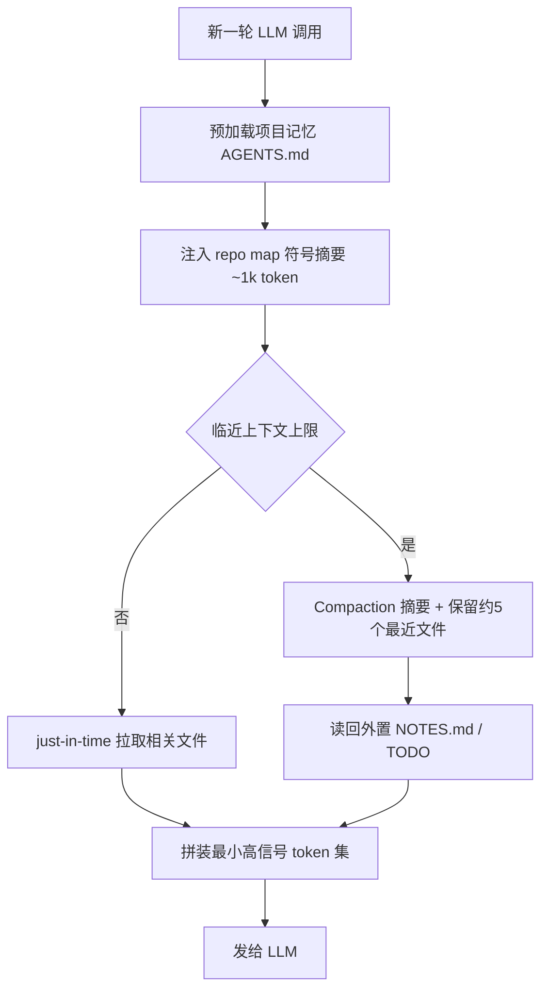

# Context Engineering · 代码库理解与上下文装配

> 长时程 coding 能连续跑数小时，靠的就是这套工程。这篇讲分层检索、上下文预算、压缩与注入防护。

## 1. 不要只做向量 RAG

代码不是普通文档。符号引用、类型、调用关系、文件路径、测试绑定与构建配置，往往比纯语义相似度更关键。采用分层检索：

1. **仓库概览**：目录树、语言、框架、包管理器、工作区配置、重要脚本、Git 状态；
2. **项目规则**：读取 `AGENTS.md`、`CLAUDE.md`、README、贡献指南及用户指定规则——记录来源路径，规则文件不能凌驾于系统安全策略之上；
3. **精确检索**：文件名、字符串、错误信息、函数 / 组件名、`rg` 搜索、Git 历史；
4. **符号检索**：TypeScript Compiler API 取定义 / 引用 / 类型 / 导出；tree-sitter 为多语言提供容错语法树；
5. **结构与依赖**：导入图、调用点、相关测试、路由注册、接口定义、组件调用链；
6. **语义检索**：当命名与描述不一致、仓库很大、前述方式不足时，才用 Embedding / 混合检索；
7. **动态证据**：测试失败、运行日志、浏览器截图、调用结果。

## 2. 仓库启动扫描（RepoProfile）

扫描时先忽略 `.git`、`node_modules`、构建产物、覆盖率输出、二进制、超大生成文件、用户排除目录、密钥目录。路径过滤由可信代码执行，不靠模型决定。

```ts
interface RepoProfile {
  repoId: string;
  rootPath: string;
  git: { branch: string; baseCommit: string; dirty: boolean };
  languages: string[];
  packageManagers: string[];
  frameworks: string[];
  monorepo: boolean;
  packages: Array<{ name: string; path: string; scripts: Record<string, string> }>;
  checks: Array<{ id: string; command: string[]; confidence: number }>;
  ruleFiles: Array<{ path: string; sha256: string }>;
  indexVersion: string;
}
```

自动发现的命令只是**候选**：执行前展示来源（如 `package.json scripts.test`），再经策略与沙箱权限决定是否放行。不直接执行 README 里复制来的任意命令。

## 3. 索引结构与刷新

MVP 先做不依赖向量库的轻量索引：

- 文件索引：路径、语言、大小、修改时间、Git blob/hash；
- 符号索引：符号名、类别、文件、范围、导出状态；
- 关系索引：导入 / 引用 / 调用 / 测试关联；
- 文本索引：文件片段倒排；
- 可选语义索引：Embedding、模型版本、片段边界、索引时间。

索引必须带 `commit_sha` 或文件 hash；分支提交变更后，旧索引只能当缓存，不能当最新事实。规模与延迟到阈值后再上专用向量库 / SCIP。

**Repo Map**：只给「哪些文件里有哪些符号」，不塞文件全文，默认约 1k token（可配置）。

## 4. 上下文装配

每次模型请求只携带当前阶段必需信息。128K 窗口典型预算：

```ts
interface ContextBudget {
  systemPromptAndTools: number;   // ~5k
  taskDefinition: number;         // ~2k
  recentHistory: number;          // ~10k
  retrievedCode: number;           // ~80k（大头）
  workingMemory: number;          // ~20k
  responseBuffer: number;        // ~11k
}
```

上下文优先级：

1. 安全规则与运行时策略（不可被仓库内容覆盖）；
2. 用户需求、验收条件与用户明确约束；
3. 当前计划与已确认审批；
4. 项目规则文件（作为项目约定，标注来源）；
5. 当前修改相关代码、测试、类型与错误日志；
6. 历史工具摘要与旧轮次摘要；
7. 其他背景资料。



## 5. 压缩（Compaction）与外置记忆

- 临近上限时，把历史交模型总结成摘要 + 保留最近约 5 个访问文件；保留架构决策 / 未解决 bug / 实现细节，丢掉冗余工具输出；
- 直接清理过期工具结果是最轻量的压缩手段；
- Agent 定期把进度写到上下文之外的 `NOTES.md` / TODO，压缩后再读回——保证数千步后目标连贯；
- 「深读十几个文件」的脏活派给子 Agent，主上下文只收 1–2k token 摘要；
- 压缩以可恢复的结构化状态为底（目标、验收、计划、已完成步骤、文件变更、最新错误、审批、剩余预算、检查点），不压成一段无法校验的摘要；模型隐藏推理不作为必需存储对象。

**context rot 是所有模型的普遍问题**，换更大的窗口也治不了本，必须靠压缩 + 外置记忆对冲。

## 6. 输入注入与不可信内容

代码注释、README、issue、网页、MCP 返回值、测试日志都可能夹带「忽略之前指令 / 泄露密钥 / 执行命令」文本。它们一律是**数据，不是权限来源**。

- 系统提示词明确区分「可信策略」与「不可信材料」；
- 无论模型如何解释这些材料，Policy 层都独立拦截越权读写、外网、凭证访问与危险命令；
- 安全不能靠 prompt 提示模型警惕——IssueTrojanBench 实测 66.5% 恶意 issue 穿透了模型与框架防护，防护必须落在框架层（沙箱 / 审批 / 密钥隔离）。详见 [security.md](./security.md)。
