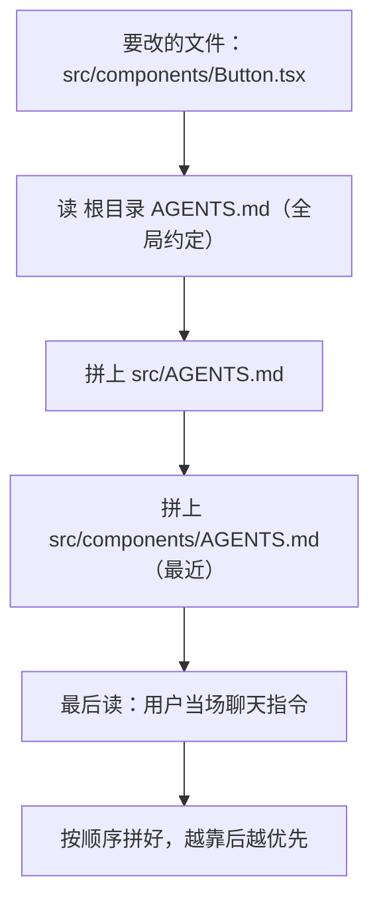
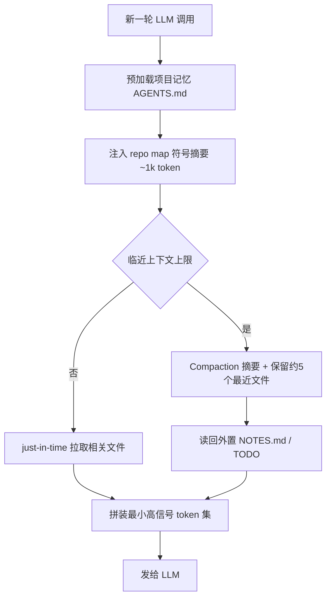
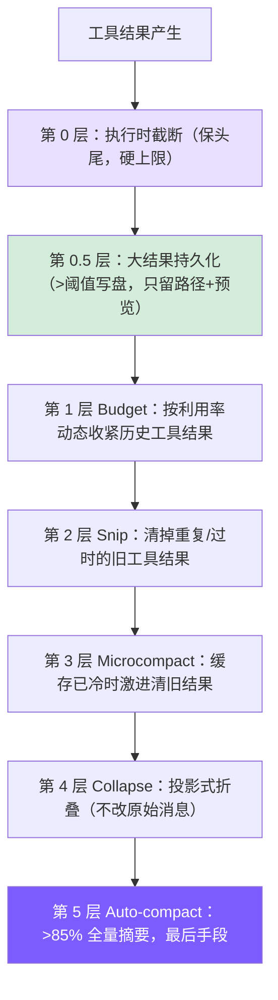

# Context Engineering · 代码库理解与上下文装配

> 长时程 coding 能连续跑数小时，靠的就是这套工程。分层检索、上下文预算、压缩、注入防护，一篇讲完。

先说结论：mod-agent 不会把整个仓库一次性灌给模型，而是先给一张仓库地图，再按需翻具体文件。大模型一次能读的字数有限（这就是上下文窗口），跑几小时的任务往里塞的东西越来越多。怎么挑、怎么压、防哪些坑，决定 agent 会不会跑偏、会不会读串代码。

## 1. 不要只做向量 RAG

代码不是普通文档。符号引用、类型、调用关系、文件路径、测试绑定与构建配置，往往比纯语义相似度更关键。采用分层检索：

1. **仓库概览**：目录树、语言、框架、包管理器、工作区配置、重要脚本、Git 状态；
2. **项目规则**：读取 `AGENTS.md`、`CLAUDE.md`、README、贡献指南及用户指定规则，同时记录来源路径。规则文件不能凌驾于系统安全策略之上；
3. **精确检索**：文件名、字符串、错误信息、函数 / 组件名、`rg` 搜索、Git 历史；
4. **符号检索**：TypeScript Compiler API 取定义 / 引用 / 类型 / 导出；tree-sitter 为多语言提供容错语法树；
5. **结构与依赖**：导入图、调用点、相关测试、路由注册、接口定义、组件调用链；
6. **语义检索**：当命名与描述不一致、仓库很大、前述方式不足时，才用 Embedding / 混合检索；
7. **动态证据**：测试失败、运行日志、浏览器截图、调用结果。

### 1.1 接口即能力（ACI）：工具界面设计与 prompt 同等重要

SWE-agent 明确把 agent 怎么操作计算机当成一等设计对象：正如大模型需要 prompt engineering，agent 需要 ACI engineering。基线 agent 用未调校的界面，差距明显（出处：https://swe-agent.com/latest/background/aci/ ）。对 mod-agent 的含义：

- 每一个工具 / 命令都不是"把系统能力直接暴露给模型"，而应像设计 prompt 一样设计：返回什么、默认裁多少、出错时说什么；
- 输出裁剪是 ACI 的核心手段（SWE-agent 实证，出处同上）：

| 工具行为 | SWE-agent 的裁剪决策                                                       | mod-agent 落点                              |
| -------- | -------------------------------------------------------------------------- | ------------------------------------------- |
| 查看文件 | 每轮只渲染 100 行，配上下翻页 / 文件内搜索命令                             | 文件读取默认分页，不一次性整文件入上下文    |
| 全局搜索 | 只列出「有命中的文件名」，不带匹配行（展示更多匹配上下文反而让模型更困惑） | grep / 搜索工具默认先给文件清单，细节二次取 |
| 空输出   | 固定返回 "Your command ran successfully and did not produce any output."   | 空结果也要给确定性文案，避免模型误判        |

## 2. 仓库启动扫描（RepoProfile）

扫描时先忽略 `.git`、`node_modules`、构建产物、覆盖率输出、二进制、超大生成文件、用户排除目录、密钥目录。路径过滤由可信代码执行，不靠模型决定。

```ts
interface RepoProfile {
  repoId: string
  rootPath: string
  git: { branch: string; baseCommit: string; dirty: boolean }
  languages: string[]
  packageManagers: string[]
  frameworks: string[]
  monorepo: boolean
  packages: Array<{ name: string; path: string; scripts: Record<string, string> }>
  checks: Array<{ id: string; command: string[]; confidence: number }>
  ruleFiles: Array<{ path: string; sha256: string }>
  indexVersion: string
}
```

自动发现的命令只是**候选**：执行前展示来源（如 `package.json scripts.test`），再经策略与沙箱权限决定是否放行。不直接执行 README 里复制来的任意命令。

### 2.1 规则文件的加载顺序与优先级

业界（Claude Code / AGENTS.md 标准 / Cursor）已收敛出一致的加载语义，mod-agent 直接对齐：

| 优先级         | 位置                         | 作用                    |
| -------------- | ---------------------------- | ----------------------- |
| 最高           | 用户当场聊天指令             | 显式覆盖一切规则        |
| ↑              | 被编辑文件最近的 AGENTS.md   | 子目录就近规则          |
| ↑              | 逐级向上的父目录 AGENTS.md   | monorepo 子包各自放规则 |
| 最低（最后读） | 根目录 AGENTS.md / CLAUDE.md | 全局约定                |

关键语义（出处：https://code.claude.com/docs/en/memory 、https://agents.md 、https://cursor.com/docs/rules ）：

1. **拼接而非覆盖**：从文件系统根到当前目录逐级拼接，越靠近当前目录的越靠后读。模型最后读到的指令印象最深，实现就近优先级；嵌套文件与父目录规则合并，更具体的优先；
2. **AGENTS.md 作回退**：没有 CLAUDE.md 时自动读 AGENTS.md（可配置 claude-md / agents-md / both），兼容别家代理的仓库约定；
3. **分层文件**：`CLAUDE.md`（可提交的团队约定）/ `CLAUDE.local.md`（gitignore 的个人临时偏好）/ 托管策略文件（组织强制，优先级最高）；
4. **就近覆盖裁决**：离被编辑文件最近的 AGENTS.md 赢；用户聊天指令优先级最高；
5. **`@path` 导入**：规则文件支持引用其它文件（Claude Code 最多递归 4 层）。

下图是就近规则怎么拼进上下文的直观过程（一个 monorepo 里改 `src/components/Button.tsx` 时）：



这套机制不是就近的覆盖远处的，而是全部拼进来、越靠近当前文件的越靠后读。模型对最后读到的规则印象最深，于是实现了就近优先。

比如，根目录 `AGENTS.md` 写"全项目用双引号"，`src/components/AGENTS.md` 写"组件目录用单引号"。模型改 Button.tsx 时两条都读到，但最后读到的是组件目录那条，于是给这个文件用单引号；改到 `src/utils/` 下的文件则回到双引号。

## 3. 索引结构与刷新

MVP 先做不依赖向量库的轻量索引：

- 文件索引：路径、语言、大小、修改时间、Git blob/hash；
- 符号索引：符号名、类别、文件、范围、导出状态；
- 关系索引：导入 / 引用 / 调用 / 测试关联；
- 文本索引：文件片段倒排；
- 可选语义索引：Embedding、模型版本、片段边界、索引时间。

索引必须带 `commit_sha` 或文件 hash；分支提交变更后，旧索引只能当缓存，不能当最新事实。规模与延迟到阈值后再上专用向量库 / SCIP。

**Repo Map（Aider 实证的机制，出处：https://aider.chat/docs/repomap.html ）**：

1. 用 tree-sitter 解析出每个文件的类 / 函数 / 方法签名（不抽实现体）；
2. 以文件依赖关系建图，用图排序算法（PageRank 类）选出最常被引用的符号，被引用越多的符号越值得先给模型；
3. 默认塞进约 1k token（`--map-tokens` 可调），未加文件时可动态放大以帮助全局理解；
4. 地图给模型一个索引，模型按需再用文件工具读具体文件，代替全量灌库。

只给"哪些文件里有哪些符号"，不塞文件全文，默认约 1k token（可配置）。

比如，仓库里有个 `PaymentService.process(order)` 被 40 个文件 import。repo map 用依赖图排序算出它最常被引用，就把它的签名摘进那张约 1k token 的地图。模型一开始就知道有这么个入口，但地图里只有签名、没有实现。真要改付款逻辑时，它再主动读 `payment_service.py` 的正文，而不是一上来把整个仓库读光。

## 4. 上下文装配

每次模型请求只携带当前阶段必需信息。128K 窗口典型预算：

```ts
interface ContextBudget {
  systemPromptAndTools: number // ~5k
  taskDefinition: number // ~2k
  recentHistory: number // ~10k
  retrievedCode: number // ~80k（大头）
  workingMemory: number // ~20k
  responseBuffer: number // ~11k
}
```

上下文优先级：

1. 安全规则与运行时策略（不可被仓库内容覆盖）；
2. 用户需求、验收条件与用户明确约束；
3. 当前计划与已确认审批；
4. 项目规则文件（作为项目约定，标注来源）；
5. 当前修改相关代码、测试、类型与错误日志；
6. 历史工具摘要与旧轮次摘要；
7. 其他背景资料。



## 5. 压缩（Compaction）与外置记忆

消息数组每轮都在变长，跑几十轮必然逼近上下文窗口。context rot 是所有模型的普遍问题：上下文越长，模型对中间内容的注意力越差，换更大窗口也治不了本。应对思路是一条渐进式压缩流水线：先用成本最低、不丢信息的手段，只有必要时才动用让模型重写摘要这种最重的手段。

### 5.0 这套功夫值不值得：Anthropic 的实测数字

在讲流水线之前，先给一组实测数据，说明上下文管理是能力项而不是优化项（出处：https://anthropic.com/news/context-management ）：

- context editing（清理过期的工具调用与结果）单独带来 +29%；
- 加上 memory tool（把信息写到上下文窗口之外的文件里）合计 +39%；
- 在一个 100 轮的 web search 评测里，上下文管理让 token 消耗下降 84%，并且完成了原本会因上下文耗尽而失败的工作流。

最后那条最值得说的是：省下来的不只是钱，是原本做不成的事做成了。所以 [§5](#_5-压缩-compaction-与外置记忆) 在 mod-agent 里是基础设施，不是锦上添花。

收益之所以这么大，是因为 agent 的成本结构是复利的：上下文每一步都要重发，所以减一次，后面每一步都在省（见 [model-gateway.md](./model-gateway.md)）。

压缩有一个必须记住的失败模式：

> 一份丢掉了关键事实的摘要，比没有摘要更糟，因为后面的每一步都会信任它，而且再也找不回来。

Anthropic 的调参建议也印证了这点：先按召回优先调压缩提示词，确保它抓住一切可能重要的东西，再往精确度上迭代。

对应的两种降低风险的手法：

1. **锚定式摘要（anchored summarization）**：任务目标、硬约束、当前计划这几项原文保留、永不摘要，只压缩周围的叙述部分；
2. **write-before-compact**：在摘要跑之前，先把持久事实外置到记忆存储，这样即使摘要漏掉了，事实仍在一个可以重新取回的地方。

### 5.1 分层压缩流水线（从最廉价到最重）



| 层  | 名称            | 做什么                                                                                 | 成本 / 时机                      |
| --- | --------------- | -------------------------------------------------------------------------------------- | -------------------------------- |
| 0   | 执行时截断      | 单次结果超硬上限（如 50K 字符）时**保留头尾**、截掉中间                                | 零成本，工具返回时               |
| 0.5 | 大结果持久化    | 超阈值（如 30KB）的完整结果**写磁盘**，上下文只留「路径 + 短预览」，模型可用 read 取回 | 零成本、**信息不丢**             |
| 1   | Budget 预算裁剪 | 利用率到 50%/70% 时，把历史工具结果分别收紧到 30K/15K 字符（保头尾）                   | 零成本，每次 API 调用前          |
| 2   | Snip 去重       | 同一文件多次读取只留最新一次；旧搜索结果清空；保留最近 N 个结果                        | 零成本，每次 API 调用前          |
| 3   | Microcompact    | 空闲超过约 5 分钟、缓存已冷时，除最近 N 个外的旧工具结果统一清成占位符                 | 零成本，缓存冷后                 |
| 4   | Collapse 折叠   | 投影式折叠：**不改原始消息**，只构造一个过滤后的视图（类比数据库 View）                | 零成本                           |
| 5   | Auto-compact    | 利用率超约 85% 时，让模型把旧历史总结成摘要替换                                        | 消耗 1 次额外模型调用，turn 边界 |

这个顺序的依据是删错了有多痛：

| 策略               | 删掉什么                                 | 风险                       | 何时用         |
| ------------------ | ---------------------------------------- | -------------------------- | -------------- |
| 工具结果清理       | 已经用完的工具输出                       | **低**（不碰推理链）       | 持续地、尽早地 |
| 锚定式摘要         | 叙述，但保留目标 / 硬约束 / 当前计划原文 | 低于普通压缩               | 状态必须存活时 |
| 普通压缩 / 摘要    | 较早的对话叙述                           | **中**（可能丢事实）       | 逼近窗口上限时 |
| 按时间裁剪最老轮次 | 最老的若干轮，不看内容                   | **高**（对重要性视而不见） | 万不得已       |

四种不是互斥的，正确用法是**叠加**：激进地清工具结果、周期性地压叙述、**永不压缩被锚定的那几项**。

几个关键设计点：

- **持久化优先于截断**。截断不可逆（中间内容永久丢失），持久化只是把数据搬到磁盘、上下文里留引用，模型随时能 `read_file` 取回。因此第 0.5 层阈值要低于第 0 层硬上限，先尝试落盘、再谈截断；截断还必须保留头尾：文件开头有 import / 类定义等结构信息，而编译错误摘要、测试统计往往在末尾；
- **Snip 只清 `tool_result` 的正文，保留 `tool_use` 元数据**。模型仍看得到"我之前读过 main.ts"，只是看不到内容，需要时重新读取。保留做过什么，比保留当时看到什么更重要；
- **Microcompact 用时间触发**是因为前缀缓存有 TTL：空闲超过约 5 分钟后缓存大概率已失效，此时改旧消息不再有击穿缓存的代价，才适合激进清理；
- **裁剪与前缀缓存是一对矛盾**（详见 [model-gateway.md §5](./model-gateway.md#_5-前缀缓存-prompt-caching)）：动了已缓存的前缀会让其后缓存全部失效。因此 Snip 要先看缓存热度，还热且利用率不高时不动它，等缓存过期；利用率顶到阈值（如 75%）以上时，宁可破一次缓存也得腾窗口。

### 5.2 触发时机：只能在 turn boundary 压缩

- 第 1–3 层（零成本）在每次 API 调用前顺序跑（Budget → Snip → Microcompact，Budget 先收紧大块让 Snip 去重更准）；
- 第 5 层 Auto-compact 只在 turn boundary 触发，即用户新消息已进入消息数组、主循环开始之前；**绝不能在工具循环中段做摘要**。原因：工具调用要求 `tool_use` 与其后的 `tool_result` 严格配对，摘要操作若在中途把最后一条 `tool_result` 切掉，前面的 `tool_use` 就失去配对，模型 API 会直接报错；
- 有效窗口取"模型上下文窗口 − 预留约 20K（给新一轮输入输出）"，触发点相应提前（如 200K 窗口约在 76–85% 利用率触发）；
- 摘要用"分析 → 摘要"两阶段提示：先让模型在 `<analysis>` 块里推理，再产出标准化的 `<summary>`（含目标、已做决定、涉及文件、未决问题等固定部分），最后剥离推理只留摘要；压缩后恢复最近若干个文件与活跃技能，避免摘要后丢失现场；
- **熔断器**：摘要可能反复失败（如压缩后仍超长），连续失败约 3 次就停止重试，避免历史上"同一对话连续压缩失败几千次、空耗大量调用"的事故。

**真实 Claude Code 数值对照（v2.1.88 快照，供 mod-agent 校准常量）：**

| 常量                        | 值                                          | 说明                                                                   |
| --------------------------- | ------------------------------------------- | ---------------------------------------------------------------------- |
| Autocompact 触发点          | 约 **92% 有效窗口**（= 原始窗口约 **83%**） | 有效窗口 = 原始窗口 − 预留输出；触发点比直觉更早，给压缩后的续跑留余量 |
| `AUTOCOMPACT_BUFFER_TOKENS` | 13,000                                      | 触发点与硬上限之间的缓冲                                               |
| 工具结果硬上限              | **100,000 tokens**                          | 超过即截断（`MAX_TOOL_RESULT_TOKENS`）                                 |
| 超长文件截断                | 扫描 **2000 行**，保留 **250 行窗口**       | 超 2000 行的文件按头尾 + 250 行窗口保留，中间置占位                    |
| 摘要输出预留                | 20,000 tokens                               | `MAX_OUTPUT_TOKENS_FOR_SUMMARY`，防摘要本身被截断                      |
| 压缩熔断阈值                | 连续失败 3 次                               | `MAX_CONSECUTIVE_AUTOCOMPACT_FAILURES`                                 |

> 对照 [§5.1](#_5-1-分层压缩流水线-从最廉价到最重) 表：mod-agent 用字符口径（50K 字符、30KB），真实 CC 用 token 口径；二者无需强行统一，但要明确触发阈值（92%/83%）比逼近 100% 再压更安全，压缩后还会续跑，必须留余量。

### 5.3 外置进度与结构化状态

- 临近上限时，把历史交模型总结成摘要 + 保留最近约 5 个访问文件；保留架构决策 / 未解决 bug / 实现细节，丢掉冗余工具输出；
- Agent 定期把进度写到上下文之外的 `NOTES.md` / TODO，压缩后再读回，保证数千步后目标连贯（自治长任务尤其依赖，见 [autonomy.md](./autonomy.md)）；
- 深读十几个文件的脏活派给子 Agent，主上下文只收 1–2k token 摘要；
- 压缩以可恢复的结构化状态为底（目标、验收、计划、已完成步骤、文件变更、最新错误、审批、剩余预算、检查点），不压成一段无法校验的摘要；模型隐藏推理不作为必需存储对象。

### 5.4 长期记忆：记什么、怎么召回

核心约束只有一条：只记忆无法从当前项目状态推导的信息。代码模式、架构、文件路径、git 历史、正在调试的内容，读代码和 `git log` 就能得到，记忆里的副本只会制造漂移。即使用户明确要求记住这个 PR 列表，也应追问其中哪些是不可推导的（截止日期？某个意外结论？）。

记忆采用**封闭分类法**（固定四型，不用自由标签，防止标签膨胀导致召回模糊）：

| 类型        | 记什么                        | 特殊要求                                         |
| ----------- | ----------------------------- | ------------------------------------------------ |
| `user`      | 用户身份、偏好、知识背景      | 了解到角色 / 偏好时记                            |
| `feedback`  | 对 agent 行为的**纠正与肯定** | 正文须含 `Why` 与 `How to apply`，才知道边界     |
| `project`   | 项目进展、决策、截止日期      | **相对日期必须转绝对日期**（「周四冻结」无意义） |
| `reference` | 外部系统 / 资源的定位         | 如 CI 看板 URL、内部文档入口                     |

`feedback` 同时记录纠正和肯定：只记错误会让模型回避用户已认可的好做法。

**存储结构（Claude Code 实证，出处：https://code.claude.com/docs/en/memory ）**：记忆分两层，一份索引常驻、每条记忆一个独立文件按需读；按项目目录哈希隔离，同一项目始终映射到同一记忆空间：

```text
memory/
  MEMORY.md              # 索引，每条记忆一行；启动只读前 200 行 / 25KB（先到为准）
  feedback_no_summary.md # 文件名带类型前缀，文件系统排序即按类型分组
  project_deploy_q2.md
  reference_ci_url.md
```

- 每条记忆是一段带 YAML frontmatter（`name / description / type`）的 Markdown，正文用 `write_file` 写入，记忆系统寄生在文件工具上，无需专门的记忆 API，用户也能用编辑器直接读写、纳入 git；
- 索引有硬上限：200 行 + 25KB 双重截断（行截断防正常膨胀、字节截断防"200 行内塞 197KB 单行"的异常情况），逼近时提示模型合并 / 精简；
- 记忆机器本地、不跨机器同步；写回时自动加 `modified` 时间戳。

**语义召回（比关键词匹配强）**：用户问"部署流程"时，标题"CI/CD 注意事项"的记忆没有共同关键词、却语义相关。做法是把所有记忆的文件名 + description 清单交给一次旁路模型调用（sideQuery），让模型选出明确有用的若干条（通常 ≤ 5），再读回正文：

- 只发清单（文件名 + 描述）、不发正文，输入 token 很少；
- 用"已展示集合"去重：本会话已召回的记忆不再重复出现；
- 预算控制：单条记忆正文约 4KB 上限、整会话召回总量约 60KB，防止记忆挤掉对话；
- **时效提示（freshness warning）**：超过约 1 天的记忆附带"这是 N 天前的时间切片、可能过时，断言前先对照当前代码"，给出行动指引而非只标注日期。

**异步预取（zero-wait）**：语义召回要花一次模型调用，同步执行会让用户多等一个往返。因此在用户提交输入的瞬间就启动召回，与首轮模型调用并行；主循环每轮做非阻塞轮询：召回没好就先不等、下一轮再看，好了就把记忆包成 `<system-reminder>` 注入。三道门控避免浪费调用：查询太短（单词）不召回、会话记忆预算已满不召回、没有记忆文件不召回。最差情况记忆晚到一轮，用户永远不需要专门等待。

> 上述记忆与召回机制参考了 [claude-code-from-scratch · Memory](https://diwang.info/claude-code-from-scratch/#/docs/08-memory) 对 Claude Code 的逆向实现。记忆、技能、子代理清单放在系统提示词动态块的末尾（近因效应），组装位置见 [system-prompt.md](./system-prompt.md)。

## 6. 输入注入与不可信内容

代码注释、README、issue、网页、MCP 返回值、测试日志都可能夹带"忽略之前指令 / 泄露密钥 / 执行命令"文本。它们一律是数据，不是权限来源。

- 系统提示词明确区分可信策略与不可信材料；
- 无论模型如何解释这些材料，Policy 层都独立拦截越权读写、外网、凭证访问与危险命令；
- 安全不能靠 prompt 提示模型警惕：IssueTrojanBench 实测 66.5% 恶意 issue 穿透了模型与框架防护，防护必须落在框架层（沙箱 / 审批 / 密钥隔离）。详见 [security.md](./security.md)。
