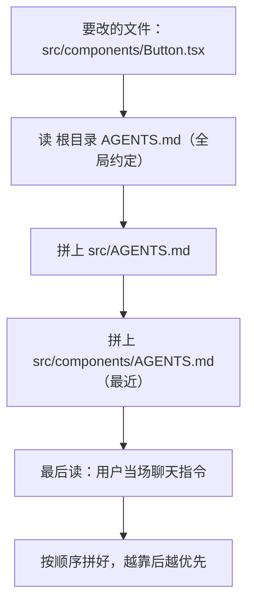
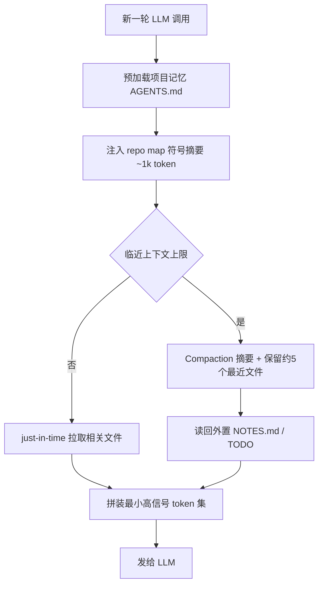

# Context Engineering · 代码库理解与上下文装配

> 长时程 coding 能连续跑数小时，靠的就是这套工程。这篇讲分层检索、上下文预算、压缩与注入防护。

如果说上一篇是「发动机」，这篇就是「给发动机喂什么油」。大模型一次能读的字数（上下文窗口）是有限的，跑几小时的任务塞进去的东西越来越多，怎么挑、怎么压、防什么坑，决定了 agent 会不会跑偏、会不会读串代码。读完你会知道：mod-agent 不是把整个仓库一次性灌给模型，而是像带新人认门——先给一张「仓库地图」，再让他按需翻具体文件。

## 1. 不要只做向量 RAG

代码不是普通文档。符号引用、类型、调用关系、文件路径、测试绑定与构建配置，往往比纯语义相似度更关键。采用分层检索：

1. **仓库概览**：目录树、语言、框架、包管理器、工作区配置、重要脚本、Git 状态；
2. **项目规则**：读取 `AGENTS.md`、`CLAUDE.md`、README、贡献指南及用户指定规则——记录来源路径，规则文件不能凌驾于系统安全策略之上；
3. **精确检索**：文件名、字符串、错误信息、函数 / 组件名、`rg` 搜索、Git 历史；
4. **符号检索**：TypeScript Compiler API 取定义 / 引用 / 类型 / 导出；tree-sitter 为多语言提供容错语法树；
5. **结构与依赖**：导入图、调用点、相关测试、路由注册、接口定义、组件调用链；
6. **语义检索**：当命名与描述不一致、仓库很大、前述方式不足时，才用 Embedding / 混合检索；
7. **动态证据**：测试失败、运行日志、浏览器截图、调用结果。

### 1.1 接口即能力（ACI）：工具界面设计与 prompt 同等重要

SWE-agent 明确把「agent 怎么操作计算机」当成一等设计对象：**正如大模型需要 prompt engineering，agent 需要 ACI engineering**——基线 agent 用未调校的界面表现大幅落后（出处：https://swe-agent.com/latest/background/aci/ ）。对 mod-agent 的含义：

- 每一个工具 / 命令都不是「把系统能力直接暴露给模型」，而应像设计 prompt 一样设计：返回什么、默认裁多少、出错时说什么；
- **输出裁剪是 ACI 的核心手段**（SWE-agent 实证，出处同上）：

| 工具行为 | SWE-agent 的裁剪决策 | mod-agent 落点 |
| --- | --- | --- |
| 查看文件 | 每轮只渲染 100 行，配上下翻页 / 文件内搜索命令 | 文件读取默认分页，不一次性整文件入上下文 |
| 全局搜索 | 只列出「有命中的文件名」，不带匹配行（展示更多匹配上下文反而让模型更困惑） | grep / 搜索工具默认先给文件清单，细节二次取 |
| 空输出 | 固定返回 "Your command ran successfully and did not produce any output." | 空结果也要给确定性文案，避免模型误判 |

## 2. 仓库启动扫描（RepoProfile）

扫描时先忽略 `.git`、`node_modules`、构建产物、覆盖率输出、二进制、超大生成文件、用户排除目录、密钥目录。路径过滤由可信代码执行，不靠模型决定。

```ts
interface RepoProfile {
  repoId: string;
  rootPath: string;
  git: { branch: string; baseCommit: string; dirty: boolean };
  languages: string[];
  packageManagers: string[];
  frameworks: string[];
  monorepo: boolean;
  packages: Array<{ name: string; path: string; scripts: Record<string, string> }>;
  checks: Array<{ id: string; command: string[]; confidence: number }>;
  ruleFiles: Array<{ path: string; sha256: string }>;
  indexVersion: string;
}
```

自动发现的命令只是**候选**：执行前展示来源（如 `package.json scripts.test`），再经策略与沙箱权限决定是否放行。不直接执行 README 里复制来的任意命令。

### 2.1 规则文件的加载顺序与优先级

业界（Claude Code / AGENTS.md 标准 / Cursor）已收敛出一致的加载语义，mod-agent 直接对齐：

| 优先级 | 位置 | 作用 |
| --- | --- | --- |
| 最高 | 用户当场聊天指令 | 显式覆盖一切规则 |
| ↑ | 被编辑文件最近的 AGENTS.md | 子目录就近规则 |
| ↑ | 逐级向上的父目录 AGENTS.md | monorepo 子包各自放规则 |
| 最低（最后读） | 根目录 AGENTS.md / CLAUDE.md | 全局约定 |

关键语义（出处：https://code.claude.com/docs/en/memory 、https://agents.md 、https://cursor.com/docs/rules ）：

1. **拼接而非覆盖**：从文件系统根到当前目录逐级拼接，越靠近当前目录的越靠后读——模型最后读到的指令印象最深，实现「就近优先级」；嵌套文件与父目录规则合并，更具体的优先；
2. **AGENTS.md 作回退**：没有 CLAUDE.md 时自动读 AGENTS.md（可配置 claude-md / agents-md / both），兼容别家代理的仓库约定；
3. **分层文件**：`CLAUDE.md`（可提交的团队约定）/ `CLAUDE.local.md`（gitignore 的个人临时偏好）/ 托管策略文件（组织强制，优先级最高）；
4. **就近覆盖裁决**：离被编辑文件最近的 AGENTS.md 赢；用户聊天指令优先级最高；
5. **`@path` 导入**：规则文件支持引用其它文件（Claude Code 最多递归 4 层）。

下图是「就近规则怎么拼进上下文」的直观过程（一个 monorepo 里改 `src/components/Button.tsx` 时）：



这张图在说什么：不是「就近的覆盖远处的」，而是全部拼进来、越靠近当前文件的越靠后读——模型对最后读到的规则印象最深，于是实现了「就近优先」。

举个例子（示意）：根目录 `AGENTS.md` 写「全项目用双引号」，`src/components/AGENTS.md` 写「组件目录用单引号」。模型改 Button.tsx 时两条都读到，但最后读到的是组件目录那条，于是给这个文件用单引号；改到 `src/utils/` 下的文件则回到双引号。

## 3. 索引结构与刷新

MVP 先做不依赖向量库的轻量索引：

- 文件索引：路径、语言、大小、修改时间、Git blob/hash；
- 符号索引：符号名、类别、文件、范围、导出状态；
- 关系索引：导入 / 引用 / 调用 / 测试关联；
- 文本索引：文件片段倒排；
- 可选语义索引：Embedding、模型版本、片段边界、索引时间。

索引必须带 `commit_sha` 或文件 hash；分支提交变更后，旧索引只能当缓存，不能当最新事实。规模与延迟到阈值后再上专用向量库 / SCIP。

**Repo Map（Aider 实证的机制，出处：https://aider.chat/docs/repomap.html ）**：

1. 用 tree-sitter 解析出每个文件的类 / 函数 / 方法签名（不抽实现体）；
2. 以「文件依赖关系」建图，用图排序算法（PageRank 类）选出最常被引用的符号——被引用越多的符号越值得先给模型；
3. 默认塞进约 1k token（`--map-tokens` 可调），未加文件时可动态放大以帮助全局理解；
4. 地图给模型「索引」，模型按需再用文件工具读具体文件——代替全量灌库。

只给「哪些文件里有哪些符号」，不塞文件全文，默认约 1k token（可配置）。

举个例子（示意）：仓库里有个 `PaymentService.process(order)` 被 40 个文件 import。repo map 用「依赖图排序」算出它最常被引用，就把它的签名摘进那张约 1k token 的地图。模型一开始就知道「有这么个入口」，但地图里只有签名、没有实现——真要改付款逻辑时，它再主动读 `payment_service.py` 的正文，而不是一上来把整个仓库读光。

## 4. 上下文装配

每次模型请求只携带当前阶段必需信息。128K 窗口典型预算：

```ts
interface ContextBudget {
  systemPromptAndTools: number;   // ~5k
  taskDefinition: number;         // ~2k
  recentHistory: number;          // ~10k
  retrievedCode: number;           // ~80k（大头）
  workingMemory: number;          // ~20k
  responseBuffer: number;        // ~11k
}
```

上下文优先级：

1. 安全规则与运行时策略（不可被仓库内容覆盖）；
2. 用户需求、验收条件与用户明确约束；
3. 当前计划与已确认审批；
4. 项目规则文件（作为项目约定，标注来源）；
5. 当前修改相关代码、测试、类型与错误日志；
6. 历史工具摘要与旧轮次摘要；
7. 其他背景资料。



## 5. 压缩（Compaction）与外置记忆

- 临近上限时，把历史交模型总结成摘要 + 保留最近约 5 个访问文件；保留架构决策 / 未解决 bug / 实现细节，丢掉冗余工具输出；
- 直接清理过期工具结果是最轻量的压缩手段；
- Agent 定期把进度写到上下文之外的 `NOTES.md` / TODO，压缩后再读回——保证数千步后目标连贯；
- 「深读十几个文件」的脏活派给子 Agent，主上下文只收 1–2k token 摘要；
- 压缩以可恢复的结构化状态为底（目标、验收、计划、已完成步骤、文件变更、最新错误、审批、剩余预算、检查点），不压成一段无法校验的摘要；模型隐藏推理不作为必需存储对象。

**context rot 是所有模型的普遍问题**，换更大的窗口也治不了本，必须靠压缩 + 外置记忆对冲。

**记忆文件结构（Claude Code 实证，出处：https://code.claude.com/docs/en/memory ）**：记忆分两层——一份索引常驻、每个记忆一个独立文件按需读：

```text
memory/
  MEMORY.md        # 索引，每条记忆一行；启动只读前 200 行 / 25KB（先到为准）
  <topic>.md       # 具体记忆（如 user_role.md），启动不加载，模型用文件工具自读
```

- 索引有硬上限，逼近时提示模型合并 / 精简，避免记忆越攒越长占爆上下文；
- 主题文件写回时自动加 `modified: ISO8601` 时间戳，方便判断时效；
- 记忆机器本地、不跨机器同步；不进会话清理。

## 6. 输入注入与不可信内容

代码注释、README、issue、网页、MCP 返回值、测试日志都可能夹带「忽略之前指令 / 泄露密钥 / 执行命令」文本。它们一律是**数据，不是权限来源**。

- 系统提示词明确区分「可信策略」与「不可信材料」；
- 无论模型如何解释这些材料，Policy 层都独立拦截越权读写、外网、凭证访问与危险命令；
- 安全不能靠 prompt 提示模型警惕——IssueTrojanBench 实测 66.5% 恶意 issue 穿透了模型与框架防护，防护必须落在框架层（沙箱 / 审批 / 密钥隔离）。详见 [security.md](./security.md)。
