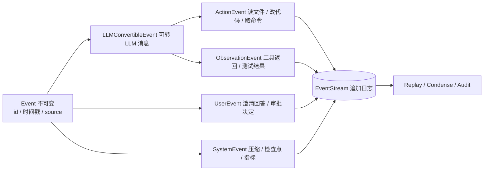
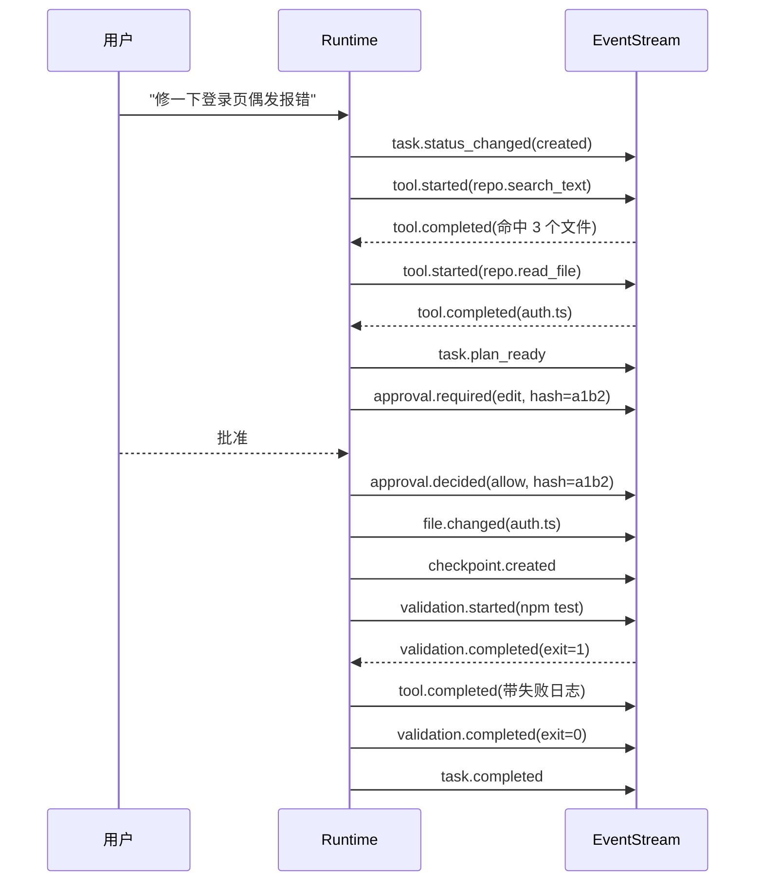
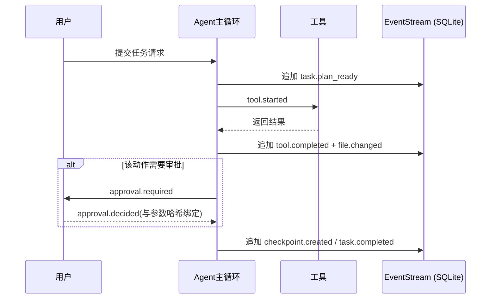

# Data & Events · 事件流与持久化

> 这篇讲一次任务的过程怎么落盘。一次任务做了什么、改了哪些文件、哪一步要审批，这些不能只放在聊天窗口的内存里，一关就没。mod-agent 把每一步都落成一条不可改的记录写进 SQLite，崩了能重放、出错能审计。
>
> 给设计存储层、任务状态机的人看。两件事先记住：状态为什么用追加事件而不是直接改一行数据库，审批为什么要和参数哈希绑死。

## 1. EventStream 事件模型

可以这样理解：EventStream（事件流）像一本只能往后翻页、写上去就不能改的流水账。所有状态 = 按时间排序的不可变事件序列（action + observation，即"动作"和"观察结果"），可 replay（重放）、condense（压缩）、audit（审计）。



事件包络（每条事件长这样）：

```ts
interface TaskEvent<T = unknown> {
  eventId: string // task_id + sequence 的稳定标识
  taskId: string
  seq: number // 同任务内自增序号
  type: string
  timestamp: string
  payload: T
}
```

事件类型：`task.status_changed`、`task.plan_ready`、`agent.message_delta`、`tool.started`、`tool.progress`、`tool.completed`、`approval.required`、`approval.decided`、`file.changed`、`validation.started`、`validation.completed`、`checkpoint.created`、`task.warning`、`task.completed`、`task.failed`、`task.cancelled`。

一次真实任务在流水账上长什么样（这几行合起来就是当时到底发生了什么的全部证据）：



没有哪一步是改一行状态字段就完事的，每一步都是追加一条新记录。所以崩溃后能重放到任意一点；审计时能回答第 7 步到底是谁批准的、批准的是什么参数。`approval.decided` 里那个 `hash=a1b2` 就是干这个用的（见 [§3](#_3-数据一致性规则)）。

> 不把每个 token 都永久写库：流式发送文本增量，但只持久化重要生命周期事件、完成消息与必要审计内容。
> 比如，agent 边想边往外蹦字，这些中间增量在屏幕上流式显示，但不会逐字写进数据库；真正落库的是任务开始了、工具跑完了、审批点了同意这种关键节点。

下面这张时序图画了"一次工具调用从发起到落库"会产生哪些事件：



每一步动作和它的结果都落成一条新事件往后追加，从不覆盖旧记录；凡是要审批的动作，问和答各记一条，而且答的那条和当时的参数哈希绑死，防止审批通过后模型偷偷把参数换掉。

### 1.1 事件化会话对象（OpenHands SDK 实证）

OpenHands 把一次交互抽象成一个 `Conversation` 对象（出处：https://github.com/OpenHands/software-agent-sdk ）。对外只暴露 `send_message` / `run`，内部把每一步产出为**不可变事件**（agent 动作 / 工具结果 / 状态更新），连同 conversation / workspace 一起被 SDK 拥有。对 mod-agent 的启示：

- 会话模型对齐：一个 `Conversation` 绑定一个 `workspace`，事件是 SDK 显式拥有的一等概念（"This repository owns agents, tools, conversations, workspaces, events, the REST/WebSocket API…"）；
- 工作区抽象为"本机目录"与"临时容器"两档（对应 [architecture.md](./architecture.md) 沙箱 / 运行时抽象）；
- 未核实项：OpenHands 具体事件枚举类型名（agent / observation / state 的确切命名清单）未在抓取到的页面逐条列示，本设计文档按自身事件类型表（见上）实现即可。

### 1.2 会话记录：用 parentUuid 串成一条链表（真实 Claude Code 证据）

除了进 SQLite 的结构化表，真实 Claude Code 每次运行还往本地写一份会话 transcript（JSONL）：`~/.claude/projects/<把工作目录转义的目录名>/<会话 id>.jsonl`。它本质是一条用 `parentUuid` 串起来的链表，每写一条消息盖上 `uuid` / `parentUuid` / 时间戳 / 类型等字段。三个精妙处：

- **工具结果的父指针指向发起它的那条 assistant 消息**，而不是物理上一条。某个工具结果能精确回溯到哪个 assistant turn 的哪次调用请求了它，因果是显式连边、不靠时间顺序猜；
- **压缩边界断物理链、留逻辑链**：压缩把一段历史换成摘要时，`parentUuid` 置空（物理断开，好让 prompt 缓存稳定），但另存 `logicalParentUuid` 保住原父指针，读时再桥接，压缩不破坏追踪的逻辑连续性；
- **`promptId` 只盖在用户消息行**（用户输入与工具结果回注行，这两种内部算 `user` 类型），作为定位锚点。

怎么从记录重建一次 prompt 的多个 turn：沿 `parentUuid` 走连边，从任意消息回溯到根，或从起点往下顺子边展开，就能把 assistant turn、它发起的工具调用、回来的结果层层连起来。`promptId` 是定位锚点、不是分组键（只在 user 行，按它分组会漏掉不带它的 assistant 行）。对 mod-agent：

- 本地 transcript 可作为 SQLite 之外的第二份、人类可读的审计/恢复格式（JSONL 追加写入，崩溃也不丢历史）；
- 子 agent / workflow 各写自己的文件，每条委派链的追踪分开（见 [verification-and-multiagent.md](./verification-and-multiagent.md)、[dynamic-workflows.md](./dynamic-workflows.md)）；
- 这是默认就在、不依赖遥测开关的那份 trace，对没有接 OTel 后端的单机用户尤其重要。

事件模型还有三处它的字段设计值得直接对齐（出处：https://code.claude.com/docs/en/headless 、https://code.claude.com/docs/en/sub-agents ，v2.1.300 核实）：

1. **每条消息带一个指向"谁发起我"的父调用 ID**。它的 `parent_tool_use_id` 有三种取值：主会话为 `null`、子代理产生的消息指向派生它的那次工具调用 ID、fork 型 skill 用固定前缀区分。有了这一个字段，一次混合输出的流就能按执行主体完整拆开，不需要额外的会话表。我们的 `EventEnvelope` 应当有等价的 `parentCallId`，并且**明确规定它可空**，而不是用 `agentId` 之类的字符串默认空值来混淆"主线程"与"未知"。
2. **会话起点事件是一份自描述体检单**。它的第一条事件把本次会话实际生效的东西全列出来：模型、工具集、每个 MCP server 的连接状态与配置来源、已加载插件、斜杠命令与 skill 清单、子代理清单、工作目录、程序版本、当前权限模式、API 凭证来源、能力位。这是把"环境装配结果"当成**事件而不是配置**来记，事后调试与"为什么这台机器行为不同"全靠它。我们的 `SessionStarted` 事件应当携带同等内容（配置指纹见 [system-prompt.md §1](./system-prompt.md)）。
3. **终止原因是枚举，不是布尔**。它的收尾事件用 `subtype` 区分 `success`、`error_max_turns`、`error_during_execution`、`error_max_budget_usd`、`error_max_structured_output_retries`，并带 `num_turns`、`duration_ms` 与 `duration_api_ms` 两个时长、`permission_denials` 拒绝清单。预算撞线、轮次撞线、执行中异常是三类不同的失败，[agent-loop.md §6](./agent-loop.md) 的循环防护要各自可辨，[usage.md §4](./usage.md) 的退出码也才有稳定语义。

## 2. 持久化表（SQLite）

PostgreSQL 是团队阶段的权威库；MVP 用 SQLite 落地同一套逻辑模型（先跑起来，逻辑不变，以后换库只换驱动）。

**`coding_tasks`**
`id`、`title`、`user_request`、`mode`、`status`、`risk_level`、`base_commit`、`worktree_ref`、`current_checkpoint_id`、`state_version`、`budget_json`、`usage_json`、`deadline_at`、`cancel_requested_at`、`last_error_code`、时间戳。

**`task_events`（追加式）**
`id`、`task_id`、`seq`、`event_type`、`payload_json`、`created_at`；唯一约束 `(task_id, seq)`，避免可变 JSON 覆盖历史审计。

**`task_checkpoints`**
`id`、`task_id`、`version`、`status`、`plan_json`、`completed_steps_json`、`context_summary_json`、`workspace_snapshot_ref`、`created_at`。存储可恢复状态及引用；Git commit / worktree 承担代码快照，不存整仓镜像。

**`tool_calls`**
`id`、`task_id`、`step_id`、`tool_name`、`input_json_redacted`、`input_hash`、`status`、`idempotency_key`、`started_at`、`finished_at`、`duration_ms`、`result_ref`、`error_code`、`retry_count`。

**`approvals`**
`id`、`task_id`、`tool_call_id`、`action_type`、`request_summary`、`parameter_hash`、`policy_version`、`status`、`requested_at`、`expires_at`、`decided_by`、`decided_at`、`decision_reason`。

**`task_artifacts`**
`id`、`task_id`、`kind`、`uri`、`sha256`、`size_bytes`、`metadata_json`、`created_at`（日志、截图、报告等）。

**`repo_index_snapshots`**
`id`、`workspace_id`、`commit_sha`、`index_version`、`status`、`artifact_uri`、`created_at`。

## 3. 数据一致性规则

- 每次状态转换带 `state_version` 乐观锁，防两个执行方同时推进任务；
  > 通俗地说：乐观锁 = "我基于版本 5 改的，如果改之前版本已经变成 6 了，说明别人动过，我这次不算数"。
- 每任务任一时刻只有一个有效执行租约，租约可续期、过期回收；
- 工具调用开始与结果分别持久化；结果未知的非幂等调用进入 `outcome_unknown`，而非自动标失败后重试；
  > 比如，agent 已经发出创建 PR 的请求，但网络断了，不知道服务端到底建没建。这时不能盲目重试，万一第一次其实成功了，重试就建出两个 PR。正确做法是记成结果未知，等人或去查一下再决定。
- 事件按 `seq` 发送，断线后可从序号补拉；
- 审批只生效一次并与 `parameter_hash` 绑定，防审批后模型偷偷改操作参数；
- 每次状态转换在同一事务里"更新状态 + 追加事件"；
- 保存期限、源码 / 日志脱敏、租户隔离与删除策略在部署前定稿。

## 4. 长期记忆

会话结束后异步整理记忆：去重、压缩、带锁防并发。项目级记忆写入 `AGENTS.md`（分层：全局 / 项目 / 子目录随访问路径注入）；NOTES/TODO 由 Agent 在任务中持续维护，压缩后读回。详见 [context-engineering.md](./context-engineering.md)。

### 4.1 为什么直接采用 AGENTS.md（开放标准实证）

决策：mod-agent 以 `AGENTS.md` 为项目指令文件第一公民，不自创私有文件（如 `.modagent.md`）。依据（出处：https://agents.md ）：

- AGENTS.md 是开放格式（无必填字段、普通 Markdown），已被 6 万+ 开源项目采用，现由 Linux 基金会旗下 Agentic AI Foundation（AAIF）托管；
- 主流工具已原生兼容：GitHub Copilot coding agent、Devin、Factory、Cursor、Codex、Gemini CLI、Windsurf、Zed、Warp、VS Code 等；
- 官方明确 "Rather than introducing another proprietary file, we chose a name and format that could work for anyone"：跟着标准走，用户跨工具复用同一份项目规则；
- 加载语义：离被编辑文件最近的 AGENTS.md 优先，用户当场聊天指令优先级最高，支持 monorepo 嵌套（详见 [context-engineering.md §2.1](./context-engineering.md#_2-1-规则文件的加载顺序与优先级)）。

> 比如，仓库根放一份全局 `AGENTS.md`（如"用 pnpm 不用 npm"），`frontend/` 目录再放一份专门约束前端的。agent 改 `frontend/components/X.tsx` 时，会把根目录和 `frontend/` 的两份规则都读进来，离文件更近的那份优先级更高。

**兼容读取策略（Devin 实证，出处：https://docs.devin.ai/cli/reference/configuration/config-file ）**：Devin 提供 `read_config_from` 开关，可选择性导入 `AGENTS.md`（含 `AGENTS.local.md`、历史名 `AGENT.md`、`.windsurfrules`）以及 Cursor / Windsurf / Claude / OpenCode / Zed 等竞品的规则文件。mod-agent 启动时同样以开关方式兼容读取 `AGENTS.md` + 已知竞品规则文件，逐项可关。

**记忆目录结构（Claude Code 实证，出处：https://code.claude.com/docs/en/memory ）**：记忆分两层，一份索引常驻、每个记忆一个独立文件按需读；索引有硬上限（前 200 行 / 25KB 先到为准），主题文件写回时自动加 `modified: ISO8601` 时间戳（详见 [context-engineering.md §5](./context-engineering.md#_5-压缩-compaction-与外置记忆)）。
