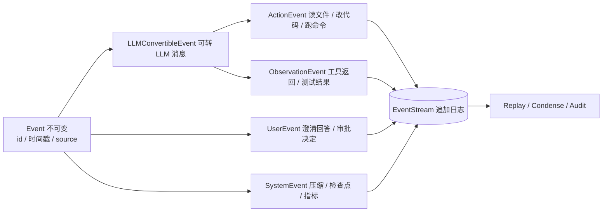

# Data & Events · 事件流与持久化

> 任务状态不能只存在内存的对话历史里。这篇讲 append-only 事件模型、SQLite 持久化与一致性规则。

## 1. EventStream 事件模型

所有状态 = 按时间排序的不可变事件序列（action + observation），可 replay / condense / audit。



事件包络：

```ts
interface TaskEvent<T = unknown> {
  eventId: string;        // task_id + sequence 的稳定标识
  taskId: string;
  seq: number;
  type: string;
  timestamp: string;
  payload: T;
}
```

事件类型：`task.status_changed`、`task.plan_ready`、`agent.message_delta`、`tool.started`、`tool.progress`、`tool.completed`、`approval.required`、`approval.decided`、`file.changed`、`validation.started`、`validation.completed`、`checkpoint.created`、`task.warning`、`task.completed`、`task.failed`、`task.cancelled`。

> 不把每个 token 都永久写库：流式发送文本增量，但只持久化重要生命周期事件、完成消息与必要审计内容。

### 1.1 事件化会话对象（OpenHands SDK 实证）

OpenHands 把一次交互抽象成一个 `Conversation` 对象（出处：https://github.com/OpenHands/software-agent-sdk ）——对外只暴露 `send_message` / `run`，内部把每一步产出为**不可变事件**（agent 动作 / 工具结果 / 状态更新），连同 conversation / workspace 一起被 SDK 拥有。对 mod-agent 的启示：

- 会话模型对齐：一个 `Conversation` 绑定一个 `workspace`，事件是 SDK 显式拥有的一等概念（"This repository owns agents, tools, conversations, workspaces, events, the REST/WebSocket API…"）；
- 工作区抽象为「本机目录」与「临时容器」两档（对应 [architecture.md](./architecture.md) 沙箱 / 运行时抽象）；
- 未核实项：OpenHands 具体事件枚举类型名（agent / observation / state 的确切命名清单）未在抓取到的页面逐条列示，本设计文档按自身事件类型表（见上）实现即可。

## 2. 持久化表（SQLite）

PostgreSQL 是团队阶段的权威库；MVP 用 SQLite 落地同一套逻辑模型。

**`coding_tasks`**
`id`、`title`、`user_request`、`mode`、`status`、`risk_level`、`base_commit`、`worktree_ref`、`current_checkpoint_id`、`state_version`、`budget_json`、`usage_json`、`deadline_at`、`cancel_requested_at`、`last_error_code`、时间戳。

**`task_events`（追加式）**
`id`、`task_id`、`seq`、`event_type`、`payload_json`、`created_at`；唯一约束 `(task_id, seq)`，避免可变 JSON 覆盖历史审计。

**`task_checkpoints`**
`id`、`task_id`、`version`、`status`、`plan_json`、`completed_steps_json`、`context_summary_json`、`workspace_snapshot_ref`、`created_at`。存储可恢复状态及引用；Git commit / worktree 承担代码快照，不存整仓镜像。

**`tool_calls`**
`id`、`task_id`、`step_id`、`tool_name`、`input_json_redacted`、`input_hash`、`status`、`idempotency_key`、`started_at`、`finished_at`、`duration_ms`、`result_ref`、`error_code`、`retry_count`。

**`approvals`**
`id`、`task_id`、`tool_call_id`、`action_type`、`request_summary`、`parameter_hash`、`policy_version`、`status`、`requested_at`、`expires_at`、`decided_by`、`decided_at`、`decision_reason`。

**`task_artifacts`**
`id`、`task_id`、`kind`、`uri`、`sha256`、`size_bytes`、`metadata_json`、`created_at`（日志、截图、报告等）。

**`repo_index_snapshots`**
`id`、`workspace_id`、`commit_sha`、`index_version`、`status`、`artifact_uri`、`created_at`。

## 3. 数据一致性规则

- 每次状态转换带 `state_version` 乐观锁，防两个执行方同时推进任务；
- 每任务任一时刻只有一个有效执行租约，租约可续期、过期回收；
- 工具调用开始与结果分别持久化；结果未知的非幂等调用进入 `outcome_unknown`，而非自动标失败后重试；
- 事件按 `seq` 发送，断线后可从序号补拉；
- 审批只生效一次并与 `parameter_hash` 绑定，防审批后模型偷偷改操作参数；
- 每次状态转换在同一事务里「更新状态 + 追加事件」；
- 保存期限、源码 / 日志脱敏、租户隔离与删除策略在部署前定稿。

## 4. 长期记忆

会话结束后异步整理记忆：去重、压缩、带锁防并发。项目级记忆写入 `AGENTS.md`（分层：全局 / 项目 / 子目录随访问路径注入）；NOTES/TODO 由 Agent 在任务中持续维护，压缩后读回。详见 [context-engineering.md](./context-engineering.md)。

### 4.1 为什么直接采用 AGENTS.md（开放标准实证）

**决策：mod-agent 以 `AGENTS.md` 为项目指令文件第一公民，不自创私有文件**（如 `.modagent.md`）。依据（出处：https://agents.md ）：

- AGENTS.md 是**开放格式**（无必填字段、普通 Markdown），已被 6 万+ 开源项目采用，现由 Linux 基金会旗下 Agentic AI Foundation（AAIF）托管；
- 主流工具已原生兼容：GitHub Copilot coding agent、Devin、Factory、Cursor、Codex、Gemini CLI、Windsurf、Zed、Warp、VS Code 等；
- 官方明确「Rather than introducing another proprietary file, we chose a name and format that could work for anyone」——跟着标准走，用户跨工具复用同一份项目规则；
- 加载语义：**离被编辑文件最近的 AGENTS.md 优先**；用户当场聊天指令优先级最高；支持 monorepo 嵌套（详见 [context-engineering.md](./context-engineering.md) §2.1）。

**兼容读取策略（Devin 实证，出处：https://docs.devin.ai/cli/reference/configuration/config-file ）**：Devin 提供 `read_config_from` 开关，可选择性导入 `AGENTS.md`（含 `AGENTS.local.md`、历史名 `AGENT.md`、`.windsurfrules`）以及 Cursor / Windsurf / Claude / OpenCode / Zed 等竞品的规则文件。mod-agent 启动时同样以开关方式兼容读取 `AGENTS.md` + 已知竞品规则文件，逐项可关。

**记忆目录结构（Claude Code 实证，出处：https://code.claude.com/docs/en/memory ）**：记忆分两层——一份索引常驻、每个记忆一个独立文件按需读；索引有硬上限（前 200 行 / 25KB 先到为准），主题文件写回时自动加 `modified: ISO8601` 时间戳（详见 [context-engineering.md](./context-engineering.md) §5）。
