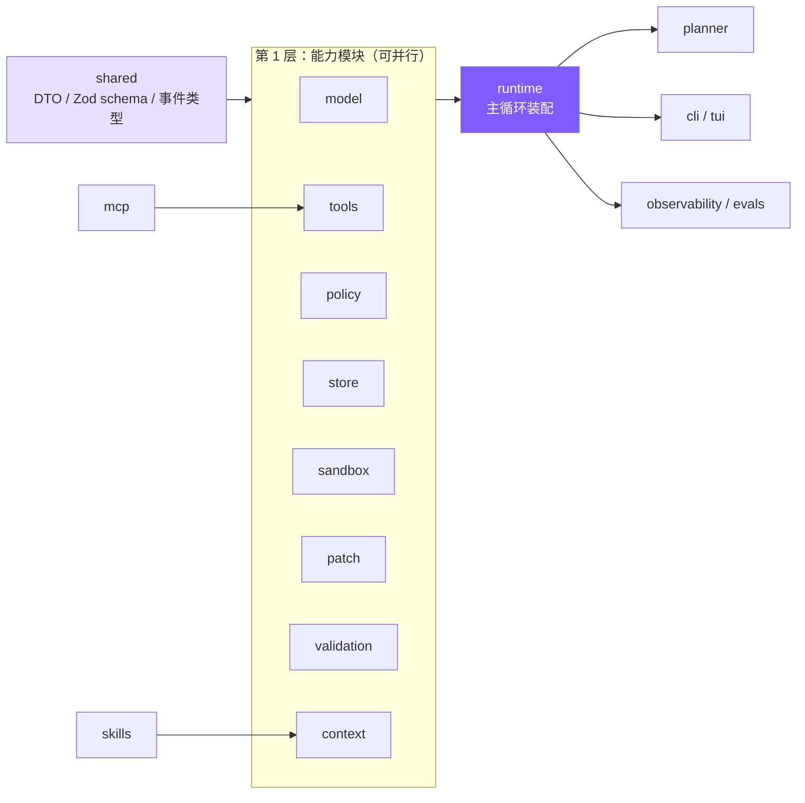

# Development Guide · 开发者实现指南

> 这篇是实现手册。[architecture.md](./architecture.md) 说明系统边界，[roadmap.md](./roadmap.md) 说明阶段验收；这里说明怎样从空目录实现第一个可运行循环：先创建哪些文件、模块怎样调用、ADR 在代码中如何体现，以及常见错误在哪里。
>
> 给准备动手写 `src/` 的人看。仓库协作那一套（环境安装、Git 钩子、提交信息、文档站硬性规则）在根目录 `CONTRIBUTING.md` 里，本文一行不重复。

先给出结论：先用一个模拟模型接上两个真实工具，让循环运行起来，再逐步替换为完整实现。主循环的关卡顺序、事件流形状和权限判定输入，都需要在真实循环中验证；只搭目录和接口，无法证明这些边界正确。

## 1. 这篇解决什么问题

现有三份文档已经把相邻的地盘占了，这篇填的是它们中间的空隙。

| 文档                                 | 回答的问题                                                                                               | 不回答的部分                 |
| ------------------------------------ | -------------------------------------------------------------------------------------------------------- | ---------------------------- |
| `CONTRIBUTING.md`（仓库根）          | 仓库怎么协作：环境、Git 钩子、提交信息、文档站硬性规则                                                   | agent 本体怎么写，一行都没讲 |
| [architecture.md](./architecture.md) | 目标结构与决策：六层、17 个 `src/` 模块、8 条 ADR、6 条边界约束                                          | 实现顺序，代码长什么样       |
| [roadmap.md](./roadmap.md)           | 排期与验收：Phase 0–8 的实现 / 验收两段、七步优先顺序、MVP 清单                                          | 每个模块内部的原理           |
| 本文                                 | 把静态结构、阶段排期、各专题机制串成一条实现线：先写哪个文件、谁调用谁、ADR 的代码形状、这一步容易错什么 | 排期承诺、仓库协作规范       |

换句话说，architecture 定义结构，roadmap 定义阶段；本文回答实现问题：第一天创建哪些文件、`runtime` 按什么顺序调用依赖，以及一条 ADR 对应哪类代码约束。

阅读顺序按编号走就有意义：§2 是动手前的底线，§3 决定 PR 怎么切，§4 是第 1 天到第 3 天的目标，§5 到 §7 处理三件绕不开的事（事件溯源、工具契约、权限引擎），§8 给每个模块的完工定义，§9 在卡住或觉得不对劲时查，§10 与 §11 是命令与延伸。

## 2. 动手前要知道的五条硬约束

这五条从 architecture.md 的 8 条 ADR 里挑出来，筛选标准只有一条：违反它，写出来的代码要整块返工。

1. **只有一个主循环**（ADR-1）。`runtime` 里那个推进器是系统唯一的动力来源，子任务是它调用的一个工具。违反会怎样：第二个循环一旦绕过它，暂停、取消、预算三个开关就有半边失效，表现为"用户按了停止，还有命令在跑"。两处代码各自看都合法，事后极难定位。
2. **事件日志是唯一事实源**（ADR-2）。状态是事件算出来的投影，不是一个能直接改的字段。违反会怎样：内存里留一份账本、库里再留一份，崩溃恢复时两份对不上，出现界面显示已完成而 `coding_tasks.status` 还是 `executing`。`store` 那条"同一事务里更新状态 + 追加事件"的边界约束就是防这个。
3. **工具契约是结构化的**（ADR-3，加上 ADR-8 的入参校验那一半）。入参过 Zod，命令拆成 `executable` 与 `args[]` 两个字段，不是一整段字符串。违反会怎样：策略引擎只能对字符串做正则，`&&` 串联、`bash -c` 包裹、引号转义，任一样都能绕过去。
4. **状态外置，任何一轮都可恢复**（ADR-5）。每轮工具结束后落检查点。违反会怎样：任务在审批处挂起之后接不上，用户等 40 分钟白跑一轮；审计问题"第 7 步是谁批的、批的什么参数"也答不出来。
5. **权限判定独立于模型**（ADR-8 的判定那一半）。允不允许做这件事，由 `policy` 读配置规则决定，模型的自然语言自述、仓库文件里的注释、MCP 工具描述都不进它的输入。违反会怎样：IssueTrojanBench 那个 66.5% 的穿透率会原样落到你头上（[security.md](./security.md) §2），而且你没法给"它为什么这么判"写测试。

第 2 条和第 5 条在 §4 的最小循环里就用得上。它们属于第 1 天就得选对形状的决策，不是后面补的优化项。

## 3. 模块依赖顺序

architecture.md §5 那 17 个目录不是并列关系。两条事实决定拓扑：`runtime` 不 import 具体实现、只依赖注入进来的接口（architecture.md §6），所以能力模块之间可以并行；但"能跑起来"所需的最小集合，比 17 个小得多。



关键路径（最长、也最该先做的那条）：

```text
shared → model（先用假 provider）→ tools → policy → runtime → store
```

三条理由说明为什么是这个顺序：

- `policy` 必须在 `runtime` 之前成型。循环里 `policy.evaluate` 这个调用点不能等最后补，先写一个只有 `allow` 与 `ask` 两档的桩，也比让循环裸跑工具强，后面所有审批语义都挂在这一个点上。
- `store` 在关键路径上，但允许被顶替一次。第一个循环可以用一个内存数组假扮事件流，等要验证恢复语义时再换成 SQLite。假的那份必须走同一个接口，否则换库等于重写循环。
- `tools` 的契约形状是唯一不能凑合的。§8 里每条断言都打在 `ToolExecutionResult` 上，工具返回改一次形，测试全要跟着改。

哪些可以并行：`sandbox`、`patch`、`validation` 三块从第 1 天就能独立写。`context` 的前半段（规则拼接与检索）可并行，后半段（压缩）要等 `store` 与消息数组稳定。`cli` 与 `tui` 放最后，roadmap.md §2 第 1 步就是这个意思：先做纵向原型，先不做漂亮界面。`mcp`、`skills`、`observability`、`evals` 是外沿，任何时间插进来都不动主干。

## 4. 第一个能跑的最小循环

目标定得比听起来小：不接真模型、不建数据库表、不做审批界面。让一个假 provider 驱动一次真工具调用，把结果喂回消息数组，第二轮拿到 final。跑通这个，剩下的活都是往循环里加关卡。

要写的东西只有四样：`shared/` 里的三份契约（工具、决策、事件，字段沿用现有文档的名字，别新造一套）、两个真工具（`repo.read_file` 与 `repo.search_text`，后者内部跑 `rg`）、一个按脚本吐决策的假 provider、一个产事件的异步生成器 `query()`。

下面所有代码都是示意骨架，重点是形状，不追求可编译。契约的样子（完整字段见 [tools-and-extensions.md](./tools-and-extensions.md) §2 与 §3）：

```ts
// src/shared/contracts.ts
export interface AgentTool<I = unknown> {
  name: string // 带命名空间，如 repo.read_file
  description: string
  inputSchema: ZodType<I>
  risk: "read" | "workspace_write" | "command" | "external_side_effect"
  idempotency: "safe" | "keyed" | "non_idempotent"
  timeoutMs: number
  isConcurrencySafe: (input: I) => boolean
  execute(input: I, ctx: ToolCtx): Promise<ToolExecutionResult>
}
```

模型这一轮的输出先被 Zod 抓住形状，才谈得上执行：

```ts
const decisionSchema = z.discriminatedUnion("type", [
  z.object({ type: z.literal("final"), summary: z.string() }),
  z.object({
    type: z.literal("tool_use"),
    callId: z.string(),
    toolName: z.string(),
    args: z.record(z.unknown()),
  }),
])
```

工具与注册表。注意 `path` 上那条 `startsWith("/")`：路径约束落在 schema 里，不落在提示词里。

```ts
const readTool: AgentTool<ReadInput> = {
  name: "repo.read_file",
  description: "读取授权工作区内的文本文件，返回带行号的分页片段",
  risk: "read",
  idempotency: "safe",
  timeoutMs: 5_000,
  inputSchema: z.object({
    path: z.string().startsWith("/"),
    limit: z.number().int().positive().max(2_000).default(200),
  }),
  isConcurrencySafe: () => true,
  async execute({ path, limit }, ctx) {
    const text = await readFile(path, "utf8")
    return ok(ctx.callId, this.name, clipByTokens(text, ctx.budgetTokens, { head: 0.6, tail: 0.4 }))
  },
}

const registry = new Map<string, AgentTool>()
export function registerTool(tool: AgentTool): void {
  if (registry.has(tool.name)) throw new Error(`duplicate tool: ${tool.name}`)
  registry.set(tool.name, tool)
}
```

假 provider（下面叫 `ScriptedProvider`）就是一个实现 `ModelProvider` 的类：`generate()` 按数组顺序吐预设决策，数组空了就抛 `script exhausted`，因为脚本被耗尽说明循环没在该停的地方停下。整条链路因此能离线跑，§8 的自测全靠它。

循环本体。四步走：问模型、拿决策、过关、回灌。

```ts
export async function* query(task: TaskState, deps: Deps): AsyncGenerator<TaskEvent> {
  const messages: Message[] = [...task.messages]
  while (true) {
    const res = await deps.model.generate({ messages, tools: schemasOf(registry) }, deps.signal)
    const d = decisionSchema.parse(res.decision)
    if (d.type === "final") {
      yield evt(task.id, "task.completed", { summary: d.summary })
      return
    }
    const tool = registry.get(d.toolName)
    if (!tool) {
      // 工具错误是数据，不是异常：模型有机会把自己编的工具名改对
      messages.push(toolResult(d.callId, `Unknown tool: ${d.toolName}`, true))
      continue
    }
    const permit = deps.policy.evaluate({ task, tool, args: d.args })
    if (permit.decision === "deny") {
      messages.push(toolResult(d.callId, "Denied by policy.", true))
      continue
    }
    if (permit.decision === "ask") {
      // 存下审批请求就退出，不阻塞线程；批准后由调度器从同一检查点恢复
      yield evt(task.id, "approval.required", { tool: tool.name, parameterHash: hash(d.args) })
      return
    }
    yield evt(task.id, "tool.started", { callId: d.callId, tool: tool.name })
    const result = await runWithTimeout(tool, d.args, deps.signal)
    messages.push(toolResult(result.callId, render(result), result.status !== "succeeded"))
    yield evt(task.id, "tool.completed", { callId: result.callId, status: result.status })
  }
}
```

跑通的判据，四条全过才算这一节做完：

- [ ] `ScriptedProvider` 喂两步（`tool_use(repo.read_file)` 然后 `final`），不联网跑完整个循环；
- [ ] 第二条决策能看到 `read_file` 的正文（把 `messages` 打出来核对，这一步能抓出配对错误）；
- [ ] 把工具名改成一个不存在的，循环不死，模型收到 `Unknown tool`；
- [ ] 把 `policy` 配成 `ask`，函数在 `approval.required` 处 return，而不是挂在那里等。

这一步最容易写错三件事，都不是难实现、是难想到：

1. `tool_use` 与 `tool_result` 的配对。Anthropic 侧靠 `tool_use_id` 放在 user 消息里，OpenAI 侧靠独立 `role: "tool"` 消息，两边格式不同、顺序要求相同（[model-gateway.md](./model-gateway.md) §1.2）；
2. 工具异常向上抛。抛出来循环就断了，正确做法是转成 `is_error` 的结果回喂（agent-loop.md §2.3）；
3. 流式响应还没结束就执行写操作。只读工具可以提前起跑，写操作和命令必须等响应完整、权限确认之后再跑。

## 5. 事件溯源怎么落地

唯一事实源落到代码上是四件具体的事：一张只追加的表、一个纯函数 replay、一层快进用的检查点、一条不重复外部副作用的恢复规则。按这个顺序做，每一步都能单独验。

第一件，仓储只开口在 append 与 read 上，接口层面就不留改历史的路：

```ts
export interface EventStream {
  // 有意不提供 update / delete：事实改不了，只能追加新事实
  append(taskId: string, events: TaskEvent[]): Promise<number>
  readSince(taskId: string, seq: number): Promise<TaskEvent[]>
  transition(taskId: string, to: TaskStatus, ev: TaskEvent, version: number): Promise<void>
}
```

`append` 与 `transition` 都在一个事务里跑：事件按 `seq` 插入 `task_events`，命中 `(task_id, seq)` 唯一约束就整体回滚；`transition` 带上你读到的 `state_version`，版本对不上说明另一个执行方动过，这次转换作废。表结构与一致性规则见 [data-and-events.md](./data-and-events.md) §2 与 §3。

第二件，replay 是纯函数：

```ts
export function replay(events: TaskEvent[], checkpoint?: Checkpoint): Message[]
```

两条断言够用：`replay(全部事件)` 与运行时手里的 `messages` 相等；`replay(检查点之后)` 加上检查点也相等。这条函数一旦需要读全局状态或者发请求，事件溯源就已经破了，测试会先抓住你。

第三件，检查点是快进，不是第二份账本。恢复等于取最新检查点再接着 replay。检查点里存引用（`workspace_snapshot_ref`、`context_summary_json`）而不是原文。把当前 diff 整段塞进 `task_checkpoints` 是这一层最常见的写错方式，那张表会悄悄变成第二个事实源。

第四件，恢复后不重复发起外部副作用。规则是先看有没有未闭合的工具调用，再决定重跑、查证还是停下来：

```ts
async function resume(taskId: string, deps: Deps): Promise<void> {
  for (const call of await deps.store.openToolCalls(taskId)) {
    if (call.idempotency === "safe")
      await deps.rerun(call) // 只读工具，重跑无害
    else if (await deps.probe(call))
      await deps.adopt(call) // 能查证的先查证：PR 到底建了没
    else await deps.markOutcomeUnknown(call) // 结果未知：进终态、问人，不自动重放
  }
  await deps.runTask(taskId)
}
```

`outcome_unknown` 是一个终态，必须写进事件日志。把它当成 `failed` 然后自动重试，就等着建出两个 PR。这段判断只能放在 `store` 与 `tools` 之间，放在模型侧等于没有。

## 6. 工具契约与执行层

§4 让循环转起来之后，这一层决定模型拿到的反馈稳不稳。七件事，都写进工具执行的公共管线，不摊到各工具实现里：

1. **两阶段校验，便宜的先做**。第一步 Zod 校字段类型，第二步业务校验（替换串是否唯一、改完的 `settings.json` 是否仍是合法 JSON）。顺序反了就等于每轮都白读一次盘（tools-and-extensions.md §2.2）。
2. **返回值统一成一个形状**。`status` / `error.code` / `retryable` / `durationMs` / `truncated` 五个字段够分支用。任何地方都不许靠匹配报错的自然语言文案来判断结果。
3. **超时与取消一条链**。一个 `AbortSignal` 从循环贯穿到子进程。命令超时杀的是整个进程组：只杀父进程，`npm` 拉起的那一堆子进程会继续跑，这是这一层最阴的资源泄漏。
4. **裁剪按 token，不按字符**。同一条阈值，代码大约三个字符一个 token，中文接近一个字符一个 token，用字符数会同时犯两种错：英文仓库裁得太狠，中文仓库还是爆窗口。估算器要用 provider 返回的 `usage` 校准，阈值做成配置项。
5. **截断保留头尾**。文件开头是 import 与类定义，测试统计与编译错误摘要在末尾，中间最可牺牲。context-engineering.md §5.1 第 0 层就是这个口径。
6. **大结果先落盘，再谈截断**。顺序是超阈值整段写进 `task_artifacts`，上下文里只留路径、短预览和一句"用 read_file 取全文"，模型随时能取回。截断不可逆，落盘可逆，所以第 0.5 层的阈值要低于第 0 层硬上限。
7. **空输出给固定文案，schema 成本用延迟加载管**。空字符串是歧义的，模型分不清成功无输出、工具崩了、权限被拒三种情况，给一句确定文案成本几乎为零；不常用工具打 `deferred`，只给名字不给 schema，靠 `tool_search` 按需激活（tools-and-extensions.md §2.3）。

## 7. 权限判定引擎的实现顺序

`policy` 是一个纯函数：输入配置规则与已展开的结构化入参，输出 `deny` / `ask` / `allow`。它不读模型说了什么，也不读仓库文件里写了什么。

为什么不能只靠 prompt：IssueTrojanBench 的实测是 66.5% 的恶意 issue 穿透全部 agent 与模型层防护，而且拒绝几乎都来自模型自身、不是框架（security.md §2）。把规则写进提示词，得到的是一条没有约束力的建议。

按这个顺序写，每一步都对应一类会被绕过的攻击：

1. **先定规则数据结构与合并语义**。规则形如 `{ tool, pattern, effect }`；配置分层之后 `allow` 取并集、`deny` / `ask` 优先且立即生效（security.md §4.1）。
2. **判定序写成三段独立检查，deny 永远第一**。命中即返回，任何模式都不翻案（§9.4）。把三态塞进一个 switch 靠顺序 fallthrough 的写法，迟早出事，而且 `noFallthroughCasesInSwitch` 会替你拦住一半。
3. **命令规则先展开、再匹配**。拆 `&&` / `||` / `;` / 管道，剥 `timeout` / `nice` / `bash -c` 这类 wrapper，然后对整段命令文本匹配（§9.4 给出处）。`sudo` 既是 wrapper 也是危险前缀，剥完还要单独判一次。每段独立判定，一段命中 `deny` 就整条拒。跳过这步，一条 `Bash(ls *)` 就会放走 `ls && rm -rf build`。
4. **路径判定用 realpath**。解析之后必须落在授权工作区内；`.env*`、`~/.ssh/**`、云凭证目录默认拒读；符号链接看解析结果，不看字符串。
5. **只读档在注册层收口**。Plan 模式的做法是不把写工具放进注册表，而不是放进去了再在 `policy` 里拒（agent-loop.md §3.2）。模型请求不到的工具，才真的请求不到。
6. **审批一次性且绑参数 hash**。批过 `npm test` 不等于批过 `npm install lodash`；`parameter_hash` 与审批记录一起存，审批只生效一次（data-and-events.md §3）。
7. **规则文件自带回归用例**。每条规则配 `match` / `not_match` 两组输入（§9.4），改规则与改代码走同一道 CI。

边界一条：hook 的 `if` 字段可以做参数级过滤，但官方自称 best-effort、不是安全边界（§9.4）。它的定位是少打扰用户，不能替代第 2 步。

## 8. 每个模块的自测口径

每行是"这个模块算写完了"的最小定义。三种手段反复用：`ScriptedProvider` 让循环离线跑，录制回放测真 provider 的流式拼装，契约测试钉住工具返回形状。

| 模块          | 最小可验证行为                           | 怎么测                                                                                           |
| ------------- | ---------------------------------------- | ------------------------------------------------------------------------------------------------ |
| `shared`      | 契约在编译期稳定                         | `npm run typecheck` 通过；Zod schema 快照                                                        |
| `model`       | 给定请求产出结构化决策                   | 假 provider 脚本化；真 provider 用录制 fixture 断言 `tool_use` 分片拼装（model-gateway.md §1.2） |
| `tools`       | 同输入得到同形状的结果                   | 契约测试断言 `status` / `truncated` / `durationMs` / `error.code` 齐全；临时目录真造文件         |
| `policy`      | 入参映射到三态                           | 回归表：每条规则一组 `match` / `not_match`，含 `&&` 串联与 wrapper 用例                          |
| `store`       | 只追加、replay 幂等                      | 断言 `replay(读回的事件) === messages`；重复投递撞 `(task_id, seq)` 唯一约束                     |
| `runtime`     | 停在正确的位置                           | §4 的四条判据 + §5 的恢复用例（不重复外部副作用）                                                |
| `patch`       | 未读不可编、mtime 变则拒、匹配非一次则拒 | 临时 git 仓库里真改文件（code-editing.md §2.1）                                                  |
| `sandbox`     | 起不来就拒绝执行                         | 注入不可用的沙箱后端，断言不降级裸跑（security.md §3.1）                                         |
| `context`     | 超预算只裁可裁的                         | 断言压缩只在 turn boundary 触发，`tool_use` 与 `tool_result` 的配对不被破坏                      |
| `validation`  | 坏改动真的被报出来                       | 故意引入一个类型错误与一个失败测试，退出码非零且报告能定位                                       |
| `cli` / `tui` | headless 事件流可机读                    | `stream-json` 输出快照 + 退出码 0 / 非 0 断言（agent-loop.md §6.3）                              |
| `evals`       | 端到端不退化                             | 30 到 50 个内部用例，prompt / 模型 / 工具 / 检索任一改动后自动跑（roadmap.md §3）                |

`policy` 与 `store` 两行的用例要写满。这两处改起来最贵，也是回归最先烂掉的地方。

## 9. 前人踩过的实现坑

材料于 2026-08-14 一手核实，来源是各家仓库源码与官方文档，出处逐条标在括号里。每条按同一个格式：现象是什么、为什么会这样、我们这边怎么写。

### 9.1 工具与载荷

**Codex CLI 没有 read / grep / glob 专用工具**。它的 `codex-rs/core/src/tools/handlers` 里是 `unified_exec`（`exec_command` + `write_stdin` 续写 PTY）、`apply_patch`、`plan`、`view_image`、`request_permissions`、`get_context_remaining`、`new_context_window`、`tool_search`、`multi_agents`，代码检索靠在 shell 里跑 `rg`（https://github.com/openai/codex ）。工具越多，下发的 schema 越占 token，模型挑错工具的概率也越大，而 shell 是极强的通用底座。我们怎么写：ADR-3 的结构化工具优先不等于工具数量多多益善，`repo.search_text` 仍然要有，因为它的返回形状可控（文件 + 命中计数 + 稳定 `error_code`）；但不要因为"已经有专用工具"就禁模型跑 `rg`，它照样过 `command.run` 的策略判定，只是不走后门。

**`apply_patch` 用专用 freeform 文本格式而不是 JSON**：`*** Begin Patch` 加 `*** Add/Update/Delete File:` 加 `*** Move to:` 加 `@@` hunk，并且只允许相对路径，仓库里为此有独立 parser 与 streaming parser（出处同上）。编辑载荷的字段高度不对称，路径与操作各一处、内容块无限长，JSON 要为这种不对称付转义成本，文本格式更省 token、也更好流式解析。我们怎么写：`patch/` 允许自定义文本 DSL，但必须同时有独立 parser 与 streaming parser，解析失败一律不写盘、把 `parse_error` 回喂。相对路径这条不照抄：工具入参一律绝对路径（code-editing.md §6 是硬约束），两处规则只能有一处说了算。

### 9.2 输出与观察的形状

**Gemini CLI 把输出裁剪做成一等配置**：`tools.truncateToolOutputThreshold = 40000`，0 或负数关闭（https://github.com/google-gemini/gemini-cli ）。不同工具的合法输出长度差一个数量级，`git status` 适用的阈值用在 `read_file` 上是灾难。我们怎么写：阈值进配置分层（默认 → 项目 → 命令行），且按 §6 第 4 条用 token 口径。

**SWE-agent 的三条观察纪律**：文件查看器每次只显示 100 行、带行号、可滚动搜索；全目录搜索只简要列出命中文件名，给更多上下文反而让模型困惑；命令空输出必须回固定串 `Your command ran successfully and did not produce any output`，否则模型以为没执行成功（https://swe-agent.com/latest/background/aci/ ）。沉默是歧义的，观察的形状统一比信息量大更要紧。我们怎么写：结果的渲染函数给"成功无输出""工具失败""权限被拒"各出一句确定文案；`search_text` 默认只给文件与命中计数，超阈值就要求收窄查询而不是硬塞。

### 9.3 编辑的安全闸

**Gemini CLI 的 `replace` 工具默认要求 `old_string` 唯一匹配**，不唯一就失败，要显式传 `allow_multiple` 才放开，且 `instruction` 字段必填（https://github.com/google-gemini/gemini-cli ）。唯一性检查是编辑安全的第一道闸，默认允许批量替换等于允许模型静默改错 N 处。我们怎么写：与 code-editing.md §2.1 一致，匹配多于一次直接失败回喂，`allow_multiple` 是显式入参，不是配置默认值。

**SWE-agent 的编辑命令触发 linter，语法不正确就拒绝该次编辑**（https://swe-agent.com/latest/background/aci/ ）。防的是级联损坏：文件在语法坏掉的状态下继续改，后面每一步都基于坏现场，错误一路放大。我们怎么写：写工具管线里插一道 parse check，不过就把诊断作为 `is_error` 的 `tool_result` 返回，文件不落盘。

### 9.4 权限规则

**Claude Code 的权限规则判定序是 deny → ask → allow**。`Bash(...)` 规则在拆分复合命令、剥离 wrapper 之后匹配整段命令文本，`*` 是通配（`ls *` 等价 `ls:*`）；共享项目文件里的 allow 规则需要 workspace trust 才生效；hook 的 `if` 字段用权限规则语法做参数级过滤，但官方自称 best-effort、不是安全边界（https://code.claude.com/docs/en/permissions ）。规则写在命令前缀上，模型给的却是一整段字符串，不拆开就会被 `ls && rm -rf build` 命中 `ls` 而放行。我们怎么写：见 §7 第 2、3 步；hook 的 `if` 只当体验优化，安全判定全部留在 `policy` 内。

**Codex 的命令策略引擎 `execpolicy` 用 Starlark 风格 `prefix_rule`**，allow / prompt / forbidden 三态、分段匹配、fail-closed，规则自带 `match` / `not_match` 测试用例（https://github.com/openai/codex ）。权限规则是代码，没测过的规则等于没写的规则。我们怎么写：`policy` 的回归集就是规则文件本身，随代码一起进 CI。

**Claude Code 的真实漏洞：Bash 做了沙箱，Read 工具没做**，于是能读 `/proc/self/environ` 偷走 `ANTHROPIC_API_KEY`（https://www.microsoft.com/en-us/security/blog/2026/06/05/securing-ci-cd-in-agentic-world-claude-code-github-action-case/ ，本仓库 [security.md](./security.md) §2 已收录）。脱敏只做在 shell 层，等于只挡了一条路。我们怎么写：路径策略、环境变量白名单、输出打码实现成工具执行层的公共前置，`read_file`、`command.run`、MCP 返回三条路径共用同一份，并写进 §8 的契约测试。

### 9.5 循环与终止

**mini-swe-agent 的主循环只有约 100 行 Python**：`while True: self.step()`，`step = execute_actions(query())`；默认 `cost_limit=3.0`、`step_limit=0`（0 为不限），另有 `wall_time_limit_seconds`；超限抛 `LimitsExceeded` / `TimeExceeded`；格式错误 `FormatError` 会追加一条纠错消息重试；最后一条消息 role 为 `exit` 即返回（https://github.com/SWE-agent/mini-swe-agent ）。终止条件本质上就三类：成本、步数、墙钟时间，缺一个就留一个跑飞的口子；格式错误是模型自己能纠的，不该终止。我们怎么写：§4 的循环里预算检查三项全实现且都可配（agent-loop.md §6 说不写死示例值，上面这些数只当量级参考），`FormatError` 走纠错重试并把重试次数计入步数。

### 9.6 历史与压缩

**历史管理有两条路线**：SWE-agent 靠 History Processors（`LastNObservations`、`ClosedWindowHistoryProcessor`、`CacheControl`）做规则式裁剪而不是 LLM 摘要；mini-swe-agent 完全线性不压缩（https://swe-agent.com/latest/background/aci/ 、https://github.com/SWE-agent/mini-swe-agent ）。规则式确定、零成本、可复现，摘要不可复现还可能丢关键事实。我们怎么写：压缩做成可插拔管线，默认档是规则式（§6 的裁剪、去重、落盘），LLM 摘要是兜底档，与 context-engineering.md §5.1 的分层顺序一致。

**压缩要有明确触发点与前后事件钩子**：Gemini CLI 用 `model.compressionThreshold = 0.5`，用量过半触发；Claude Code 提供 `PreCompact` / `PostCompact` 两个 hook 事件，matcher 为 `manual | auto`（https://github.com/google-gemini/gemini-cli 、https://code.claude.com/docs/en/hooks ）。触发点含糊等于行为不可预测，而用户脚本需要知道压缩什么时候发生。我们怎么写：阈值可配、只在 turn boundary 触发（context-engineering.md §5.2）、压缩前后各发一条事件进 `EventStream`。

### 9.7 规则文件与快照

**上下文加载是拼接，不是覆盖**：Gemini CLI 的 `GEMINI.md` 按 global → workspace / 祖先 → JIT（工具触达路径向上到 trusted root）加载，全部 concatenate；Claude Code 的 memory 层级 Managed policy > User > Project > Local 同样是拼接而非覆盖，`@path` import 最多 4 跳（https://github.com/google-gemini/gemini-cli 、https://code.claude.com/docs/en/memory ）。就近优先级来自模型的读取顺序，越靠后印象越深；实现里做"后写覆盖前写"会把父级约定整条丢掉。我们怎么写：`context` 的规则装配是一个有序数组 append，越靠近被编辑文件的越靠后，import 深度硬上限 4（context-engineering.md §2.1 是同一结论）。

**检查点的存放位置有讲究**：Cline / Roo 系用 shadow git，踩过嵌套 `.git` 的坑；Kilo Code 把快照移出仓库，放 `~/.local/share/kilo/snapshot/`，按每条用户消息捕获；Gemini CLI 的 checkpointing 用 shadow git repo `~/.gemini/history/<project_hash>` 加 checkpoints JSON，`/restore` 会同时"revert 文件 + 恢复对话 + 重新提出原 tool call"，且默认关闭（https://docs.cline.bot/core-workflows/checkpoints 、https://github.com/Kilo-Org/kilocode 、https://github.com/google-gemini/gemini-cli ）。影子仓库放进被管理仓库，`git status` 和路径策略都会看见它，越写越乱；只回滚文件的恢复会留下上下文与现场不一致。我们怎么写：快照落 `~/.mod/snapshot/<project_hash>/`，同时写进路径策略的忽略清单；`restore` 三样一起退，默认关闭，且与 auto-approve 捆绑才允许打开（code-editing.md §3.1）。

### 9.8 子代理与分层

**子代理应当建模成"一个带独立上下文预算的工具"**：Claude Code 非 fork 子代理拿全新隔离上下文（看不到历史与已读文件）、只回传摘要、转录独立且不受主会话压缩影响，默认最多在主对话下方 3 层派生（可经 `CLAUDE_CODE_MAX_SUBAGENT_SPAWN_DEPTH` 配置，设 1 关闭）；Gemini CLI 的自定义 agent 每个注册成同名工具、且子代理不能再调子代理；Goose 的 subagent 禁止递归再生（https://diwang.info/how-claude-code-works/#/ 、https://github.com/google-gemini/gemini-cli 、https://block.github.io/goose/ ）。派生不设深度上限，成本与失控都会指数化；子代理一旦不走工具管线，就会绕开权限关与预算关。我们怎么写：它是一个 `AgentTool`，入参是任务描述 + 工具白名单 + token 预算，返回只有最终摘要与产物引用，派生深度是策略参数、默认 1 层，与 verification-and-multiagent.md §5.5 的"同一个 Agent 类、配置不同"对齐。

**工具集与运行时分层，换工具不动循环**：OpenHands 已把 agent 核心重构进独立 SDK `OpenHands/software-agent-sdk`，`openhands-tools` 下一手可见的工具名是 `terminal`、`file_editor`、`task_tracker`、`apply_patch`、`browser_use`、`delegate`、`task`、`planning_file_editor`、`ask_oracle`、`glob`、`grep`、`workflow`，condenser 组件在 `openhands-sdk` 的 `context/` 下（https://github.com/OpenHands/software-agent-sdk ）。工具能换、上下文策略能换而循环不动，是这套分层真正的收益。我们怎么写：`tools/` 与 `mcp/` 产出同一类型的注册表条目，`runtime` 只认 `AgentTool`。

**观测要按决策和阻塞时长建模，正文默认不落盘**：Claude Code 的 OTel metrics 里有 `claude_code.lines_of_code.count`、`.pull_request.count`、`.commit.count`、`.code_edit_tool.decision`、`.active_time.total`、`.cost.usage`、`.token.usage`，spans 覆盖 `interaction` / `llm_request` / `hook` / `tool` / `tool.blocked_on_user` / `tool.execution`，且正文默认不落盘、需要显式开关（https://diwang.info/how-claude-code-works/#/ ，四层结构与隐私开关见本仓库 [observability-evaluation.md](./observability-evaluation.md) §1.2）。只记 token 看不出该优化什么，"等你批权限"的墙钟时间和决策分布才是能拿去改产品的数。我们怎么写：埋点从第一天带上审批阻塞计时与三态决策计数，正文导出全部默认关。

## 10. 开发环境与日常循环

与写代码直接相关的几条命令：

```bash
node -v             # >= 22，以 .nvmrc 与 package.json 的 engines 为准
npm install
npm run typecheck   # tsc --noEmit：strict + noUncheckedIndexedAccess
npm run lint        # ESLint + markdownlint + 文档链接 + Prettier
npm run docs        # 本地预览文档站，http://localhost:5173
```

两条只在这个仓库的实现期会碰到的事：

- `npm run typecheck` 现在实际只覆盖 `docs/.vitepress/`。`tsconfig.json` 的 `include` 已经写了 `src/**/*.ts`，第一个 `src/` PR 落地那天它才开始把关。所以契约文件和第一版实现要在同一个 PR 里，别先合契约再合实现。
- 除了 `strict`，还开了 `noUncheckedIndexedAccess` 与 `noFallthroughCasesInSwitch`。§7 里那句"三态判定别靠 switch fallthrough"，仓库层面就拦得住一半。

日常循环按 §8 的口径走：先给模块补一条最小可验证用例，再写实现，`runtime` 每加一条分支就同时加一条 `ScriptedProvider` 脚本。仓库协作那部分（husky 钩子、Conventional Commits、默认分支 `master` 与 squash merge、文档站标题不能动）见根目录 `CONTRIBUTING.md` 与 `AGENTS.md`，本文不重复。

## 11. 延伸阅读

| 想搞清楚什么                                    | 去读                                                         |
| ----------------------------------------------- | ------------------------------------------------------------ |
| 模块划分、边界约束、8 条 ADR 的完整理由         | [architecture.md](./architecture.md)                         |
| 阶段排期、七步优先顺序、MVP 验收清单            | [roadmap.md](./roadmap.md)                                   |
| 状态机全量、七类继续原因、停止与恢复语义        | [agent-loop.md](./agent-loop.md)                             |
| 八阶段工具生命周期、延迟加载、并行、MCP、Skills | [tools-and-extensions.md](./tools-and-extensions.md)         |
| 事件类型、表结构、一致性规则                    | [data-and-events.md](./data-and-events.md)                   |
| 权限规则合并、判定管线、沙箱基线                | [security.md](./security.md)                                 |
| read-before-edit、mtime、编辑策略四种格式的取舍 | [code-editing.md](./code-editing.md)                         |
| 分层检索、上下文预算、压缩流水线                | [context-engineering.md](./context-engineering.md)           |
| Provider 契约、双后端流式差异、前缀缓存         | [model-gateway.md](./model-gateway.md)                       |
| 观测四层、评测与发布门禁                        | [observability-evaluation.md](./observability-evaluation.md) |
