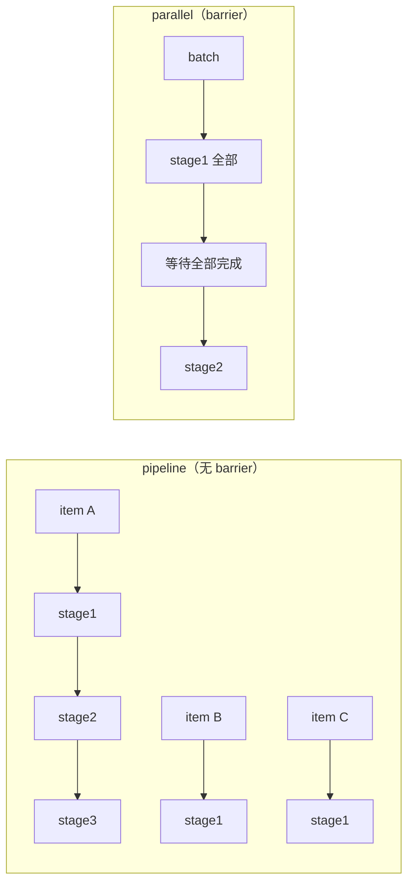
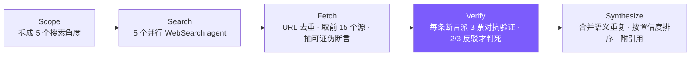

# Dynamic Workflows · 用确定性脚本编排 Agent 舰队

> 当"模型边想边调度"撑不起几百个并行子任务时，把编排权交给一段确定性脚本：fan-out 多少、怎么串、何时收敛，全写死在控制流里。

[verification-and-multiagent.md](./verification-and-multiagent.md) 讲的多 Agent，不管是主 Agent 派子 Agent、协调器分派 worker，还是 Swarm 点对点，有一个共同前提：谁来派、何时派、何时收，都是模型在推理里临场决定的。这种模型驱动编排对常见任务够用，但碰到真正的大活，比如把一个改动铺到几十个文件、审一整条依赖链、对一大批候选逐一核实，它有三个硬伤：

- 模型每轮都要重新决定"现在派谁"，几百个任务时既慢又容易漏；
- 并发上限、token 预算、断点续跑这些**可靠性约束**靠提示词叮嘱，模型可能不遵守；
- 编排过程本身不可复现，同一段输入，两次跑可能铺开不同的舰队。

Dynamic Workflows 的解法是换一个协调器：**把那个"当协调器的模型"换成一段确定性的 JS 脚本**。脚本一次性铺开几十到几百个子 agent，由运行时按并发上限成批执行、按 token 预算刹车、中断后可从断点续跑。触发词是 `ultracode`。

> 与 [autonomy.md](./autonomy.md) 的关系：`/loop` 是时间轴上的串行续跑，同一个主模型隔一段时间回来再干一轮；Workflow 是空间轴上的并行 fan-out，一段脚本此刻就规划出几十上百个 agent。两者共享同一套哲学，上层用脚本/提示词表达要干什么，下层运行时兜底怎么调度、怎么保住状态，只是落在不同的轴上，不是一回事。

## 1. 两种编排：模型当协调器，还是脚本当协调器

先把两种编排的边界划清楚：

| 维度            | 模型驱动编排（Subagent / Coordinator / Swarm） | 脚本驱动编排（Dynamic Workflows） |
| --------------- | ---------------------------------------------- | --------------------------------- |
| fan-out 决策    | 模型每轮推理临场决定                           | 脚本控制流写死                    |
| 并发 / 预算约束 | 提示词叮嘱，可能不遵守                         | 运行时硬强制                      |
| 可复现性        | 同一输入两次跑可能不同                         | 脚本确定性执行，可重放            |
| 适用规模        | 几个到十几个子 agent                           | 几十到几百个                      |
| 灵活性          | 高，可边干边调整                               | 分支固定，需先写脚本              |

关键判断：Workflow 不是另一套多 Agent 底座，而是复用已有的子 agent 原语。一个子 agent 怎么派生、异步任务怎么用 `<task-notification>` 通知回来、并行写文件怎么用 worktree 隔离，这些原封不动复用 [verification-and-multiagent.md §5](./verification-and-multiagent.md#_5-多-agent-策略) 的实现；Workflow 只在上面加了一层确定性脚本 + 并发/预算/续跑的壳。

## 2. 一段 Workflow 脚本长什么样

Workflow 工具让主模型现写一段 JS 脚本，交给运行时确定性地执行。脚本必须以一个纯字面量的 `meta` 声明开头，写清楚名字、一句话描述、有哪些 phase，这几样会显示在权限弹窗和 `/workflows` 面板里：

```javascript
export const meta = {
  name: "review-changes",
  description: "Review changed files across dimensions, verify each finding",
  phases: [{ title: "Review" }, { title: "Verify" }],
}
```

`meta` 之后是脚本体，用一组内置 hook 编排：

| Hook                                 | 职责                                                                                                                       |
| ------------------------------------ | -------------------------------------------------------------------------------------------------------------------------- |
| `agent(prompt, opts?)`               | 派生一个子 agent，返回它的结果；不带 schema 返回终文本，带 schema 返回校验过的对象                                         |
| `pipeline(items, stage1, stage2, …)` | 让每个 item 独立穿过一串 stage，stage 之间无 barrier                                                                       |
| `parallel(thunks)`                   | 并发跑一批任务，**等全部完成**才返回（barrier）                                                                            |
| `phase(title)`                       | 把后续 `agent()` 归入某个 phase（面板分组与进度）                                                                          |
| `log(msg)`                           | 往 `/workflows` 面板打一条进度消息                                                                                         |
| `budget`                             | 查 token 预算：`budget.total` / `budget.spent()` / `budget.remaining()`                                                    |
| `workflow(nameOrRef, args?)`         | 内联跑另一个 workflow（存好的或脚本路径）；子 workflow 共享本 run 的并发上限、agent 计数、中止信号和预算，**只准嵌套一层** |

`agent()` 的 `opts` 能指定：`label`、`phase`、`model`、`effort`（推理强度）、`isolation: 'worktree'`（独立工作区）、`agentType`（走 Agent 工具同一个注册表）、`schema`（结构化返回）。

### 2.1 三条为「可重放」而设的限制

脚本是纯 JS（不是 TS，写类型注解会解析失败），而且：

- **禁用 `Date.now()`、`Math.random()`、不带参的 `new Date()`**，它们会让断点续跑（见 [§6](#_6-隔离与断点续跑)）算出不同结果；
- 这几条限制透出 Workflow 的定位：脚本要可重放，不许有不确定性。

一段真正的 workflow，审查一批改动文件、每条发现随即对抗式复核：

```javascript
const results = await pipeline(
  DIMENSIONS,
  (d) => agent(d.prompt, { phase: "Review", schema: FINDINGS }),
  (review) =>
    parallel(
      review.findings.map(
        (f) => () =>
          agent(`Adversarially verify: ${f.title}`, { phase: "Verify", schema: VERDICT }).then(
            (v) => ({ ...f, verdict: v }),
          ),
      ),
    ),
)
```

### 2.2 派生出去的子 agent 是「叶子 worker」

一次 workflow 派出去的子 agent 是一个独立的客户端请求，系统提示头一句是"You are a subagent spawned by a workflow orchestration script"，并特意交代：你的最终文本会被原样当成字符串返回给调用脚本，那是返回值，不是给人看的消息。

它还是个叶子 worker：主模型手里那几个能再往下编排、排程的工具（`Agent`、`Workflow`、`ScheduleWakeup`、`TaskOutput`）都从子 agent 的工具集里摘掉了（实测子 agent 76 个工具、主模型 80 个，差的正是这 4 个）。所以它只能干活，不能再 fan-out。对主模型来说，整个 Workflow 调用是个后台任务：一调就立刻返回一个 task id，跑完再用 `<task-notification>` 通知回来（机制见 [background-fleet.md](./background-fleet.md)）。

## 3. 默认用 pipeline，为什么 parallel 是 barrier

这是整套设计里最见功力、也是工具描述花最多篇幅讲的一点：什么时候用 pipeline、什么时候用 parallel。



- `parallel` 是一道 **barrier**：并发跑一批任务，等**所有**任务都完成才返回；
- `pipeline` 不设 barrier：每个 item 独立穿过所有 stage，item A 可能已经在第 3 个 stage，item B 还在第 1 个。

差别落到墙钟时间上很实在：pipeline 的总耗时约等于最慢那一条单项链，而不是每个 stage 里最慢那个之和。如果 5 个 finder 并行跑、最慢的比最快的慢 3 倍，用 barrier 就白白浪费掉快 finder 三分之二的空闲。

因此工具描述把规则说死了：

> 默认用 pipeline。只有当 stage N 真的需要前一个 stage 的全部结果凑齐才能干时，才该用 barrier，比如在昂贵下游步骤前先对全量结果去重、零发现就整轮跳过、或某个 stage 的提示词要引用其它所有发现来比对。

它还给了一个快速判据：如果你写的是并发跑一批 → 把结果 flatten/map/filter 一下 → 再并发跑一批，那中间那步根本不需要 barrier，把它塞进 pipeline 的一个 stage 就行。

算一笔时间账，差别就很具体了。3 个 item，每个要走 3 个 stage，各 stage 耗时如下。

| item | stage1    | stage2 | stage3 |
| ---- | --------- | ------ | ------ |
| A    | 1 min     | 1 min  | 1 min  |
| B    | **3 min** | 1 min  | 1 min  |
| C    | 1 min     | 1 min  | 1 min  |

- **用 barrier（parallel）**：stage1 要等最慢的 B（3 min），stage2 再等全员（1 min），stage3 再等（1 min）→ 总计 5 min。A 和 C 在 stage1 结束后干等了 2 分钟。
- **用 pipeline**：A 走完自己的链 3 min，C 也是 3 min，B 是 5 min，各自独立 → 总耗时 ≈ 最慢那条链 = 5 min。

这个例子里两者一样，因为它正好是个反例：只有当每个 stage 内部耗时差异大时，barrier 的浪费才明显。把 B 的 stage1 改成 9 min：

- barrier：9 + 1 + 1 = 11 min（A、C 各干等 8 分钟）
- pipeline：仍是最慢那条链 = 11 min，但 A 在 3 min 时就全部完成了，它的结果早 8 分钟可用。

所以对结果要逐个消费的场景（找到一个就验证一个），pipeline 的优势不在总时长，而在首个结果的到达时间和中间不被拖住。这就是为什么规则说拿不准就 pipeline。

> 一个把编程模型做成工具、还在工具描述里教模型别乱设 barrier、拿不准就 pipeline 的系统，其实是在替模型提前堵掉一类经典并发反模式。

错误语义也值得记：`parallel` 里某个任务抛错，那一格变成 `null`（用结果前先 `.filter(Boolean)` 滤掉）；`pipeline` 里某个 stage 抛错，那个 item 就落下、跳过它剩下的 stage。失败被隔离成单点，不会把整批带崩。

## 4. 让子 agent 返回结构化数据

多个 agent 串成流水线，前一个的输出要能喂给后一个；纯文本不好办，还得解析。Workflow 的做法是给 `agent()` 一个 `schema`（一份 JSON Schema）：

- 带上 schema，运行时就往这个子 agent 的工具集里塞一个叫 `StructuredOutput` 的工具，把这份 schema 作为该工具的 `input_schema`；
- 工具描述写着"You MUST call this tool exactly once at the end"，子 agent 干完活必须调它一次；
- 参数当场按 schema 校验（`required`、`additionalProperties: false` 都生效），`agent()` 于是拿到一个校验过的对象，不用再解析。

校验发生在工具调用那一层：形状不对会先 nudge、再重试；但子 agent 到末尾还是不调用、或超过结构化输出重试上限，这次 `agent()` 就失败。它若在 `parallel`/`pipeline` 的 slot 里，失败被隔离成 null；直接 `await agent(...)` 则抛错。

于是一个 agent 产出一批 `{file, line, severity}`、下一个 agent 挨个 verify 这种拼装在成功路径上是可靠的：stage 之间流动的是结构化数据，不是等着被正则的字符串。

## 5. 三道硬上限加一个预算

一段脚本能铺开几百个 agent，就必须有护栏，否则一个写错的循环能把机器和账单一起拖垮。运行时压了三道硬上限：

| 上限     | 值                      | 含义                                                                                                  |
| -------- | ----------------------- | ----------------------------------------------------------------------------------------------------- |
| **并发** | `min(16, CPU 核数 - 2)` | 同时在跑的 `agent()` 调用夹在此值，超出的排队，腾出槽位再跑                                           |
| **单次** | `4096` 个 item          | 一次 `parallel()` / `pipeline()` 最多收 4096 个 item，再多直接报错（不是静默截断）                    |
| **总数** | `1000` 个 agent         | 一个 workflow 整个生命周期最多派 1000 个 agent；这是「防失控循环」的兜底，设得远高于任何真实 workflow |

第四道不是上限而是预算。如果给这轮任务下过 token 目标（`+500k` 式指令），`budget` 就把它变成硬天花板：`budget.total` 是目标、`budget.spent()` 是已花、`budget.remaining()` 是剩余；花到顶再调 `agent()` 就抛错。这让脚本能按预算动态决定深度：

```javascript
while (budget.total && budget.remaining() > 50_000) {
  // 边花边看还剩多少，决定要不要再派一轮
}
```

撞上上限或预算，分别记 `tengu_workflow_agent_cap_exceeded` 和 `tengu_workflow_budget_cap_exceeded` 两个事件（事件体系见 [observability-evaluation.md](./observability-evaluation.md)）。

## 6. 隔离与断点续跑

几百个 agent 并行干活，两件事会出岔：它们同时改同一个文件会互相覆盖；这么大的运行跑到一半挂了，重头再来太亏。Workflow 对这两件事各有一手。

### 6.1 Worktree 隔离

给 `agent()` 传 `isolation: 'worktree'`，运行时就给这个子 agent 开一个独立 git worktree，让它在自己那份副本里改：跑完没改动自动删，有改动把路径交回来。它贵，每个 agent 多花几百毫秒加一份磁盘，所以只在并行写、会互相冲突时才开；并行只读/写不同文件不必开。

### 6.2 Journal 与 runId 断点续跑

每次 run 有个 id（形如 `wf_000d0acb-383`），脚本每个 `agent()` 都往 journal 里记两条，一条 `started`、一条 `result`，都带一个 `v2:<哈希>` 的 key，那个 key 就是这次调用（prompt 加 opts）的内容哈希。

带 `resumeFromRunId` 重跑时，key 没变的最长一段 `agent()` 前缀直接命中 journal 里上次存的 result，从第一个哈希变了的调用起才真重跑。所以一个 100 个 agent 的迁移跑到第 60 个断了，接着跑不会重做前 59 个。这也解释了 [§2.1](#_2-1-三条为「可重放」而设的限制) 为什么禁 `Date.now()` / `Math.random()`：脚本必须可重放，缓存命中才对得上。

落盘布局（真实运行可见）：

```text
<会话>/subagents/workflows/wf_<runId>/
  journal.jsonl          # 每个 agent() 的 started/result 两条
  agent-<id>.jsonl       # 每个子 agent 的完整对话
```

模型现写的那段脚本本身会被存成一个可编辑的 `.js` 文件，方便人审阅这次到底跑了什么。

## 7. 把可靠性编排进流程

Workflow 真正有意思的地方，不只是并行快，而是它把一套追求可信度的编排范式写进工具描述，鼓励模型照着搭：

| 范式                    | 做法                                                                                                   | 防什么                               |
| ----------------------- | ------------------------------------------------------------------------------------------------------ | ------------------------------------ |
| **对抗式复核**          | 每条发现另派 N 个独立怀疑者，各自被要求去**反驳**它；多数反驳成立就剔除                                | 「看着有道理其实站不住」的发现混过去 |
| **视角分散的复核**      | 一条发现能从多个角度出问题时，给每个复核者一个不同镜头（正确性/安全/性能/可复现），而不是派 N 个一样的 | 单一视角的盲区                       |
| **Judge panel**         | 从不同切入点独立生成 N 个方案，并行打分，从赢家里综合、再嫁接亚军的好点子                              | 单方案次优                           |
| **Loop-until-dry**      | 对不知道有多少的发现（bug、边角情况），一直派 finder，直到连续 K 轮没有新东西才停                      | 「跑 N 轮」漏掉长尾                  |
| **Completeness critic** | 最后派一个 agent 专门问「还缺什么，哪种搜法没跑、哪条断言没验、哪份材料没读」                          | 收尾遗漏                             |

这些范式合起来是一个朴素主张：多个 agent 的价值不在于快，而在于用结构化的冗余，把单个 agent 容易疏漏这件事系统地纠回来。

### 7.1 活例子：/deep-research 就是一个 workflow

Claude Code 自带的 `/deep-research` 照着这套范式搭了一个成品 workflow，它的 phase 元数据结构是：



数一下就对上了：多路搜索是 multi-modal sweep，3 票 2/3 是对抗式复核，取源那步的 URL 去重正是先凑齐再往下、需要 barrier 的地方，一个 workflow 把前面几节的范式几乎全用上了。

## 8. 入口、面板与关停

- **`ultracode` 触发词**：在 prompt 里带上它，当前这一轮 opt-in 成 Workflow 工具，模型自己写一段 workflow 并跑起来，只作用于这一次；
- **`/effort ultracode`**：会话级开关，xhigh 推理 + 常驻自动 workflow 编排，整个会话都开着；
- **`/workflows` 面板**：看每个 workflow 的实时进度（`meta` 的 phase 和 `log()` 打的消息显示在这儿）；
- **`/deep-research`**：官方打包好的 workflow，多路搜索、深读、对抗式核实再综合成带引用的报告；
- **关停**：`CLAUDE_CODE_DISABLE_WORKFLOWS=1` 整体关掉。

## 9. 对 mod-agent 的落地

Workflow 是 [roadmap.md](./roadmap.md) 的 Phase 6（多 Agent 后期）能力，**前置依赖未满足前不要做**：

- 前置：子 agent 派生与权限继承（[verification-and-multiagent.md §5](./verification-and-multiagent.md#_5-多-agent-策略)）、worktree 隔离、后台任务与 task-notification（[background-fleet.md](./background-fleet.md)）、token 预算（[observability-evaluation.md](./observability-evaluation.md)）；
- 没有这些底座，Workflow 只是"一段会失控的 fan-out 脚本"。

### 9.1 最小版本

mod-agent 不必一上来就实现全套。最小可用版本砍到：

1. 一个 `runWorkflow(script, opts)` 运行器：解析 `meta` + 实现 `agent()` / `pipeline()` / `parallel()` 三个 hook（`phase`/`log`/`budget` 可后补）；
2. 一道并发上限（先用固定值，如 `min(8, CPU-2)`），总 agent 上限可直接用常量（如 100）；
3. 子 agent 复用现有 Agent 类，强制叶子（摘派生工具）；
4. 结构化返回先不做 schema 注入，退化为"在提示词里要求返回 JSON + 运行时 `JSON.parse` 校验"，失败隔离成 null；
5. 续跑先不做 journal，等真正出现"长跑中断"的场景再补。

### 9.2 什么时候才值得写脚本

- 任务能静态拆出 ≥ 20 个独立 item、且每个 item 的处理流程相同，否则用普通子 agent 即可，写脚本的开销不划算；
- 有明确的质量诉求（每条结果都要复核）或预算诉求（要硬刹 token）；
- 一次 fan-out 少于 10 个、且不重复的任务，模型直接派生几个子 agent 更简单，不必动用 Workflow。

## 10. 设计决策（ADR）

| 决策               | 选择                                     | 理由 / 对立面                                                                      |
| ------------------ | ---------------------------------------- | ---------------------------------------------------------------------------------- |
| 编排决策谁来做     | 确定性 JS 脚本，而非模型临场             | 模型驱动不可复现、并发预算靠叮嘱不可靠；对立面：继续用协调器模型，规模一大就慢且漏 |
| 默认并发原语       | pipeline（无 barrier）                   | pipeline 墙钟≈最慢单项链；barrier 浪费快任务空闲；只有需要全量结果才用 parallel    |
| 失败处理           | 隔离成 null/跳过 item，不带崩整批        | 对立面：一个失败整批中止，大规模运行太脆弱                                         |
| 阶段间数据         | StructuredOutput + schema 校验           | 对立面：纯文本 + 正则解析，脆弱；校验放工具层，形状不对重试                        |
| 并行写隔离         | 按需 worktree，只在冲突时开              | 对立面：每个 agent 都开，贵且费磁盘                                                |
| 断点续跑           | journal 内容哈希前缀命中                 | 对立面：中断重跑，大运行太贵；禁不确定性 API 保证可重放                            |
| mod-agent 实现时机 | Phase 6，最小版只做 3 个 hook + 1 道并发 | 前置底座（子 agent/worktree/后台/预算）未就绪前不做                                |

> Dynamic Workflow 的本质不是让 agent 更多，而是把编排这件事从模型的临场判断变成确定性脚本 + 运行时强制的可靠性约束。模型负责在脚本里写清楚要什么，运行时负责并发、预算、隔离、续跑这些它必须做到、而模型可能忘掉的事。
