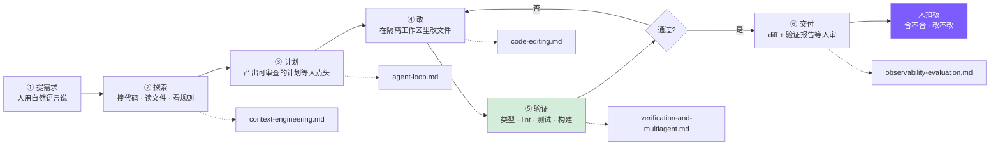
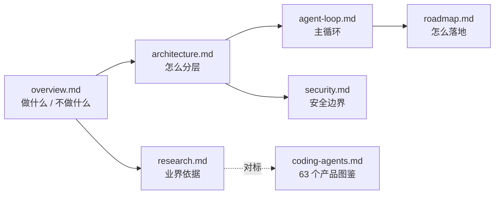

# mod-agent

一个用 TypeScript + Node.js 从零实现的 AI Coding Agent CLI，形态类似 Claude Code：读入自然语言编程需求，自主完成读代码、改文件、跑测试、再迭代修复的闭环，最后产出可审查的 diff。

> 项目阶段：**设计阶段**。本文档集描述目标架构与工程约定，尚未开始编码。

> 这套文档现在的作用：mod-agent 还没写第一行代码，这里先把它该长成什么样、怎么一步步搭、哪些坑前人踩过，白纸黑字定下来。它是施工图，不是成品。

## 设计目标

在持久隔离的工作区里接收自然语言需求或 issue，自主完成仓库探索、多文件修改、测试验证与自我修正，最终产出可审查的分支 diff。它是一个**人在环上（human-in-the-loop）**的委托执行系统，而不是完全无人值守的"AI 软件工程师"：人负责需求决策与最终审查，Agent 负责探索、实现、验证与迭代。

需要覆盖的能力：多模型统一接入、结构化工具调用、MCP 扩展、Hook 生命周期、上下文压缩、长期记忆与项目级指令注入、运行时 Checkpoint（长任务中断可恢复）、Git Worktree 任务隔离。

## 一次任务是怎么跑完的

先建立整体印象，再钻细节。下面是一次典型任务的六个阶段，每个阶段都对应一篇文档：

中间 ④↔⑤ 是一个可以反复绕的环：测试不过就回去改。这也是整个系统里唯一让模型自己兜圈子的地方，所以必须有轮次上限（见 [agent-loop.md](./agent-loop.md)）。最后那一步永远留给人：diff 摆在桌上，合不合由人决定。

## 技术栈

| 层次          | 选型                                    | 说明                                                          |
| ------------- | --------------------------------------- | ------------------------------------------------------------- |
| 语言 / 运行时 | TypeScript + Node.js                    | 流式 API 原生友好                                             |
| CLI / TUI     | **Commander + Ink**                     | 命令框架 + React 风格终端渲染，流式输出与工具状态展示         |
| 数据校验      | **Zod**                                 | 工具入参、计划、模型结构化输出统一校验                        |
| 本地存储      | **SQLite**（better-sqlite3）            | 会话、消息、检查点、记忆的本地持久化                          |
| LLM 接入      | Model Gateway 统一抽象                  | OpenAI / Anthropic / Ark 等可插拔 Provider，透传 prompt cache |
| 协议扩展      | **MCP**（官方 TypeScript SDK）          | 外部工具生态                                                  |
| 沙箱          | Docker + 受限子进程（降级）             | 命令隔离、网络默认关闭                                        |
| 代码检索      | ripgrep + tree-sitter / TS Compiler API | 词法 + 符号 + 关系，纯向量 RAG 只是补充                       |
| 工作区隔离    | **Git Worktree**                        | 每任务独立分支与目录，完成后合并清理                          |

> 远期方向（MVP 不做）：把单 CLI 扩展为 Web 控制台 + BFF + PostgreSQL + 队列的团队平台（多租户、RBAC、PR/Issue 集成）。相关设计见 `roadmap.md` Phase 5。

## 文档导航

按"为什么 → 是什么 → 怎么做"组织：

| 文档                                                               | 回答的问题                                                                                |
| ------------------------------------------------------------------ | ----------------------------------------------------------------------------------------- |
| [overview.md](./overview.md)                                       | 目标与边界、设计原则、任务模式、MVP 做 / 不做                                             |
| [usage.md](./usage.md)                                             | 使用者视角：命令怎么敲、四种模式怎么切、审批与回滚怎么看（设计阶段的使用体验规格）        |
| [research.md](./research.md)                                       | 领域调研：主流产品、评测基准、架构范式、失败模式与安全实证                                |
| [coding-agents.md](./coding-agents.md)                             | Coding Agent 全景图鉴：63 个产品 / 框架 / 协议的逐一对标画像，以及对 mod-agent 的设计启示 |
| [architecture.md](./architecture.md)                               | 总体分层架构、架构决策记录（ADR）、技术选型、monorepo 结构                                |
| [agent-loop.md](./agent-loop.md)                                   | Agent Runtime：任务状态机、核心循环、停止/恢复/预算语义                                   |
| [context-engineering.md](./context-engineering.md)                 | 代码库理解、分层检索、上下文装配与压缩、注入防护                                          |
| [system-prompt.md](./system-prompt.md)                             | 系统提示词分层（静态/动态）、提示词写法、规则注入、缓存边界                               |
| [tools-and-extensions.md](./tools-and-extensions.md)               | 工具契约、统一执行结果、延迟加载、并行执行、MCP、Skills、人工审批策略                     |
| [code-editing.md](./code-editing.md)                               | 文件读取与编辑策略、编辑安全校验、Worktree 隔离、用户变更保护、Diff 审核                  |
| [verification-and-multiagent.md](./verification-and-multiagent.md) | 验证流水线、错误分类、Repair Loop、子 Agent 协作模式与隔离                                |
| [autonomy.md](./autonomy.md)                                       | 自治与续跑：目标追达（/goal）、定时/自排程（/loop）、动作自动批准（Auto Mode）            |
| [dynamic-workflows.md](./dynamic-workflows.md)                     | 动态工作流：确定性脚本编排、pipeline/parallel、结构化返回、三道上限、断点续跑             |
| [agent-teams.md](./agent-teams.md)                                 | Agent 团队：对等组队、共享任务/记忆/产出、跨会话安全（用户权威不转移）                    |
| [background-fleet.md](./background-fleet.md)                       | 后台舰队：脱终端常驻、daemon 监管、子 agent 后台化、commit/push/draft PR 收尾             |
| [security.md](./security.md)                                       | 威胁模型、沙箱基线、权限判定引擎、命令执行层、密钥/网络、安全验收                         |
| [data-and-events.md](./data-and-events.md)                         | EventStream 事件模型、SQLite 持久化、检查点、一致性规则                                   |
| [model-gateway.md](./model-gateway.md)                             | Provider 适配、模型路由、提示词版本管理、结构化输出                                       |
| [observability-evaluation.md](./observability-evaluation.md)       | Trace/指标/日志/成本，以及评测体系与发布门禁                                              |
| [roadmap.md](./roadmap.md)                                         | 分阶段路线（Phase 0–6）、优先开发顺序、MVP 验收清单                                       |
| [development-guide.md](./development-guide.md)                     | 开发者视角：模块依赖顺序、最小可跑循环、各模块自测口径、前人踩过的实现坑                  |
| [references.md](./references.md)                                   | 参考来源汇总                                                                              |

### 从哪篇开始读

不用从头读到尾，按你的身份挑入口：

| 你是谁                 | 建议先读                                                                                                           | 目的                               |
| ---------------------- | ------------------------------------------------------------------------------------------------------------------ | ---------------------------------- |
| 第一次来、只想快速了解 | [overview.md](./overview.md) → [research.md](./research.md) 前两节                                                 | 5 分钟知道它做什么、不做什么       |
| 想知道将来怎么用       | [usage.md](./usage.md) → [overview.md](./overview.md)                                                              | 看命令、模式与审批交互长什么样     |
| 要参与开发             | [architecture.md](./architecture.md) → [development-guide.md](./development-guide.md) → [roadmap.md](./roadmap.md) | 先看分层，再看怎么动手与开发顺序   |
| 想判断设计靠不靠谱     | [research.md](./research.md) → [security.md](./security.md) → [coding-agents.md](./coding-agents.md)               | 看业界事实依据、安全边界与对标图鉴 |

下图是这份文档集的阅读主线（箭头表示"先读哪篇再读哪篇"）：

先搞清楚做什么，再谈业界怎么做、我们怎么分层；细节专题都是主干上的分支，开发路线收在 roadmap。

## 设计原则（速览）

1. **单 Agent 闭环优先**：一个 ReAct 主循环 + 受控子任务派生，不做对等多 Agent 编排。
2. **接口即能力（ACI）**：工具输入输出契约与模型能力同等重要，输出结构化、无歧义、带裁剪。
3. **验证驱动**：生成廉价、验证昂贵，任何修改都要跑测试 / lint / 类型检查，不信模型自述成功。
4. **上下文是缓存**：按需检索、临近上限压缩、记忆外置，对抗 context rot。
5. **安全默认**：文件写入 / 命令执行 / 网络默认隔离与授权，破坏性操作显式确认。
6. **状态外置可恢复**：任务状态、失败历史、检查点持久化，长任务可从中断点恢复。

详见 [overview.md](./overview.md)。
