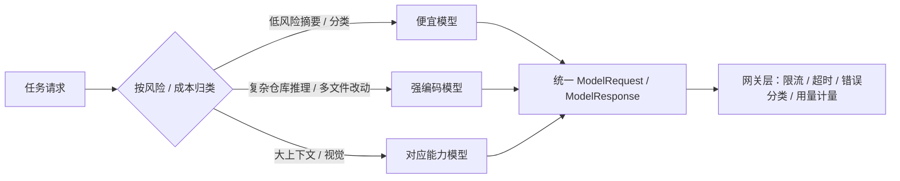
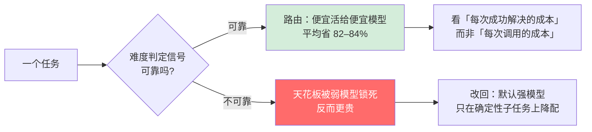

# Model Gateway · 模型接入与提示词管理

> 本篇面向实现 Provider、控制成本和选择模型的开发者：先把不同厂商的差异关在网关里，再讨论路由、提示词版本、结构化输出和可靠性。

不同模型的协议、价格和能力各不相同。Model Gateway 把这些差异隔离在适配层里：业务代码只面对统一接口，用量、限流和重试也在同一处处理。

## 1. 模型适配层

网关最核心的抽象是一个 `ModelProvider` 接口，每个厂商各自实现一次：

```ts
interface ModelProvider {
  id: string
  capabilities: {
    toolCalling: boolean // 是否支持工具调用
    streaming: boolean // 是否支持流式
    structuredOutput: boolean // 是否支持约束输出
    vision: boolean // 是否支持图片输入
  }
  generate(input: ModelRequest, signal?: AbortSignal): Promise<ModelResponse>
}
```

业务层只依赖统一的 `ModelRequest / ModelResponse`，每个 Provider 负责协议映射（也就是把统一请求翻译成各家厂商的格式）。统一处理：工具调用解析、内容块、流式结束原因、token 用量、请求 ID、限流、超时、错误分类、结构化输出与模型特定差异。MVP 先只接一个 Provider 建立可靠基线。

> 对业务代码来说，只需要“发一个请求”，不必知道背后是 Anthropic 还是 OpenAI。换模型不应牵动业务逻辑。`capabilities` 则告诉网关该模型是否支持流式、视觉或工具调用，避免把不具备工具调用能力的模型派去执行 Agent 任务。

### 1.1 配置分层与用量计量（业界实证）

Provider / 权限配置分层（Claude Code settings，出处：https://code.claude.com/docs/en/settings ）：托管策略 > 命令行 `--settings` > 团队项目文件 > 用户文件 > 项目本地 `settings.local.json`；`allow` 列表跨层取并集，`deny` / `ask` 优先且立即生效（详见 [security.md §4.1](./security.md#_4-1-配置优先级与权限规则合并-claude-code-settings-实证-出处-https-code-claude-com-docs-en-settings)）。

用量计量是网关的一等输出：

- Claude Code headless 的 JSON 载荷自带 `total_cost_usd` 与 per-model 成本拆分（出处：https://code.claude.com/docs/en/headless ）；
- Gemini CLI headless 的 `stats` 返回 per-model token 分项（prompt / candidates / total / cached / tool）、工具调用统计（totalCalls / totalSuccess / totalFail / totalDecisions: accept | reject | modify | auto_accept）与文件增删行（出处：https://google-gemini.github.io/gemini-cli/docs/cli/headless.html ）；
- 这些字段喂给 [observability-evaluation.md](./observability-evaluation.md) 的成本指标与 [agent-loop.md §6.3](./agent-loop.md#_6-3-headless-事件流输出-claude-code-gemini-cli-实证) 的事件流输出，脚本可直接 `jq` 取数。

强弱模型分工（Aider 实证，出处：https://aider.chat/docs/git.html ）：commit message 这类低风险文本生成交给低成本的 weak-model，主模型只做编码。这是路由策略里低风险摘要用便宜模型的落地案例。

> 比如，主模型刚改完代码、跑通了测试，现在要写一句 git commit。这事不需要再花一次强模型的钱，交给便宜的小模型写"fix: 修复登录态过期判断"就够了。

### 1.2 两类后端的协议差异（wire-level mapping）

统一接口之下，各 Provider 的消息协议看起来相似、细节却不同。网关要把这些差异消化在适配层里，不能让它们渗进业务代码。下面以 Anthropic 与 OpenAI 兼容接口为例：

| 维度             | Anthropic                                                               | OpenAI 兼容                                                     |
| ---------------- | ----------------------------------------------------------------------- | --------------------------------------------------------------- |
| 系统提示词       | 独立的 `system` 参数（可为带 `cache_control` 的 text block 数组）       | 放在 `messages` 里一条 `role: "system"`                         |
| 工具 schema 字段 | `input_schema`                                                          | `function.parameters`（外层包 `type: "function"`）              |
| 模型请求工具     | assistant 消息里的 `tool_use` content block                             | assistant 消息里的 `tool_calls`（含 `function.name/arguments`） |
| 工具结果回灌     | 放在 `role: "user"` 消息里的 `tool_result` block，靠 `tool_use_id` 配对 | 独立的 `role: "tool"` 消息，靠 `tool_call_id` 配对              |
| 结束原因         | `stop_reason`                                                           | `finish_reason`                                                 |
| 用量             | `usage`（含 cache 分项）                                                | `usage`（缓存命中在 `prompt_tokens_details.cached_tokens`）     |

最容易踩坑的是流式工具调用的分片累积：OpenAI 接口里一个工具调用的 `function.arguments` 是分片到达的：`id` 与 `name` 只在第一个 chunk 出现，后续 chunk 只有 arguments 的增量片段；一次响应里多个工具调用的 chunk 会交错，需要用 `index` 字段各自累积，拼完整后才能 `JSON.parse`。Anthropic 侧则是 `content_block_start`（建 tool_use 块）→ 若干 `input_json_delta`（partial JSON）→ `content_block_stop`（该块 JSON 完整）。

工程含义：

- 两套后端各自维护一份消息历史：因为 system 位置、工具调用 / 结果的载体都不同，运行时按后端分别维护，而不是在一种格式上反复转换；
- 网关对外暴露的统一事件（文本增量、工具调用开始 / 参数完整、结束、用量）与上述具体事件解耦；
- 工具块何时算完整是流式提前执行的触发点（见 [tools-and-extensions.md §2.4](./tools-and-extensions.md#_2-4-并行工具执行) 与 [agent-loop.md §2.4](./agent-loop.md#_2-4-流式窗口里提前执行工具)）。

## 2. 模型路由策略

初期固定默认模型，之后按自己的评测数据考虑：

- 低风险摘要 / 简单分类用便宜模型；
- 复杂仓库推理与多文件修改用强编码模型；
- 大上下文 / 视觉需求选对应能力模型；
- 高成本模型触发前依据预算与任务风险决定；
- 故障切换必须重新校验工具调用与上下文兼容性，不能假设不同模型工具行为一致。



请求不是默认都发给最贵的模型，而是先按任务的风险和成本分桶。便宜的活给便宜模型，复杂的仓库改动才上强模型；无论走哪桶，最后都汇到统一接口，并在网关这一层统一做限流、超时和记账。

多 Provider 中立（OpenAI Agents SDK 实证，出处：https://openai.github.io/openai-agents-python/ ）：SDK 官方定位 provider-agnostic，同一套 agent 定义可经 LiteLLM / any-llm 接 100+ 模型，不绑死 OpenAI；mod-agent 的 `ModelProvider` 接口方向一致，MVP 先建一条可靠基线、再横向铺 Provider。

### 2.1 路由的成本账：为什么「一律上最强模型」是错的

不要只看厂商公开榜单选默认模型。用自己的真实仓库任务集测成功率、延迟、成本、修复轮数与副作用风险。下面是一组可用于校准的实测数字（2026 年口径）：

| 场景         | 单任务成本（Sonnet 4.6 量级） |
| ------------ | ----------------------------- |
| 单文件编辑   | ~\$0.031                      |
| Bug 排查     | ~\$0.089                      |
| PR 代码审查  | ~\$0.062                      |
| 多文件重构   | ~\$0.17                       |
| 端到端新功能 | ~\$0.53                       |

几个结构性事实，比上面的单价更重要：

1. 智能路由相对一律上最强模型平均省 82–84%。差距主要不在贵模型贵，而在便宜的活占了大多数；
2. agent 的成本大头是输入，不是输出。每一步都要把整段对话重发一遍，实测典型编码 agent 调用发 15k–42k 输入 token，只回几百输出 token，所以选型时输入价格远比输出价格重要；
3. 长任务占成本约 80%。一个跑到底的自治会话，比二十次小修小补贵得多；因此预算门禁要卡在长任务上（见 [agent-loop.md §6](./agent-loop.md#_6-预算与循环防护)）；
4. 便宜模型可能更贵：要看每次成功解决的成本，而非每次调用的成本。一个便宜但失败率高的模型，算上重试和人工返工的时间，常常更贵；
5. 快慢模型配对有个隐藏前提：弱模型不知道自己什么时候已经超出能力范围。所以简单活给弱模型、难的升级到强模型这套路由，需要一个可靠的难度判定信号，判不准就退化成质量天花板由弱模型决定（见 [verification-and-multiagent.md §5.7](./verification-and-multiagent.md#_5-7-2026-年的反转-多-agent-从「别做」到「这样做」)）。



换句话说，路由不是越省越好，而是要有能信的难度信号。没有信号就别硬分桶，把便宜模型留给那些确定简单的活（格式化、摘要、分类），而不是让分类器去猜。

### 2.1 别名、档位与降级链（Claude Code v2.1.300 实证，出处：https://code.claude.com/docs/en/model-config ）

路由这一层它给我们的四条可抄事实：

- **对用户暴露别名，不对用户暴露型号**。`opus`、`sonnet`、`haiku`、`fable`、`default`、`best` 加 `[1m]` 变体是一层稳定接口，而别名到具体型号的解析结果**按平台与版本分成四组不同映射**（Anthropic API、Bedrock 与 Agent Platform、Foundry、Claude Platform on AWS 各一套）。任何把某个别名钉死到某个型号的文档都会在下个版本失效，我们的 [usage.md §4](./usage.md) 命令表因此只写 `--model <id>` 而不列型号。
- **推理档位是独立于模型选择的一个轴**。它有 `low`、`medium`、`high`、`xhigh`、`max` 五档，**每个型号有自己的默认档**（新出的 5.5 一代默认 `medium`，上一代普遍默认 `high`，个别型号默认 `xhigh`），给了不支持的档位则**降级到不超过请求值的最高可用档**而不是报错。"按能力降档而不是失败"这条对网关很实用。
- **思考预算要显式承认为成本项**。新模型的自适应思考已经关不掉（界面直接显示关不掉的状态），且官方明写思考 token 即使被折叠或被脱敏也照常计费。我们的 [observability-evaluation.md §2](./observability-evaluation.md) 指标里应当有 thinking token 的独立计数。
- **降级链要有长度上限与作用域**。过载时 `--fallback-model sonnet,haiku` 给一条链，去重后**最多三个型号**，且**只对当轮生效**，不改变会话默认。把降级做成临时行为而不是持久改配置，能避免"降级后没人改回来"这类运维事故。

### 2.2 辅助模型与速度档

出处：Claude Code `advisor.md`、`fast-mode.md`、`model-config.md` v2.1.300 实证。上一节只讲了"主模型怎么切"。真实 Claude Code 还有三件事值得单列，因为它们都不是"换个更贵的模型"能涵盖的：

**① Advisor tool：主模型 + 强裁判**。在关键点把决策"升级"给一个更强模型判一次，主模型继续按判决执行。与 subagent 的区别是：advisor 不接管任务、不产生独立上下文，只回答"这一步该不该这么做"；与 model 切换的区别是：切了就一路切到底，advisor 只在关键节点回灌一次。工程要点三条：

- Advisor 是**独立模型 + 独立 API key 池 + 独立 rate limit**，主模型撞限流时不能借道 advisor；
- Advisor 复用主模型 prompt cache（官方明确"server tool 复用主模型的 cached prompt"），一次判决调用只付新增部分；
- 会话内切换 advisor **不击穿缓存**（advisor 走 tool 通道，不动 system 静态块），这一点与切 model 击穿缓存形成对照，见 [§5.2](#_5-2-保持缓存有效的几条硬规则)。

对应 [architecture.md ADR-11](./architecture.md)：mod-agent 把 advisor / evaluator / classifier 三种辅助角色统一封装在网关层，业务侧只调 `gateway.consult(role, prompt, opts)`，避免 autonomy（分类器）、verification（评估器）、workflows（决策裁判）三处各造一套。

**② opusplan：按任务阶段切模型的双阶段别名**。规划那一轮用 Opus 想清楚，执行那一轮自动回落 Sonnet。它揭示一个方向：路由不只是"按风险分桶"（§2.1 表），还可以"按任务阶段"分。真实 Claude Code 里 `opusplan` 是一等别名，mod-agent 的 `ModelProvider` 路由层应保留一位 `planPhase` / `executePhase` 的模型分派钩子，让上层 planner 能声明"这两阶段用不同模型"，而不是把整个会话绑死一个。

**③ Fast mode（Opus 高速档）与 effort 是两个正交轴**。同一 Opus 模型换一份 API 端点配置：延迟降到约 2.5 倍快、价格约 2 倍（Anthropic 定价 $8/$40 每 MTok 量级）。三个坑必须写清：

- **首次开启击穿整段缓存**：cache 是按 model + endpoint 组合的，从标准 Opus 切到 fast Opus 相当于换后端，之前所有 cached input 全作废、按 uncached 全价重付一次；
- **rate limit 自动降级**：撞 fast 端点限流时官方实现是**回落标准端点**而不是排队，UI 要显式提示"当前非 fast 模式"；
- **Alt+O 快捷键与 `/fast` 命令是会话级、不落配置**，重启后回到 settings 里的 `fastMode: boolean`。

对 mod-agent 落地：网关暴露两个正交轴——`effort: low|medium|high|xhigh|max`（模型内部思考预算）与 `speedTier: standard|fast`（后端点选择）——两者组合决定"发给哪个 endpoint 的哪个 model"。用户 UI 上分开展示（避免"我调了 effort 为 max 为什么还这么快"这种误解）。

**④ 企业 allowlist**：真实 Claude Code 提供 `availableModels` 数组作为 managed 层键，限定会话内可切的模型集合。mod-agent 在 [security.md §4](./security.md) 的 managed 键集合里保留一位 `availableModels`，供 Phase 5 团队与企业能力使用（详见 [roadmap.md Phase 5](./roadmap.md)）。

## 3. 提示词版本管理

- system policy、任务规划、工具说明、总结提示分层存放；
- 每个提示词带 `prompt_id`、`version`、`content_hash`；
- Trace 记录实际使用的版本与模型配置；
- Prompt 改动必须跑离线回归集；
- 仓库规则与 Skill 内容作为不可信 / 低信任上下文单独添加，不拼进 system policy 取得同等信任。

> 换句话说，提示词不是写死在代码里的字符串，而是有版本号、有内容哈希的制品。改了哪版提示词、配哪个模型跑出来的结果，trace 里都能对上号；仓库里的 `AGENTS.md` 是用户提供的低信任内容，不能和系统级策略放在同一信任级别。

## 4. 结构化输出

对计划、终止结论、风险分类与交付摘要用 Schema（Zod）约束；解析失败可有限重试或走安全失败路径。工具调用仍需执行端二次校验：JSON 合法不等于权限合法。

> 比如，要求模型输出一个 JSON 计划，语法校验通过了，不代表它想做的事是被允许的。就像一份填得整整齐齐的申请表，格式对了，也还得人事部门再批一次权限。

## 5. 前缀缓存（Prompt Caching）

每个请求都重复发送同样的系统提示词、工具定义、项目规则，是巨大浪费。前缀缓存让服务端记住以相同前缀开头的请求，命中部分按约 0.1× 计费（首次写入约 1.25×，未命中全价）。这是 [system-prompt.md](./system-prompt.md) 把提示词切成静态 / 动态两半的直接原因。

### 5.1 两个缓存断点

Anthropic 接口要求缓存点用 `cache_control` 标记，系统提示词里通常打两个断点：

1. **静态核心块**：逐字节不变的身份、规则、工具偏好。跨会话都能命中，设置尽可能长的 TTL（如 `global` 对应组织级）；
2. **滚动的最后一条消息**：在消息数组末尾（或动态环境块之后）打第二个断点，让上一轮对话在下一轮命中。

工具定义在请求里的实际渲染顺序是排在 system 之前的，所以静态系统块标了断点会一并覆盖前面的工具定义。

### 5.2 保持缓存有效的几条硬规则

- **动态尾巴不进静态块**：`cwd`、平台、git 状态、当前日期这些每次都变的内容，必须放在静态块之后；`CLAUDE.md` / `AGENTS.md` 因项目而异，放进首条 user 的 `<system-reminder>`，而不是系统提示词，否则静态块每个项目一份、缓存碎片化；
- **内置工具分区排序、MCP 工具追加在后**：工具列表变化不能动到前面的静态前缀（见 [tools-and-extensions.md §1.1](./tools-and-extensions.md#_1-1-mcp-连接生命周期-工具发现、路由与调用)）；
- **前缀缓存极其脆弱**：缓存点之前的任何一个字节变化，都会让其后的缓存全部失效，所以静态内容必须稳定、确定性渲染（无随机顺序、无时间戳）；
- **缓存与压缩互相矛盾**：为腾窗口而裁剪、压缩历史，会改变已缓存的前缀。需要按缓存热度权衡：刚缓存上、利用率还低时不动它，等缓存 TTL 过期或窗口逼近上限再压缩（见 [context-engineering.md §5.1](./context-engineering.md#_5-1-分层压缩流水线-从最廉价到最重)）；
- **会话内切换 model / speedTier 都击穿缓存，切 advisor / effort 不击穿**。这四类操作要按"是否改动 system 静态块"分类：切 model（含别名重解析到新后端）与开/关 fast mode（切后端点）都会让 cached prompt 全废、按 uncached 全价重付一次；advisor 走 tool 通道、effort 走 `thinking.budget_tokens` 参数，两者都不动前缀、缓存继续命中。UI 上第一次做击穿类切换要有"这一轮按全价重付"的显式提示，不能让用户以为换模型免费。

### 5.3 命中率监控

缓存命中会在 `usage` 里体现（Anthropic 分 `cache_creation_input_tokens` 与 `cache_read_input_tokens`；OpenAI 兼容在 `prompt_tokens_details.cached_tokens`）。计算真实窗口占用时必须把 cache_read 这部分加回输入 token，它们仍占上下文，只是计费便宜。运行时应监控 `cache_read` 占比：命中率突然下降超过一定幅度（如 5%）时，归因检查是否静态块被意外改动、工具排序被打乱、或压缩击穿了缓存。

## 6. 流式传输与可靠性

### 6.1 流式 SSE

走 SSE（Server-Sent Events）拿逐 token 事件，主要价值是**首字延迟（TTFT）**：用户在模型开始生成的几百毫秒内就看到内容，而不是等整段生成完。网关把各后端的 SSE 事件归一化为统一事件流：文本增量、工具块开始、参数增量、工具块完整、消息结束、用量、错误。异常时可从最近一次完成的工具块恢复，而非丢弃整轮。

当前实现（`src/model/streaming.ts` + 两个 provider 的 `generateStream` + `ModelGateway.stream`）落的是其中最小可用的部分：

- 归一化事件只有文本增量、工具块开始、参数增量、块结束与"最终响应"，`thinking` 增量单独一路（不渲染）；
- 增量与非流式的**结果一致性由构造保证**：流式只负责把增量拼回与非流式同形状的原始响应，最后交给同一个 `parseXxxResponse`，不重写一遍映射；
- **重试语义**与非流式不同，且是有意的：一个增量都还没吐出来时可以退避重试；一旦吐过，断流只能失败 —— 重放会让用户看到重复的半段文本；
- 主循环把增量按阈值合并成 `agent.message_delta` 事件（事件要落库，逐 token 会把事件表撑爆）；
- OpenAI 兼容端点的流式请求默认带 `stream_options.include_usage: true`，拿官方 usage 而不是只靠估算；端点若以 400 拒绝该字段（错误体里出现字段名），自动去掉它重发一次并记住该端点不支持，后续请求不再重复这半个往返。其它 400 不降级 —— 模型名写错之类必须原样报出来；
- **断流恢复**：一旦吐过增量，断流抛 `MODEL_STREAM_INTERRUPTED`（不可重试），并把断流前**参数已完整**的工具调用挂到 `details.toolCalls`。主循环据此写一条 assistant `tool_use` + 配对 `tool_result`（内容为"未执行，因流中断"）的历史，让模型接着往下做；每个任务最多恢复一次，第二次仍断即失败。Anthropic 侧的依据是 `content_block_stop`；OpenAI 侧的分片协议没有块结束信号，只有已看到 `finish_reason` 才算完整，更早的断流没有可恢复的工具块（宁可整轮失败，也不补半截参数）；
- CLI 侧 `--no-stream` 可以把这次运行退化成一次 `generate()`：网关的 `capabilities.streaming` 会如实报 `false`，主循环据此走非流式分支，不需要调用点各自判断开关。

### 6.2 重试：只重试可恢复错误，退避要带抖动

| 错误                                                           | 是否重试                 | 处理                                                                                             |
| -------------------------------------------------------------- | ------------------------ | ------------------------------------------------------------------------------------------------ |
| `429`（限流）、`503` / `529`（过载）、`ECONNRESET`（连接重置） | 重试                     | 指数退避 + **抖动**，上限约 30s，遵守 `Retry-After`                                              |
| `400`（参数错误）、`401`（鉴权失败）、`404`（模型不存在）      | 不重试                   | 直接失败，重试只会重复报错                                                                       |
| 请求中断 / 超时                                                | 可重试一次（幂等的只读） | 非幂等写操作不自动重放，见 [tools-and-extensions.md §4](./tools-and-extensions.md#_4-重试与幂等) |

抖动（jitter）不可省略：限流是所有客户端同时撞上的，若大家都用固定的 1s、2s、4s 退避，会在相同时刻再次同时发起请求、形成重试风暴；加随机抖动才能把请求散开。

### 6.3 扩展思考（Extended Thinking）

支持推理的模型可有三档：`adaptive`（默认，由模型判断是否思考）、`enabled`（强制思考）、`disabled`（关闭）。工程要点：

- thinking block 只用于维持 API 契约，不渲染、不写入长期记忆、不进计划：模型生成的 `<think>` 推理块要原样回传给下一轮（Anthropic 要求 thinking 块与助手消息配对），但 TUI 不展示、不落库分析；
- 启用思考时通常限制更高的输出 token（思考本身占 output token）；
- 对工具执行而言，思考结束、出现 tool_use 才进入工具生命周期，思考过程不触发任何动作。
