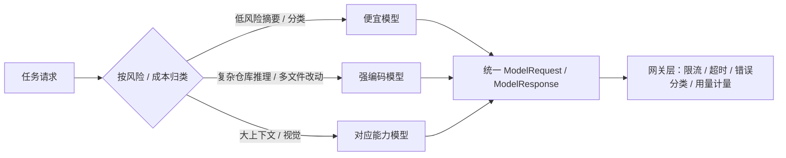

# Model Gateway · 模型接入与提示词管理

> **这篇讲什么**：mod-agent 后面可能接 Claude、GPT、Gemini、本地模型……它们协议不同、价格不同。这篇讲怎么用一层「网关」把这些差异挡住，让业务代码只面对一套统一接口，顺便在这层把成本、限流、用量记下来。
>
> **给谁看**：写模型适配层、做成本与路由策略的人。**读完你该知道**：为什么业务层不该直接 `fetch` 某个厂商接口，以及「便宜活给便宜模型」怎么落地。

## 1. 模型适配层

网关最核心的抽象是一个 `ModelProvider` 接口，每个厂商各自实现一次：

```ts
interface ModelProvider {
  id: string;
  capabilities: {
    toolCalling: boolean;   // 是否支持工具调用
    streaming: boolean;    // 是否支持流式
    structuredOutput: boolean; // 是否支持约束输出
    vision: boolean;       // 是否支持图片输入
  };
  generate(input: ModelRequest, signal?: AbortSignal): Promise<ModelResponse>;
}
```

业务层只依赖统一的 `ModelRequest / ModelResponse`，每个 Provider 负责协议映射（也就是把统一请求翻译成各家厂商的格式）。统一处理：工具调用解析、内容块、流式结束原因、token 用量、请求 ID、限流、超时、错误分类、结构化输出与模型特定差异。MVP 先只接一个 Provider 建立可靠基线。

> 通俗地说：业务代码只说「我要发一个请求」，不关心背后是 Anthropic 还是 OpenAI——换模型像换插头，不改业务代码。`capabilities` 这一栏是让网关知道「这个模型会不会流式、能不能看图」，别拿一个不支持工具调用的模型去硬派 agent 任务。

### 1.1 配置分层与用量计量（业界实证）

**Provider / 权限配置分层（Claude Code settings，出处：https://code.claude.com/docs/en/settings ）**：托管策略 > 命令行 `--settings` > 团队项目文件 > 用户文件 > 项目本地 `settings.local.json`；`allow` 列表跨层取并集，`deny` / `ask` 优先且立即生效（详见 [security.md](./security.md) §4.1）。

**用量计量是网关的一等输出**：

- Claude Code headless 的 JSON 载荷自带 `total_cost_usd` 与 per-model 成本拆分（出处：https://code.claude.com/docs/en/headless ）；
- Gemini CLI headless 的 `stats` 返回 per-model token 分项（prompt / candidates / total / cached / tool）、工具调用统计（totalCalls / totalSuccess / totalFail / totalDecisions: accept | reject | modify | auto_accept）与文件增删行（出处：https://google-gemini.github.io/gemini-cli/docs/cli/headless.html ）；
- 这些字段喂给 [observability-evaluation.md](./observability-evaluation.md) 的成本指标与 [agent-loop.md](./agent-loop.md) §6.3 的事件流输出，脚本可直接 `jq` 取数。

**强弱模型分工（Aider 实证，出处：https://aider.chat/docs/git.html ）**：commit message 这类低风险文本生成交给低成本的 weak-model，主模型只做编码——路由策略里「低风险摘要用便宜模型」的落地案例。
> 举个例子（示意）：主模型刚改完代码、跑通了测试，现在要写一句 git commit。这事不需要再花一次强模型的钱——交给便宜的小模型写「fix: 修复登录态过期判断」就够了。

## 2. 模型路由策略

初期固定默认模型，之后按自己的评测数据考虑：

- 低风险摘要 / 简单分类用便宜模型；
- 复杂仓库推理与多文件修改用强编码模型；
- 大上下文 / 视觉需求选对应能力模型；
- 高成本模型触发前依据预算与任务风险决定；
- 故障切换必须重新校验工具调用与上下文兼容性，不能假设不同模型工具行为一致。



**这张图在说什么**：请求不是无脑都发给最贵的模型，而是先按任务的风险和成本分桶——便宜的活给便宜模型，复杂的仓库改动才上强模型；无论走哪桶，最后都汇到统一接口，并在网关这一层统一做限流、超时和记账。

**多 Provider 中立（OpenAI Agents SDK 实证，出处：https://openai.github.io/openai-agents-python/ ）**：SDK 官方定位 provider-agnostic——同一套 agent 定义可经 LiteLLM / any-llm 接 100+ 模型，不绑死 OpenAI；mod-agent 的 `ModelProvider` 接口方向一致，MVP 先建一条可靠基线、再横向铺 Provider。

> 不要只看厂商公开榜单选默认模型。用自己的真实仓库任务集测成功率、延迟、成本、修复轮数与副作用风险。成本锚点参考：公开榜单上 agentic 修复平均约 \$0.86/题。

## 3. 提示词版本管理

- system policy、任务规划、工具说明、总结提示分层存放；
- 每个提示词带 `prompt_id`、`version`、`content_hash`；
- Trace 记录实际使用的版本与模型配置；
- Prompt 改动必须跑离线回归集；
- 仓库规则与 Skill 内容作为不可信 / 低信任上下文单独添加，不拼进 system policy 取得同等信任。
> 通俗地说：提示词不是写死在代码里的字符串，而是有版本号、有内容哈希的「制品」。改了哪版提示词、配哪个模型跑出来的结果，trace 里都能对上号；仓库里的 `AGENTS.md` 是用户提供的低信任内容，不能和系统级策略放在同一信任级别。

## 4. 结构化输出

对计划、终止结论、风险分类与交付摘要用 Schema（Zod）约束；解析失败可有限重试或走安全失败路径。工具调用仍需执行端二次校验——JSON 合法不等于权限合法。
> 举个例子（示意）：要求模型输出一个 JSON 计划，语法校验通过了，不代表它想做的事是被允许的——就像一份填得整整齐齐的申请表，格式对了，也还得人事部门再批一次权限。
