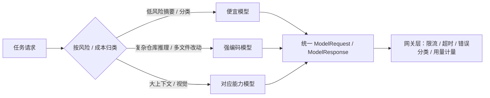
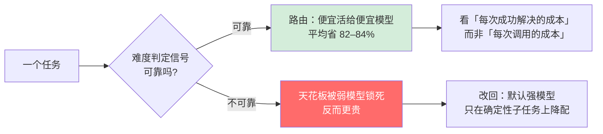

# Model Gateway · 模型接入与提示词管理

> mod-agent 后面可能接 Claude、GPT、Gemini、本地模型……它们协议不同、价格不同。这篇讲怎么用一层网关把这些差异挡住，让业务代码只面对一套统一接口，顺便在这层把成本、限流、用量记下来。
>
> 给谁看：写模型适配层、做成本与路由策略的人。读完你该知道：为什么业务层不该直接 `fetch` 某个厂商接口，以及便宜活给便宜模型怎么落地。

## 1. 模型适配层

网关最核心的抽象是一个 `ModelProvider` 接口，每个厂商各自实现一次：

```ts
interface ModelProvider {
  id: string
  capabilities: {
    toolCalling: boolean // 是否支持工具调用
    streaming: boolean // 是否支持流式
    structuredOutput: boolean // 是否支持约束输出
    vision: boolean // 是否支持图片输入
  }
  generate(input: ModelRequest, signal?: AbortSignal): Promise<ModelResponse>
}
```

业务层只依赖统一的 `ModelRequest / ModelResponse`，每个 Provider 负责协议映射（也就是把统一请求翻译成各家厂商的格式）。统一处理：工具调用解析、内容块、流式结束原因、token 用量、请求 ID、限流、超时、错误分类、结构化输出与模型特定差异。MVP 先只接一个 Provider 建立可靠基线。

> 换句话说，业务代码只说要发一个请求，不关心背后是 Anthropic 还是 OpenAI。换模型像换插头，不改业务代码。`capabilities` 这一栏是让网关知道这个模型会不会流式、能不能看图，别拿一个不支持工具调用的模型去硬派 agent 任务。

### 1.1 配置分层与用量计量（业界实证）

Provider / 权限配置分层（Claude Code settings，出处：https://code.claude.com/docs/en/settings ）：托管策略 > 命令行 `--settings` > 团队项目文件 > 用户文件 > 项目本地 `settings.local.json`；`allow` 列表跨层取并集，`deny` / `ask` 优先且立即生效（详见 [security.md §4.1](./security.md#_4-1-配置优先级与权限规则合并-claude-code-settings-实证-出处-https-code-claude-com-docs-en-settings)）。

用量计量是网关的一等输出：

- Claude Code headless 的 JSON 载荷自带 `total_cost_usd` 与 per-model 成本拆分（出处：https://code.claude.com/docs/en/headless ）；
- Gemini CLI headless 的 `stats` 返回 per-model token 分项（prompt / candidates / total / cached / tool）、工具调用统计（totalCalls / totalSuccess / totalFail / totalDecisions: accept | reject | modify | auto_accept）与文件增删行（出处：https://google-gemini.github.io/gemini-cli/docs/cli/headless.html ）；
- 这些字段喂给 [observability-evaluation.md](./observability-evaluation.md) 的成本指标与 [agent-loop.md §6.3](./agent-loop.md#_6-3-headless-事件流输出-claude-code-gemini-cli-实证) 的事件流输出，脚本可直接 `jq` 取数。

强弱模型分工（Aider 实证，出处：https://aider.chat/docs/git.html ）：commit message 这类低风险文本生成交给低成本的 weak-model，主模型只做编码。这是路由策略里低风险摘要用便宜模型的落地案例。

> 比如，主模型刚改完代码、跑通了测试，现在要写一句 git commit。这事不需要再花一次强模型的钱，交给便宜的小模型写"fix: 修复登录态过期判断"就够了。

### 1.2 两类后端的协议差异（wire-level mapping）

统一接口之下，每个 Provider 真正要处理的是两类同构不同形的消息协议，网关必须把这些差异完全吃掉、不泄漏到业务层。以 Anthropic 与 OpenAI 兼容接口为例：

| 维度             | Anthropic                                                               | OpenAI 兼容                                                     |
| ---------------- | ----------------------------------------------------------------------- | --------------------------------------------------------------- |
| 系统提示词       | 独立的 `system` 参数（可为带 `cache_control` 的 text block 数组）       | 放在 `messages` 里一条 `role: "system"`                         |
| 工具 schema 字段 | `input_schema`                                                          | `function.parameters`（外层包 `type: "function"`）              |
| 模型请求工具     | assistant 消息里的 `tool_use` content block                             | assistant 消息里的 `tool_calls`（含 `function.name/arguments`） |
| 工具结果回灌     | 放在 `role: "user"` 消息里的 `tool_result` block，靠 `tool_use_id` 配对 | 独立的 `role: "tool"` 消息，靠 `tool_call_id` 配对              |
| 结束原因         | `stop_reason`                                                           | `finish_reason`                                                 |
| 用量             | `usage`（含 cache 分项）                                                | `usage`（缓存命中在 `prompt_tokens_details.cached_tokens`）     |

最容易踩坑的是流式工具调用的分片累积：OpenAI 接口里一个工具调用的 `function.arguments` 是分片到达的：`id` 与 `name` 只在第一个 chunk 出现，后续 chunk 只有 arguments 的增量片段；一次响应里多个工具调用的 chunk 会交错，需要用 `index` 字段各自累积，拼完整后才能 `JSON.parse`。Anthropic 侧则是 `content_block_start`（建 tool_use 块）→ 若干 `input_json_delta`（partial JSON）→ `content_block_stop`（该块 JSON 完整）。

工程含义：

- 两套后端各自维护一份消息历史：因为 system 位置、工具调用 / 结果的载体都不同，运行时按后端分别维护，而不是在一种格式上反复转换；
- 网关对外暴露的统一事件（文本增量、工具调用开始 / 参数完整、结束、用量）与上述具体事件解耦；
- 工具块何时算完整是流式提前执行的触发点（见 [tools-and-extensions.md §2.4](./tools-and-extensions.md#_2-4-并行工具执行) 与 [agent-loop.md §2.4](./agent-loop.md#_2-4-流式窗口里提前执行工具)）。

## 2. 模型路由策略

初期固定默认模型，之后按自己的评测数据考虑：

- 低风险摘要 / 简单分类用便宜模型；
- 复杂仓库推理与多文件修改用强编码模型；
- 大上下文 / 视觉需求选对应能力模型；
- 高成本模型触发前依据预算与任务风险决定；
- 故障切换必须重新校验工具调用与上下文兼容性，不能假设不同模型工具行为一致。



请求不是默认都发给最贵的模型，而是先按任务的风险和成本分桶。便宜的活给便宜模型，复杂的仓库改动才上强模型；无论走哪桶，最后都汇到统一接口，并在网关这一层统一做限流、超时和记账。

多 Provider 中立（OpenAI Agents SDK 实证，出处：https://openai.github.io/openai-agents-python/ ）：SDK 官方定位 provider-agnostic，同一套 agent 定义可经 LiteLLM / any-llm 接 100+ 模型，不绑死 OpenAI；mod-agent 的 `ModelProvider` 接口方向一致，MVP 先建一条可靠基线、再横向铺 Provider。

### 2.1 路由的成本账：为什么「一律上最强模型」是错的

不要只看厂商公开榜单选默认模型。用自己的真实仓库任务集测成功率、延迟、成本、修复轮数与副作用风险。下面是一组可用于校准的实测数字（2026 年口径）：

| 场景         | 单任务成本（Sonnet 4.6 量级） |
| ------------ | ----------------------------- |
| 单文件编辑   | ~\$0.031                      |
| Bug 排查     | ~\$0.089                      |
| PR 代码审查  | ~\$0.062                      |
| 多文件重构   | ~\$0.17                       |
| 端到端新功能 | ~\$0.53                       |

几个结构性事实，比上面的单价更重要：

1. 智能路由相对一律上最强模型平均省 82–84%。差距主要不在贵模型贵，而在便宜的活占了大多数；
2. agent 的成本大头是输入，不是输出。每一步都要把整段对话重发一遍，实测典型编码 agent 调用发 15k–42k 输入 token，只回几百输出 token，所以选型时输入价格远比输出价格重要；
3. 长任务占成本约 80%。一个跑到底的自治会话，比二十次小修小补贵得多；因此预算门禁要卡在长任务上（见 [agent-loop.md §6](./agent-loop.md#_6-预算与循环防护)）；
4. 便宜模型可能更贵：要看每次成功解决的成本，而非每次调用的成本。一个便宜但失败率高的模型，算上重试和人工返工的时间，常常更贵；
5. 快慢模型配对有个隐藏前提：弱模型不知道自己什么时候已经超出能力范围。所以简单活给弱模型、难的升级到强模型这套路由，需要一个可靠的难度判定信号，判不准就退化成质量天花板由弱模型决定（见 [verification-and-multiagent.md §5.7](./verification-and-multiagent.md#_5-7-2026-年的反转-多-agent-从「别做」到「这样做」)）。



换句话说，路由不是越省越好，而是要有能信的难度信号。没有信号就别硬分桶，把便宜模型留给那些确定简单的活（格式化、摘要、分类），而不是让分类器去猜。

## 3. 提示词版本管理

- system policy、任务规划、工具说明、总结提示分层存放；
- 每个提示词带 `prompt_id`、`version`、`content_hash`；
- Trace 记录实际使用的版本与模型配置；
- Prompt 改动必须跑离线回归集；
- 仓库规则与 Skill 内容作为不可信 / 低信任上下文单独添加，不拼进 system policy 取得同等信任。

> 换句话说，提示词不是写死在代码里的字符串，而是有版本号、有内容哈希的制品。改了哪版提示词、配哪个模型跑出来的结果，trace 里都能对上号；仓库里的 `AGENTS.md` 是用户提供的低信任内容，不能和系统级策略放在同一信任级别。

## 4. 结构化输出

对计划、终止结论、风险分类与交付摘要用 Schema（Zod）约束；解析失败可有限重试或走安全失败路径。工具调用仍需执行端二次校验：JSON 合法不等于权限合法。

> 比如，要求模型输出一个 JSON 计划，语法校验通过了，不代表它想做的事是被允许的。就像一份填得整整齐齐的申请表，格式对了，也还得人事部门再批一次权限。

## 5. 前缀缓存（Prompt Caching）

每个请求都重复发送同样的系统提示词、工具定义、项目规则，是巨大浪费。前缀缓存让服务端记住以相同前缀开头的请求，命中部分按约 0.1× 计费（首次写入约 1.25×，未命中全价）。这是 [system-prompt.md](./system-prompt.md) 把提示词切成静态 / 动态两半的直接原因。

### 5.1 两个缓存断点

Anthropic 接口要求缓存点用 `cache_control` 标记，系统提示词里通常打两个断点：

1. **静态核心块**：逐字节不变的身份、规则、工具偏好。跨会话都能命中，设置尽可能长的 TTL（如 `global` 对应组织级）；
2. **滚动的最后一条消息**：在消息数组末尾（或动态环境块之后）打第二个断点，让上一轮对话在下一轮命中。

工具定义在请求里的实际渲染顺序是排在 system 之前的，所以静态系统块标了断点会一并覆盖前面的工具定义。

### 5.2 保持缓存有效的几条硬规则

- **动态尾巴不进静态块**：`cwd`、平台、git 状态、当前日期这些每次都变的内容，必须放在静态块之后；`CLAUDE.md` / `AGENTS.md` 因项目而异，放进首条 user 的 `<system-reminder>`，而不是系统提示词，否则静态块每个项目一份、缓存碎片化；
- **内置工具分区排序、MCP 工具追加在后**：工具列表变化不能动到前面的静态前缀（见 [tools-and-extensions.md §1.1](./tools-and-extensions.md#_1-1-mcp-连接生命周期-工具发现、路由与调用)）；
- **前缀缓存极其脆弱**：缓存点之前的任何一个字节变化，都会让其后的缓存全部失效，所以静态内容必须稳定、确定性渲染（无随机顺序、无时间戳）；
- **缓存与压缩互相矛盾**：为腾窗口而裁剪、压缩历史，会改变已缓存的前缀。需要按缓存热度权衡：刚缓存上、利用率还低时不动它，等缓存 TTL 过期或窗口逼近上限再压缩（见 [context-engineering.md §5.1](./context-engineering.md#_5-1-分层压缩流水线-从最廉价到最重)）。

### 5.3 命中率监控

缓存命中会在 `usage` 里体现（Anthropic 分 `cache_creation_input_tokens` 与 `cache_read_input_tokens`；OpenAI 兼容在 `prompt_tokens_details.cached_tokens`）。计算真实窗口占用时必须把 cache_read 这部分加回输入 token，它们仍占上下文，只是计费便宜。运行时应监控 `cache_read` 占比：命中率突然下降超过一定幅度（如 5%）时，归因检查是否静态块被意外改动、工具排序被打乱、或压缩击穿了缓存。

## 6. 流式传输与可靠性

### 6.1 流式 SSE

走 SSE（Server-Sent Events）拿逐 token 事件，主要价值是**首字延迟（TTFT）**：用户在模型开始生成的几百毫秒内就看到内容，而不是等整段生成完。网关把各后端的 SSE 事件归一化为统一事件流：文本增量、工具块开始、参数增量、工具块完整、消息结束、用量、错误。异常时可从最近一次完成的工具块恢复，而非丢弃整轮。

### 6.2 重试：只重试可恢复错误，退避要带抖动

| 错误                                                           | 是否重试                 | 处理                                                                                             |
| -------------------------------------------------------------- | ------------------------ | ------------------------------------------------------------------------------------------------ |
| `429`（限流）、`503` / `529`（过载）、`ECONNRESET`（连接重置） | 重试                     | 指数退避 + **抖动**，上限约 30s，遵守 `Retry-After`                                              |
| `400`（参数错误）、`401`（鉴权失败）、`404`（模型不存在）      | 不重试                   | 直接失败，重试只会重复报错                                                                       |
| 请求中断 / 超时                                                | 可重试一次（幂等的只读） | 非幂等写操作不自动重放，见 [tools-and-extensions.md §4](./tools-and-extensions.md#_4-重试与幂等) |

抖动（jitter）不可省略：限流是所有客户端同时撞上的，若大家都用固定的 1s、2s、4s 退避，会在相同时刻再次同时发起请求、形成重试风暴；加随机抖动才能把请求散开。

### 6.3 扩展思考（Extended Thinking）

支持推理的模型可有三档：`adaptive`（默认，由模型判断是否思考）、`enabled`（强制思考）、`disabled`（关闭）。工程要点：

- thinking block 只用于维持 API 契约，不渲染、不写入长期记忆、不进计划：模型生成的 `<think>` 推理块要原样回传给下一轮（Anthropic 要求 thinking 块与助手消息配对），但 TUI 不展示、不落库分析；
- 启用思考时通常限制更高的输出 token（思考本身占 output token）；
- 对工具执行而言，思考结束、出现 tool_use 才进入工具生命周期，思考过程不触发任何动作。
