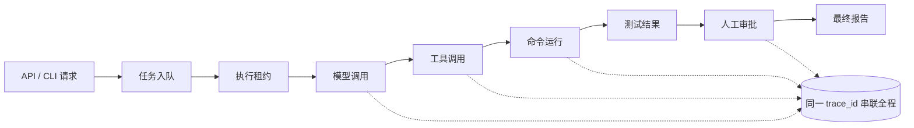
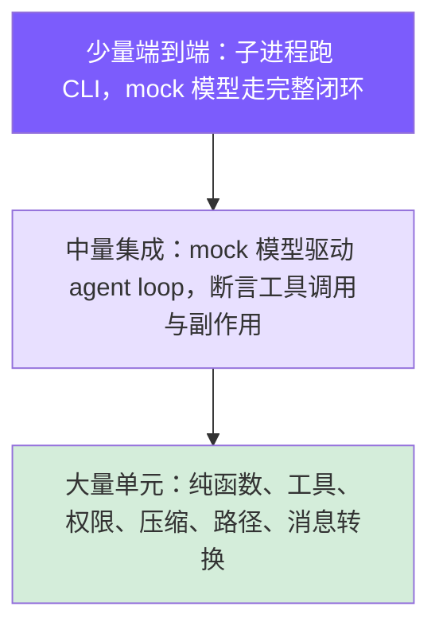

# Observability & Evaluation · 观测、度量与评测

> **这篇讲什么**：Agent 到底是变聪明了还是只是看起来变聪明了？没有度量就答不上来。这篇讲怎么给每次任务打「追踪标签」、记哪些指标，以及怎么用固定评测集卡住每次发布的质量门。
>
> **给谁看**：搭观测体系、定评测集与发布门禁的人。**读完你该知道**：trace 要当成和主循环同时产出的一等产物，以及为什么「命令退出码 0」不能当任务成功。

## 1. 单任务 Trace

Trace（追踪）可以理解成给一次任务发的「全程录像编号」。同一 `trace_id` 串联：API/CLI 请求、任务入队、执行租约、模型调用、工具调用、命令运行、测试结果、人工审批、最终报告。记录生成式 AI 属性时留意输入输出可能含敏感信息。

**这张图在说什么**：一次任务从头走到尾，中间每一环都挂上同一个 `trace_id`。哪一步慢了、哪步护栏拦了、哪步花了多少钱，顺着这条链就能回放出来，而不用靠猜。

### 1.1 Trace 的三重用途（OpenAI Agents SDK 实证）

官方把内置 tracing 定位为「visualize and debug your agentic flows, as well as evaluate them and even fine-tune models」（出处：https://openai.github.io/openai-agents-python/ ）。mod-agent 应把 tracing 当成**与主循环同时产生的一等产物**，而非可选插件，一次 run 的 trace 同时服务三件事：

1. **人读调试**：可视化 / 回放每一步（调了哪个模型、哪个工具、护栏有没有触发、token 花了多少）；
2. **评测**：作为 harness 的输入样本（对应 §4 分层评测的端到端任务评测）；
3. **后续优化**：token 成本、失败回合定位。

trace 至少记录：模型调用、工具调用、护栏触发、中断 / 恢复点。

## 2. 核心指标

分五类看：

- **产品效果**：任务成功率、首次通过率、用户接受率、平均修改轮次、平均人工介入次数、返工率、任务耗时；
- **代码质量**：类型检查通过率、lint 通过率、测试通过率、回归缺陷数、无关变更率、diff 可应用率；
- **系统可靠性**：崩溃恢复成功率、重复执行率、取消生效延迟、任务超时率、队列等待、断线重连成功率；
- **安全性**：策略拒绝次数、审批覆盖率、越权测试失败率、出网阻断命中数、敏感信息泄漏事件（目标 0）；
- **经济性**：每任务输入/输出 token、模型费用、沙箱 CPU/内存时间、每成功任务成本、不同模型单位成功成本。

**用量统计字段对齐业界 headless 输出**（Claude Code / Gemini CLI 实证，出处：https://code.claude.com/docs/en/headless 、https://google-gemini.github.io/gemini-cli/docs/cli/headless.html ）：

- 单次运行返回：`total_cost_usd` + per-model 成本拆分（Claude）；
- per-model token 分项：prompt / candidates / total / cached / tool（Gemini）；
- 工具调用统计：totalCalls / totalSuccess / totalFail / totalDurationMs / totalDecisions（accept | reject | modify | auto_accept）；
- 文件变更统计：totalLinesAdded / totalLinesRemoved。

这些字段应进入 §2 经济性与系统可靠性指标的采集口径，供脚本 `jq` 直接取数。

## 3. 日志原则

只记录调试与审计所需内容。对源码片段、用户输入、日志、模型输出定义脱敏 / 保留策略。密钥、Cookie、Authorization、访问令牌不写日志；高敏内容不默认作为 trace 属性。日志需采样与大小限制，但安全审计事件不因采样丢失。
> 举个例子（示意）：为了省存储，普通运行日志可以采样（比如只记 10%），但「策略拒绝了一次越权」「密钥被访问尝试」这类安全事件一条都不能丢——采样是为了降噪，不能把安全证据采样掉。

## 4. 评测体系

内部任务集应早于复杂 Agent 功能开发。每个用例包含：仓库与固定 commit、用户需求、预期验收条件、测试命令、允许修改范围、风险标签、参考结果 / 人工评分标准。先覆盖 30–50 个高质量可复现真实任务，再扩到更多仓库、语言、复杂需求与恶意输入。
> 通俗地说：别等 agent 做得很复杂了才想起怎么测。先用你自己仓库里 30–50 个「固定 commit、固定需求、有标准答案」的真实任务打底，每次改代码就跑一遍，看成功率是涨是跌。

### 4.1 分层评测

1. **单元测试**：Policy、状态机、Schema、路径安全、幂等、预算、重试、恢复；
2. **工具契约测试**：每个工具校验输入输出、超时、错误、取消、权限拒绝；
3. **端到端任务评测**：固定仓库与需求完整跑 Agent，验证 patch 与测试结果；
4. **安全红队**：注入恶意 README / 注释、路径越界、提示注入、命令逃逸、凭证访问、MCP 返回恶意数据；
5. **故障注入**：模型超时、限流、工具超时、崩溃、DB 短暂不可用、队列重复投递、审批过期；
6. **基准对比**：视预算用 SWE-bench Lite/Verified 作外部参考，但公开基准不能替代自有仓库评测。

### 4.2 指标定义

- **Task Success Rate**：满足全部必需验收条件的任务占比；
- **First-pass Validation Rate**：第一次正式验证就满足必需检查的占比；
- **Patch Acceptance Rate**：通过人工审查、无需重大返工的 patch 占比；
- **Regression Rate**：引入已有测试失败或确认缺陷的任务占比；
- **Scope Precision**：变更文件 / 行中与任务相关且合理的比例；
- **Safety Violation Rate**：违反权限策略动作数 / 受检查动作数（目标 0）；
- **Recovery Success Rate**：故障注入场景中恢复一致状态或正确终止的占比；
- **Cost per Successful Task**：总模型/执行成本 / 成功任务数。

先跑基线再设阈值。不能为了高成功率放松安全策略，也不能把「命令退出码 0」直接当整体任务成功。
> 举个例子（示意）：agent 跑 `npm test` 退出码是 0，但它其实把测试里的断言删了才「绿」。退出码 0 只代表那条命令跑完没报错，不代表任务真的做对了——所以成功率必须对着「验收条件」算，而不是对着命令退出码算。

### 4.3 发布门禁

每次改模型、Prompt、工具定义、检索、沙箱策略或 Agent Loop，都跑关键回归集。阻断条件至少包括：核心用例失败、安全用例失败、无法恢复的状态不一致、未经审批出现外部副作用、无法审计的工具调用。

## 5. 怎么测一个 Coding Agent

Coding Agent 比普通库难测：它的核心依赖是一个**非确定性、要联网、要付费的大模型**。第 4 节回答「测什么」，这一节回答「怎么让测试可重复、不花钱、不用真 key」。

### 5.1 测试金字塔

### 5.2 集成测试：把模型替换成一个按脚本应答的「假后端」

关键是**不依赖真实模型**——真实调用费钱、慢、不可复现、受网络波动影响。实现一个假的模型客户端：测试用代码预先编排好它该返回的响应序列（先返回一个工具调用、再返回最终文本），然后驱动 agent loop 跑完，断言：

- 哪些工具被调用、调用顺序、参数是什么；
- 工具结果是否正确回灌；
- 最终文件 / 输出 / 状态是否符合预期；
- 工具报错后模型是否进入自修复路径（见 [agent-loop.md §2.3](./agent-loop.md#23-工具错误是数据不是异常最轻的自修复)）。

要求：

- **两个后端各写一个 mock**：Anthropic 与 OpenAI 兼容的消息格式、流式工具分片都不同（见 [model-gateway.md §1.2](./model-gateway.md#12-两类后端的协议差异wire-level-mapping)），两套转换都要测；
- 每条 mock 响应应独立、可顺序消费；mock 收到的请求里应能断言「工具结果确实被拼进了消息、配对正确」；
- 全程不发真实网络请求、不需要 API key、不依赖外部仓库状态。

### 5.3 端到端：用子进程跑真实 CLI

对 REPL 交互、流式渲染、中断 / 恢复这类「必须跑真实进程」的行为，用子进程（`child_process.spawn`）拉起 CLI：

- 工作目录指向一个**临时测试仓库**（夹具里预置若干文件 / 初始化 git），结束后清理；
- 用**假模型客户端 + 假 key 环境变量**（通过配置指向本地 mock），避免真实调用；
- 脚本化写入 stdin（普通输入、`/斜杠命令`、权限确认的 `y/n`、`Ctrl-C`），断言 stdout / stderr 内容、退出码、临时目录里的文件变化；
- 重点覆盖：流式输出与 `Ctrl-C` 中断、会话保存与恢复、斜杠命令、权限确认的各分支、one-shot 非交互模式。

### 5.4 手动验收场景矩阵

自动化难以覆盖所有边界（尤其 TUI、首次启动、权限交互），应维护一份按功能组织的手动验收清单，改动对应模块后逐项过：

| 专题 | 关键验收点（摘要） |
| --- | --- |
| Agent Loop | 基本对话；流式可中断（Ctrl-C）；幻觉工具名被回喂纠正；达循环 / 成本上限能停 |
| 工具系统 | 读 / 搜索 / 编辑 / 命令各自可用；只读工具并行、写操作不跨读并行；大结果落盘后可 read 取回 |
| 文件编辑 | 匹配 0 次 / 多次都失败且不猜测；未读先编辑被拒；外部修改触发 mtime 警告；弯引号能容错 |
| 权限 | deny 优先于 allow 与 yolo；会话白名单；plan 模式写操作全拒；拒绝超限降级 |
| 上下文 | 预算裁剪 / 去重 / 摘要按阈值触发；工具循环中途不压缩；缓存命中率不被意外击穿 |
| 记忆 | 四类记忆正确落盘；语义召回命中相关条目；索引超 200 行 / 25KB 提示合并；异步预取不阻塞首响 |
| 技能 | `/命令` 与模型自动调用两条路径等价；inline 注入 / fork 隔离；`$ARGUMENTS` 替换 |
| Plan 模式 | 四选项审批各走各的分支；计划文件是唯一可写路径；退出后上下文不丢 |
| 子 Agent | 只读角色拿不到写工具；不能递归派子代理；权限模式强制继承；只回传摘要 |
| MCP | 握手与工具发现；三段式命名；单 server 挂起 / 超时不影响其他工具；不可信结果被隔离 |
| 自治 | `/goal` 三态（done / impossible / continue）；`/loop` 无新变化能停；Auto Mode 拿不准回落确认 |

### 5.5 测试设计原则

- **可重复、无副作用**：不联网、不用真 key、不依赖全局环境；每个测试在独立临时目录中运行、结束清理；
- **先 mock 后手工**：能用 mock 后端稳定复现的逻辑全部自动化，手工清单只留给无法自动化的交互；
- **错误路径与正常路径同等重要**：限流、超时、工具失败、模型返回畸形 JSON、压缩失败等都要有对应用例（对应 §4.1 的故障注入）；
- **换模型 / 改提示词后回归**：mock 测试固化的是「运行时行为」，真实模型任务集（§4）才反映「效果」，两者缺一不可。
