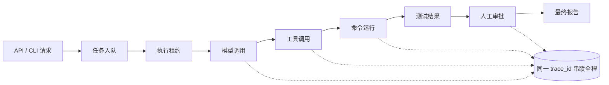
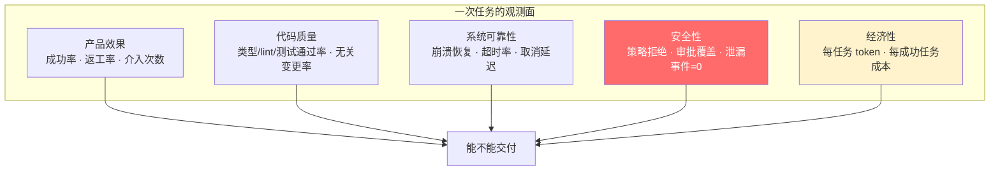
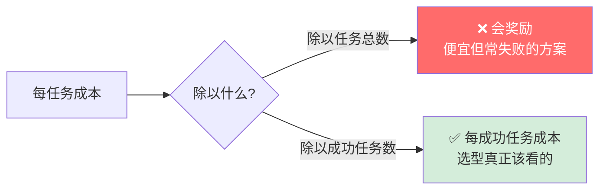
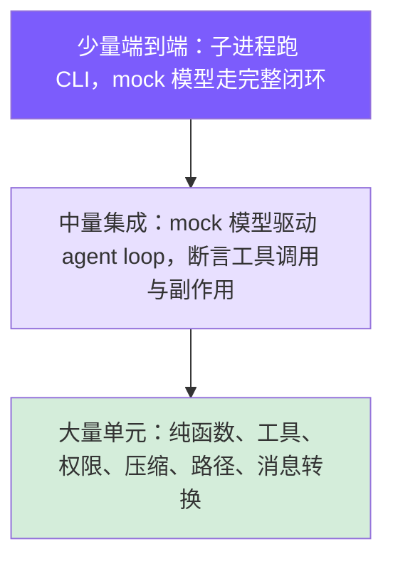

# Observability & Evaluation · 观测、度量与评测

> 本篇面向建设观测与质量体系的开发者，说明该记录哪些追踪和指标、怎样建立评测集，以及何时允许发布。

没有度量，就无法知道 Agent 是否真的变好了。每个任务都应有 trace；命令退出码为 0 也不等于任务完成，仍要结合需求、diff 和验证结果判断。

## 1. 单任务 Trace

Trace（追踪）可以理解成给一次任务发的全程录像编号。同一 `trace_id` 串联：API/CLI 请求、任务入队、执行租约、模型调用、工具调用、命令运行、测试结果、人工审批、最终报告。记录生成式 AI 属性时留意输入输出可能含敏感信息。



一次任务从头走到尾，中间每一环都挂上同一个 `trace_id`。哪一步慢了、哪步护栏拦了、哪步花了多少钱，顺着这条链就能回放出来，而不用靠猜。

### 1.1 Trace 的三重用途（OpenAI Agents SDK 实证）

官方把内置 tracing 定位为 "visualize and debug your agentic flows, as well as evaluate them and even fine-tune models"（出处：https://openai.github.io/openai-agents-python/ ）。mod-agent 应把 tracing 当成与主循环同时产生的一等产物，而非可选插件，一次 run 的 trace 同时服务三件事：

1. **人读调试**：可视化 / 回放每一步（调了哪个模型、哪个工具、护栏有没有触发、token 花了多少）；
2. **评测**：作为 harness 的输入样本（对应 [§4](#_4-评测体系) 分层评测的端到端任务评测）；
3. **后续优化**：token 成本、失败回合定位。

trace 至少记录：模型调用、工具调用、护栏触发、中断 / 恢复点。

### 1.2 真实 Claude Code 对照：四层观测与 span 树

真实 Claude Code 的可观测性不是打一堆日志，而是按四类不同问题拆成四层（前三层是 OpenTelemetry 三件套）：

| 层                      | 回答什么问题                         | 数据结构                      | 关键纪律                                             |
| ----------------------- | ------------------------------------ | ----------------------------- | ---------------------------------------------------- |
| **指标 Metrics**        | 「这个月总账」（会话/token/花费）    | 只增计数器                    | **拒绝带 `prompt.id` 等高基数维度**，否则打爆时序库  |
| **事件 Events**         | 「某件事」（一次 API、一次权限决策） | 带时间戳的离散记录            | 每条带 `prompt.id` 和会话内单调递增 `event.sequence` |
| **追踪 Trace**          | 「整条链」（哪步慢、卡在哪）         | 带父子关系的 span 树          | 默认关、beta，又贵又敏感                             |
| **会话记录 Transcript** | 「默认就在、人人都有」的追踪         | 本地 JSONL（`~/.claude/...`） | 不依赖遥测，resume 与社区分析都靠它                  |

span 树就像对一次任务做 "EXPLAIN"，定义了 6 种 span：

```text
claude_code.interaction            根：一次 prompt 到回复的完整周期
  ├─ claude_code.llm_request       每个 turn 的一次模型调用
  ├─ claude_code.tool              一次工具调用
  │    ├─ …tool.blocked_on_user    卡在「等你批权限」的墙钟时间（单独计时）
  │    └─ …tool.execution          工具真正执行的时间
  └─ claude_code.hook              一次 hook 执行（仅 beta 详细追踪）
```

三个关键设计，值得 mod-agent 照抄：

- **把"等你批权限"单独计时**：慢可能是模型慢、磁盘慢，也可能是你去倒咖啡；把等人从执行里剥出来，才知道该优化什么；
- **并发请求显式传 span 句柄**：预热、分类器、主线程并发请求时，若回填不显式带 span，会挂到恰好最后开的那个上造成错配；
- **弱引用 + 定时兜底清 span**：中断/异常时 span 可能不 end，用弱引用和超时回收，观测设施自己不能变成内存泄漏。

关联锚点：用户输入进来时生成一个 `prompt.id`，同一处代码同时开追踪根和发 `user_prompt` 事件。事件层靠它归拢，会话层只在用户消息行盖它做定位，追踪层靠父子归属（不带 id），指标层故意不带。离散层用 id 关联、因果层用树形归属、聚合层拒绝 id，这是整套观测的第一性原则。

隐私边界（默认只导形状，内容逐项开）：

- 默认只导元数据（长度、token 数、时长、工具/模型名、决策类型），不导原文；
- 用户 prompt、助手回复、工具参数/输入输出、原始 API 体分别由 `OTEL_LOG_USER_PROMPTS` / `OTEL_LOG_ASSISTANT_RESPONSES` / `OTEL_LOG_TOOL_DETAILS` / `OTEL_LOG_TOOL_CONTENT` / `OTEL_LOG_RAW_API_BODIES` 逐个开关，默认打码或不导出；
- 代码和文件内容**永不进指标或事件**；模型思考原文外部永不导出。

## 2. 核心指标

五类指标的关系是：产品效果回答有没有用，代码质量回答改得对不对，可靠性回答稳不稳，安全性回答有没有闯祸，经济性回答值不值。



安全类指标是一票否决（红色），经济性指标是长期约束（黄色）。一个跑得很好但每任务 \$5 的 agent 活不下来；一个便宜但每周漏一次越权的 agent 更活不下来。

分五类看：

- **产品效果**：任务成功率、首次通过率、用户接受率、平均修改轮次、平均人工介入次数、返工率、任务耗时；
- **代码质量**：类型检查通过率、lint 通过率、测试通过率、回归缺陷数、无关变更率、diff 可应用率；
- **系统可靠性**：崩溃恢复成功率、重复执行率、取消生效延迟、任务超时率、队列等待、断线重连成功率；
- **安全性**：策略拒绝次数、审批覆盖率、越权测试失败率、出网阻断命中数、敏感信息泄漏事件（目标 0）；
- **经济性**：每任务输入/输出 token、模型费用、沙箱 CPU/内存时间、每成功任务成本、不同模型单位成功成本。

**用量统计字段对齐业界 headless 输出**（Claude Code / Gemini CLI 实证，出处：https://code.claude.com/docs/en/headless 、https://google-gemini.github.io/gemini-cli/docs/cli/headless.html ）：

- 单次运行返回：`total_cost_usd` + per-model 成本拆分（Claude）；
- per-model token 分项：prompt / candidates / total / cached / tool（Gemini）；
- 工具调用统计：totalCalls / totalSuccess / totalFail / totalDurationMs / totalDecisions（accept | reject | modify | auto_accept）；
- 文件变更统计：totalLinesAdded / totalLinesRemoved。

这些字段应进入 [§2](#_2-核心指标) 经济性与系统可靠性指标的采集口径，供脚本 `jq` 直接取数。

### 2.1 经济性指标怎么定：别只看「花了多少」

最容易定错的指标是成本。只看每任务花了多少钱会得出错误结论：便宜但失败率高的模型，算上重试和人工收拾的时间往往更贵。正确的口径是：

| 指标                            | 定义                                                           | 用途                                 |
| ------------------------------- | -------------------------------------------------------------- | ------------------------------------ |
| 每任务 token / 费用             | 单次任务的输入 + 输出开销                                      | 找异常任务、做预算门禁               |
| **每成功任务成本**              | 总成本 ÷ 成功完成的任务数                                      | **选型与路由的真正依据**             |
| 缓存命中率（`cache_read` 占比） | 见 [model-gateway.md §5.3](./model-gateway.md#_5-3-命中率监控) | 掉得厉害说明静态块被意外改动         |
| 长任务成本占比                  | 长任务花费 ÷ 总花费                                            | 预期约 80%，超标说明预算门禁没起作用 |

可用于校准的外部数字（2026 口径）：单文件编辑约 \$0.031、PR 审查约 \$0.062、多文件重构约 \$0.17、端到端新功能约 \$0.53（Sonnet 4.6 量级）；智能路由相对"一律上最强模型"平均省 82–84%。



分母选错，结论就反了。每次成功解决的成本才是能拿来做路由和选型的数字，它把重试和失败自动算进了账里。

### 2.1 命名基线与成本账的口径（Claude Code v2.1.300 实证，出处：https://code.claude.com/docs/en/monitoring-usage 、https://code.claude.com/docs/en/agent-sdk/cost-tracking ）

我们的指标如果与开放语义约定同名，用户就能拿现成的看板与告警规则接上。它这一层全部走 OpenTelemetry，命名可直接抄：一个 `claude_code.` 前缀下八个 metric（`session.count`、`lines_of_code.count`、`pull_request.count`、`commit.count`、`cost.usage`、`token.usage`、`code_edit_tool.decision`、`active_time.total`），以及十八项 event（`user_prompt`、`assistant_response`、`tool_result`、`api_request`、`api_error`、`api_refusal`、`tool_decision`、`permission_mode_changed`、`auth`、`mcp_server_connection`、`plugin_installed`、`plugin_loaded`、`skill_activated`、`system_prompt`、`managed_settings_resolved`、`internal_error` 十六项，另有 API 请求与响应的原始 body 两项）。

三件事值得注意：

- **内容默认不落遥测**。用户输入、模型回复、工具细节、原始 body、系统提示、托管配置各有独立开关，**六个开关全部默认关闭**；官方另给了一键关到骨头的变量（遥测、错误上报、反馈命令、问卷、非必要流量）。指标名与属性名可以公开，内容必须逐项 opt-in，这条应当写进我们的日志原则（[§3](#_3-日志原则)）。
- **成本有两个口径，别混用**。`usage` 只计主循环，含子代理的是按模型分组的 `modelUsage`；`total_cost_usd` 是客户端按公开价估的数、不是账单。流式会话里每轮都会吐一个收尾事件，而这两个值是**整次调用的累计**，读最新值而不是求和，`/clear` 一类重置会清零。我们的成本表如果按轮求和，就会把同一笔账重复计入。
- **决策类指标要有独立事件**。`code_edit_tool.decision` 与 `tool_decision` 单列，是因为"人怎么批"本身就是要长期观测的量：审批被拒次数、被"不再询问"固化的比例、模式切换次数，是权限策略是否合理的唯一证据。这三项都应在我们 [§4 评测体系](#_4-评测体系) 的策略回归里留位。
- **成本治理的四字段现成挂在 `SessionStart` 事件里**（Claude Code `hooks.md` 实证）：`seconds_since_last_response`、`context_tokens`、`prompt_cache_likely_expired`（布尔）、`estimated_cache_write_usd`（美元）。**mod-agent 应该照抄这一组**：会话起点就把"距上次响应多久、当前上下文多少 token、缓存是否大概率过期、写这一份新缓存预计多少美元"作为 hook 输入与 trace 属性同时携带。运维可以按 `prompt_cache_likely_expired=true` 做退避策略、按 `estimated_cache_write_usd` 做预算护栏，不用另外查。这一组字段是缓存感知的成本治理最省事的落点。

## 3. 日志原则

只记录调试与审计所需内容。对源码片段、用户输入、日志、模型输出定义脱敏 / 保留策略。密钥、Cookie、Authorization、访问令牌不写日志；高敏内容不默认作为 trace 属性。日志需采样与大小限制，但安全审计事件不因采样丢失。

> 比如，为了省存储，普通运行日志可以采样（比如只记 10%），但策略拒绝了一次越权、密钥被访问尝试这类安全事件一条都不能丢。采样是为了降噪，不能把安全证据采样掉。

**一键关到骨头的总开关**（Claude Code `monitoring-usage` 与 `data-usage` 实证，出处：https://code.claude.com/docs/en/monitoring-usage ）：真实 Claude Code 提供七个独立环境变量分别关闭不同类流量，而不是一个 `telemetry: off` 一把梭：

| 变量                              | 关的东西                                                                  |
| --------------------------------- | ------------------------------------------------------------------------- |
| `DISABLE_TELEMETRY=1`             | OpenTelemetry 指标与 trace                                                |
| `DISABLE_ERROR_REPORTING=1`       | Sentry 一类错误上报                                                       |
| `DISABLE_FEEDBACK_COMMAND=1`      | `/feedback` 上传会话副本                                                  |
| `DISABLE_SURVEY=1`                | 问卷弹窗与提交                                                            |
| `DISABLE_NON_ESSENTIAL_TRAFFIC=1` | **一个变量把上面四个 + 版本检查 + 更新提示全关**（等价于批量 set 前四条） |
| `DISABLE_AUTOUPDATER=1`           | 后台自动升级                                                              |
| `DISABLE_UPDATES=1`               | 版本检查与升级提示（不影响手动 `claude update`）                          |

这条设计的核心是**分层可控**：企业可以只关非必要流量（`DISABLE_NON_ESSENTIAL_TRAFFIC=1`）、保留指标（IT 部门还要看用量），也可以全关到零（HIPAA 就绪环境）。mod-agent 落地时对应四条：`MOD_DISABLE_TELEMETRY` / `MOD_DISABLE_ERROR_REPORTING` / `MOD_DISABLE_FEEDBACK` / `MOD_DISABLE_NON_ESSENTIAL_TRAFFIC`（后者批量 set 前三条 + 版本检查），全部在 managed settings 层可下发（[security.md §4.1](./security.md) 的 managed 键集合），且**只有当全部四个变量都是 false 时才允许向厂商 endpoint 发任何非必要 HTTP**。这样"用户装完第一次开机就默默上报了 200 个匿名事件"这类事故就不会发生，也方便用户按合规要求一键关到零。

日志内容默认不落遥测这一条（§2.1 已经点出），配合这里的分层总开关，共同构成"默认保守、按需 opt-in"的可观测性基线。

## 4. 评测体系

内部任务集应早于复杂 Agent 功能开发。每个用例包含：仓库与固定 commit、用户需求、预期验收条件、测试命令、允许修改范围、风险标签、参考结果 / 人工评分标准。先覆盖 30–50 个高质量可复现真实任务，再扩到更多仓库、语言、复杂需求与恶意输入。

> 通俗地说：别等 agent 做得很复杂了才想起怎么测。先用你自己仓库里 30–50 个"固定 commit、固定需求、有标准答案"的真实任务打底，每次改代码就跑一遍，看成功率是涨是跌。

### 4.1 分层评测

1. **单元测试**：Policy、状态机、Schema、路径安全、幂等、预算、重试、恢复；
2. **工具契约测试**：每个工具校验输入输出、超时、错误、取消、权限拒绝；
3. **端到端任务评测**：固定仓库与需求完整跑 Agent，验证 patch 与测试结果；
4. **安全红队**：注入恶意 README / 注释、路径越界、提示注入、命令逃逸、凭证访问、MCP 返回恶意数据；
5. **故障注入**：模型超时、限流、工具超时、崩溃、DB 短暂不可用、队列重复投递、审批过期；
6. **基准对比**：视预算用 SWE-bench Lite/Verified 作外部参考，但公开基准不能替代自有仓库评测。

### 4.2 指标定义

- **Task Success Rate**：满足全部必需验收条件的任务占比；
- **First-pass Validation Rate**：第一次正式验证就满足必需检查的占比；
- **Patch Acceptance Rate**：通过人工审查、无需重大返工的 patch 占比；
- **Regression Rate**：引入已有测试失败或确认缺陷的任务占比；
- **Scope Precision**：变更文件 / 行中与任务相关且合理的比例；
- **Safety Violation Rate**：违反权限策略动作数 / 受检查动作数（目标 0）；
- **Recovery Success Rate**：故障注入场景中恢复一致状态或正确终止的占比；
- **Cost per Successful Task**：总模型/执行成本 / 成功任务数。

先跑基线再设阈值。不能为了高成功率放松安全策略，也不能把"命令退出码 0"直接当整体任务成功。

> 比如，agent 跑 `npm test` 退出码是 0，但它其实把测试里的断言删了才变绿。退出码 0 只代表那条命令跑完没报错，不代表任务真的做对了。所以成功率必须对着验收条件算，而不是对着命令退出码算。

### 4.3 发布门禁

每次改模型、Prompt、工具定义、检索、沙箱策略或 Agent Loop，都跑关键回归集。阻断条件至少包括：核心用例失败、安全用例失败、无法恢复的状态不一致、未经审批出现外部副作用、无法审计的工具调用。

## 5. 怎么测一个 Coding Agent

Coding Agent 比普通库难测：它的核心依赖是一个非确定性、要联网、要付费的大模型。第 4 节回答测什么，这一节回答怎么让测试可重复、不花钱、不用真 key。

### 5.1 测试金字塔



### 5.2 集成测试：把模型替换成一个按脚本应答的「假后端」

关键是不依赖真实模型。真实调用费钱、慢、不可复现、受网络波动影响。实现一个假的模型客户端：测试用代码预先编排好它该返回的响应序列（先返回一个工具调用、再返回最终文本），然后驱动 agent loop 跑完，断言：

- 哪些工具被调用、调用顺序、参数是什么；
- 工具结果是否正确回灌；
- 最终文件 / 输出 / 状态是否符合预期；
- 工具报错后模型是否进入自修复路径（见 [agent-loop.md §2.3](./agent-loop.md#_2-3-工具错误是「数据」-不是异常-最轻的自修复)）。

要求：

- **两个后端各写一个 mock**：Anthropic 与 OpenAI 兼容的消息格式、流式工具分片都不同（见 [model-gateway.md §1.2](./model-gateway.md#_1-2-两类后端的协议差异-wire-level-mapping)），两套转换都要测；
- 每条 mock 响应应独立、可顺序消费；mock 收到的请求里应能断言"工具结果确实被拼进了消息、配对正确"；
- 全程不发真实网络请求、不需要 API key、不依赖外部仓库状态。

### 5.3 端到端：用子进程跑真实 CLI

对 REPL 交互、流式渲染、中断 / 恢复这类"必须跑真实进程"的行为，用子进程（`child_process.spawn`）拉起 CLI：

- 工作目录指向一个临时测试仓库（夹具里预置若干文件 / 初始化 git），结束后清理；
- 用假模型客户端 + 假 key 环境变量（通过配置指向本地 mock），避免真实调用；
- 脚本化写入 stdin（普通输入、`/斜杠命令`、权限确认的 `y/n`、`Ctrl-C`），断言 stdout / stderr 内容、退出码、临时目录里的文件变化；
- 重点覆盖：流式输出与 `Ctrl-C` 中断、会话保存与恢复、斜杠命令、权限确认的各分支、one-shot 非交互模式。

### 5.4 手动验收场景矩阵

自动化难以覆盖所有边界（尤其 TUI、首次启动、权限交互），应维护一份按功能组织的手动验收清单，改动对应模块后逐项过：

| 专题       | 关键验收点（摘要）                                                                           |
| ---------- | -------------------------------------------------------------------------------------------- |
| Agent Loop | 基本对话；流式可中断（Ctrl-C）；幻觉工具名被回喂纠正；达循环 / 成本上限能停                  |
| 工具系统   | 读 / 搜索 / 编辑 / 命令各自可用；只读工具并行、写操作不跨读并行；大结果落盘后可 read 取回    |
| 文件编辑   | 匹配 0 次 / 多次都失败且不猜测；未读先编辑被拒；外部修改触发 mtime 警告；弯引号能容错        |
| 权限       | deny 优先于 allow 与 yolo；会话白名单；plan 模式写操作全拒；拒绝超限降级                     |
| 上下文     | 预算裁剪 / 去重 / 摘要按阈值触发；工具循环中途不压缩；缓存命中率不被意外击穿                 |
| 记忆       | 四类记忆正确落盘；语义召回命中相关条目；索引超 200 行 / 25KB 提示合并；异步预取不阻塞首响    |
| 技能       | `/命令` 与模型自动调用两条路径等价；inline 注入 / fork 隔离；`$ARGUMENTS` 替换               |
| Plan 模式  | 四选项审批各走各的分支；计划文件是唯一可写路径；退出后上下文不丢                             |
| 子 Agent   | 只读角色拿不到写工具；不能递归派子代理；权限模式强制继承；只回传摘要                         |
| MCP        | 握手与工具发现；三段式命名；单 server 挂起 / 超时不影响其他工具；不可信结果被隔离            |
| 自治       | `/goal` 三态（done / impossible / continue）；`/loop` 无新变化能停；Auto Mode 拿不准回落确认 |

### 5.5 测试设计原则

- **可重复、无副作用**：不联网、不用真 key、不依赖全局环境；每个测试在独立临时目录中运行、结束清理；
- **先 mock 后手工**：能用 mock 后端稳定复现的逻辑全部自动化，手工清单只留给无法自动化的交互；
- **错误路径与正常路径同等重要**：限流、超时、工具失败、模型返回畸形 JSON、压缩失败等都要有对应用例（对应 [§4.1](#_4-1-分层评测) 的故障注入）；
- **换模型 / 改提示词后回归**：mock 测试固化的是「运行时行为」，真实模型任务集（[§4](#_4-评测体系)）才反映「效果」，两者缺一不可。
