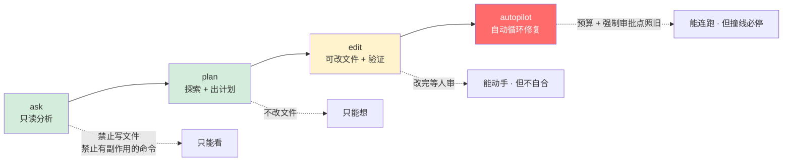

# Overview · 目标、边界与范围

> 这篇说清楚：做什么、不做什么、按什么原则做。架构实现见 [architecture.md](./architecture.md)。

> 一句话：mod-agent 会自己动手翻代码、改文件、跑测试，但事事留痕，关键动作等你点头。改完它把 diff 摆在桌上，合不合、改不改由你定。

## 1. 产品定位

mod-agent 是一个**人在环上（human-in-the-loop）**的 AI Coding Agent CLI，核心能力：

1. **需求理解**：把模糊的自然语言描述解析为结构化、可验证的开发任务，必要时向人澄清；
2. **代码生成与修改**：greenfield 与 brownfield 双场景产出，以可审查 diff 呈现；
3. **环境交互**：读写文件、执行受控命令、跑测试、检索代码库；
4. **自我修正**：基于编译 / 测试 / lint 的结构化反馈迭代修复，直至验收通过或升级人工。

**边界**：人类监督下的委托执行系统。人负责需求决策与最终审查（改不改、合不合），Agent 负责探索、实现、验证与迭代。Agent 不自动部署生产、不合并主分支、不访问线上数据。

箭头绕了一圈回到人手里：agent 在中间干活，但改不改、合不合的开关始终在人这边。

### 1.1 目标任务与验收

| 任务类型 | 示例输入                           | 预期行为                                              | 主要验收                     |
| -------- | ---------------------------------- | ----------------------------------------------------- | ---------------------------- |
| 新功能   | 「在用户列表页加姓名搜索和分页」   | 找页面、复用已有组件与 API 模式，改 UI/状态/请求/测试 | 符合项目规范，测试通过       |
| 缺陷修复 | 「切查询条件后仍显示上次搜索结果」 | 追踪竞态、复现、修复 stale response，补回归测试       | 回归通过，旧行为不退化       |
| 重构     | 「把重复的格式化逻辑抽成公共工具」 | 搜调用方、评估影响面、最小变更                        | 类型检查与测试通过，兼容明确 |
| 代码理解 | 「解释这个页面的请求链路」         | 搜入口、组件、Hooks、API、状态来源                    | 结论带文件路径与符号证据     |
| 测试生成 | 「给这个 Hook 补边界测试」         | 分析测试框架、生成最小测试并运行                      | 新测试真实运行且有判定价值   |

### 1.2 任务模式

- `ask`：只读分析，禁止写文件或执行有副作用命令；
- `plan`：只探索并给出计划，不改文件；
- `edit`：允许工作区文件变更，验证后等待人审阅；
- `autopilot`：在明确权限策略与预算内自动循环修复，仍不能跳过强制审批点。

四档模式的差别，就是看 agent 的手能伸多远：

越往右，agent 的手伸得越远，但每一档都保留人这个终点。最右的 autopilot 标红是提醒：它也不是无边界，预算上限和强制审批点照样生效，只是省掉了中间的逐次确认。

默认模式应为 `plan` 或 `edit`，而不是无边界全自动。**人与管理员的授权范围，优先级永远高于模型提出的动作。**

比如，你说"看看登录页为什么偶发报错"，用 `ask`，它只查不改；说"把这个报错修了"，用 `edit`，它改完把 diff 给你审；说"这一串重构你自己连跑几轮"，才上 `autopilot`，且预算和强制审批点照旧生效。

### 1.3 一次任务怎样算成功

不只看模型有没有生成代码，而要同时满足：

- **需求相关性**：改动确实解决用户描述的问题；
- **变更范围**：没有不必要的大规模重写；
- **可验证性**：项目可执行的检查被真实运行并记录；
- **可审查性**：Diff 清晰、变更来源可追踪；
- **安全性**：没有越权访问、危险命令或未授权外部副作用；
- **可恢复性**：中断后能继续、取消后停止新动作；
- **诚实交付**：测试没跑、环境失败或存在不确定性时明确说明。

## 2. 设计原则

调研表明，拉开 Coding Agent 差距的不是模型本身，而是 **Agent Runtime**（运行时）的工程设计。本项目遵循：

1. **Agent 不等于模型**：模型只负责推断与选择动作；业务层负责状态机、权限、审批、幂等、超时与持久化。
2. **单 Agent 闭环优先**：一个主 Agent + 确定性验证流程；只有在评测证明有独立收益时才引入子 Agent。
3. **接口即能力（ACI）**：工具为 LLM 反向定制，输出裁剪、命令白名单、强制绝对路径、报错带修复提示。SWE-agent 仅靠改进 ACI 就把 SWE-bench 解决率从 ~2% 提到 12.5%。
4. **验证驱动**：用仓库自带测试 / lint / 类型检查作为 ground truth，不叠一个 LLM 批评家；不信模型自述已修复。
5. **上下文是缓存**：just-in-time 检索 + compaction 压缩 + 外置笔记 + 子 Agent 隔离，对抗 context rot。
6. **人在环上**：Plan 先出计划等人确认，draft diff 不自合；在 checkpoint / blocker 暂停等人。
7. **执行必须沙箱隔离**：只要跑 `npm install` / `bash` 就在隔离环境里，不在宿主直接跑。
8. **配置即代码**：models / 权限 / 工具 / MCP 全部走配置文件，不硬编码。
9. **每步可回滚**：起步用 Git Worktree / shadow commit 快照，比自研 checkpoint 系统便宜。
10. **先做纵向闭环，再横向铺能力**：先证明一个任务能安全、可恢复地改代码并验证，再上向量库、多 Agent、浏览器自动化。

这 10 条的内核：模型只负责出主意，真正可靠的是外面那套工程，也就是状态机、权限、测试、回滚。写代码便宜，跑通测试才贵，所以一切改动都以仓库自带的测试为准，而不是听模型说它改好了。

### 2.1 与业界事实标准的对齐（2026-08 核实）

以下机制已在主流 coding agent 的官方文档中核实为事实标准，mod-agent 的设计原则与之对齐：

| mod-agent 原则                             | 业界事实标准（出处）                                                                                                                                                                       |
| ------------------------------------------ | ------------------------------------------------------------------------------------------------------------------------------------------------------------------------------------------ |
| 规则文件用 AGENTS.md / CLAUDE.md，就近覆盖 | AGENTS.md 开放标准，6 万+ 项目、Linux 基金会托管（https://agents.md ）；Claude Code 拼接加载 + AGENTS.md 回退（https://code.claude.com/docs/en/memory ）                                   |
| 自主程度分档（ask / edit / autopilot）     | Codex / Gemini CLI 审批档位（https://google-gemini.github.io/gemini-cli/docs/cli/headless.html ）；Factory 自治等级默认只读逐级放权（https://docs.factory.ai/droid-cli/cli-reference.md ） |
| 每步可回滚（shadow commit / checkpoint）   | Cline Shadow Git 每工具调用快照（https://docs.cline.bot/core-workflows/checkpoints ）；Aider 改动即 commit（https://aider.chat/docs/git.html ）                                            |
| 接口即能力（ACI）                          | SWE-agent 明确提出 ACI engineering（https://swe-agent.com/latest/background/aci/ ）                                                                                                        |
| headless 可机读输出                        | Claude Code `json / stream-json` + 成本（https://code.claude.com/docs/en/headless ）；Gemini `stats` 用量（https://google-gemini.github.io/gemini-cli/docs/cli/headless.html ）            |
| 沙箱默认关网络、fail-closed                | Devin 沙箱解析失败即拒绝启动 + 域名过滤（https://docs.devin.ai/cli/reference/configuration/config-file ）                                                                                  |

## 3. MVP 范围

### 3.1 首期要做

- 支持一个本地或 Git 仓库工作区，优先 TypeScript / JavaScript / React 项目；
- 支持新功能、改逻辑、修 bug、补测试、解释代码五类任务；
- 读取项目约定与关键文件，生成可审查计划；
- Agent 可搜索、读文件、编辑文件、运行受控命令与测试；
- 支持 Diff 预览、人工批准、暂停、恢复、取消、超时、有限重试；
- 使用独立任务工作区（Git Worktree），结束时给出改动文件、验证结果、风险与后续建议；
- 通过 `ModelProvider` 接口接入至少一个模型供应商；
- 通过 MCP 接入外部工具；本地文件与命令由可信内部工具层托管。

### 3.2 首期明确不做

- 不让 Agent 默认部署生产、改线上数据、合并主分支或发版；
- 不追求首期支持所有语言、所有 IDE、所有构建系统；
- 不一开始就把功能拆成多个 Agent 再协调；
- 不允许把任意网页内容当成高信任指令；
- 不宣称所有任务完全无人干预，复杂需求与高风险动作必须能回到人工确认；
- 不做向量数据库、多 Agent、Web 控制台（见 `roadmap.md` 的远期阶段）。
