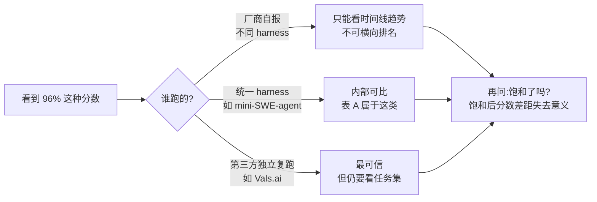
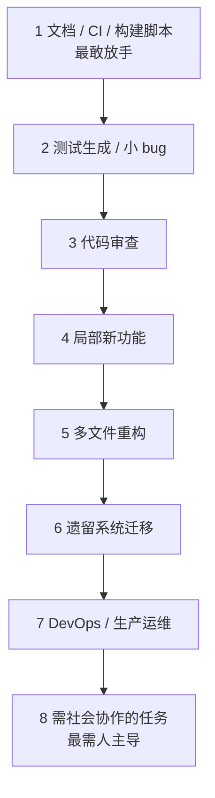

# Research · 领域调研综述

> 这篇说明"为什么这样设计"：什么是 AI Coding Agent、主流产品、真实能力边界、核心范式与失败模式。

> 这篇是后面每个设计选择的决策依据：为什么这样拍板，对应哪条业界数据或失败案例，都记在这里。读的时候重点盯数字旁边那行口径警告，分数好不好看，首先取决于它是在什么条件下跑出来的。

## 1. 什么是 AI Coding Agent

LLM 在一个循环里自主调用工具、每步从环境拿到 ground truth（测试结果、文件内容、命令输出）再决定下一步的系统。经典循环是 gather context → take action → verify work → repeat。

比如，修一个 bug：agent 先读相关文件（gather context），再改一个文件（take action），然后跑测试看红还是绿（verify work）；测试红了，就带着报错信息再来一圈。

与 Copilot 式补全的区别：

| 维度     | 行内补全 / 聊天助手 | AI Coding Agent                          |
| -------- | ------------------- | ---------------------------------------- |
| 决策粒度 | 单段补全、单轮问答  | 读哪些文件、改什么、跑什么测试由模型自决 |
| 执行环境 | 人打开的编辑器      | 持久沙箱（shell + editor + browser）     |
| 验证闭环 | 无                  | 跑仓库测试、读失败输出、再改代码         |
| 交付物   | 文本 / 代码片段     | 分支上的 diff、draft PR、可运行补丁      |
| 自主程度 | 人逐字确认          | Plan/审批点后人放手，连续跑数小时        |

底层范式已经收敛为自主工具循环 + 确定性测试闭环。循环里用哪种心智（ReAct/Reflexion）不是决定成败的主要因素，真正拉开差距的是 ACI、scaffolding、context engineering 这三层工程。

## 2. 主流产品与项目

### 商业产品

| 产品                 | 形态                    | 核心架构                                                         | 关键理念                                            |
| -------------------- | ----------------------- | ---------------------------------------------------------------- | --------------------------------------------------- |
| Devin (Cognition)    | 云端工作台，输出 PR     | 云端隔离 VM + OS 级进程沙箱 + 域名过滤代理，工作区每次会话重置   | 人可观察可接管的完整工作台 + 测试闭环               |
| Cursor               | AI IDE（fork VS Code）  | Tab + Agent/Composer 双梯度、codebase embedding、Plan 模式       | 索引 + `@` 取上下文 + 远程并行 git worktree         |
| Claude Code          | CLI + IDE 扩展          | 极简 ReAct loop、subagents 独立上下文（默认主对话下 3 层，可配） | 简单 loop + 分层权限 + 子代理隔离 + CLAUDE.md       |
| GitHub Copilot agent | 平台原语 issue→draft PR | 跑在 Actions VM、code search、推 draft PR                        | 产物天然是 PR、workflow 改动人审、auto-merge 交平台 |

### 开源 / 学术

| 项目                     | 定位                              | 关键理念                                                                  |
| ------------------------ | --------------------------------- | ------------------------------------------------------------------------- |
| SWE-agent (Princeton)    | 证明瓶颈在 agent-计算机接口       | ACI 三件套：定制编辑器、分页 viewer、精简 bash；论文口径 SWE-bench 12.47% |
| OpenHands (原 OpenDevin) | 开源通用平台                      | Agent + EventStream（append-only 事件溯源）+ Docker runtime               |
| Aider                    | 终端 pair-programming、git-native | Repo Map（tree-sitter 符号索引 ~1k token）、多编辑格式自动 commit         |
| Cline                    | IDE 内、每步人批                  | Plan/Act 双模式、Shadow Git 每工具调用后快照任意回滚                      |
| Agentless (UIUC)         | 反 agent 固定三阶段流水线         | 分层定位→生成 patch→多候选跑测试；SWE-bench Lite 32%、单 issue \$0.70     |

> 2026 年的产品版图已经远不止这 9 个。我们对 63 个 coding agent / 框架 / 协议做了逐一对标（每个都实际打开了官方仓库与文档核实），完整画像见 [Coding Agent 全景图鉴](./coding-agents.md)，这里只给分类结论与精简对比。

### 2.1 四大形态速览

| 形态                       | 代表产品                                                                                                             | 运行位置         | 典型产物              | mod-agent 关注的点                                |
| -------------------------- | -------------------------------------------------------------------------------------------------------------------- | ---------------- | --------------------- | ------------------------------------------------- |
| **终端 / CLI agent**       | Claude Code、Codex CLI、Gemini CLI、Aider、OpenCode、Goose、Crush、Qwen Code                                         | 本地终端         | 工作区改动 + commit   | 直接对标形态：AGENTS.md、审批三档、沙箱、headless |
| **IDE 内 agent**           | Cursor、Windsurf、Cline、Kilo Code、Zed、Trae、Copilot Chat agent mode                                               | 编辑器内         | inline diff / 检查点  | Shadow Git、checkpoint、细粒度权限、MCP           |
| **云端 / 自治 agent**      | Devin、Copilot cloud agent、Replit Agent、v0、Lovable、Factory Droid、bolt.diy                                       | 厂商云 VM / 容器 | draft PR、可访问 URL  | 云端沙箱、draft PR 护栏、自动分支、永不碰 main    |
| **开源框架 / 学术 / 协议** | SWE-agent、OpenHands、Agentless、AutoCodeRover、MetaGPT、AutoGen、CrewAI、LangGraph、Agents SDK、MCP、A2A、AGENTS.md | 自托管           | 论文结果 / 可编排平台 | EventStream、ACI、分层定位、多 agent 教训、协议   |

### 2.2 从 63 个项目里得到的分类结论

1. **CLI agent 已收敛出一套"事实标准"组合**：项目记忆文件（`AGENTS.md` / `CLAUDE.md` / `GEMINI.md`）+ 显式自主程度旋钮（只读 / 可改文件 / 全自动）+ 每步落 Git + 网络默认关闭的沙箱 + headless JSON 输出 + MCP 接工具。
2. **开源路线几乎全部 BYOK（自带 Key）、模型无关**：Aider、Cline、Kilo、OpenCode、Goose、Crush、Pydantic AI、Mastra 等都不绑定单一模型；Goose/Zed 还能经 ACP 复用用户已有的 Claude/ChatGPT 订阅。
3. **变更安全是分层的三件套**：Aider 式"改动即 commit"→ Cline/Kilo 式"每步 checkpoint / Shadow Git"→ 云端式"自动分支 + draft PR + 永不推 main + 发起者不可自批 + Actions 默认不跑"。
4. **学术侧给出两个相反但都成立的答案**：重型 agent 派（OpenHands、SWE-agent）靠 ACI 与事件流堆能力；流水线派（Agentless、AutoCodeRover）证明边界清晰、有测试信号的任务，确定性流水线更便宜更可控。
5. **协议层基本定型**：MCP 管"agent 接工具"、A2A 管"agent 连 agent"、ACP 管"编辑器挂 CLI agent"、AGENTS.md 管"agent 读项目规则"，四者互补。
6. **活跃度与许可证是硬约束**：2026 年 Roo Code 停服、Continue 只读、Void 弃用、gpt-engineer 归档、AutoGen 转维护模式、Amazon Q CLI 停更；Crush（FSL）、Claude Code（自定义源码许可）、AutoCodeRover（Sonar 源码可用）、Zed（GPL-3.0）都不是标准宽松许可，选型时必须逐项目核对 LICENSE 与最近提交（见 [references.md](./references.md)）。

## 3. 真实能力水平（2025–2026，2026-08 核实）

### 3.1 SWE-bench Verified：先看「谁跑的」，再看分数

同一套 harness 才能横向比；跨 harness 只能看时间线演进。两张表分开列，就是因为这个。

**表 A · 官方统一 harness 榜**（swebench.com，全部用 mini-SWE-agent 跑，2026-02 更新）。这张表内部可比。2026-08-14 回官方榜单数据复核，前三行（Gemini 3 Flash 72.7 / Claude 4.6 Opus 72.0 / Claude 4.5 Opus 70.7）与官方一致，其余行未逐格重验。

| 模型                              | % Resolved | 平均成本/题     |
| --------------------------------- | ---------- | --------------- |
| Claude 4.5 Opus（high reasoning） | 76.80%     | \$0.75          |
| Gemini 3 Flash（high reasoning）  | 75.80%     | \$0.36          |
| MiniMax M2.5（high reasoning）    | 75.80%     | **\$0.07**      |
| Claude Opus 4.6                   | 75.60%     | \$0.55          |
| GPT-5-2 Codex / GLM-5             | 72.80%     | \$0.45 / \$0.53 |
| Claude 4.5 Sonnet                 | 71.40%     | \$0.66          |
| Kimi K2.5                         | 70.80%     | **\$0.15**      |
| DeepSeek V3.2                     | 70.00%     | \$0.45          |
| GPT-5 Mini                        | 56.20%     | \$0.05          |

**表 B · 厂商自报 / 第三方独立复跑**（harness 各不相同）。只能看趋势：

| 时间    | 系统                                  | 分数             | 口径                                      |
| ------- | ------------------------------------- | ---------------- | ----------------------------------------- |
| 2025-02 | Claude 3.7 Sonnet + extended thinking | 62.3%            | 自定义 scaffold 70.3%                     |
| 2025-05 | Claude Opus 4 / Sonnet 4              | ~72.5%           | 自报                                      |
| 2025-09 | Claude Sonnet 4.5                     | 77.2%            | 自报                                      |
| 2025-12 | Claude 4.5 Opus（live-SWE-agent）     | 79.2%            | 自报，\$0.86/题                           |
| 2026-05 | Claude Opus 4.8                       | 88.6%            | 自报                                      |
| 2026-07 | Claude Opus 5                         | 96.0%            | 自报（5 次平均）                          |
| 2026-09 | Claude Opus 5                         | **97.00% ±0.76** | **Vals.ai 独立复跑**（bash-only harness） |

62.3% → 77.2% → 88.6% → 96%。修 GitHub issue 这类任务，一年半里成功率从六成出头涨到接近满分。确实变强了，但这个涨幅本身要打折看，原因见下。

饱和与污染是这里最大的坑，必读。第三方核查（benchlm，2026-08-09）指出，收录的 82 个模型里，76 个是厂商自报，0 个来自榜主或独立运行。前三名差距不到 1.0 分，顶部严重聚集，这是饱和信号。榜主后续审计也发现，高分段仍残留有缺陷或欠规范的测试题。所以接近顶部的分数，已经很难读出谁更强。

看到 benchmark 分数，先别排座次，第一件事是问它是怎么跑出来的。跑的人不同，两个分数连在一起比较的资格都没有。

### 3.2 Terminal-Bench：运维级任务仍然是另一条更难的曲线

- 当前版本已是 Terminal-Bench 4.0，2.x 的分数与 4.0 不可直接比较（任务集与资源都换了）；
- 2.0 榜（tbench.ai）顶部是 agent 脚手架而非裸模型：GPT-5.5 + NexAU-AHE 84.7% ±2.1，LemonHarness 84.5%，GPT-5.5 + Codex CLI 82.2%；
- 裸模型直接跑：GPT-5.5 约 73%，Claude Opus 4.7 约 68.5%，明显低于 SWE-bench 的 80%+，运维级任务至今比修 issue 更难；
- **脚手架效应**：同一模型换 harness 差异巨大，例如 Gemini 2.5 Pro 用 Terminus 2 比用 OpenHands 高约 17 个百分点。系统分不等于模型裸分；
- **难度断层**：Easy 任务前沿模型平均约 65%，Hard 任务平均约 16%，49 个百分点的差距对所有模型一致，说明卡住大家的是同一类瓶颈，不是某家模型单独的问题。

### 3.3 成本：agent 的钱主要烧在「重发的上下文」上

| 场景         | 单任务成本（Sonnet 4.6 量级，2026-03 价） |
| ------------ | ----------------------------------------- |
| 单文件编辑   | ~\$0.031                                  |
| Bug 排查     | ~\$0.089                                  |
| PR 代码审查  | ~\$0.062                                  |
| 多文件重构   | ~\$0.17                                   |
| 端到端新功能 | ~\$0.53                                   |

其他可引用数字：

- Aider Polyglot（225 题 / 6 语言）：单任务 \$0.028（Gemini 2.5 Pro）～ \$0.129（GPT-5 high reasoning）；GPT-5 跑完全集 \$29.08；
- Claude Code 企业部署：约 \$13/开发者/活跃日，90% 用户低于 \$30/天；
- 智能路由相比一律上最强模型，平均省 82–84%；
- **结构事实**：agent 每一步都要把整段对话和代码重发一遍。实测典型编码 agent 一次调用发 15k–42k 输入 token、只回几百输出 token，所以对 agent 来说输入价格远比输出价格重要，且长任务占成本约 80%。

### 3.4 其他事实

- 33k 条 agent PR 实证（MSR 2026）：文档/CI/构建类合并率最高，性能优化与 bug 修复最差；未合并主因是缺评审、重复 PR、未过 CI、越界功能。agent 最大的失败在社会-技术层失配，代码写错本身占比很小；
- HumanEval 已饱和且易过拟合，只作烟雾测试；LiveCodeBench 防污染竞赛题 frontier pass@1 约 35–58%。

把这几条读成一句话：agent 失败的大头不在语法写错，而在找错地方、改漏文件、过不了 CI、提的 PR 没人评审。所以本项目把检索、跨文件一致性、测试闭环放在比换更强模型更优先的位置。

## 4. 核心架构范式

| 范式                    | 机制                                                  | Coding 适用性                                                                    |
| ----------------------- | ----------------------------------------------------- | -------------------------------------------------------------------------------- |
| **ReAct**               | thought→action→observation 交错                       | 现代 coding agent 最小内核；缺点是贪心单路径、无回溯                             |
| **Plan-and-Execute**    | 先出多步计划，不符时 replan                           | 跨文件重构有效；bug 根因事前不可知，需高层 plan + 动态 replan 折中               |
| **Reflexion**           | 失败后用自然语言写教训进下次 prompt                   | 编译/测试报错是免费 reward signal；反思质量上限=模型自诊能力，可能自欺           |
| **Orchestrator-Worker** | 中央拆子任务、独立上下文 worker                       | 多文件修改典型模式；但 agent 间通信引入不一致（MetaGPT 失败约 44% 是一致性问题） |
| **ACI**                 | 为 LLM 定制薄接口：输出裁剪、报错带提示、强制绝对路径 | Anthropic 实测「改强制绝对路径后模型再没犯过这类错」                             |
| **Context Engineering** | just-in-time 检索、compaction、外置笔记、子代理隔离   | 长时程任务能跑数小时的核心；缺它跑十几轮就 context rot                           |
| **Subagent**            | 子 agent 独立上下文翻几十文件，只回 1–2k token 摘要   | 复杂研究任务显著优于单 agent；并行写文件用 worktree 隔离                         |

## 5. 典型失败模式

| 失败模式                  | 实证                                                           |
| ------------------------- | -------------------------------------------------------------- |
| 错误定位 / 改错文件       | 仓库级定位 File Hit@10 仅约 68%                                |
| 多文件不一致 / 跨文件漏改 | 多 agent 失败约 44% 是一致性问题；未合并 PR 平均触碰更多文件   |
| CI / 测试失败             | 每多一个失败 CI check，合并 odds 约降 15%                      |
| 上下文丢失 / context rot  | 上下文越长准确召回越差，靠压缩 + 外置记忆对冲                  |
| 幻觉 API / 工具误用       | 与工具集臃肿、文档不清直接相关；相对路径迷路靠强制绝对路径根治 |
| 循环卡死                  | ReAct 单路径贪心 + 错误反思，必须设最大迭代与 stuck 判定       |
| 测试造假 / 改测试变绿     | 业界广泛报告；测试文件改动须单独标记并告警                     |

自主边界：高自主可行的前提是任务边界清晰、有可自动执行的验收信号、改动局部化、环境可沙箱化。因此当前产品形态一律是人在环里，agent 自主干活，在 checkpoint/blocker 暂停等人，人保留最终 review 与合并权。

## 6. 能力成熟度排序（从可托付到最需人主导）

1. 文档 / CI 配置 / 构建脚本更新（合并率最高）；
2. 测试生成 / 小范围 bug 修复（有复现测试）；
3. 代码审查 / 多视角投票找 bug；
4. 局部新功能开发（需人定义验收标准）；
5. 多文件重构 / 跨文件一致性修改（需强测试网兜底）；
6. 遗留系统迁移 / 大规模改造（依赖 compaction + 子代理）；
7. DevOps / 生产运维（密钥、网络、不可逆操作，最需人全程确认）；
8. 需社会协作判断的任务（提 PR、对齐、签 CLA，最不成熟）。

越靠上（1）越可以放心交给 agent 自动跑，越靠下（8）越需要人全程盯着。mod-agent 的 MVP 先吃 1–3 这几段最成熟的区间。
