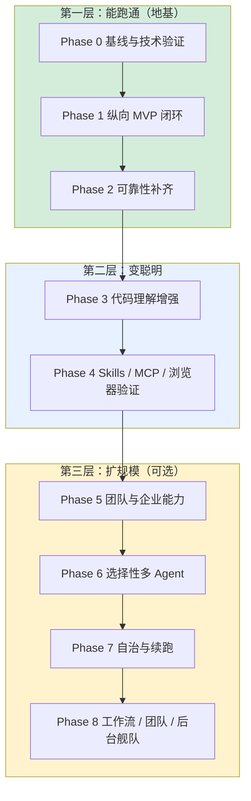

# Roadmap · 分阶段路线与验收

> 路线图只有一个核心顺序：先证明一个任务能安全、可恢复地改代码并验证，再扩展到长期运行、工具生态与复杂协作。

> 这篇是实施排期与取舍表：先让一个任务安全跑通（Phase 1–2），再增强代码理解和扩展能力（Phase 3–4），之后才考虑团队与多 Agent（Phase 5–6）。前一阶段未验收通过时，不进入后一阶段。

> 把它当作排期与取舍依据，不是对外发布日期。具体模块的实现方法见 [development-guide.md](./development-guide.md) 和相应专题。

比起每个条目，依赖顺序更重要：路线分为三层，后一层必须建立在前一层已经跑通的基础上。

前一层没有验收通过，就不要急着进入后一层。多 Agent（Phase 6）排得靠后，并不是它不重要，而是它依赖前面已经具备可观测性、权限和验证能力；缺少这些，只会把失败放大。

## 1. 开发路线

### Phase 0 · 基线与技术验证

产出：需求边界、威胁模型、模型 Provider PoC、Git Worktree PoC、命令沙箱 PoC、最小评测集。
验收：能在测试仓库安全读文件、调用一次模型、返回结构化工具调用，并在隔离工作区成功跑一个项目测试命令。

### Phase 1 · 纵向 MVP 闭环

实现：任务创建、状态机、事件流、仓库扫描、规则加载、精确搜索、读文件、补丁编辑、git diff、命令执行、基础审批、类型检查/测试、交付报告；静态/动态系统提示词组装（见 [system-prompt.md](./system-prompt.md)）、编辑安全（read-before-edit、mtime 外部修改检测、引号容错）、工具错误作为 tool_result 回喂的自修复。**成本极低的输入净化也放这一期**：不可见字符剥离（零宽、双向控制、Unicode Tag 段）与提示"Removed N invisible characters"（见 [security.md §1](./security.md)、[context-engineering.md §6](./context-engineering.md)）；**CLI 与 SDK 共用同一 runtime 内核的骨架**（ADR-10，见 [architecture.md §2](./architecture.md)），Phase 1 就先把 `sdk.query()` 走同一 loop 的实现路径定死，后期不再有"SDK 与 CLI 行为漂移"的债。
验收：覆盖"改一个组件""修一个 bug""补一个测试"三类端到端任务；失败与取消可观察；用户可审 diff；工具执行有审计；未读先编辑、文件被外部改动等场景能被代码层拦下；复制粘贴含不可见字符的 prompt 被剥离并提示。

### Phase 2 · 可靠性补齐

实现：SQLite 检查点、执行租约、幂等工具执行、分层超时、失败分类、有限重试、暂停/恢复/取消、资源预算、用户原有变更保护；流式双后端适配与前缀缓存（[model-gateway.md](./model-gateway.md)）、分层压缩流水线（大结果持久化 → 裁剪 → 去重 → 摘要，[context-engineering.md §5](./context-engineering.md#_5-压缩-compaction-与外置记忆)）、工具延迟加载与只读并行执行、Plan 模式只读契约与四选项审批（[agent-loop.md §3.2](./agent-loop.md#_3-2-plan-mode-的落地-只读契约-计划文件-审批四选项)）。**Phase 2 一并交付**：Output Style 作为一等子系统（[system-prompt.md §6.1](./system-prompt.md)，与权限档正交的行为轴）；`dontAsk` 权限档进入判定管线（[security.md §4.2](./security.md)，CI/headless 未显式给档时的默认回落）；`startup_failure_reason` 枚举与 `system/api_retry` 独立事件、`permission_denials` 收尾数组（[data-and-events.md §1.3](./data-and-events.md)）；会话消息队列 vs 中断的 TUI 契约（[agent-loop.md §2.5](./agent-loop.md)）与权限模式跨 resume 的恢复矩阵（[agent-loop.md §5.2](./agent-loop.md)）。
验收：在模型超时、工具超时、崩溃、重复投递、审批过期等故障注入下，任务状态与文件变更一致且可追踪；压缩只在 turn boundary 触发、不破坏工具调用配对；缓存命中率可观测；重试过程可回放（`retry.api` 事件齐全）；`--resume` 跨高危模式（bypass / root / `--restricted`）不静默继承。

### Phase 3 · 代码理解增强

实现：TS 符号索引、依赖关系、测试映射、影响分析、增量索引；按评测收益再补 Embedding/混合检索；长期记忆的四类型分类、语义召回（sideQuery）与异步预取（[context-engineering.md §5.4](./context-engineering.md#_5-4-长期记忆-记什么、怎么召回)）。
验收：相比只用 `rg` 的基线，目标文件召回率、上下文相关性或成功率有可测提升；索引失效不导致错误结论；记忆召回零额外等待、命中条目相关且可判定时效。

### Phase 4 · Skills、MCP 与浏览器验证

实现：Skill 加载/版本、inline / fork 执行模式与双触发路径（[tools-and-extensions.md §6.2](./tools-and-extensions.md#_6-2-触发路径与执行模式-inline-fork)）、Skill listing 预算（1% 窗口 + 单条 1,536 字符 + 从最少调用先丢，见 [tools-and-extensions.md §6.2](./tools-and-extensions.md)）、MCP Client（按 2026-07-28 无状态规范实现：stdio / Streamable HTTP、三段式命名、**工具名 128 字符显式校验不静默丢**、**凭据名模板变量例外**、懒加载与失败隔离、列表缓存、MRTR 交互、错误码 `-32602`，见 [tools-and-extensions.md §1.1](./tools-and-extensions.md)、[tools-and-extensions.md §1.2](./tools-and-extensions.md#_1-2-2026-07-28-规范改了什么-必读-影响所有-mcp-代码)）、外部文档/代码托管集成、Playwright 页面验证与截图产物。**Worktree 完整子能力也在这一期**：`.worktreeinclude` 跨 worktree 拷贝 gitignored 文件、`EnterWorktree` / `ExitWorktree` 一等工具、`WorktreeCreate` / `WorktreeRemove` hooks（任何非零退出即失败）、`--worktree` CLI flag 与 `isolation: worktree` 子代理配置、四条硬拦截（[code-editing.md §3.3](./code-editing.md)），把 worktree 从"我们建了个目录"升级为"我们拦得住回流"。**Advisor / 辅助模型统一封装**（ADR-11，[model-gateway.md §2.2](./model-gateway.md)）同期落地，供 Phase 6 多 Agent 与 Phase 7 自治复用。**Plugin 声明式打包同期落地**（[tools-and-extensions.md §7.1](./tools-and-extensions.md)）：清单 schema 一次定死三种覆写语义（追加 / 替换 / 合并）、本地 marketplace + `github` / 仓库相对路径两档 source、`mod plugin details` 审计入口，Phase 4 不做在线 marketplace。
验收：MCP 工具调用带权限与审批信息；恶意工具描述不能绕过策略；单个 MCP server 挂起不影响其余工具；worktree 隔离会话期间任何写主检出、`git -C` 逃逸、`cwd` 落回主检出都被拦下且审计事件带 `bypass-immune` 标签；浏览器结果可复现并归档；plugin 装前 `mod plugin details` 打出 Component inventory，未声明 sha 锁定的远程 source 拒绝安装。

### Phase 5 · 团队与企业能力

实现：多租户、RBAC、组织级策略、费用限额、仓库级配置、审计导出、团队评测看板、PR 工作流、可控模型路由（含 Web 控制台 + BFF + PostgreSQL + 队列）。**企业 managed 键集合**同步落地：`allowManagedPermissionRulesOnly` / `allowManagedHooksOnly` / `allowManagedMcpServersOnly` / `availableModels`（组织级模型 allowlist，见 [model-gateway.md §2.2](./model-gateway.md)）/ `requiredMinimumVersion` / `requiredMaximumVersion` / `blockedMarketplaces` / `strictKnownMarketplaces`（组织 marketplace 白名单，与 `allowManagedMcpServersOnly` 同级；见 [tools-and-extensions.md §7.1](./tools-and-extensions.md)）；**managed 文件解析失败即拒绝启动**这条 fail-closed 行为也在此期定死（[security.md §6](./security.md) 验收清单）。**Artifact 分享与 Channels 事件驱动**同期落地：Artifact 从 MVP 的"本地产物 + 私有"扩到四态可见性（组织内 / 分享链接 / 公开）与 `<artifact-reply>` 交互回灌（[tools-and-extensions.md §3.1](./tools-and-extensions.md)）；Channels 把 CI 结果 / chat 消息 / 监控告警从外部推入正在跑的会话（[agent-loop.md §2.6](./agent-loop.md)），与 Artifact 一起构成"团队从会话外看进来 + 团队从会话外喊进来"两条通路。**远程 marketplace**（`npm` / `archive` 两档 source，强制 sha 校验）同期落地。
验收：跨租户隔离与审计通过安全测试；团队可追踪成本、成功率、审批与模型版本；组织侧下发的模型 allowlist、hooks 白名单、MCP 白名单、marketplace 白名单在个人配置里翻不了案；Artifact 分享链接可撤销、`kind: "html"` 走独立子域 + CSP `sandbox`；Channels 事件不携带用户权威、未宣告的事件类型丢弃而不是崩溃。

### Phase 6 · 选择性多 Agent

基于评测决定是否引入只读分析、测试分析、diff Review 子 Agent；上线前验证相较单 Agent 基线的效果、成本与延迟收益。子 Agent 用同一 Agent 类配置化实现，落实四层工具过滤（只读、禁递归、权限继承、白名单）、独立上下文与输出捕获（见 [verification-and-multiagent.md §5.5](./verification-and-multiagent.md#_5-5-子-agent-的实现模式-一个-agent-类-配置不同)）。**Mods 函数级扩展点同期落地**（[tools-and-extensions.md §7.2–§7.3](./tools-and-extensions.md)）：`register(on, options)` 与 `($, e, next)` 三参中间件、事件分组、能改写别的扩展点向模型呈现的内容（`prompt.section` / `skill.prompt` / `tool.describe` / `command.describe`）、每个 API 方法同时是同名事件；**策略 mod 与 mods 同批上**（对应 Claude Code `sec-default`），最先加载、managed 与 deny 规则优先、用户关不掉，不留"装了 mods 但没策略 mod"的裸奔窗口。Mods 只在 §6.5 hook 事件清单已经收敛稳定之后启用，否则改事件名就要重跑一遍 mod 兼容性。

### Phase 7 · 自治与续跑

在权限、沙箱、验证、子代理全部可靠后，再做长时自治（见 [autonomy.md](./autonomy.md)）：`/goal` 目标追达（Stop hook 封装、独立评估器 JSON 三形状、判决走 API 层 schema、`impossible` 防死循环、停止条件回灌、迭代/成本上限）、`/loop` 定时与自排程续跑（解析三规则、`CronCreate` 固定间隔 7 天过期、Jitter 完整规则（recurring ≤ 半间隔 30 分钟、`*/5` 特例提前 15 秒、one-shot 遇 `:00`/`:30` 提前 ≤ 90 秒）、`ScheduleWakeup` 缓存感知 + `stop: true` 主动收尾、Esc 撤 wakeup、`CLAUDE_CODE_DISABLE_CRON` 与 `scheduled_tasks.json` 落盘、无新变化即停、headless 日志）、**Routines 三档触发**（`/loop` 会话内、`/schedule` 一次性脱离会话、Routines 支持定时 + API + GitHub 事件三种触发，权限按发起者而非部署者，见 [autonomy.md §2.5](./autonomy.md)）、Auto Mode 动作自动批准（四规则桶、两段式 64/4096 裁决、reasoning-blind、不对称意图门槛、fail-closed、拒绝上限、权限传子代理）。**模型路由的两个正交轴**同期补齐：`speedTier: standard | fast`（fast mode 击缓存代价与限流自动降级，见 [model-gateway.md §2.2](./model-gateway.md)）与 `planPhase / executePhase` 双阶段别名（`opusplan` 语义，规划用强、执行用弱）。
验收：评估器与执行分离、目标不可达时能 `impossible` 刹车、裁判不被主 agent 话术忽悠；循环有硬性上限且幂等；分类器拿不准一律回落确认、deny 不可绕过、子代理权限不被提权、只读工具不触发分类器；cron 关闭时任务落到 `scheduled_tasks.json` 下次开机可续跑；Routines 三种触发路径都按发起者权限判定、部署者不能借道越权；会话内切 fast / model 击缓存有 UI 提示，切 advisor / effort 无提示。

### Phase 8 · 工作流、团队与后台舰队

在 Phase 6 多 Agent 与 Phase 7 自治之上，再做三类高协作能力（均为可选项，按真实需求与评测驱动）：

- **Dynamic Workflows（[dynamic-workflows.md](./dynamic-workflows.md)）**：确定性 JS 脚本编排，`agent/pipeline/parallel`、StructuredOutput、四道上限（并发 `min(16,CPU-2)` / 4096 item / 1000 agent / stall 重试 5 次）+ 25 agent / 1.5M token 软性警告、预算、worktree 隔离、journal 断点续跑；先做最小版（3 个 hook + 1 道并发）；
- **Agent Teams（[agent-teams.md](./agent-teams.md)）**：对等组队、共享任务/记忆/产出、`SendMessage` 四种寻址；安全规则随通信一起上：跨会话消息不携带用户权威、转发被拒动作即权限洗白、跨机 bridge 为 bypass-immune 必问人、团队记忆跳过 secret；先做同进程对等，再跨会话；
- **Background Fleet（[background-fleet.md](./background-fleet.md)）**：会话内子 agent 后台化（Phase 6 已含）、`/bg` 脱终端、`claude agents` 表、commit/push/draft PR 收尾；daemon 健康检查/重生/孤儿收养最后做，且 on-demand 不常驻。

验收：工作流失败被隔离成单点、不重做已完成前缀；团队成员间通信不产生越权、跨机消息必经真人确认、共享记忆无密钥；后台任务关掉终端仍能跑完并交付 draft PR，且不直推主干/force-push/merge。

箭头只往右走、不允许跳级。每个阶段都有文末 [§3](#_3-mvp-验收清单) 那套可勾选的验收清单，过不了就不进下一阶段。

### 1.1 各阶段的业界对照（2026-08 核实）

| 阶段             | 关键机制                                                                                                                                                                                               | 业界实证来源（已 fetch）                                                                                                                                                                                      |
| ---------------- | ------------------------------------------------------------------------------------------------------------------------------------------------------------------------------------------------------ | ------------------------------------------------------------------------------------------------------------------------------------------------------------------------------------------------------------- |
| Phase 1 规则加载 | 直接采用 `AGENTS.md`（就近覆盖、嵌套），不造私有文件                                                                                                                                                   | https://agents.md ；https://docs.devin.ai/cli/reference/configuration/config-file                                                                                                                             |
| Phase 1 产物     | 改动即 commit + 自动分支命名（`<工具名>/<基线>-<随机串>`），永不直接推 main                                                                                                                            | https://aider.chat/docs/git.html ；https://v0.dev/faq                                                                                                                                                         |
| Phase 2 检查点   | checkpoint 与 auto-approve 捆绑设计；三态恢复（文件 / 对话 / 两者）；命名快照 + 不可逆警示                                                                                                             | https://docs.cline.bot/core-workflows/checkpoints ；https://docs.windsurf.com/windsurf/cascade/cascade                                                                                                        |
| Phase 4 集成     | Skills 按需加载（SKILL.md ≤500 行 + 分包）；规则 frontmatter 激活矩阵；MCP 工具 = 任意代码执行、调用前显式同意                                                                                         | https://code.claude.com/docs/en/skills ；https://cursor.com/docs/rules ；https://modelcontextprotocol.io/specification/                                                                                       |
| Phase 5 团队     | Devin 三件套工作台（Shell / IDE / Browser）+ 可接管 + IM 派活；Copilot custom agents + Automations（定时 / 事件触发）；云端每任务独立 worktree + 每轮自动 commit/push                                  | https://docs.devin.ai/get-started/devin-intro ；https://docs.github.com/en/copilot/how-tos/use-copilot-agents/cloud-agent/use-cloud-agent-on-github ；https://kilo.ai/docs/code-with-ai/platforms/cloud-agent |
| Phase 5 安全     | 团队放权但「发起者不可自批」+「Actions 默认不自动跑」；fail-closed 沙箱 + 域名级网络过滤                                                                                                               | https://docs.github.com/en/copilot/how-tos/use-copilot-agents/cloud-agent/use-cloud-agent-on-github ；https://docs.devin.ai/cli/reference/configuration/config-file                                           |
| Phase 6 多 Agent | 子代理独立上下文 + 只回传结果；并行写文件用 detached-HEAD worktree；mission 并行要求自治等级先到 high；子 agent 默认后台、摘派生工具                                                                   | https://zed.dev/docs/ai/tools ；https://zed.dev/docs/ai/parallel-agents ；https://docs.factory.ai/droid-cli/cli-reference.md                                                                                  |
| Phase 8 前沿     | 确定性脚本编排（pipeline 默认无 barrier、StructuredOutput、journal 续跑）；对等团队（跨会话不携带用户权威、bridge bypass-immune、记忆跳过 secret）；后台舰队（on-demand daemon、commit/push/draft PR） | https://diwang.info/how-claude-code-works/#/ （Claude Code 架构深度分析，21 章；前沿见第 17–21 章）                                                                                                           |
| 跨阶段实现细节   | 工具延迟加载/并行、read-before-edit 与 mtime、分层压缩、双后端流式、前缀缓存、记忆语义召回、Skills inline/fork、/goal·/loop·Auto Mode 自治                                                             | https://diwang.info/claude-code-from-scratch/#/ （Claude Code 最小实现逆向教程，16 章）                                                                                                                       |

## 2. 建议优先开发顺序

一个熟悉 TypeScript 的工程师主导时，按此顺序，而不是先搭完整多 Agent 架构：

1. **先做 CLI/Worker 纵向原型**：传入仓库与需求，完成"读 → 计划 → 补丁 → 测试 → diff 报告"，先不做漂亮 UI；
2. **加安全工作区**：Git Worktree、受限命令运行器、路径与命令策略；没有沙箱就别对陌生仓库开放自动命令执行；
3. **做任务持久化与状态机**：SQLite 状态、事件、检查点，支持暂停 / 恢复 / 取消；
4. **接 TUI 控制台**：任务创建、事件流、审批、diff 与验证报告（Ink）；
5. **把能力模块化**：Model Gateway、Tool Registry、Context Builder、Skills、MCP Client；
6. **搭评测与观测**：先取基线数据，再按失败分类优化上下文、工具与模型；
7. **最后加高级能力**：语义索引、浏览器自动化、多 Agent、自治续跑（/goal、/loop、Auto Mode）、工作流/团队/后台舰队、PR/Issue、团队权限。

## 3. MVP 验收清单

### 产品闭环

- [ ] 用户可选工作区、输入自然语言需求并创建任务；
- [ ] TUI 实时展示状态、工具执行、计划、审批、diff、验证结果；
- [ ] 支持 plan-only 与 edit 模式；
- [ ] 最终报告列出改动、真实运行的命令、结果、未执行项与风险。

### Agent 与代码修改

- [ ] 支持搜索、读文件、精确补丁、diff、项目规则加载；
- [ ] 计划与工具参数均过 Schema 校验；
- [ ] Agent 修改只作用于任务授权工作区；
- [ ] 基准 hash 冲突时不静默覆盖新内容；
- [ ] 未读文件不得编辑（read-before-edit 代码层强制）；文件在读取后被外部修改时写入被 mtime 校验拦下；
- [ ] 工具错误（幻觉工具名、替换串未命中、命令非零退出）作为 tool_result 回喂，模型可自修复而非中断；
- [ ] 无关文件变更与异常大改动可触发策略拦截。

### 可靠性

- [ ] 库中保存任务状态、事件、工具调用与检查点；
- [ ] 取消、暂停、恢复与最长运行时间生效；
- [ ] 模型/工具超时有明确错误码与重试策略；
- [ ] 重启与重复投递不导致状态错乱；
- [ ] 外部非幂等动作结果未知时不无条件重试。

### 安全

- [ ] 沙箱非 root、资源限额、工作区挂载限制与网络策略已验证；
- [ ] 默认阻止访问密钥与工作区外路径；
- [ ] 高风险工具审批与参数 hash 绑定；
- [ ] MCP 返回内容按不可信数据处理；
- [ ] 审计日志不含明文密钥。

### 测试与评测

- [ ] 至少 30–50 个内部任务用例，覆盖功能、bug、测试、重构与安全边界；
- [ ] 每个改动记录实际运行的验证命令与退出码；
- [ ] Prompt、模型、工具或检索更改后自动跑关键回归集；
- [ ] 有 Task Success、First-pass Validation、Cost per Successful Task 等指标。
