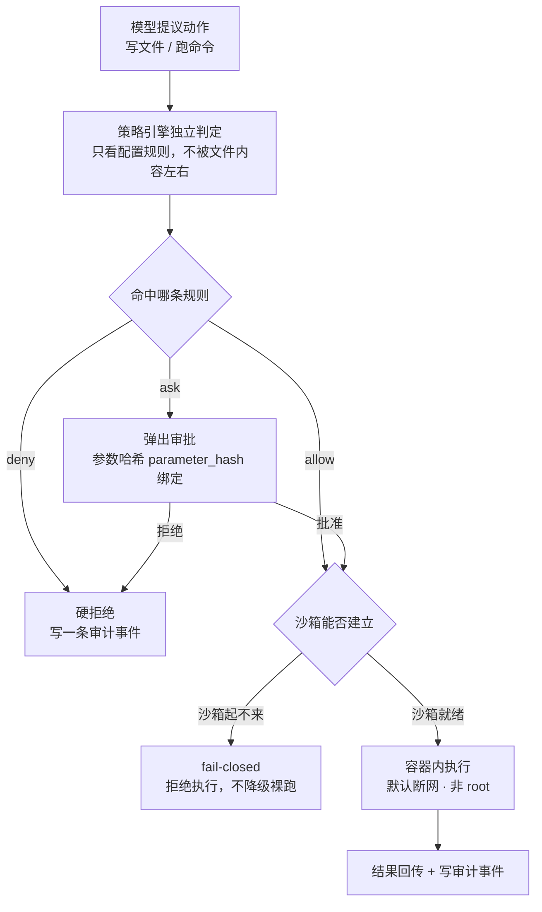
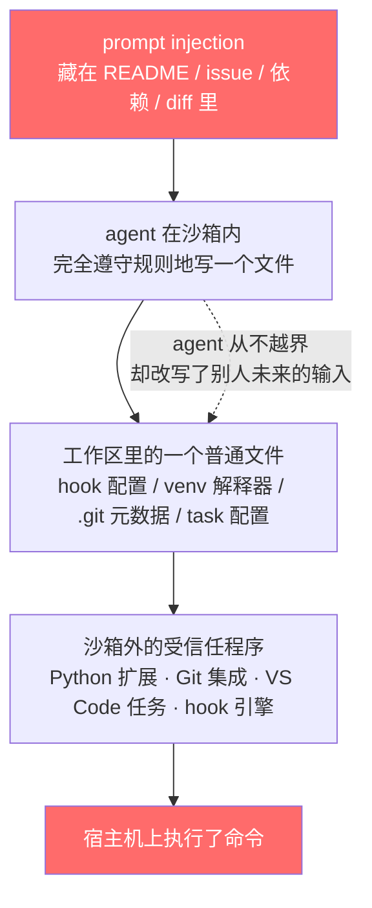
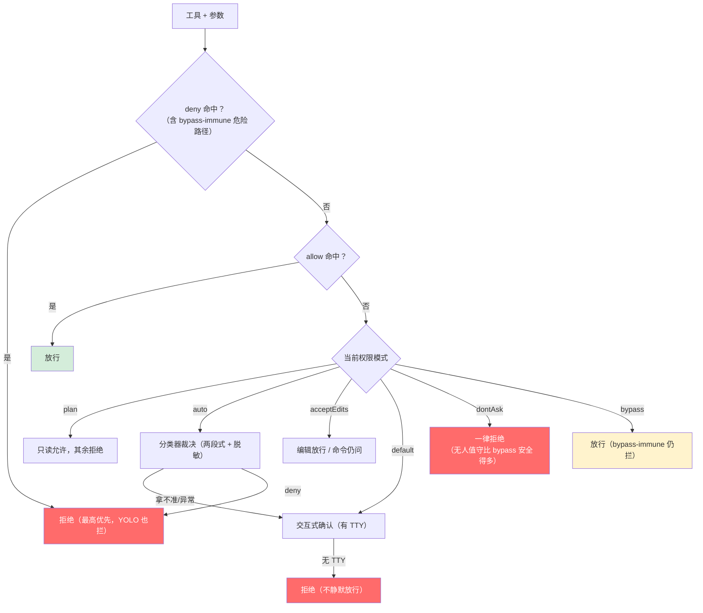

# Security · 沙箱、权限与安全架构

> 本文给核心实现者和安全评审者一套可落地的边界：要防什么、沙箱能挡住什么、权限该在哪里判断，以及交付前如何验收。

Agent 会读取仓库、网页和工具输出，也会运行命令；这些内容都可能夹带不可信指令。安全控制必须由运行时强制执行，不能指望模型“自己小心”。提示注入是首要防护对象。

## 1. 威胁模型

先认清要防谁、防什么。mod-agent 至少要考虑这些入口：恶意 / 误导用户输入、仓库内 prompt injection（比如藏在 README、issue、HTML 注释里的指令）、恶意依赖脚本、工具参数注入、路径穿越、符号链接逃逸、网络访问 / SSRF、密钥泄漏、资源耗尽、MCP Server 被攻陷、模型误生成危险命令、重试造成重复副作用。

一条 2026 年才浮出水面、但代价极低的入口值得单列：**用户从网页、issue、聊天里复制粘贴的文本可能携带不可见字符**（零宽空格 U+200B / U+200D、双向控制符 U+202A–U+202E、Unicode Tag 字符 U+E0000 段），肉眼看不到但会改变模型对文本结构的解析，是 prompt injection 的一条"隐形"通道。真实 Claude Code 在输入框按 Enter 前会主动剥离这些字符并显示"Removed N invisible characters · review and press Enter to send"。mod-agent 的输入净化管线（详见 [context-engineering.md §6](./context-engineering.md#_6-输入注入与不可信内容)）从 Phase 1 就要接上这一条：不追求 100% 覆盖，只保证"复制粘贴携带"这一大类可预防攻击不再需要模型自觉。

## 2. 关键实证（为什么防护必须落框架层）

这些真实数据说明一件事：光靠提示模型提高警惕挡不住攻击，必须在框架层硬拦。

- **IssueTrojanBench**：66.5% 的恶意 issue 穿透 Cursor / Claude Code / Codex 全部 agent 与模型层防护；且拒绝几乎都来自 LLM 自身而非框架。靠 prompt 提示模型警惕基本无效。
  > 比如，一条看似正常的 issue 标题里藏着指令，让 agent 改 CI 配置去偷凭证。三次里有两次能穿过主流 agent 的防线，这就是为什么不能赌模型自觉。
- **真实事件**：Clinejection（恶意 issue 标题做 CI/CD 缓存投毒、外泄凭证）；RoguePilot（issue 隐藏 HTML 注释诱导仓库接管）；还有诱导 agent 写 `.vscode/settings.json` 开 `autoApprove` 持久化、诱导读私有仓库再经公开 PR 外送等。
- **Claude Code 漏洞教训**：Bash 子进程做了 Bubblewrap 沙箱，但 Read 工具未受同等约束，可读 `/proc/self/environ` 窃取 `ANTHROPIC_API_KEY`。环境 scrub（脱敏）必须覆盖所有工具读取路径，不只是 Bash。
- **Agents Rule of Two**（Microsoft）：读不可信输入 + 访问敏感密钥 + 对外变更/通信，三者同时满足是高危组合，不可同时成立。
  > 通俗地说：让 agent 一边读陌生的东西、一边碰密钥、一边往外发，这三件事绝不能凑齐；最多同时占两样。

## 3. 沙箱基线

沙箱就是给每次任务隔出来的独立环境，agent 在里面干活，碰不到外面的系统。基线配置：

- 每任务独立容器 / 更强隔离环境；工作目录只挂载该任务授权的工作区；
- 非 root 用户；rootless Docker、只读根文件系统、默认 seccomp、去除多余 capabilities；
- 限制 CPU、内存、进程数、磁盘、文件数、日志量、运行时长与并发；
- 默认关闭网络；确有装包需求时按域名 / IP / 端口及阶段临时开放出口；
- 不挂载 Docker Socket、宿主机 home、SSH agent、云凭证目录等高权限资源；
- 不向任务容器注入通用 API key；远程操作由服务端凭证代理执行；
- 命令与子进程做生命周期管理，取消时终止整个进程组；
- 对输出中的 ANSI 控制符、二进制、超长日志做处理，防终端 / UI 注入与资源耗尽。

下面这张图把完整走画画出来：一次写操作从模型提议，到策略判定，再到沙箱执行。



模型说了不算。它的每次动作先过独立的策略引擎，规则判 `deny` 直接拦、`ask` 要人点头、`allow` 才放行；哪怕放行，执行前还得确认沙箱真的建得起来，建不起来就宁可停手也不裸跑。

### 3.1 沙箱安全与网络过滤的业界实证

fail-closed（失败即关闭）原则（Devin 官方文档原文，出处：https://docs.devin.ai/cli/reference/configuration/config-file ）：当隔离执行环境无法建立时（例如沙箱工具在平台不可用），CLI 应拒绝启动任务，而不是降级为裸跑。原文："If `--sandbox` is passed but sandbox resolution fails… the CLI will refuse to start rather than running unsandboxed." 这是隔离意图永不被静默绕过的安全底线。

> 比如，你本来要求必须在沙箱里跑，结果这台机器没装沙箱工具。错误做法是"算了，直接在本机跑吧"；正确做法是干脆报错退出，宁可任务不跑，也不能偷偷失去隔离。

网络分级过滤（出处同上）：

- `allowed_domains` 白名单（空 = 不过滤）、`denied_domains` 黑名单（优先级更高）、`network_mode`：`full`（全方法）/ `limited`（仅 GET / HEAD / OPTIONS）；
- 域名通配：`example.com` 精确、`*.example.com` 任意子域（不含 apex）、`.example.com` 含 apex 与任意子域；
- 与 [§5](#_5-网络、密钥与外部数据) 的 allowlist 互补：Devin 在本机 loopback 起受控代理，把所有联网请求按名单过滤，连只能发 GET 不能 POST 都能限制。

> 比如，把 `network_mode` 设成 `limited` 后，agent 想 `curl -X POST` 把数据发到外面也发不出去，连请求方法都被管起来。

执行权限分三集合（Devin，出处同上）：

```json
{
  "permissions": {
    "allow": ["Read(**)", "Exec(git)"],
    "deny": ["Exec(sudo)"],
    "ask": ["Write(**/.env*)"]
  }
}
```

- `allow` 自动放行 / `deny` 硬拒绝 / `ask` 每次弹确认；规则形如 `Read(...)` / `Write(...)` / `Exec(...)`；
- 配套开关 `respect_gitignore`：开启后禁止工具读写 gitignored 路径；
- 项目级可提交（团队共用）+ `*.local.json` gitignore（个人覆盖）分层。

> 通俗地说：`.env*` 这种碰了就是 `ask`（每次问你），`sudo` 这种直接 `deny`（想都别想），`git`、读文件这种安全的标 `allow`（不问）。

自治等级逐级放权（Factory Droid CLI 参考，出处：https://docs.factory.ai/droid-cli/cli-reference.md ）：

| 等级                        | 用途             | 放权内容                              |
| --------------------------- | ---------------- | ------------------------------------- |
| （默认）                    | 只读侦察         | 文件读取、git diff、环境检查          |
| `--auto low`                | 安全编辑         | 建 / 改文件、格式化、非破坏命令       |
| `--auto medium`             | 本地开发         | 装依赖、build / test、本地 git commit |
| `--auto high`               | CI/CD 编排       | git push、部署脚本、长时操作          |
| `--skip-permissions-unsafe` | 仅一次性隔离容器 | 移除全部护栏                          |

官方注记："Only raise access when the environment is safe."，意思是权限跟着环境危险度逐级解锁，默认只读。

> 比如，默认先只让 agent 看仓库；确认这是个干净的隔离容器，才逐步开放改文件、跑测试；要 `git push` 这种对外动作，得升到最高档，绝不一上来就全自动。

CI / 无人值守的最小面（Claude Code `--bare`，出处：https://code.claude.com/docs/en/headless ）：CI 与脚本默认推荐 bare 模式，不自动加载 hooks / skills / 自定义命令 / subagent / 插件 / MCP / auto memory / CLAUDE.md，不读本机 OAuth 与钥匙串，必须显式给 API key；需要的设置用 `--settings <file|json>`、MCP 用 `--mcp-config` 显式注入。安全含义：避免仓库里一份 `.mcp.json` 在你从未信任的文件夹里被静默执行。

### 3.2 「沙箱没被打破，人却出来了」：2026 年最值得记住的一次实证

这一节是整篇文档里最该读的一段。它推翻了一个很自然的假设：沙箱结实，agent 就一定出不来。事实并非如此。

Pillar Security 在 2026-07-20 发布 "Week of Sandbox Escapes" 系列，在 Cursor、OpenAI Codex CLI、Google Gemini CLI、Antigravity 四款主流工具上复现了 7 个绕过。关键在于：agent 全程待在沙箱里、每一条规则都遵守，它只是写了一个文件，沙箱外某个受信任的程序稍后读、执行或扫描了这个文件，逃逸就自行完成了。



红色两头都不是 agent 直接干的。agent 只是写了个文件，但那个文件恰好是外面某个程序的输入。攻击者拿下的不是沙箱，是沙箱外程序的输入源。

四款工具、7 个发现，归为四种失败模式：

| #   | 失败模式                                   | 具体表现                                                                                                                       | 处置                              |
| --- | ------------------------------------------ | ------------------------------------------------------------------------------------------------------------------------------ | --------------------------------- |
| 1   | **denylist 沙箱跟不上操作系统**            | macOS Seatbelt 的拒绝名单被绕过                                                                                                | 见厂商回应                        |
| 2   | **工作区配置其实就是可执行代码**           | Cursor 的工作区 hook 配置导致非沙箱命令执行（**CVE-2026-48124**，3.0.0 修复）；`.vscode` task 配置绕过 Antigravity Secure Mode | 已修 / 见下                       |
| 3   | **「安全」命令白名单只信命令名、不信参数** | Codex CLI 把 `git show` 列为只读安全命令，实际调用并非只读，可写入攻击者控制的内容                                             | v0.95.0 修复，OpenAI 支付高额赏金 |
| 4   | **特权本地守护进程完全在沙箱外**           | Docker socket 同时影响 Cursor / Codex / Gemini CLI                                                                             | 已修                              |

还有一个特别刁钻的：Git 元数据不必放在叫 `.git` 的目录里。攻击者借 `fsmonitor` 触发执行，绕过了 Cursor 基于路径的规则（3.0.0 修复）。

对 mod-agent 的四条硬结论：

1. 别用 denylist 做主防线。名单永远追不上操作系统。默认拒绝（allowlist）+ 策略引擎判定才是主轴。这正是 [§4.1](#_4-1-配置优先级与权限规则合并-claude-code-settings-实证-出处-https-code-claude-com-docs-en-settings)「黑名单永远优先」之外还必须补的另一半。
2. 命令白名单必须连参数一起判。只匹配 `executable` 字段是不够的：`git show` 可以是读，`git show "..."` 带上特定参数就能写。`CommandRequest` 里 `args` 是数组而非字符串，就是为了能被逐项检查。
3. 把 agent 能写和外部程序会读的交集当成真正的攻击面。工作区里的 hook 配置、IDE 任务配置、venv 解释器路径、`.git` 元数据，这些看着像数据、实则是代码的位置要单独列一份高危清单。
4. 沙箱外的特权守护进程（Docker socket、SSH agent、云凭证目录）绝不能暴露，[§3](#_3-沙箱基线) 基线里那条「不挂载 Docker Socket」就是这么来的。

> 一句话记住它："If an agent gets to write the future inputs of systems, it was never sandboxed in the first place."（如果一个 agent 能写系统未来的输入，那它从来就没被真正沙箱化过。Pillar Security）

厂商反应本身也是一条经验：Google 把两个 Antigravity 发现降级为"其他有效漏洞"、判定难以利用因而未修补；Pillar 的反驳是："难利用"之所以成立，是因为需要开发者信任一个被投毒的仓库，而信任陌生仓库恰恰是这类 agent 引入的日常风险。换句话说，别把需要受害者先上当当成不算漏洞的理由。

同类发现的延续：Cymulate 在 2026-04 已在 Claude Code / Gemini CLI / Codex CLI 上命名过同一模式 Configuration-Based Sandbox Escape。到 2026-08，Adversa AI 汇总中出现更重的一类：零点击 prompt injection 逃逸终端沙箱并覆写沙箱辅助二进制，这意味着光验证 agent 行为不够，还得做沙箱组件自身的二进制完整性校验。

agent 产出的工作流默认不自动跑（GitHub Copilot，出处：https://docs.github.com/en/copilot/how-tos/use-copilot-agents/cloud-agent/use-cloud-agent-on-github ）：Copilot 云端代理 push 后，GitHub Actions 默认不自动执行，因为 workflow 可能有权限访问敏感密钥，而 agent 可能改过 `.github/workflows/`；需人亲眼看过改动后手动点"Approve and run workflows"。凡 agent 改动涉及工作流定义 / 密钥读取路径时，评审界面显式提示。

### 3.3 沙箱不覆盖清单（Claude Code v2.1.300 实证，出处：https://code.claude.com/docs/en/sandboxing ）

上一节的结论是"沙箱外程序的输入源才是攻击面"。这一节把它落到具体产品上：厂商自己列出的盲区清单，比任何第三方评测都更能说明"开了沙箱"到底买到了什么。

先说平台事实。它的 Bash 沙箱在 macOS 用内置 Seatbelt、Linux 与 WSL2 用 bubblewrap（文件系统隔离加独立 network namespace），**WSL1 不支持**，**原生 Windows 上沙箱根本不运行**、命令全部 unsandboxed；依赖缺失或平台不支持时默认行为是**静默回退**到不隔离，除非显式设 `sandbox.failIfUnavailable: true`。也就是说"配了沙箱"与"沙箱真的在跑"是两件事，它给了 `/sandbox` 面板与两行自查命令（`touch ~/sandbox-probe`、`curl --noproxy '*' https://example.com`）来区分。

官方明确列出的不覆盖范围：

| 不受沙箱约束                                                                                | 原因                                                  |
| ------------------------------------------------------------------------------------------- | ----------------------------------------------------- |
| 内置 `Read`、`Edit`、`Write`、`WebFetch`、`WebSearch`                                       | 这些工具不经 Bash 沙箱，走权限规则                    |
| hooks、本地 MCP server、插件 monitors、LSP、statusline 命令、`apiKeyHelper`                 | 全部在沙箱外执行                                      |
| 用户以 `!` 前缀手敲的 shell mode 命令                                                       | 多数会话下 unsandboxed                                |
| 命中 `sandbox.excludedCommands` 的命令、沙箱失败后带 `dangerouslyDisableSandbox` 重试的命令 | 前者是显式豁免，后者需人批但批了就绕过                |
| `allowAllUnixSockets: true` 时的 Unix socket                                                | 可及 Docker socket，正是 §3.2 里第 4 类失败模式的成因 |
| 自定义 proxy 端口、`filesystem.disabled: true`、`allowAppleEvents: true`                    | 分别使网络管控失效、关掉文件隔离、放宽进程间控制      |

网络默认不放开：所有出站经本地代理逐 host 校验，未列域名按当前权限模式处理。有一条值得学：`WebFetch(domain:...)` 的 allow 规则会直接喂给沙箱域名 allowlist，一份配置两处生效，避免权限规则与网络策略漂移。

对 mod-agent 的三条硬结论：

1. **覆盖率要显式声明**。[§3](#_3-沙箱基线) 的基线表应当增加一列"是否受沙箱约束"，把只读工具、扩展执行体（hook、MCP、statusline）、用户手敲命令三类点名列出，并注明各自的兜底机制是权限规则还是 workspace 信任还是审批，避免读者把"开了沙箱"读成"全都隔离了"。
2. **静默回退是不可接受的默认**。它把选择权交给用户，代价是绝大多数用户不知道自己从未被隔离。我们的 Docker 方案应当默认 fail-closed：沙箱不可用则拒绝高风险动作，把降级许可做成显式配置项并进安全验收清单（[§6](#_6-安全验收清单)）。
3. **扩展执行体是一等攻击面**。它把 hooks 与本地 MCP 明言放在沙箱外，正对应 §3.2 的失败模式 2 与本节表第 2 行。我们的插件与 hook 引擎必须落在沙箱**内**执行，或者像它一样在文档里明写"不覆盖"并靠信任工作区加审批兜底，两者择一，不能含糊。

## 4. 命令执行层

不把模型生成的一整段文本交给有宿主机权限的 shell（也就是不要 `bash -c "<模型吐出的一长串>"`）。接口采用可审查结构：

```ts
interface CommandRequest {
  executable: string
  args: string[]
  cwd: string // 必须位于授权工作区
  env?: Record<string, string> // 仅白名单变量
  timeoutMs: number
  networkProfile: "none" | "package_registry" | "approved_domains"
  reason: string
}
```

> 通俗地说：模型给的不是一整条命令字符串，而是要跑哪个程序、参数数组、在哪个目录、能不能联网这样的结构化字段。这样策略引擎才能逐项核对，而不是被一段引号转义绕过去。

确需 shell 的 package scripts 在沙箱内执行，靠命令风险分类、网络策略与容器权限约束。shell 字符串安全不只是引号转义问题。破坏性命令硬策略拒绝或人工审批，不依赖模型自我约束。

### 4.1 配置优先级与权限规则合并（Claude Code settings 实证，出处：https://code.claude.com/docs/en/settings ）

配置分层（高 → 低）：托管策略 > 命令行 `--settings` > 团队 `.mod/settings.json` > 用户 `~/.mod/settings.json` > 项目 `settings.local.json`。

权限规则合并语义：

- `allow` 列表跨层取并集；`deny` / `ask` 优先且立即生效（不需要信任文件夹）；
- 团队提交的 `allow` 规则需用户信任文件夹后才生效；`deny` 不受此限，即"团队可以放权，但绝不能越权替你解禁"；
- 个人例外写 `settings.local.json`，自动加进 git exclude，不污染团队；
- **合并语义按键类型区分**（对应 [architecture.md ADR-9](./architecture.md)）：数组类键（`permissions.allow`、`permissions.deny`、`claudeMdExcludes`、`mcpServers`）跨层取并集；标量类键（`model`、`defaultMode`、`autoCompactWindow`）按"最 specific 层"替换、不做合并。两类混在同一次合并里，如果按直觉"整体覆盖 / 整体合并"实现，都会写错方向。

> 比如，团队在仓库里塞一条"允许跑 npm test"的规则，得你点了信任这个文件夹才作数；但团队绝对写不了一条"帮你把 sudo 也允许了"，因为 `deny` 永远压过 `allow`，且个人能在 `settings.local.json` 里加自己的例外。

命令层的前缀双表（Kilo Code 实证，出处：https://kilo.ai/docs/features/auto-approving-actions ）：自动执行终端命令用前缀白名单 + 前缀黑名单两张表。黑名单永远优先，即使白名单写了 `*`（放开全部）也照样拦下；危险前缀（sudo、rm -rf 类）应主动进黑名单；生产 / 敏感数据场景禁止 `*`。

### 4.2 单次动作的判定管线（fail-closed）

静态规则（[§4.1](#_4-1-配置优先级与权限规则合并-claude-code-settings-实证-出处-https-code-claude-com-docs-en-settings) 合并出的 allow / deny / ask 集合）回答预先怎么配，这里回答模型真的发起一个动作时按什么顺序判。整个管线默认安全：任何一环拿不准，结果都落在问人而非放行。



**为什么 `dontAsk` 是必备档**（Claude Code 六模式实证，出处：https://code.claude.com/docs/en/permission-modes ）：语义是"本该弹框的动作一律自动拒绝"，而不是"全放行"。CI / 无人值守场景下，`bypassPermissions` 把安全检查一起关掉、太危险；`default` 在没有 TTY 时又必须回落拒绝（等同 dontAsk）；把它单独立成一档的意义在于**意图显式**——运维选它就是在承诺"宁可漏做、也绝不错做"，配置审阅时一眼可辨。mod-agent 的 `--mode` / `permissions.defaultMode` 必须支持这一档，作为 `--print` / `--bare` 未显式给档时的回落默认。

配套规则：

- **规则结构 = 工具名 + 模式**：模式支持精确匹配、前缀匹配与 glob 通配（如 `Read(~/.ssh/**)`）；危险路径（密钥、系统目录、`.mod/` 配置自身）列入 bypass-immune 名单，即使 `--skip-permissions-unsafe` / YOLO 也不豁免；
- deny 永远最先、不可被任何模式覆盖；这是"团队可以放权、不能越权替你解禁"的实现基础；
- **会话白名单**：用户在确认框可选择"本会话对相同参数放行"，记录参数 hash，仅在本次会话有效、不写回配置；
- **拒绝追踪**：自动模式下连续被拒（如 3 次）回落到交互式确认，累计拒绝达上限（如 20 次）中止任务，防止模型反复硬闯；
- **确认竞速**：UI 对话框、Pre-Tool Hook、Auto 分类器三者并发时，以首个确定结论生效且人类意图优先，用户一旦操作，分类器结论作废，并设防误触宽限期；
- **权限随子代理传播**：plan / auto 等模式强制被派生的子代理继承，不能借子代理提权（见 [autonomy.md §3.5](./autonomy.md#_3-5-权限必须传播给子代理)、[verification-and-multiagent.md §5.5](./verification-and-multiagent.md#_5-5-子-agent-的实现模式-一个-agent-类-配置不同)）。

分类器如何脱敏、两段式快慢路径与 fail-closed 细节见 [autonomy.md §3](./autonomy.md#_3-动作自动批准-auto-mode)。

## 5. 网络、密钥与外部数据

- 外网域名走 allowlist，拒绝云元数据地址、localhost / 私有网段；区分公司内网白名单与普通互联网；
- 密钥只在需要的服务端工具中短暂使用；日志与模型上下文做脱敏；secret 不写工作区或命令行参数；
- MCP Server 用最小 OAuth scope，校验来源，必要时独立网络出口；
- 文件内容、MCP 工具描述、模型输出都不等于可信策略；策略引擎独立判定权限；
- 所有写入、命令、外部调用都写审计事件，含操作者、任务、工具、参数摘要、审批关联与结果。

> 一条要刻在脑子里的原则：agent 读到的任何文本（README、MCP 返回、模型自己的输出）都不能拿来当权限依据。能不能干这件事，只由独立的策略引擎说了算。

## 6. 安全验收清单

交付前逐条过：

- [ ] 无法读取工作区之外的任意文件；
- [ ] 无法访问被禁主机目录、Docker Socket 与凭证；
- [ ] 网络关闭时出网失败；allowlist 外域名访问失败；
- [ ] 提示注入无法使 Agent 读密钥或绕过工具授权；
- [ ] 拒绝审批后不会继续执行该动作；
- [ ] 取消任务后不再启动新命令；
- [ ] 多任务之间无目录、凭证、事件、产物越权；
- [ ] 通过故障注入验证恢复能力：超时、重复消息、Worker 崩溃、队列重复投递；
- [ ] 命令白名单按「程序 + 参数」判定，而非只匹配程序名（[§3.2](#_3-2-「沙箱没被打破-人却出来了」-2026-年最值得记住的一次实证) 失败模式 3）；
- [ ] 「看着像数据、实则是代码」的位置有独立高危清单：工作区 hook 配置、IDE task 配置、venv 解释器、`.git` 元数据、CI 配置（[§3.2](#_3-2-「沙箱没被打破-人却出来了」-2026-年最值得记住的一次实证) 失败模式 2）；
- [ ] 沙箱外特权守护进程（Docker socket / SSH agent / 云凭证目录）确认不可达（[§3.2](#_3-2-「沙箱没被打破-人却出来了」-2026-年最值得记住的一次实证) 失败模式 4）；
- [ ] 沙箱辅助二进制自身有完整性校验，不被 agent 覆写；
- [ ] `bypassPermissions` 在 Linux / macOS 上以 root 或 `sudo` 启动时被拒、以 `--restricted` 启动时被拒（fail-closed，与厂商一致；出处 https://code.claude.com/docs/en/permission-modes ）；
- [ ] Managed 层配置文件解析失败时**拒绝启动**，而不是"当作没有策略继续跑"；
- [ ] Worktree 隔离四条硬拦截（[code-editing.md §3.3](./code-editing.md#_3-3-worktree-隔离的四条硬拦截)）默认 bypass-immune，`--dangerously-skip-permissions` 也不豁免；
- [ ] 输入净化管线剥离零宽 / 双向 / Unicode Tag 字符，剥离时提示用户 review（[§1](#_1-威胁模型)）；
- [ ] 权限模式跨 `--resume` 恢复按矩阵重算（[agent-loop.md §5.2](./agent-loop.md#_5-2-权限模式的恢复矩阵)），高危档不静默继承。
