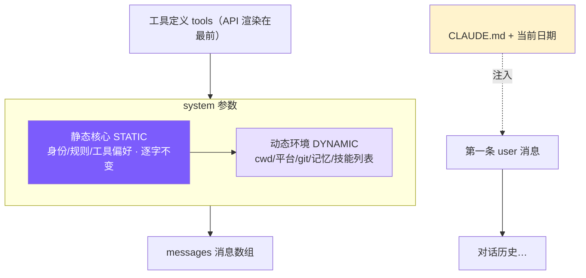
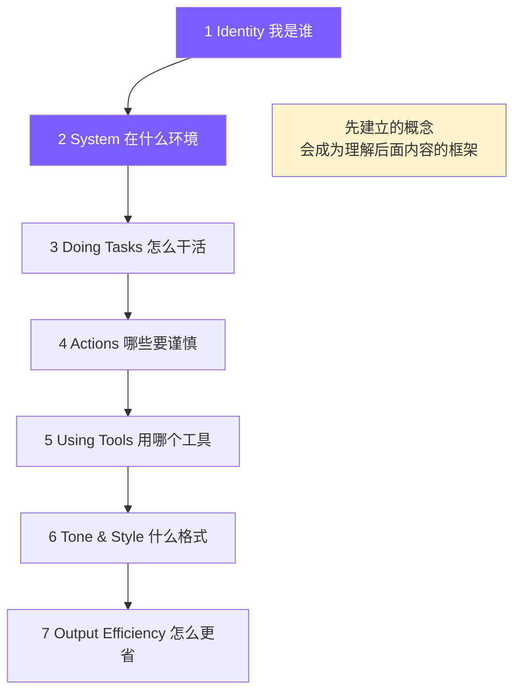

# System Prompt · 系统提示词工程

> 模型的能力上限由工具决定，但它「稳不稳定照做」由系统提示词决定。这篇讲提示词怎么分层、怎么写、怎么为缓存让路。

如果说工具系统是给 agent 一双手，系统提示词就是它的「岗前培训手册」——每次调模型前，这段话都会拼在最前面，告诉它：你是谁、在什么环境里、该怎么干活、哪些事要谨慎。工具解决「能不能做」，提示词解决「愿不愿意、会不会好好做」。这是整个系统里**改一行就能改变行为、成本最低**的地方，所以值得当成工程来做，而不是随手写一段人设。

读完你会知道：mod-agent 的提示词为什么要切成「静态核心 + 动态环境」两半、为什么负面指令比正面指令管用、为什么项目规则要包进 `<system-reminder>` 而不是塞进系统提示词。

## 1. 提示词在请求里的位置

一次模型请求里，「发给模型的文字」分三块，拼装顺序是刻意安排的：



三个关键决策：

1. **静态 / 动态切两半**。所有用户、所有会话都相同的角色与规则放进静态核心，逐字节不变；因机器、项目而异的环境事实单独拼成动态块。这条切分线首先是为**前缀缓存**让路——静态块打上 `cache_control` 后跨会话稳定命中，动态内容不污染它（缓存的 wire 细节见 [model-gateway.md §5](./model-gateway.md#_5-前缀缓存-prompt-caching)）。
2. **项目规则不放 system，而包进 `<system-reminder>` 塞第一条 user 消息**。`CLAUDE.md` 因项目而异，放进系统提示词会让缓存的静态块变成「每个项目一份」，白占缓存；包进首条 user 消息则静态块始终可共享。
3. **记忆 / 技能 / 子代理列表放动态块末尾**。利用模型对结尾内容权重更高的近因效应，让「有哪些可复用能力」更容易被想起来。

> 通俗说：就像公司给每个人发的《员工手册》是固定的（静态、统一印刷好直接复用），而你每天上班桌上的「今日环境便签」（在哪个项目、什么分支、有哪些同事可求助）是临时的。手册统一印最省钱，便签每天换。

## 2. 静态核心：七层递进结构

静态核心不是一段流水账，而是按「从抽象到具体」分七层，**先建立身份和约束框架，再填具体行为指导**——这个顺序很重要，模型先建立的概念会成为理解后续内容的框架。

| 层 | 名称 | 回答的问题 | 典型内容 |
| --- | --- | --- | --- |
| 1 | Identity 身份 | 我是谁？ | 「你是一个交互式的软件工程命令行代理」 |
| 2 | System 环境 | 运行在什么环境？ | 真实环境、当前目录、工具可用（部分由动态块补） |
| 3 | Doing Tasks 怎么干活 | 怎么写代码？ | 先读后改、不扩大范围、不过度工程（反模式接种） |
| 4 | Actions 操作谨慎 | 哪些操作要确认？ | 可逆性 × 爆炸半径框架 |
| 5 | Using Tools 怎么用工具 | 优先用哪个工具？ | 专用工具优先于 shell 的映射表 |
| 6 | Tone & Style 风格 | 输出什么格式？ | 简短、先给结论、用 `路径:行号` 引用 |
| 7 | Output Efficiency 效率 | 怎么更省？ | 不重复用户已知信息、不输出无关内容 |

顺序本身是有讲究的——**从抽象到具体**，先立框架再填细节：



这张图在说什么：第 1、2 层是「世界观」，先让模型知道自己是干什么的、在哪儿干活；第 3、4 层是「行为准则」；第 5–7 层才是具体技巧。倒过来写（一上来就讲格式要求）效果会差，因为模型还没有消化这些要求的框架。

这套结构来自对 Claude Code 系统提示词的逆向分析（参考 [claude-code-from-scratch](https://diwang.info/claude-code-from-scratch/#/docs/03-system-prompt)），它是大量 A/B 测试和模型行为观察迭代出来的工程产物，不是一次写就的。

## 3. 三个让模型「稳定照做」的写作技巧

### 3.1 反模式接种：明确「不要做什么」比「要做什么」有效

正面指令（「请简洁」）会给模型留下自我合理化的空间——它会觉得「加注释是让代码更简洁易读的」，于是给每个函数补 docstring。而负面指令（「不要给你没改动的代码加注释」）消除了这种解释余地。

Claude Code 在「怎么干活」部分有三条精确的「不要」，价值不在概念（谁都知道别过度工程），而在**措辞的精确度**——给了可判断的标准，而非模糊原则：

| 写法 | 提示词 | 模型实际会怎么做 |
| --- | --- | --- |
| ❌ 正面原则 | 「请保持代码简洁」 | 给每个函数补上 docstring——它觉得「加了注释更好读 = 更简洁」 |
| ✅ 负面指令 | 「**不要**给你没改动的代码加注释」 | 没有解释余地，只能照做 |

Claude Code 在「怎么干活」部分有三条精确的「不要」，价值不在概念（谁都知道别过度工程），而在**措辞的精确度**——给了可判断的标准，而非模糊原则：

- **不要扩大范围**：修一个 bug 不需要顺手重构周围代码；
- **不要防御性编程**：不为不可能发生的场景加 try-catch 和冗余校验；
- **不要过早抽象**：「三行相似的代码，好过一个过早的抽象」。

再举一个对照，帮助理解「可判断的标准」长什么样：

```text
❌ 「注意代码质量」
✅ 「修改范围限制在完成这个需求所必需的文件内；
    如果发现必须改动范围外的文件，先停下来说明原因，不要直接改。」
```

后者之所以有效，是因为它给了模型一个**具体的判断动作**（停下来说明），而不只是一个形容词（注意）。

### 3.2 爆炸半径框架：教推理，别穷举禁令

「操作谨慎」部分不罗列「禁止做 X、Y、Z」，而是教给模型一个**二维风险评估框架**：评估操作的**可逆性 × 影响范围**。

|  | 只影响本地 | 影响共享环境 |
| --- | --- | --- |
| **可逆** | 低风险：编辑本地文件、跑本地测试 | 中风险：建分支、发草稿 PR |
| **不可逆** | 中风险：本地 `reset --hard` | 高风险：`push --force`、删云资源、`DROP TABLE` |

它比穷举规则扩展性强得多：模型遇到规则列表之外的新场景（比如调用某个 API 删除云资源）也能自行推理。配套还有一条关键规则——**用户批准一次操作，不等于批准所有同类操作**，每次授权只对当前范围有效。

> 这套框架与 [security.md](./security.md) 的策略层是「双保险」：提示词让模型**主动倾向于谨慎**，策略层在模型判断失误时**硬性拦截**。安全永远不能只靠提示词。

### 3.3 工具偏好映射表：不写就默认用 bash

专用工具和底层 shell 命令功能差不多，但专用工具权限可细粒度控制（读 / 写分开授权）、输出结构化、原生支持并行。如果提示词不明确，模型会默认用训练语料里出现最多的方式——也就是各种 shell 命令。因此要在提示词里给出映射：

```
用 Read 而不是 cat / head / tail
用 Edit 而不是 sed / awk
用 Glob 而不是 find / ls
用 Grep 而不是 grep / rg
```

每个工具还可以通过自己的 `prompt()` 方法向系统提示词注入专属使用指南（例如编辑工具注入「old_string 必须精确且唯一」），让工具行为指引与工具定义内聚，而不是散落在全局提示词里。

## 4. 动态环境块：让模型知道「此刻在哪」

动态块每次会话（甚至每轮）拼装，包含当前环境事实：

- **工作目录**（绝对路径）、**操作系统与架构**、**当前 shell**；
- **Git 上下文**：当前分支、最近 5 条 commit、`git status --short`；这些命令并行执行、设短超时（约 3s），在非 git 目录静默降级为空串；
- **当前日期**：用于判断「上周」「这个周四」这类相对时间（Claude Code 实际把日期放进首条 user 的 reminder）；
- **记忆索引 / 技能清单 / 子代理类型清单**：见 [context-engineering.md](./context-engineering.md) 与 [tools-and-extensions.md](./tools-and-extensions.md)。

环境上下文每会话计算一次并缓存（memoize），不必每轮重算 git。

## 5. 项目规则文件的发现与拼装

`CLAUDE.md`（mod-agent 以 `AGENTS.md` 为优先、回退兼容 `CLAUDE.md`）是面向 AI 的项目级约定，类似 `.eslintrc` 但管的是行为。加载顺序、就近优先级、`@path` 导入等机制已在 [context-engineering.md §2.1](./context-engineering.md#_2-1-规则文件的加载顺序与优先级) 详述，这里补充三个与提示词组装直接相关的实现要点：

1. **从当前目录向上遍历**收集各级规则文件，靠近当前目录的**后拼接、优先级更高**（近因效应）；
2. **支持 `@include` 指令模块化**：`@./relative/path`（相对当前文件）、`@~/path`（相对 home）、`@/abs/path`（绝对）三种路径。解析时必须做两道防护——
   - **循环引用检测**：用已访问文件集合（A include B、B include A 时注入 `<!-- circular -->` 标记而非无限递归）；
   - **深度上限**：最多递归约 5 层，防止嵌套过深；
   - 找不到文件时留下 HTML 注释标记，不中断整体加载；
3. **`.claude/rules/*.md`（或 `.mod-agent/rules/`）规则目录自动加载**，并标注来源（`<!-- rule: xxx.md -->`），规则文件本身也支持 `@include`。

### 5.1 规则文件怎么管，才不会自己撑爆上下文

规则文件最容易犯的错，是变成一个越写越长、什么都塞的垃圾桶。官方给出的经验值（出处：https://claude.com/blog/steering-claude-code-skills-hooks-rules-subagents-and-more ）：

- **把 `CLAUDE.md` 控制在 200 行以内**，给它指定 owner，并**像评审代码一样评审对它的改动**；
- 内容遵循写提示词的通用规则：说清楚、解释约束背后的**为什么**、给出示例；
- 把它当作「代码库概览」或「指向更多文件的索引」，而不是百科全书；
- monorepo 里**给每个团队的目录各放一份子 `CLAUDE.md`**，各队只加载自己的约定；开发者可用排除设置跳过自己从不会碰的那些团队目录；
- 全组织必须统一的标准（安全策略、合规要求）走**集中托管的 `CLAUDE.md`**，通过 MDM / 配置管理下发到开发机，个人设置**排除不掉**。

**无作用域规则 vs 路径作用域规则，是个实打实的 token 账**：

| 类型 | 何时加载 | 代价 |
| --- | --- | --- |
| 无作用域规则 | **每次会话开始都加载**，且压缩时被重新注入 | 会话全程占着 token，哪怕这次任务跟它毫无关系 |
| **路径作用域规则**（带 `paths:` frontmatter） | 只在**相关时**加载 | 只在真正需要时付费 |

写法示例——一条只管 API 目录的规则，只在模型读 `src/api/` 下文件时才进上下文：

```yaml
---
paths: "src/api/**"
---
所有 API handler 必须在处理前用 Zod 校验入参。
```

什么时候选路径作用域规则、什么时候选嵌套 `CLAUDE.md`？判断标准是：**这条约束是横跨多处、但又不遍布全库的吗？** 是 → 用路径作用域规则；只属于某一个子包 → 用嵌套的 `CLAUDE.md`。

> 举个具体例子：「数据库迁移文件只能追加、不能改已有的」——这类约束会出现在多个（但不是全部）角落，就该写成带 `paths:` 的规则，而不是塞进某个子目录的 `CLAUDE.md`。

另外要记住一条跟压缩相关的行为：**无作用域规则会在压缩时重新注入**，所以它们是「压不掉」的常驻成本。这也解释了 [§5.1](#_5-1-规则文件怎么管-才不会自己撑爆上下文) 开头那条建议——规则文件不是越长越好，写得长就没人看，还会反复付 token。

### 5.2 Skills 在压缩时的行为

技能正文不是常驻的，但它有一条例外值得写下来：**压缩发生时，已调用过的技能会按一个总预算被重新注入；如果这次会话调用过很多技能，最老的那些先掉。** 这意味着一个长会话里早期用过的技能，可能在压缩后悄悄消失——如果某个技能是任务必需的，要么把它写进任务目标，要么在压缩后的恢复步骤里显式重新加载（见 [context-engineering.md §5.2](./context-engineering.md#_5-2-触发时机-只能在-turn-boundary-压缩)）。

## 6. 工具清单如何呈现给模型

工具定义随每次请求下发，呈现方式直接影响 token 成本与命中率：

- **内置工具按字母序排列且置于 MCP 工具之前**，不做全局混排。原因是服务端的缓存断点设在最后一个内置工具之后，分区排序能保证「后来挂上的 MCP 工具」不影响内置工具部分的缓存命中；
- **不常用工具延迟加载**：只给模型下发工具名（或通过 `tool_search` 按需激活），避免几十个工具的完整 schema 白占 token。机制见 [tools-and-extensions.md §2.3](./tools-and-extensions.md#_2-3-延迟加载-deferred-tools-tool-search)；系统提示词里同步告知模型「哪些工具可以通过 tool_search 激活」；
- **技能 / 子代理只下发 frontmatter 摘要**（名字 + 描述 + 何时用），完整 prompt 调用时才读取。

## 7. 设计决策（ADR）

| 决策 | 选择 | 理由 / 对立面 |
| --- | --- | --- |
| 静态与动态是否分开 | **分开，静态块打缓存断点** | 对立面：拼成一段——因项目而异的内容会让前缀缓存逐项目失效 |
| 项目规则放哪 | **`<system-reminder>` 注入首条 user** | 对立面：放 system——污染静态缓存块 |
| 行为约束写法 | **负面指令 + 风险框架为主** | 正面原则留自我合理化空间；穷举规则无法覆盖新场景 |
| 能力清单（工具/技能） | **只下发摘要，按需加载全量** | 全量下发在工具/技能增多时 token 成本高 |
| 环境信息 | **每会话算一次并缓存** | 每轮重算 git 等命令纯属浪费 |
| 安全由谁兜底 | **策略层 / 沙箱硬拦截** | 提示词只让模型「倾向谨慎」，不能作为安全边界（见 [security.md](./security.md)） |

## 8. 与真实 Claude Code 的差距（本篇范围）

| 维度 | 真实 Claude Code | mod-agent 目标 |
| --- | --- | --- |
| 静态块缓存范围 | `scope: 'global'` 跨用户共享同一份核心提示词 | 走公开 API 默认隔离范围（组织 / workspace 级） |
| 规则来源 | 企业托管策略 → 用户 → 项目 → 本地 → CLI 等约 5 层 | 用户级 + 项目级（+ 聊天指令最高优先） |
| 每工具使用指南 | 各工具 `prompt()` 动态注入 | 静态核心集中描述 + 关键工具内联 |
| 提示词迭代 | 大量线上 A/B 测试打磨 | 初始对齐业界结构，后续按评测数据调优（见 [observability-evaluation.md](./observability-evaluation.md)） |

## 9. 内置子 Agent 的提示词：让分工可复用（真实 Claude Code 证据）

子 agent 不只是「主 agent 加一个开关」，还需要**一段角色化的系统提示词**。真实 Claude Code 的三个内置子 agent 提示词，各有分工、可直接借鉴（子 agent 派生与工具过滤见 [verification-and-multiagent.md §5](./verification-and-multiagent.md#_5-多-agent-策略)）：

| 子 Agent | 定位 | 提示词要点 | 关键约束 |
| --- | --- | --- | --- |
| **Explore** | 只读代码探索，给后续 agent 铺路 | 「快速、广撒网、只观察不结论」；先 `grep`/`glob` 定位，再按需读文件；输出按文件/符号组织的发现 + 路径 | 不给写/命令工具；**只报告观察、不做推断**；输出是「给下一个 agent 的素材」 |
| **Plan** | 只读 + 规划，产出执行计划 | 先探索理解现状、识别约束，再产出分阶段计划（目标、步骤、涉及文件、风险、回滚点） | 只读；计划必须可验证、标注假设；输出结构化计划供人审批 |
| **General-Purpose** | 全权子 agent，干独立完整任务 | 自包含完成探索→改→验证；最终文本是「返回给调用方的字符串」 | 工具最全；摘派生工具（叶子）；最终输出不含给人看的客套 |
| **Verification** | 独立复核主 agent 的工作，不被其话术影响 | 逐字核对「声称完成的事是否真有证据」；不信任主 agent 的自述，独立重跑验证 | 只读；**发现证据不足就判失败**；输出结构化结论（verified/failed + 证据） |

### 9.1 Verification Agent 提示词的关键原则

Verification Agent 的提示词是「执行的人不能给自己当裁判」（[autonomy.md §1.1](./autonomy.md#_1-1-为什么必须有独立评估器)）的具体落地，几条最见功力：

- **独立核验，不信声明**：主 agent 说「修好了」不算证据，必须亲自跑测试、查文件、对输出；
- **先假设会失败**：带着「找漏洞」的立场去查，而不是确认主 agent 的结论；
- **证据要可追溯**：每个判定附命令输出、文件路径、行号等具体证据；
- **不替主 agent 找补**：证据不足就直接判失败，不脑补「应该没问题」；
- 它与 `/goal` 的评估器是同一类角色：**裁判与执行分离，且不被执行者的自述说服**（对比 [autonomy.md §1.5](./autonomy.md#_1-5-真实-claude-code-证据-goal-其实是-stop-hook-的封装) 的 goal 裁判提示词）。

### 9.2 对子 agent 提示词的写法约束

- **角色定位放第一句**（如「You are a subagent… / You are a verification agent…」）——让模型立即进入角色；
- **明确输出是「返回值」还是「给人看的消息」**——子 agent 最终文本会被程序当字符串消费，不该含客套/确认；
- **能力边界用「不注册工具」而非提示词叮嘱**——只读子 agent 物理上拿不到写工具（见 [verification-and-multiagent.md §5.5](./verification-and-multiagent.md#_5-5-子-agent-的实现模式-一个-agent-类-配置不同)）；
- mod-agent 的子 agent 提示词建议与 `SKILL.md` 结构对齐（YAML frontmatter + 正文），存于 `.agents/<name>.md`，由 Agent 注册表加载。

> 提示词是「最便宜的代码」：改它不用改架构、不用重新发版，但它能系统性地改变模型在每一轮的默认行为。正因为如此，它的每次修改都应当可对照、可评测，而不是凭感觉。
