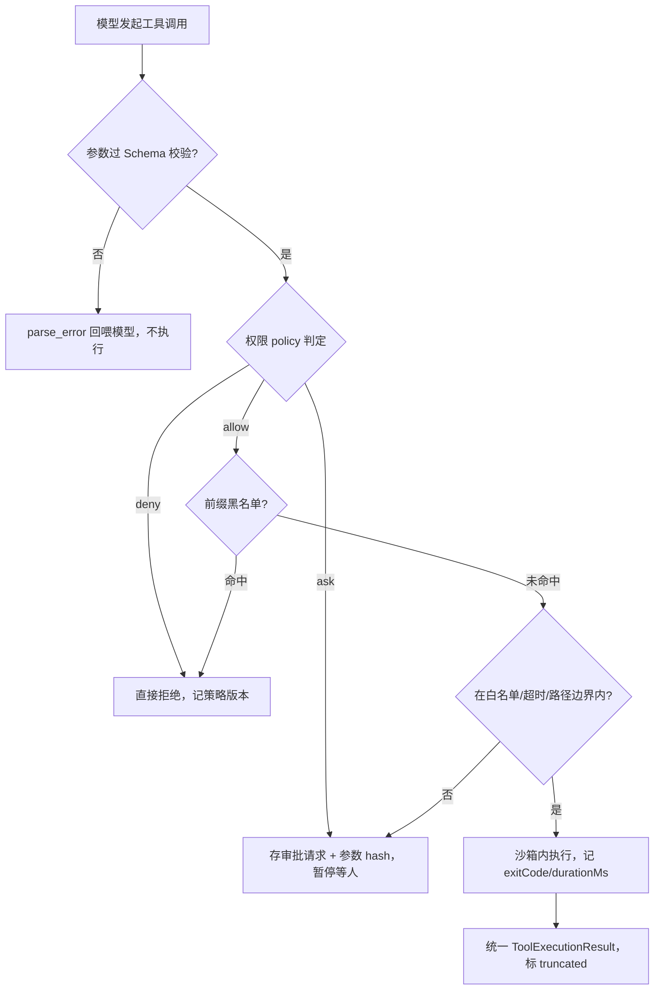

# Tools & Extensions · 工具系统、MCP 与 Skills

> 这篇讲工具契约、统一执行结果、幂等与重试、人工审批策略，以及 MCP / Skills 扩展机制。

模型再聪明，也得靠「动手」才能改代码、跑命令。这篇回答两个问题：模型每次能调用哪些「手」（工具），以及每只手伸出去之前要过几道安检。可以把工具理解成餐厅菜单上的菜、把审批理解成后厨的门禁——不是点了就能做，要看这道菜危不危险、要不要先问老板。读完你会知道 mod-agent 为什么连「跑哪条命令」都要拆成前缀白名单/黑名单来管。

## 1. 工具分层

**A. 内部核心工具（由 Node 进程直接执行，高可信）**

- `repo.list_files` / `repo.read_file` / `repo.search_text`
- `repo.find_symbol` / `repo.find_references`
- `repo.git_status` / `repo.read_diff` / `repo.apply_patch`
- `command.run` / `test.run`
- `browser.open_page` / `browser.screenshot`（后期）

**B. MCP 外部能力**

- GitHub/GitLab：读 Issue/PR、建分支、发 PR（后期）；
- 文档系统 / 工单系统 / 设计工具 / 自定义企业工具。

MCP 是互操作协议，不天然代表可信或安全。每个 MCP Server 单独登记来源、用途、权限范围、认证方式、网络目标、超时与数据分类；其工具描述、注释、返回内容一律按不可信输入处理。

**MCP 的角色模型（协议规范原文，出处：https://modelcontextprotocol.io/specification/ ）**：

| 角色 | 是谁 | 干什么 |
| --- | --- | --- |
| Host | 主应用（mod-agent CLI） | 发起并管理所有 MCP 连接 |
| Client | Host 内部的连接器 | 与某个具体 Server 会话、做能力协商 |
| Server | 外部工具 / 数据服务 | 暴露 Resources（可读数据）/ Prompts（模板化提示）/ Tools（可调用函数）三原语 |
| Elicitation | Client → Server 反向 | 允许 server 在任务中向用户追问信息，映射为 CLI 提问交互 |

**MCP 工具安全基线（规范原文，出处同上）**：协议文档明确「Tools represent arbitrary code execution（工具就是任意代码执行）」，且「工具描述、注释等应按不可信处理」，并承认「MCP itself cannot enforce these security principles at the protocol level」——consent / 授权流必须由本 CLI 自己实现：

1. 一个 MCP 工具 = 任意本地代码执行，不能因为它「来自某个 server」就信任；
2. 调用有副作用的工具前走显式确认（与 §5 审批、agent-loop 的阻塞式校验同源）；
3. Host 必须让用户理解每个工具干什么再授权。

## 2. 工具描述契约（ACI）

```ts
interface AgentTool<I = unknown, O = unknown> {
  name: string;                       // 命名空间，如 repo.read_file
  description: string;                // 写清楚，防模型幻觉 API
  inputSchema: unknown;               // Zod / JSON Schema adapter
  outputSchema?: unknown;
  risk: "read" | "workspace_write" | "command" | "external_side_effect";
  idempotency: "safe" | "keyed" | "non_idempotent";
  timeoutMs: number;
  requiresApproval: (input: I, ctx: TaskContext) => boolean;
  execute(input: I, ctx: ToolExecutionContext): Promise<O>;
}
```

- 模型可见的工具子集按任务模式、任务状态、用户权限与注册策略动态生成；
- 工具名带命名空间（`repo.read_file`），避免多个 MCP Server 提供同名 `search` 产生歧义；
- ACI 反向定制：输出分页 / 折叠 / 截断、报错结构化带「你可能想运行…」提示、强制绝对路径。Anthropic 实测改成强制绝对路径后，模型再没犯过相对路径错误。

每次工具调用不是「模型说啥就跑啥」，而是依次过下面这道安检：



这张图在说什么：模型想跑的任何一条命令，都要先过「参数对不对 → 允不允许 → 黑不黑名单 → 要不要问人」这一串关卡，最后拿到的都是一份格式统一、标了截断、带耗时和退出码的结果。这样模型拿到的反馈是确定的，不会因为一次报错文本措辞不同就判断失误。

举个例子（示意）：你刚批准模型跑 `npm test`。下一轮它想跑 `npm install lodash`——这是另一条命令、带网络副作用，不能因为你批过 npm 相关的命令就自动放行。审批必须和「具体参数」绑定，系统会按参数 hash 重新问你一次。

## 3. 统一执行结果

```ts
interface ToolExecutionResult<T = unknown> {
  callId: string;
  toolName: string;
  status: "succeeded" | "failed" | "timed_out" | "cancelled";
  output?: T;
  error?: { code: string; message: string; retryable: boolean };
  startedAt: string;
  finishedAt: string;
  durationMs: number;
  artifacts?: Array<{ kind: string; uri: string; sha256?: string }>;
  usage?: { inputTokens?: number; outputTokens?: number; costUsd?: number };
}
```

- observation 一律标注 `truncated`，让模型知道结果不完整；
- 错误对象必须有稳定 `error_code`，不靠匹配自然语言报错文案来判断分支。

## 4. 重试与幂等

- 只读操作（GET、搜索、读文件）可按策略有限重试；
- 模型请求重试区分超时 / 限流 / 网络错误 / 参数错误，遵守 `Retry-After`，指数退避加抖动；
- 补丁重试前必须检查目标文件 hash 与是否已应用，不能不判断就再写；
- 创建 PR、发消息、改工单等外部副作用用幂等键，或先查副作用是否已发生；没有幂等保证时，超时后不自动重放，转人工确认；
- 结果未知的非幂等调用进入 `outcome_unknown` 语义，而非自动标失败后重试。

## 5. 人工审批策略

| 风险动作 | 默认策略 |
| --- | --- |
| 读工作区内普通源码 | 允许，受路径策略约束 |
| 改授权目录内源码 | 按任务模式允许，前端展示 diff |
| 改锁文件 / 权限 / CI/CD / 部署脚本 | 更严格确认或管理员策略决定 |
| 跑测试 / lint / 类型检查 | 命令在白名单 / 隔离环境内可自动执行 |
| 新增依赖、访问外网装包 | 需网络策略放行；首次新增建议审批 |
| 读密钥 / 凭证 / SSH 私钥 | 默认拒绝；确需则由服务端能力托管，不回模型上下文 |
| 批量删文件、改 Git 历史 | 默认拒绝或强制审批 |
| push / 建 PR / 合并 / 发布 | 先审批；MVP 默认不自动 merge / deploy |
| 访问生产系统 / 改线上数据 | 默认拒绝，需独立授权与审计 |

审批必须与具体动作参数绑定：用户批准了 `command.run` 的一条命令，不能复用于参数不同的另一条。保存请求摘要、参数 hash、策略版本、审批人、时间、结果与失效时间。

### 5.1 细粒度权限矩阵（Kilo Code 实证，出处：https://kilo.ai/docs/features/auto-approving-actions ）

不要只做一个「全自动」总开关。把动作拆成类别，各自标风险并**逐项**决定 ask / auto / deny：

| 动作 | 风险等级 | 默认建议 |
| --- | --- | --- |
| 读文件 / 目录 | 中 | 可自动（起手推荐） |
| 改文件 | 高 | 默认逐次确认 |
| 执行终端命令 | 高 | 仅白名单前缀可自动 |
| 无头浏览器 | 中 | 逐次确认 |
| 调用 MCP 工具 | 中高 | 逐次确认 + 可单独白名单 |

- 另设「主开关」一键全开 / 全关，便于在敏感代码与快速开发之间切换；
- 工作区外读写、受保护文件写、删除——各自再独立标「极高」并默认关闭；
- 自动批准与快照是**捆绑设计**：单独放开 auto-approve 而无每步快照等于裸奔（见 [code-editing.md](./code-editing.md) §3）；官方同样警告 auto-approve 可能造成数据丢失 / 文件损坏。

**命令执行 = 前缀白名单 + 前缀黑名单，且黑名单优先级最高**（出处同上）：

1. 白名单写命令前缀（`git`、`npm test`、`ls`），命中即自动执行不问人；
2. 黑名单写危险前缀，**无论白名单是否含 `*`，黑名单一律拦截**；
3. 生产 / 敏感数据场景禁止用 `*` 放开全部；删除类操作单独一档（极高风险）。

**最高自治档（YOLO）必须配「前置守门员」**（出处同上）：YOLO = 一键放开全部权限，仅推荐隔离环境 / 低风险任务；可选开启 AI 守门员——用一个小而快的模型在每个写操作真正落盘前先判一次，放行或拦截。守门员有额外成本与延迟；生产 / 敏感数据默认不开 YOLO。

**权限模型分两层，别混为一谈（Zed 实证，出处：https://zed.dev/docs/ai/tools ）**：

1. **Profile（工具可用性）**：决定某 agent 线程挂载哪组工具（read / search / edit / terminal / mcp…），不挂载即物理不可用；
2. **Tool Permission（行为）**：对每个已挂载工具设三态——自动批准 / 自动拒绝 / 逐次确认；
3. 终端工具额外叠加 OS 级沙箱：限制可访问的网络主机（`allow_hosts` / `allow_all_hosts`）。

「能不能用」与「用的时候要不要问人」是两个正交维度，应分别配置。

## 6. Skills · 工程流程复用

| 概念 | 是什么 | 例子 |
| --- | --- | --- |
| **Tool** | 可被程序调用的原子能力 | 读文件、搜代码、跑测试 |
| **Skill** | 可复用的工作流程 / 说明，指导 Agent 何时按何步骤调工具 | 「定位 React 状态竞态」「给项目加页面」「排查构建错误」 |
| **Workflow / 状态机** | 程序强制执行的可靠流程 | 必须审批、测试失败最多修两轮、取消后不再跑命令 |

安全约束不能只写在 Skill 文本里：Skill 可以建议，Policy 与状态机负责强制。

### 6.1 Skill 文件结构

```text
.agent/skills/
  react-feature/
    SKILL.md
    examples.md
    checklist.md
  bug-triage/
    SKILL.md
    checklist.md
  test-repair/
    SKILL.md
    examples.md
```

`SKILL.md` 包含：名称、适用场景、输入前提、必须遵守的边界、步骤、成功条件、常见失败与恢复方式、需调用的工具、相关示例。按需加载，不要把所有 Skill 一次性塞进每轮上下文。

**Skill 文件标准（Claude Code 实证，出处：https://code.claude.com/docs/en/skills ）**：每个技能一个目录，目录下必须有 `SKILL.md`；它由两段组成——YAML frontmatter（告诉模型何时用）+ Markdown 正文（用的时候遵循的步骤）：

```text
my-skill/
  SKILL.md          # frontmatter（name / description / paths / allowed-tools）+ 正文
  reference.md      # 详细参考资料，按需自读
  examples.md
  scripts/helper.py # 被工具调用，而非被读入上下文
```

- **按需加载**：与规则文件常驻不同，技能正文只在被触发时进入上下文，常驻的只有「技能名 + description」清单——长参考资料几乎零成本；
- **`SKILL.md` 建议 ≤ 500 行**：详细参考拆到 `reference.md` / `examples.md`，正文用相对路径引用，由模型按需自读；
- frontmatter 的 `description` 决定模型何时自动触发；`paths`（glob）限定只在命中某类文件时触发；命令名取自目录名，用户可 `/name` 手动调用。

### 6.2 选择与版本管理

- 由轻量 Router 按任务类型召回候选；明确的用户指令优先；
- 每个 Skill 带 `id`、`version`、`source`、`content_hash`、`trust_level`；
- 仓库内 Skill 是项目辅助指引而非安全策略；启用外部来源 Skill 前审阅并固定版本；
- Skill 作为可评测资产：维护标准任务与成败案例，验证它是否真的降低步骤错误、修改范围与成本。

### 6.3 规则加载的激活矩阵（Cursor 实证，出处：https://cursor.com/docs/rules ）

规则不是「一股脑全塞进 prompt」。用 frontmatter 三个开关决定一条规则何时注入上下文，避免撑爆上下文还能装很多规则：

| alwaysApply | description | globs | 何时注入上下文 |
| --- | --- | --- | --- |
| true | — | — | 每次会话都注入 |
| false | — | 提供 | 上下文里出现匹配文件时自动挂载 |
| false | 提供 | 省略 | agent 读描述后自行判断相关性再拉取 |
| false | 空 | 空 | 仅当用户 `@规则名` 时注入 |

- 规则源优先级 Team → Project → User，冲突时前者优先；
- 最佳实践：单条规则 < 500 行、大规则拆成可组合小规则、用 `@文件` 引用而非复制内容。

**嵌套规则文件（就近优先，出处同上）**：支持在任意子目录放 `AGENTS.md`；当操作的文件位于某目录（或其子目录）时，自动叠加该目录及所有父目录的 `AGENTS.md`，越靠近文件的规则越优先（例：根 `AGENTS.md` 全局风格 + `components/AGENTS.md` 组件约定），无需用户手动 @ 引用。

### 6.4 Hooks 生命周期挂点（Claude Code 实证，出处：https://code.claude.com/docs/en/hooks ）

在 agent loop 的固定挂点允许用户脚本介入，事件分三类节奏：

| 节奏 | 事件 | 可否阻断 |
| --- | --- | --- |
| 会话 | SessionStart / SessionEnd | 否 |
| 轮次 | UserPromptSubmit / Stop | 可阻断 prompt |
| 工具调用 | PreToolUse（执行前）/ PostToolUse（执行后） | PreToolUse 可阻断 |

1. 钩子从 stdin 收事件 JSON，用退出码 2 阻断，stderr 作为原因回喂模型；
2. PreToolUse 输入含 tool_name / tool_input（文件路径展开为绝对路径，防 `~/` 相对路径绕过）；
3. PostToolUse 两种介入：`additionalContext`（向上下文追加事实，如当前分支 / 测试命令；超长则落盘只传路径）、`updatedToolOutput`（替换模型看到的工具输出，如把 stdout 里的密钥打码为 `[redacted]`，不影响已发生的副作用）；
4. 写作要求：追加内容用**陈述句事实**，避免祈使句式「系统指令」，否则会触发模型的 prompt-injection 防御而被丢弃。
