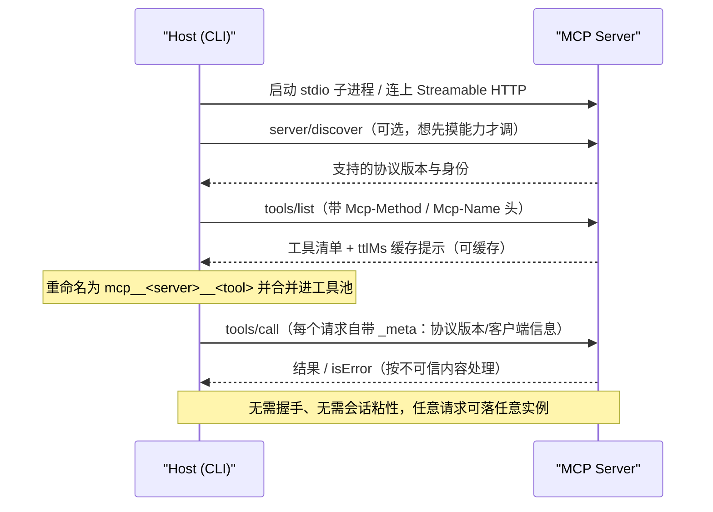
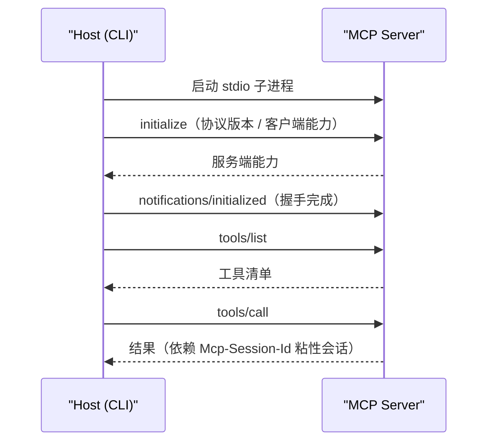
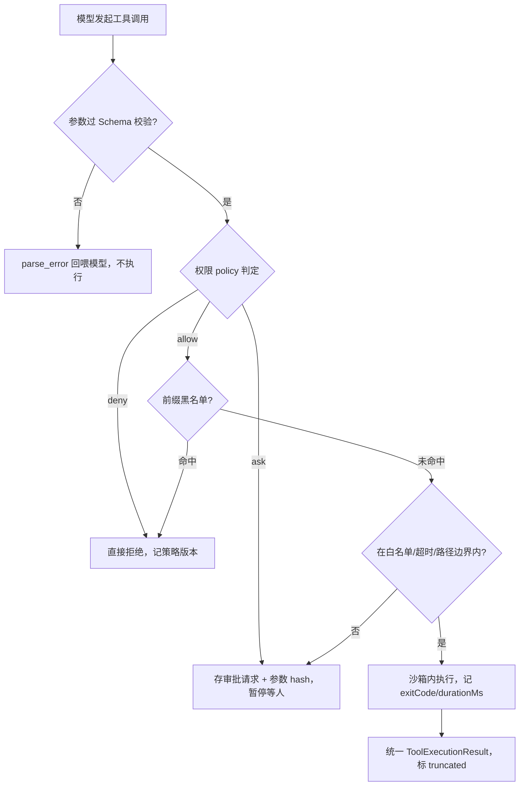

# Tools & Extensions · 工具系统、MCP 与 Skills

> 本文定义工具契约、统一执行结果、幂等与重试、审批策略，以及 MCP / Skills 扩展机制。

模型必须通过工具才能修改代码或运行命令。这里重点规定两件事：每轮可用的能力集合，以及一个调用从模型请求到实际执行前要经过哪些检查。工具分为内部核心工具和 MCP 外部能力；审批由动作风险决定。

## 1. 工具分层

**A. 内部核心工具（由 Node 进程直接执行，高可信）**

- `repo.list_files` / `repo.read_file` / `repo.search_text`
- `repo.find_symbol` / `repo.find_references`
- `repo.git_status` / `repo.read_diff` / `repo.apply_patch`
- `command.run` / `test.run`
- `browser.open_page` / `browser.screenshot`（后期）

**B. MCP 外部能力**

- GitHub/GitLab：读 Issue/PR、建分支、发 PR（后期）；
- 文档系统 / 工单系统 / 设计工具 / 自定义企业工具。

MCP 是互操作协议，不天然代表可信或安全。每个 MCP Server 单独登记来源、用途、权限范围、认证方式、网络目标、超时与数据分类；其工具描述、注释、返回内容一律按不可信输入处理。

**MCP 的角色模型（协议规范原文，出处：https://modelcontextprotocol.io/specification/ ）**：

| 角色        | 是谁                    | 干什么                                                                       |
| ----------- | ----------------------- | ---------------------------------------------------------------------------- |
| Host        | 主应用（mod-agent CLI） | 发起并管理所有 MCP 连接                                                      |
| Client      | Host 内部的连接器       | 与某个具体 Server 会话、做能力协商                                           |
| Server      | 外部工具 / 数据服务     | 暴露 Resources（可读数据）/ Prompts（模板化提示）/ Tools（可调用函数）三原语 |
| Elicitation | Client → Server 反向    | 允许 server 在任务中向用户追问信息，映射为 CLI 提问交互                      |

> **版本提示**：上表的 Elicitation、`initialize` 握手、Roots 等机制对应的是 2025-11-25 及更早的规范。现行规范为 2026-07-28，是自发布以来最大的一次改版，握手与会话已被移除、Elicitation 被 MRTR 取代。详见 [§1.2](#_1-2-2026-07-28-规范改了什么-必读-影响所有-mcp-代码)。新代码一律按 2026-07-28 写。

**MCP 工具安全基线（规范原文，出处同上）**：协议文档明确 "Tools represent arbitrary code execution（工具就是任意代码执行）"，要求 "工具描述、注释等应按不可信处理"，也承认 "MCP itself cannot enforce these security principles at the protocol level"。所以 consent / 授权流必须由本 CLI 自己实现：

1. 一个 MCP 工具 = 任意本地代码执行，不能因为它来自某个 server 就信任；
2. 调用有副作用的工具前走显式确认（与 [§5](#_5-人工审批策略) 审批、agent-loop 的阻塞式校验同源）；
3. Host 必须让用户理解每个工具干什么再授权。

### 1.1 MCP 连接生命周期：工具发现、路由与调用

第 1 节的角色模型回答谁是谁，这里讲连接怎么建、工具怎么发现、调用怎么路由。先看现行规范（2026-07-28）的写法，再对照已被移除的旧握手。保留旧图，是为了让你读存量资料和旧 server 时不至于困惑。

**现行（2026-07-28，无状态）**：



**旧版（≤2025-11-25，已移除，仅供对照）**：



落地要点：

- **三段式命名**：每个外部工具重命名为 `mcp__<serverName>__<toolName>`，既避免不同 server 同名工具冲突，也让模型与权限规则能精确路由到具体 server；
- **命名长度显式校验、不静默丢弃**：真实 Claude Code 的 `mcp__<server>__<tool>` 全长超过 **128 字符**时直接把这条工具**丢掉不发给模型**，属于典型"静默失败"。mod-agent 的注册阶段必须显式校验并报错 `MCP tool name too long: mcp__<server>__<tool> (N > 128)`，让 server owner 改命名而不是让模型看不见工具；
- **凭据名模板变量例外**：真实 Claude Code 的 `.mcp.json` 里 `${VAR}` 与 `${VAR:-default}` 支持变量展开，**但** `ANTHROPIC_API_KEY`、`ANTHROPIC_AUTH_TOKEN`、`AWS_BEARER_TOKEN_BEDROCK`、`HTTPS_PROXY`、`NPM_TOKEN` 五个"看起来像凭据"的名字在远端 `url` 与 `headers` 字段里会被读成空且不套用默认值，防止 `.mcp.json` 里 `${ANTHROPIC_API_KEY}` 被静默展开外送到第三方 server。mod-agent 的模板变量替换必须显式维护一份"凭据黑名单"（默认至少含上面这五个）并做同样的处理；
- **懒加载 + 失败隔离**：server 可按需启动而非开局全拉起；单个 server 启动失败、发现超时或调用超时，只让它名下的工具不可用，不能拖垮主进程或其他 server；连接、发现、调用各设独立超时；
- **合并进工具池时分区排序**：内置工具按字母序在前、MCP 工具追加在后，不做全局混排。缓存断点设在最后一个内置工具之后，动态挂接的 MCP 工具不影响内置工具部分的前缀缓存命中（见 [system-prompt.md §6](./system-prompt.md#_6-工具清单如何呈现给模型)、[model-gateway.md](./model-gateway.md)）；
- **工具 schema 也要过校验**：server 声明的参数模式在注册时做兼容性校验，畸形 schema 不注册；工具结果一律标记为不可信数据，走 [context-engineering.md §6](./context-engineering.md#_6-输入注入与不可信内容) 的注入防护。注意：2026-07-28 起 `inputSchema` 支持完整 JSON Schema 2020-12（含 `oneOf` / `anyOf` / `$ref`），校验器不能再假设它是扁平结构。

### 1.2 2026-07-28 规范改了什么（必读，影响所有 MCP 代码）

这是 MCP 自发布以来最大的一次改版，不是增量更新。如果你在 2026-07 之前学过 MCP，有一部分认知已经是历史了。

| 变化                                  | 旧（≤2025-11-25）                                                          | 新（2026-07-28）                                                                                                                | 对 mod-agent 的影响                                                                                                                 |
| ------------------------------------- | -------------------------------------------------------------------------- | ------------------------------------------------------------------------------------------------------------------------------- | ----------------------------------------------------------------------------------------------------------------------------------- |
| **协议内核**                          | 双向有状态，需 `initialize`/`initialized` 握手 + `Mcp-Session-Id` 粘性会话 | **无状态**：握手与会话头一并废除（SEP-2567/2575），每个请求在 `_meta` 自带协议版本、客户端身份与能力                            | server 可跑在普通轮询负载均衡后，**无需共享会话存储**                                                                               |
| **需要跨调用状态时**                  | 藏在 transport 的会话里                                                    | server 从工具里**签发一个显式 handle**，模型把它当普通参数传回来                                                                | handle 对模型可见、可审计，比藏在传输层好                                                                                           |
| **路由**                              | 网关要解析 JSON body                                                       | 必带 `MCP-Protocol-Version` / `Mcp-Method` / `Mcp-Name` 头（SEP-2243）                                                          | 网关、限流、WAF **只看头部**就能路由和鉴权                                                                                          |
| **服务端反向请求**                    | `sampling/createMessage`、`elicitation/create`、`roots/list`，需常开双向流 | **MRTR（多往返请求，SEP-2322）**：返回 `resultType: "input_required"` + `inputRequests`，客户端带 `inputResponses` 重试原调用   | 审批/追问交互改造为「返回问题 → 客户端补答案重试」                                                                                  |
| **列表结果**                          | 每次重连重新拉                                                             | 带 **ttl 与缓存范围 + 确定性顺序**                                                                                              | 可缓存工具目录，**重连后上游 prompt cache 保持稳定**（直接利好 [§1.1](#_1-1-mcp-连接生命周期-工具发现、路由与调用) 的缓存断点设计） |
| **长任务**                            | 需保持 HTTP 连接打开                                                       | **Tasks 扩展（SEP-2663）**：返回 task handle，客户端用 `tasks/get` / `tasks/update` / `tasks/cancel` 跟踪                       | 数小时级任务不再占连接                                                                                                              |
| **UI**                                | 无                                                                         | **MCP Apps 扩展（SEP-1865）**：server 可返回沙箱 iframe 里的交互 HTML                                                           | 工具可自带表单/面板                                                                                                                 |
| **错误码**                            | 资源缺失返回自定义 `-32002`                                                | 改为 JSON-RPC 标准 **`-32602`**                                                                                                 | 任何硬编码匹配 `-32002` 的代码会静默漏判                                                                                            |
| **废弃（12 个月最短窗口，SEP-2596）** | Roots / Sampling / Logging 可用                                            | 三者**废弃**，分别改用工具参数或资源 URI、直接调 LLM 厂商 API、stderr 或 OpenTelemetry；HTTP+SSE 传输也废弃，转 Streamable HTTP | 别在新代码里用它们；用了就当作已知搬迁债务                                                                                          |

治理归属这点在选型评审时会被问到：Anthropic 已于 2025-12-09 把 MCP 捐给 Linux 基金会旗下的 Agentic AI Foundation（AAIF），创始成员包括 AWS、Anthropic、Block、Bloomberg、Cloudflare、Google、Microsoft、OpenAI；基金会明确不干预技术方向，日常仍走 SEP 流程。MCP 不再是单一厂商的赌注，协议被弃的长期风险小了不少。

规模参考：Tier 1 SDK 月下载接近 5 亿次，TypeScript 与 Python SDK 累计下载各破 10 亿。

Client 侧兼容清单（落到实现）：

- 本地 / 私有 server 用 **stdio**；远端共享 server 用 **Streamable HTTP**（SSE 已是兼容回退，不是推荐）；
- 优先用官方或厂商维护的 server，其次才自建；自建时把工具面做到最窄，写权限单独设闸；
- 信任一个 server 之前，先跑一次低成本健康检查；
- 一次性 HTTP 调用、或"包一个巨大通用 wrapper"的场景，不要用 MCP，直接写个简单工具更合适。

## 2. 工具描述契约（ACI）

```ts
interface AgentTool<I = unknown, O = unknown> {
  name: string // 命名空间，如 repo.read_file
  description: string // 写清楚，防模型幻觉 API
  inputSchema: unknown // Zod / JSON Schema adapter
  outputSchema?: unknown
  risk: "read" | "workspace_write" | "command" | "external_side_effect"
  idempotency: "safe" | "keyed" | "non_idempotent"
  timeoutMs: number
  requiresApproval: (input: I, ctx: TaskContext) => boolean
  execute(input: I, ctx: ToolExecutionContext): Promise<O>
}
```

- 模型可见的工具子集按任务模式、任务状态、用户权限与注册策略动态生成；
- 工具名带命名空间（`repo.read_file`），避免多个 MCP Server 提供同名 `search` 产生歧义；
- ACI 反向定制：输出分页 / 折叠 / 截断、报错结构化带"你可能想运行…"提示、强制绝对路径。Anthropic 实测改成强制绝对路径后，模型再没犯过相对路径错误。

模型说跑什么，运行时不会直接跑。每次工具调用都要依次过一道安检：



模型想跑任何一条命令，都要先过一串关卡：参数对不对、允不允许、黑不黑名单、要不要问人。过完关，拿到的是一份格式统一、标了截断、带耗时和退出码的结果。反馈是确定的，模型不会因为一次报错文本措辞不同就判断失误。

比如，你刚批准模型跑 `npm test`。下一轮它想跑 `npm install lodash`，这是另一条命令、带网络副作用，不能因为你批过 npm 相关的命令就自动放行。审批必须和具体参数绑定，系统会按参数 hash 重新问你一次。

### 2.1 工具注册：三层流水线与 fail-closed 默认值

模型这一轮能看到哪些工具，不是固定的静态清单，而是每轮按上下文组装的结果：


工具元数据（只读 / 并发安全 / 破坏性）的默认值必须 fail-closed：

| 标记                | 安全默认     | 为什么默认成这样                                                       |
| ------------------- | ------------ | ---------------------------------------------------------------------- |
| `isConcurrencySafe` | 默认 `false` | 误标「可并发」会让写操作在无保护下并发；误标「不可并发」顶多串行慢一点 |
| `isReadOnly`        | 默认 `false` | 误标「只读」可能绕过写权限检查；误标「非只读」只是多一次确认           |
| `isDestructive`     | 默认 `false` | 破坏性由更上层的命令 / 路径策略显式判定                                |

原则：标记出错时，后果要落在多打扰用户这一边（烦人但安全），而不是静默放行那一边（危险且隐蔽）。

### 2.2 单次工具执行的八阶段生命周期

一次工具调用从模型吐出 tool_use 到结果回到模型，生产级实现拆成固定阶段，把校验、Hook、权限、裁剪这些横切关注点插在标准位置：

1. **工具查找**：按名解析，找不到就回 `Unknown tool` 作为工具结果（不抛异常）；
2. **输入验证（两阶段）**：先做低成本的 Zod schema 校验（字段类型），再做业务校验（如 `edit_file` 的待替换串是否唯一、配置文件改完是否仍是合法 JSON）。先做便宜的检查，减少无谓磁盘 I/O；
3. **并行启动**：Pre-Tool Hook 与命令安全分类器同时启动，各耗时几十到几百毫秒，并行化压低权限判定总延迟；
4. **权限检查**：Hook → 工具自带 `checkPermissions` → 规则引擎 → 分类器 → 交互式确认，顺序裁决（见 [§5](#_5-人工审批策略) 与 [security.md](./security.md)）；
5. **执行**：在沙箱内运行，支持流式进度回调（长命令、多文件任务可回报进度）；
6. **结果处理**：标准化、裁剪；超过 `maxResultSizeChars` 的大结果落盘，模型只收到路径 + 短预览 + 用 read 取回全文的指示（与 [context-engineering.md §5](./context-engineering.md#_5-压缩-compaction-与外置记忆) 的分层裁剪衔接）；
7. **Post-Tool Hook**：可向上下文追加事实或替换输出（如把 stdout 里的密钥打码）；
8. **返回 `tool_result`**：成功或失败都以数据形式回灌模型（见 [agent-loop.md §2.3](./agent-loop.md#_2-3-工具错误是「数据」-不是异常-最轻的自修复)）。

> 每个工具还可自带两类渲染：`prompt()` 向系统提示词注入该工具的专属使用指南（内聚于工具），`renderToolUse / renderToolResult` 决定它在 TUI 里怎么展示。新增工具无需改全局渲染。

### 2.3 延迟加载（deferred tools / tool_search）

工具一旦多起来，把所有工具的完整 schema 都下发给模型，会固定占用大量 token。成熟做法是**延迟加载**：

- 不常用工具打 `deferred` 标记，下发时只给名字、不给完整 schema；系统提示词里告知模型这些工具可以通过 `tool_search` 按需激活；
- 模型需要时调用 `tool_search`（按名字 / 关键词检索），匹配到的工具被加入已激活集合，下一次模型请求才带上其完整 schema；
- 典型例子是 `enter_plan_mode` / `exit_plan_mode`（见 [agent-loop.md §3.2](./agent-loop.md#_3-2-plan-mode-的落地-只读契约-计划文件-审批四选项)）：只在用户要规划时才值得占 schema。

这与 [§6](#_6-skills-·-工程流程复用) Skills 的常驻只放 frontmatter 摘要、正文按需加载是同一思路：把能力的目录给模型，把详情推迟到真正使用的时刻。

### 2.4 并行工具执行

模型一轮可能请求多个工具（如同时读 5 个文件）。全部串行会让只读等待白白累加：

- 并发安全判定按参数而非按工具：`isConcurrencySafe(input)` 接收本次入参。同一个 shell 工具，对 `ls` 判只读、对 `rm` 判非并发，比给整个工具贴标签精确；
- 调度规则：有非并发安全工具在执行时，它独占执行；只存在并发安全工具时可并行，并设并发上限（如 10）；
- 与流式配合：流式响应中某个只读工具的参数 JSON 一旦完整（`content_block_stop`）就提前开跑（见 [agent-loop.md §2.4](./agent-loop.md#_2-4-流式窗口里提前执行工具)）；对不支持工具 block 级流式事件的后端，则把连续的并发安全工具分组用 `Promise.all` 并行执行；
- 混合序列要保持语义：`[读, 读, 写, 读]` 被切成 `[读‖读] → [写] → [读]` 三个批次，写操作前后的读不会跨越写操作并行，避免读到中间态。

典型收益：模型一轮读 3–5 个文件时，并行通常带来 2–3 倍的提速，且文件读取（毫秒级）几乎能完全藏进模型流式生成（数秒到数十秒）的窗口里。

### 2.5 工具输入的硬阈值是契约的一部分

出处：Claude Code `tools-reference` v2.1.300 实证（https://code.claude.com/docs/en/tools-reference ）。工具的能力边界不只由"能不能调"决定，也由"单次能吃多少、返多少、跑多久"这三档数值决定。这些数值容易被当成"实现细节"随手写死，一旦这样就会产生两类事故：模型看不见限制、撞上去时以难以诊断的方式失败；或限制被随手改动、成本与延迟失控。mod-agent 把它们写进 `AgentTool` 契约的一等字段（`inputLimits` / `outputLimits` / `timeoutMs`），TUI 与错误提示都要显式引用。

| 工具        | 数值上限                                                                                                   | 撞上时的行为                                                                                                                  |
| ----------- | ---------------------------------------------------------------------------------------------------------- | ----------------------------------------------------------------------------------------------------------------------------- |
| `Read`      | 单次返回 **25,000 tokens**；整读文件 **256 KB** 硬顶，可传 `allow_large: true` 覆盖                        | 默认拒读、错误消息里给出"分段读"或"显式覆盖"两条建议，不静默截断                                                              |
| `Read` PDF  | 超过 10 页必须传 `pages`；每次最多 **20 页**                                                               | 缺 `pages` 直接失败并回提示，不允许"隐式整本读"                                                                               |
| `Glob`      | 结果按修改时间排序、截 **100 个文件**；**默认不遵循 `.gitignore`**（`globNoIgnore: false` 可改）           | 结果多于 100 时明确标"截断，请收窄 pattern"；不遵循 gitignore 是刻意设计（模型经常需要找到 `dist/` 之类），要写进 description |
| `Grep`      | 基于 ripgrep 语法、**遵循 `.gitignore`**、默认 output mode `files_with_matches`                            | 与 Glob 保持"一个默认包含、一个默认排除"的互补，两个默认值本身要在提示词里说明                                                |
| `Bash`      | 单次默认超时 **2 分钟**、硬顶 **10 分钟**；输出 inline 约 **30,000 字符**、失败约 10,000，硬顶 **150,000** | 超时的处理见下文"前台命令超时自动移入后台"；输出超 30K 落盘只留路径 + 预览（对齐 §2.2 第 6 步）                               |
| 命令总量    | Bash 会话内输出总量超 **5 GB** 直接被 kill                                                                 | 防"一条 `yes > /dev/null` 类命令把机器与磁盘同时打死"，kill 前把已产生结果 flush 到文件                                       |
| `WebSearch` | 交互会话**每会话 200 次**（`maxWebSearchesPerSession`）                                                    | 撞顶时返回稳定错误码 `SEARCH_QUOTA_EXCEEDED`，让模型知道换方案而不是继续调                                                    |

三条实现约束值得单独点：

- **数值必须可查、可改**。每一项都是 settings 键（kebab-case），文档里列一次、代码里读一处。避免 Claude Code 那种"改一个 `BASH_MAX_OUTPUT_LENGTH` 需要同步改三处默认值"的散落；
- **撞顶错误要教模型下一步做什么**。`Read: file too large, pass allow_large:true or use offset+limit` 远比 `Read: 256KB limit` 有用，前者模型能立即自愈、后者只能瞎猜；这条与 [agent-loop.md §2.3](./agent-loop.md) "错误是数据"的自修复一脉相承；
- **前台命令超时自动移入后台**（Claude Code `agent-view` 实证）。真实 Claude Code 的行为是：一条前台 Bash 命令跑到 `timeout` 前几秒，运行时给它一次机会——若它已经产出部分内容或看起来会跑很久，自动 `run_in_background: true` 化、把句柄回给模型，模型可选择继续等（用 `TaskOutput`）或走开做别的。这样"我以为是 30s 结果这条测试跑了 12 分钟"就不再阻塞整个 turn。mod-agent 落地时对应 [background-fleet.md §6](./background-fleet.md) 的会话内后台层：`CommandRequest.timeoutMs` 触发时不是简单 kill，而是按 `onTimeout: "kill" | "move-to-background"` 分派，默认对 `test.*` / `build.*` 这类前缀走 `move-to-background`，对一次性快速命令走 `kill`。

## 3. 统一执行结果

```ts
interface ToolExecutionResult<T = unknown> {
  callId: string
  toolName: string
  status: "succeeded" | "failed" | "timed_out" | "cancelled"
  output?: T
  error?: { code: string; message: string; retryable: boolean }
  startedAt: string
  finishedAt: string
  durationMs: number
  artifacts?: Array<{ kind: string; uri: string; sha256?: string }>
  usage?: { inputTokens?: number; outputTokens?: number; costUsd?: number }
}
```

- observation 一律标注 `truncated`，让模型知道结果不完整；
- 错误对象必须有稳定 `error_code`，不靠匹配自然语言报错文案来判断分支。

### 3.1 Artifact：一等输出类型，不只是"日志文件"

`artifacts[]` 字段上面已经预留了位置，但真实 Claude Code 的实践值得单列一节，因为**多数 agent 只把产物当"落盘文件 + 路径回给模型"，丢掉了产物本身可以承载交互与分享语义**。

Claude Code 的做法是把 artifact 定为一等公民（出处：https://code.claude.com/docs/en/artifacts ）：工具可以产出 `kind: "html" | "markdown" | "diff" | "chart" | "screenshot"` 的产物，平台负责四种可见性：**私有**（只有本会话看得到）、**组织内公开**（团队成员可访问）、**分享链接**（拿到 URL 的人可访问，可撤销）、**发外链**（永久公开）。产物本身可交互：HTML 里可以有脚本、可以填表、可以把用户点回来的动作以 `&lt;artifact-reply&gt;` 消息形式送回会话，形成"生成 → 让人在页面上标注 → 页面回灌到会话 → 修改"的闭环。

对 mod-agent 的落地：

- **不要把 artifact 只当"落盘 + 路径"**。`TaskArtifact` 表（见 [data-and-events.md §2](./data-and-events.md)）已经有 `sha256` 与 `uri`，再加三个字段：`kind`（受控枚举，不是自由字符串）、`visibility`（同上四态）、`share_token`（可空，撤销即置空）；
- **产物类型必须白名单**。当前 MVP 支持 `diff` / `markdown` / `screenshot` 三类（都是本仓库现有能力的自然产物），`html` 与 `chart` 留到 Phase 5 团队与 Web 控制台阶段（见 [roadmap.md](./roadmap.md)）；
- **HTML 类必须 iframe 沙箱隔离**。真实 Claude Code 的 artifact 页跑在 claude.ai 域下的独立沙箱 iframe，不给同源 cookie。我们如果 Phase 5 上 `kind: "html"`，也必须走独立子域 + CSP `sandbox` 属性，禁止 `allow-same-origin`。这一条与 [security.md §3](./security.md) 的沙箱基线同源，只是从"命令子进程"扩到"用户可打开的产物页"；
- **回灌通道复用消息队列**。`&lt;artifact-reply&gt;` 事件与 [agent-loop.md §2.6](./agent-loop.md) Channels 事件走同一条 `pendingExternalEvents` 队列、同样受"跨来源不携带用户权威"约束（[agent-teams.md §4](./agent-teams.md)）。这是 artifact 从"能看"升级为"能对话"的关键：产物不再是终点，是一次交互的中间态。

Phase 归属：MVP 只做本地产物 + `TaskArtifact` 表落盘，`visibility` 强制 `private`；公开分享与交互回灌留到 Phase 5 团队与企业能力。

## 4. 重试与幂等

- 只读操作（GET、搜索、读文件）可按策略有限重试；
- 模型请求重试区分超时 / 限流 / 网络错误 / 参数错误，遵守 `Retry-After`，指数退避加抖动；
- 补丁重试前必须检查目标文件 hash 与是否已应用，不能不判断就再写；
- 创建 PR、发消息、改工单等外部副作用用幂等键，或先查副作用是否已发生；没有幂等保证时，超时后不自动重放，转人工确认；
- 结果未知的非幂等调用进入 `outcome_unknown` 语义，而非自动标失败后重试。

## 5. 人工审批策略

| 风险动作                           | 默认策略                                         |
| ---------------------------------- | ------------------------------------------------ |
| 读工作区内普通源码                 | 允许，受路径策略约束                             |
| 改授权目录内源码                   | 按任务模式允许，前端展示 diff                    |
| 改锁文件 / 权限 / CI/CD / 部署脚本 | 更严格确认或管理员策略决定                       |
| 跑测试 / lint / 类型检查           | 命令在白名单 / 隔离环境内可自动执行              |
| 新增依赖、访问外网装包             | 需网络策略放行；首次新增建议审批                 |
| 读密钥 / 凭证 / SSH 私钥           | 默认拒绝；确需则由服务端能力托管，不回模型上下文 |
| 批量删文件、改 Git 历史            | 默认拒绝或强制审批                               |
| push / 建 PR / 合并 / 发布         | 先审批；MVP 默认不自动 merge / deploy            |
| 访问生产系统 / 改线上数据          | 默认拒绝，需独立授权与审计                       |

审批必须与具体动作参数绑定：用户批准了 `command.run` 的一条命令，不能复用于参数不同的另一条。保存请求摘要、参数 hash、策略版本、审批人、时间、结果与失效时间。

### 5.1 细粒度权限矩阵（Kilo Code 实证，出处：https://kilo.ai/docs/features/auto-approving-actions ）

不要只做一个全自动总开关。把动作拆成类别，各自标风险并逐项决定 ask / auto / deny：

| 动作          | 风险等级 | 默认建议                |
| ------------- | -------- | ----------------------- |
| 读文件 / 目录 | 中       | 可自动（起手推荐）      |
| 改文件        | 高       | 默认逐次确认            |
| 执行终端命令  | 高       | 仅白名单前缀可自动      |
| 无头浏览器    | 中       | 逐次确认                |
| 调用 MCP 工具 | 中高     | 逐次确认 + 可单独白名单 |

- 另设主开关一键全开 / 全关，便于在敏感代码与快速开发之间切换；
- 工作区外读写、受保护文件写、删除，各自再独立标极高并默认关闭；
- 自动批准与快照是捆绑设计：单独放开 auto-approve 而无每步快照等于裸奔（见 [code-editing.md §3](./code-editing.md#_3-工作区隔离与用户变更保护)）；官方同样警告 auto-approve 可能造成数据丢失 / 文件损坏。

命令执行 = 前缀白名单 + 前缀黑名单，且黑名单优先级最高（出处同上）：

1. 白名单写命令前缀（`git`、`npm test`、`ls`），命中即自动执行不问人；
2. 黑名单写危险前缀，无论白名单是否含 `*`，黑名单一律拦截；
3. 生产 / 敏感数据场景禁止用 `*` 放开全部；删除类操作单独一档（极高风险）。

最高自治档（YOLO）必须配前置守门员（出处同上）：YOLO = 一键放开全部权限，仅推荐隔离环境 / 低风险任务；可选开启 AI 守门员，用一个小而快的模型在每个写操作真正落盘前先判一次，放行或拦截。守门员有额外成本与延迟；生产 / 敏感数据默认不开 YOLO。

权限模型分两层，别混为一谈（Zed 实证，出处：https://zed.dev/docs/ai/tools ）：

1. **Profile（工具可用性）**：决定某 agent 线程挂载哪组工具（read / search / edit / terminal / mcp…），不挂载即物理不可用；
2. **Tool Permission（行为）**：对每个已挂载工具设三态：自动批准 / 自动拒绝 / 逐次确认；
3. 终端工具额外叠加 OS 级沙箱：限制可访问的网络主机（`allow_hosts` / `allow_all_hosts`）。

能不能用，与用的时候要不要问人，是两个正交维度，应分别配置。

### 5.2 Claude Code 实证：判定顺序、规则语法与持久度（出处：https://code.claude.com/docs/en/permissions 、https://code.claude.com/docs/en/permission-modes ，v2.1.300 核实）

它有六种权限模式：`default`（界面里叫 Manual）、`acceptEdits`、`plan`、`auto`、`dontAsk`、`bypassPermissions`，其中 `dontAsk` 的语义值得单记：**会问的一律拒绝**，而不是全放行，这使它成为无人值守场景里比 bypass 安全得多的默认档。另有一张"任何模式都不会自动批准"的清单：命中显式 ask 规则的调用、组织设为 ask 的 connector、需要人交互的工具、critical path 上的 `rm` 与 `rmdir`、跨会话消息防护、目录外读取（开关式）。这张清单是"自治上限"的可执行定义，我们的审批表应当有对应的一列 bypass-immune，而不是把高风险动作写成"默认审批"。

判定顺序是 deny、ask、allow，第一个命中的结论生效，**规则写得具体与否不参与排序**，且任何一层的 deny 全局无法在别处放行。这一点容易写错：直觉方案是"更具体的规则优先"，那会让团队级 deny 被个人级 allow 精确规则翻掉。

规则语法的四个坑会直接决定白名单是否误伤：

1. `Bash(ls:*)` 与 `Bash(ls *)` 等价，但 `Bash(ls*)` 会连 `lsof` 一起命中，前者要求 `ls` 后必须是空格；
2. 复合命令按 `&&`、`||`、`;`、`|`、`&` 与换行拆成子命令**逐个匹配**，全部通过才放行，所以 `Bash(git status *)` 放不倒 `git status && rm -rf /tmp/x`；
3. wrapper 会先剥离再匹配（`timeout`、`nice`、`nohup`、`stdbuf`、`command`、裸 `xargs` 等），但 `npx`、`docker exec`、`mise exec` 这类"再套一层执行入口"的**不剥**；
4. 路径规则的锚点有四种（`//` 文件系统绝对、`~/` 相对 home、`/` 相对**该 settings 文件所在目录**、裸路径相对 cwd），且同一 pattern 在 allow 与 deny 下**目录深度语义不同**：`Edit(src/**)` 作 allow 时只覆盖 `<cwd>/src`，`Read(secrets/**)` 作 deny 时匹配任意深度。写收权规则可以偷懒，写放权规则不行。

审批的持久度按动作类型分档，不是一把梭：Bash 的"不再询问"按仓库加命令永久落盘，文件修改的批准**只活到会话结束**（官方原话"A file-modification approval isn't saved to the file."），WebFetch 按仓库加域名永久。工作区信任又是另一档：接受只对当次会话有效、不写盘，也没有持久化开关。这个三档划分比"要么记住要么每次都问"精细，建议照抄进 §5 表的"失效时间"列。

## 6. Skills · 工程流程复用

| 概念                  | 是什么                                                 | 例子                                                    |
| --------------------- | ------------------------------------------------------ | ------------------------------------------------------- |
| **Tool**              | 可被程序调用的原子能力                                 | 读文件、搜代码、跑测试                                  |
| **Skill**             | 可复用的工作流程 / 说明，指导 Agent 何时按何步骤调工具 | 「定位 React 状态竞态」「给项目加页面」「排查构建错误」 |
| **Workflow / 状态机** | 程序强制执行的可靠流程                                 | 必须审批、测试失败最多修两轮、取消后不再跑命令          |

安全约束不能只写在 Skill 文本里：Skill 可以建议，Policy 与状态机负责强制。

### 6.0 Agent Skills 已是一个开放标准（2026 核实）

`SKILL.md` 这套一个目录 + 一个 Markdown 文件的格式，已经是一个开放标准：由 Anthropic 提出并开源、被大量 agent 产品采用（出处：https://skill.md ）。mod-agent 因此直接跟标准，不自造一套。

格式小到不能再小：一个目录 + `SKILL.md`（YAML frontmatter + Markdown 正文）。frontmatter 只有两个必需字段：

| 字段            | 必需 | 约束                                                                                    |
| --------------- | ---- | --------------------------------------------------------------------------------------- |
| `name`          | 是   | 1–64 字符，仅小写字母、数字、连字符；无首尾连字符、无连续连字符；**必须与父目录名一致** |
| `description`   | 是   | 1–1024 字符，非空；须同时说清**做什么**和**何时用**，并带上便于匹配的关键词             |
| `license`       | 否   | 许可证名或指向 bundled 许可证文件                                                       |
| `compatibility` | 否   | ≤500 字符，说明环境要求（目标产品、系统包、网络）                                       |
| `metadata`      | 否   | 字符串键值映射，给标准未定义的属性用                                                    |
| `allowed-tools` | 否   | 空格分隔的预批准工具串；**规范标为实验性**，各实现支持度不一                            |

目录约定（可选）：`scripts/`（可执行代码）、`references/`（按需加载的文档）、`assets/`（模板与静态资源）。正文无任何格式限制，规范建议写清分步指令、输入输出示例、常见边界情况，并建议把过长的正文拆到被引用的文件里，因为正文一旦激活就整体进入上下文。

真正让这套格式好用的是渐进披露三段，也是所有实现唯一的共同行为：


一个团队可以装几十个技能，平时只付几十个名字 + 一句话的 token 成本。`description` 因此是整份文件里权重最高的字段，模型在做决定前唯一能看到的文字就是它：写得太模糊，技能永远不会触发；写得太宽泛，技能会在不该触发的时候乱触发。

规模与落地：规范的客户端展示页列出 46 个产品支持，包括 Claude Code、ChatGPT/Codex、Cursor、GitHub Copilot、VS Code、Gemini CLI、OpenHands、Goose、Amp 等。安装路径的通用位置是项目根的 `.agents/skills/`，Claude Code 另扫 `.claude/skills/`（个人 `~/.claude/skills/`、项目 `.claude/skills/`）。规范建议正文 <5000 token / <500 行。

要清醒的边界：规范只定义了目录里放什么，没有定义目录放哪、重名怎么解、遇到没见过的 frontmatter 字段怎么办。跨 agent 移植时坏掉的正是这三件事，所以 [§6.3](#_6-3-选择与版本管理) 要求自己维护 `id` / `version` / `content_hash`，不要指望标准替你解决。

安全（规范原文强调）：只从可信来源装技能。恶意技能可以让 agent 以与其声称目的不符的方式调用工具或执行代码，造成数据外泄或未授权访问。启用前需审计 `SKILL.md` 及其所有附带文件（`scripts/`、图片、资源），重点看异常的网络调用、与声称目的不符的文件访问模式。从外部 URL 取数的技能风险尤其高，即使技能本身可信，它的外部依赖也可能随时间变坏。把装技能当成装软件来对待。

### 6.1 Skill 文件结构

```text
.agent/skills/
  react-feature/
    SKILL.md
    examples.md
    checklist.md
  bug-triage/
    SKILL.md
    checklist.md
  test-repair/
    SKILL.md
    examples.md
```

`SKILL.md` 包含：名称、适用场景、输入前提、必须遵守的边界、步骤、成功条件、常见失败与恢复方式、需调用的工具、相关示例。按需加载，不要把所有 Skill 一次性塞进每轮上下文。

Skill 文件标准（Claude Code 实证，出处：https://code.claude.com/docs/en/skills ）：每个技能一个目录，目录下必须有 `SKILL.md`；它由两段组成：YAML frontmatter（告诉模型何时用）+ Markdown 正文（用的时候遵循的步骤）：

```text
my-skill/
  SKILL.md          # frontmatter（name / description / paths / allowed-tools）+ 正文
  reference.md      # 详细参考资料，按需自读
  examples.md
  scripts/helper.py # 被工具调用，而非被读入上下文
```

- **按需加载**：与规则文件常驻不同，技能正文只在被触发时进入上下文，常驻的只有技能名 + description 清单，长参考资料几乎零成本；
- **`SKILL.md` 建议 ≤ 500 行**：详细参考拆到 `reference.md` / `examples.md`，正文用相对路径引用，由模型按需自读；
- frontmatter 的 `description` 决定模型何时自动触发；`paths`（glob）限定只在命中某类文件时触发；命令名取自目录名，用户可 `/name` 手动调用。

### 6.2 触发路径与执行模式（inline / fork）

技能有两条等价的触发路径，最终汇合到同一个"展开技能 prompt"的逻辑：

1. **用户手动调用**：输入 `/commit [参数]`，CLI 解析出技能名与参数，展开 prompt 后交给主循环；
2. **模型程序化调用**：用户只说"帮我提交代码"，模型理解意图后调用 `skill` 工具，工具返回的是展开后的指令文本（元工具：它返回的不是数据，而是给模型的指令），模型在随后的回合按它执行。

只支持手动会漏掉用户根本不知道有这个技能的场景；只支持模型自动调用又失去精确触发时机，两条路径都要有。

技能 prompt 在执行前做模板替换：

- `$ARGUMENTS` / `${ARGUMENTS}`：替换用户传入的参数；
- `${CLAUDE_SKILL_DIR}`（mod-agent 对应 `${AGENT_SKILL_DIR}`）：替换技能目录，便于技能正文引用同目录下的模板、脚本（`scripts/` 下的脚本由工具调用执行，而不是读进上下文）。

执行模式有两种：

| 模式               | 行为                                                                                                            | 适用                                                                           |
| ------------------ | --------------------------------------------------------------------------------------------------------------- | ------------------------------------------------------------------------------ |
| **inline（默认）** | 把展开后的 prompt 直接注入当前对话，由主 agent 继续                                                             | 一两步、不污染上下文的轻量流程（如规范一次提交信息）                           |
| **fork**           | 派生一个**独立子 agent**，以技能 prompt 为其系统提示、按 `allowed-tools` 白名单收敛工具，单独跑完只回传最终结果 | 需要多轮工具调用、会读很多文件的流程（如代码审查），避免这些中间过程污染主对话 |

fork 的安全约束：工具集受 frontmatter `allowed-tools` 白名单限制；未指定时至少摘除 `agent` / 子代理派生工具以防止递归；fork 出去的子 agent 必须继承主 agent 的权限模式（不能借 fork 提权，见 [verification-and-multiagent.md](./verification-and-multiagent.md) 与 [autonomy.md §3.5](./autonomy.md#_3-5-权限必须传播给子代理)）。

> 技能发现遵循项目级覆盖用户级（先加载用户目录、再加载项目目录，同名以项目为准）；启动时只载入 frontmatter，正文调用时才读取。技能清单也要受 token 预算约束：预算充足时全量展示描述，紧张时保留内置常用技能的完整描述、其余降级为仅列名称。

**Skill listing 预算的具体规格**（Claude Code v2.1.300 实证，出处：https://code.claude.com/docs/en/skills ）：把上面那句"预算约束"落成三个数，mod-agent 直接照抄：

- **单条描述截断 1,536 字符**：`description` 与 `when_to_use` 合并后硬截；配置键 `skillListingMaxDescChars` 可调，但不能设成不限；
- **总预算 = 模型上下文窗口的 1%**：配置键 `skillListingBudgetFraction`（默认 `0.01`）或环境变量 `SLASH_COMMAND_TOOL_CHAR_BUDGET` 直接给绝对字符数。这条预算的隐含意义：装了 40 个技能、每个描述 500 字符，一共 20,000 字符 ≈ 5,000 token，逼近 200K 窗口的 1%——再多就要开始丢描述；
- **超预算从最少调用的先丢**：按调用频次升序，先降级为"只列名字"、再降级为"完全不列"。这条排序判据是"用过多少次的运行时统计"，不是安装顺序，也不是字母序。

预算告警的 UI 侧：真实 Claude Code 给了 `/skill-doctor` 命令，列出每个 skill 的上下文成本与调用频次，让用户自己判断哪个该改短描述、哪个该卸载。mod-agent 也应有等价入口（`/skills audit`），不要让用户对着黑箱调"为什么我装了 30 个 skill 模型开始不用了"。

### 6.3 选择与版本管理

- 由轻量 Router 按任务类型召回候选；明确的用户指令优先；
- 每个 Skill 带 `id`、`version`、`source`、`content_hash`、`trust_level`；
- 仓库内 Skill 是项目辅助指引而非安全策略；启用外部来源 Skill 前审阅并固定版本；
- Skill 作为可评测资产：维护标准任务与成败案例，验证它是否真的降低步骤错误、修改范围与成本。

### 6.4 规则加载的激活矩阵（Cursor 实证，出处：https://cursor.com/docs/rules ）

规则不是一股脑全塞进 prompt。用 frontmatter 三个开关决定一条规则何时注入上下文，这样既不撑爆上下文，又能装很多规则：

| alwaysApply | description | globs | 何时注入上下文                     |
| ----------- | ----------- | ----- | ---------------------------------- |
| true        | —           | —     | 每次会话都注入                     |
| false       | —           | 提供  | 上下文里出现匹配文件时自动挂载     |
| false       | 提供        | 省略  | agent 读描述后自行判断相关性再拉取 |
| false       | 空          | 空    | 仅当用户 `@规则名` 时注入          |

- 规则源优先级 Team → Project → User，冲突时前者优先；
- 最佳实践：单条规则 < 500 行、大规则拆成可组合小规则、用 `@文件` 引用而非复制内容。

嵌套规则文件（就近优先，出处同上）：支持在任意子目录放 `AGENTS.md`；当操作的文件位于某目录（或其子目录）时，自动叠加该目录及所有父目录的 `AGENTS.md`，越靠近文件的规则越优先（例：根 `AGENTS.md` 全局风格 + `components/AGENTS.md` 组件约定），无需用户手动 @ 引用。

### 6.5 Hooks 生命周期挂点（Claude Code 实证，出处：https://code.claude.com/docs/en/hooks ）

在 agent loop 的固定挂点允许用户脚本介入，事件分三类节奏：

| 节奏     | 事件                                        | 可否阻断          |
| -------- | ------------------------------------------- | ----------------- |
| 会话     | SessionStart / SessionEnd                   | 否                |
| 轮次     | UserPromptSubmit / Stop                     | 可阻断 prompt     |
| 工具调用 | PreToolUse（执行前）/ PostToolUse（执行后） | PreToolUse 可阻断 |

1. 钩子从 stdin 收事件 JSON，用退出码 2 阻断，stderr 作为原因回喂模型；
2. PreToolUse 输入含 tool_name / tool_input（文件路径展开为绝对路径，防 `~/` 相对路径绕过）；
3. PostToolUse 两种介入：`additionalContext`（向上下文追加事实，如当前分支 / 测试命令；超长则落盘只传路径）、`updatedToolOutput`（替换模型看到的工具输出，如把 stdout 里的密钥打码为 `[redacted]`，不影响已发生的副作用）；
4. 写作要求：追加内容用陈述句事实，避免祈使句式系统指令，否则会触发模型的 prompt-injection 防御而被丢弃。

真实 Claude Code 的完整 Hooks 体系（v2.1.300 快照，逐页核实于 2026-08-15）：上表 6 个是最高频的子集，官方事件表实际列了 **33 个事件**，按生命周期五组分布：会话级 `SessionStart`、`Setup`、`SessionEnd`、`ConfigChange`、`InstructionsLoaded`；轮次级 `UserPromptSubmit`、`UserPromptExpansion`、`MessageDisplay`、`Stop`、`StopFailure`、`PreCompact`、`PostCompact`、`PreModelSwitch`、`PostModelSwitch`、`Notification`；工具级 `PreToolUse`、`PostToolUse`、`PostToolUseFailure`、`PostToolBatch`、`PermissionRequest`、`PermissionDenied`、`Elicitation`、`ElicitationResult`；子代理与团队 `SubagentStart`、`SubagentStop`、`TaskCreated`、`TaskCompleted`、`TeammateIdle`；工作区 `CwdChanged`、`DirectoryAdded`、`FileChanged`、`WorktreeCreate`、`WorktreeRemove`。执行器类型也不再只有命令行一种，官方支持 `command`、`http`、`mcp_tool`、`prompt`、`agent` 五种（最后一种标注 experimental）。

| 决策类型       | 效果                                               |
| -------------- | -------------------------------------------------- |
| 继续（放行）   | 正常往下走                                         |
| 阻断（exit 2） | 阻止本次动作，stderr 回喂模型                      |
| 追加上下文     | 向上下文加事实（PostToolUse 的 additionalContext） |
| 替换输出       | 改模型看到的工具输出（updatedToolOutput）          |

阻断能力要按事件区分，不能笼统承诺"exit 2 就拦"。可阻断的是 `PreToolUse`、`UserPromptSubmit`、`UserPromptExpansion`、`Stop`、`SubagentStop`、`TeammateIdle`、`TaskCreated`（回滚这次创建）、`TaskCompleted`、`ConfigChange`、`PostToolBatch`、`PreCompact`、`PreModelSwitch`、`Elicitation`、`ElicitationResult`、`WorktreeCreate` 与 `WorktreeRemove`（这两个任何非零退出都算失败）；不可阻断的走专门契约：`PermissionRequest` 要返回 `decision` 对象、`PostToolUse` 与 `PostToolUseFailure` 的 stderr 是展示给模型、`PermissionDenied` 用 `retry: true`、`SubagentStart` 与 `SessionStart` 等的 stderr 只给人看、`DirectoryAdded` 只进 debug log。stdout 里还能改三样东西，层次分明：`updatedInput` 改入参、`updatedToolOutput` 改返回、`displayContent` **只改显示而不改模型输入**，这一档是审计与体验分离的现成范式。

其余数值口径：timeout 默认按类型 600 秒（command / http / mcp_tool）、30 秒（prompt）、60 秒（agent），并按事件下调（`MessageDisplay` 10 秒、`SessionEnd` 全体共享 1.5 秒）；同一事件下所有匹配的 hook **并行执行**；`additionalContext`、`systemMessage`、`initialUserMessage` 的注入长度上限都是 **10,000 字符**；hook 的 allow 不能越过 settings 的 deny 规则，但 hook 的 deny 在 `bypassPermissions` 下依然生效；`UserPromptSubmit` 只能追加、不能替换用户输入。

除上表的核心事件外，还有 Notification、SubagentStop、PreCompact、SessionStart 的 `source` 等更细挂点（如压缩前、子 agent 停止、通知时）。对 mod-agent：

- MVP 先做上表 6 个事件 + 阻断/追加/替换三类决策，覆盖 90% 场景；其余事件按真实需求再补，但**事件名要一次性预留** `PostToolBatch`、`PermissionRequest`、`InstructionsLoaded` 三个位，它们分别对应并行批次收敛、规则未命中时的决策外移、规则加载可观测，事后补名会牵动事件流；
- Hook 是确定性扩展：比让模型临场改行为可靠，也让用户/组织在不写代码的前提下，把确定性逻辑插进主循环；
- Hook 与 Auto Mode 的 Stop hook 是同一套引擎：`/goal` 本质就是封装了一个会话级 Stop hook（见 [autonomy.md §1.5](./autonomy.md#_1-5-真实-claude-code-证据-goal-其实是-stop-hook-的封装)）；
- CI/无人值守默认不自动加载仓库自带 hooks（`--bare`，见 [security.md §3](./security.md#_3-沙箱基线)），防止恶意仓库借 hook 执行任意代码。

## 7. Plugins 与 Mods：扩展的打包与函数级扩展点

出处：Claude Code `plugins/overview`、`plugins/components`、`plugins/manifest-reference`、`plugins/marketplace-reference`、`plugins/mods/*` 与 `anthropics/claude-code/tree/main/plugins` v2.1.300 实证。Skills / Hooks / MCP / Subagents / Output styles / Workflows 各管一段能力，但真实团队会遇到两类问题：**一个想复用的能力横跨多个组件（比如"code review 包"要同时挂 skill + hook + subagent + MCP），怎么打包？以及"给所有工具调用注入统一校验"或"改写系统提示的某一节"这类需求，frontmatter 那一层够不着，怎么办？** Claude Code 的答案分别是 Plugins 与 Mods。mod-agent 应当同样预留两层，但把它们放在**不同的信任级**。

### 7.1 Plugin：声明式扩展的打包与分发单位

Plugin 不是一个新扩展点，它是"把已有的六类扩展点打包成一个可分发单位"。组件目录约定与真实实现一致，字段全部可选、按需放：

```text
my-plugin/
  .claude-plugin/plugin.json     # 清单，只有 name 必填（kebab-case）
  skills/                        # 追加到默认扫描（不顶掉用户已有 skill）
  commands/                      # 替换默认扫描
  agents/                        # 替换默认扫描，子目录进 scoped identifier
  hooks/hooks.json               # 与默认 hooks 合并加载
  .mcp.json                      # 与默认 MCP servers 合并加载
  .lsp.json                      # 与默认 LSP 配置合并加载
  bin/                           # 会被加进 Bash 工具的 PATH
  settings.json                  # 插件根级默认设置
  output-styles/                 # 替换默认扫描
  workflows/                     # 替换默认扫描
  themes/ · monitors/ · mods/    # 见下文 §7.2
```

**三种覆写语义必须一次定清楚**（这是 guide.md §10.3 反复强调的"最容易写错的地方"）：追加（`skills`）只加不减、替换（`commands` / `agents` / `outputStyles` / `workflows` / `themes`）顶掉默认扫描、合并（`hooks` / `mcpServers` / `lspServers`）与用户已有配置合并加载。**mod-agent 的清单 schema 要在文档里显式声明每个字段的语义，不能让实现者靠猜**——一份 plugin.json 的 `skills: ["./custom"]` 是"追加"还是"只扫这里"，写错就是"装了插件反而少了 skill"的诡异 bug。

**Marketplace 是分发单位**，`marketplace.json` 声明 `plugins[]`，每个条目的 `source` 允许几种形态：仓库内相对路径、`github{repo,ref,sha}`、任意 git `url{...}`、`npm{package,version,registry}`、`archive{url,sha256}`。MVP 只做前两种 + 本地路径即可，其他形态按需再加。

**没有代码签名机制**是必须显式声明的现实，不是"我们还没做"：真实 Claude Code 唯一能提供的完整性只有 `archive` 源的 `sha256` 与 marketplace 名对应的源域校验（保留 marketplace 名要求来自 `github.com/anthropics/`）。mod-agent 侧的兜底四件套：

1. **保留 marketplace 名 + 源域校验**（同 Claude Code 逻辑），其他 marketplace 明确标注"第三方"，UI 上装之前一眼可辨；
2. **`archive` 与 `github` 类源要求 sha / ref 锁定**，防止"上游 force-push 之后我这边悄悄换代码"；
3. **审计入口 `mod plugin details <name>`** 打出 Component inventory：这个 plugin 提供了几个 skill / hook / MCP server / agent、各自的权限范围，让装的人在装之前看一眼；
4. **企业 managed 层两把闸**：`blockedMarketplaces`（明确禁止的 marketplace）与 `strictKnownMarketplaces`（只允许列出的 marketplace），后者是"组织白名单"，与 `allowManagedMcpServersOnly`（[security.md §4.1](./security.md)）同级。

### 7.2 Mods：函数级扩展点，能改写别的扩展

Mods 是**用 TypeScript 函数挂钩引擎事件**的插件。核心签名：

```ts
export function register(on, options) {
  on("tool.call", "Bash", async ($, e, next) => {
    e.tool_input.command = sanitize(e.tool_input.command)
    return next(e)
  })
}
```

`$` 是 mods API（`$.model.complete` / `$.fs.read` / `$.ui.open` / `$.http.fetch` 等），`e` 是**深度冻结**的事件输入，`next(e)` 是中间件式继续。事件点按组：`tool.*`、`prompt.*`、`command.*`、`turn.*`、`session.*`、`agent.*`、`ui.*`、`plugin.*`、`engine.*`、`telemetry.*`，另有一族 `classic.<Event>` 把 §6.5 那些 settings 型 hook 事件也接进来。**巧思是"每个 API 方法同时是同名事件"**：`fs.read`、`model.complete`、`ui.open` 既能调也能拦。

Mods 与 skills / plugins 的关键差别在**能改写别的扩展点向模型呈现的内容**：`prompt.section` 改系统提示词的某一节、`skill.prompt` 改某个 skill 展开后的正文、`tool.describe` 改工具描述、`command.describe` 改命令描述。frontmatter 那一层做不到这件事，因为它是"声明"、不是"函数"。

### 7.3 两层扩展的信任分级（mod-agent 的核心决策）

声明式扩展能被审计、能被策略管控，但它改不动引擎怎么想；函数级扩展能力强、但每一分能力都是攻击面。所以 mod-agent 必须把两层放在**不同的信任级**，明确到规则：

| 层               | 载体                 | 触发                     | 关闭方式                                                                         | 谁负责审                                       |
| ---------------- | -------------------- | ------------------------ | -------------------------------------------------------------------------------- | ---------------------------------------------- |
| Plugin（声明式） | 目录 + `plugin.json` | `/plugin` 装、启动时加载 | `disableAllPlugins`、`disableAllHooks`、`/plugin` disable                        | 用户在装前跑 `mod plugin details`              |
| Mods（函数级）   | `hooks/*.js` 模块    | 引擎事件驱动             | **不受 `disableAllHooks` 影响**，只有 `--safe-mode` 与 `mod plugin disable` 能关 | 用户**逐个显式批准**，装完第一次触发时再问一次 |

内建 mod 的四个示范各是一类：`diff` 接管 `/diff` 并自己绘制面板（**UI 接管型**）；`agents-md` 负责读 `AGENTS.md`（**规则加载型**，见 [context-engineering.md §2.1](./context-engineering.md)）；`sec-default` 是守护组织配置不被用户 mod 绕过的策略 mod（**策略 mod**，见下）；`telemetry` 给其它 mod 提供上报方法（**基础设施型**）。

**策略 mod 是一个必须单列的模式**：真实 Claude Code 的 `sec-default` 最先加载、managed 与 deny 规则优先、**用户关不掉**。这是"用同一个 mod 机制反过来守护配置"的做法，`plugin.register` 事件可以返回 `{refuse}` 拒绝其他 mod 注册。mod-agent 若上 mods，第一版就要有等价的"内核策略 mod"，否则 mods 系统会自己变成越权通道。

### 7.4 落地节奏

- **Phase 4（Skills / MCP 同期）**：Plugin 声明式打包 + 本地 marketplace + 保留 marketplace 名 + `mod plugin details` 审计入口。这一期只做"把已有的 6 类扩展点打包成一份目录 + 装/卸/启用/禁用"，不做在线 marketplace；
- **Phase 5（团队与企业）**：企业 managed 层的 `blockedMarketplaces` / `strictKnownMarketplaces`、远程 marketplace（`github` / `npm` / `archive` 三档 source）；
- **Phase 6+（引擎事件总线稳定之后）**：Mods 函数级扩展点。前提是 §6.5 的事件清单已经收敛、子代理与 team 事件也已经稳定，否则改一次事件名就要重跑一遍 mod 兼容性；策略 mod（"用户关不掉的那一个"）与 mods 同期上，不留裸奔窗口；
- **反 sprawl 边界**：`themes/`（配色）、`monitors/`（进程外监控）、语音输入、屏幕阅读器适配、状态栏自定义、终端配置等 —— 都属"用户体验层"的扩展，本设计文档不预留结构，Phase 6 后按需再加。这一档如果提前抽象，会变成"为了未来可能的插件写一堆现在没人用的字段"。

> 与 §6 Skills / §1 MCP / §6.5 Hooks 的关系：它们都是**组件类型**，Plugin 是它们的**打包与分发单位**，Mods 是一个**新组件类型**（函数级、能改写别的组件）。四者共同构成 mod-agent 的扩展体系，全景对照见 [claude-code-guide.md §10.6](./claude-code-guide.md#_10-6-扩展点全景对照)。
