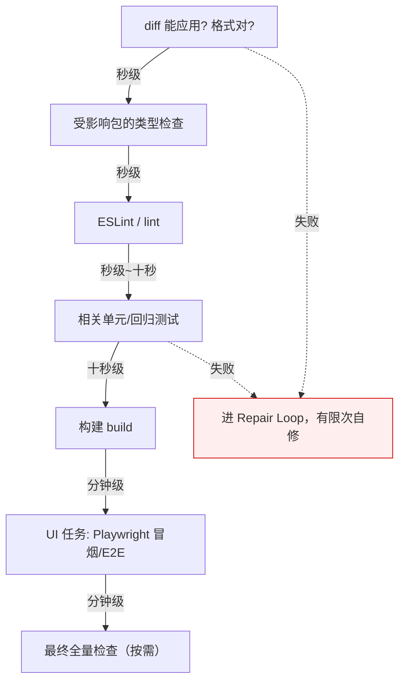
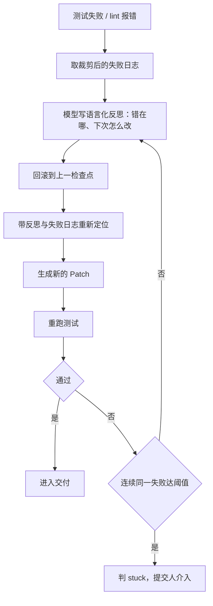
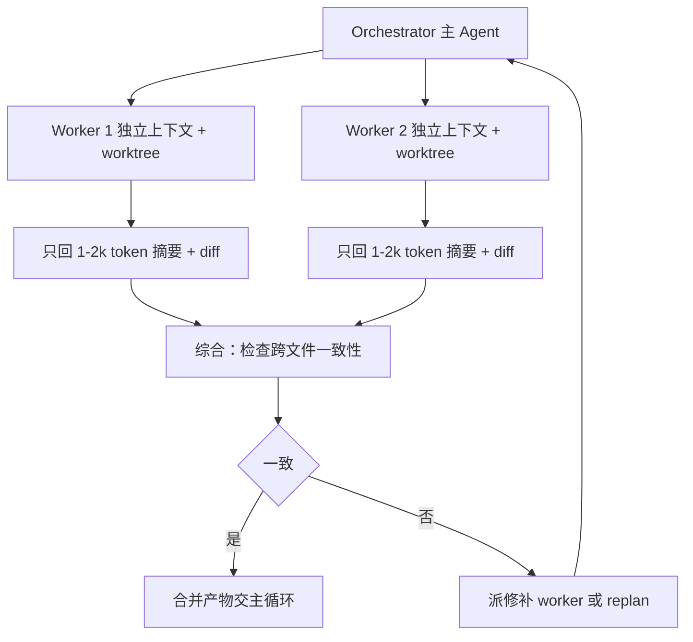
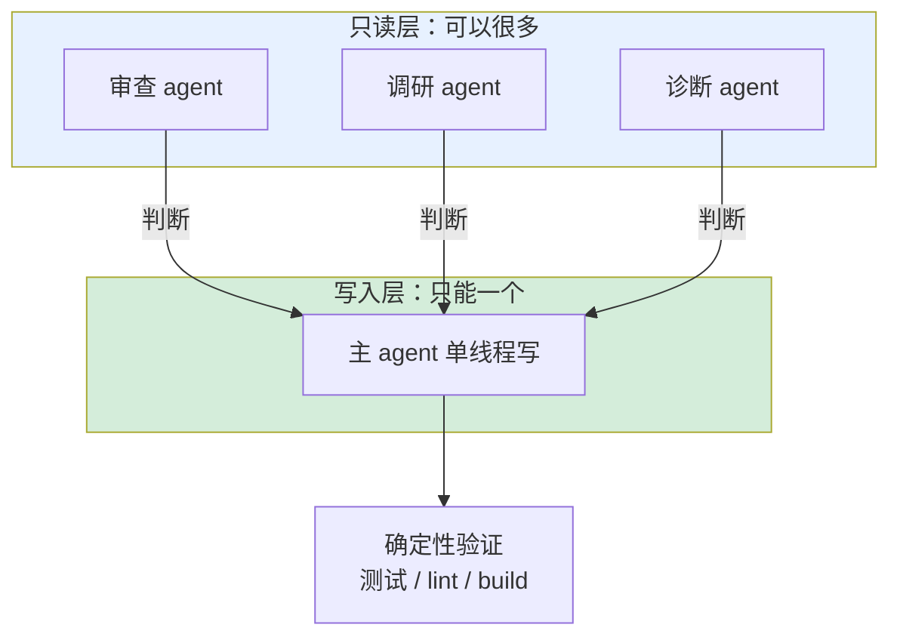

# Verification & Multi-Agent · 验证闭环与子代理

> Agent 说“做完了”不算完成；能复现的检查结果才算。本篇先讲验证如何驱动修复，再说明什么情况下值得把工作交给子 Agent，避免为了并发而并发。

模型的自我报告不能作为完成依据。修改后，应按成本从低到高运行检查：先看 diff 和格式，再跑类型检查与 lint，最后运行测试、构建或 E2E。本篇也说明何时适合拆分子任务，以及如何避免多 Agent 的协调风险。

## 1. 验证流水线

根据改动类型选择检查，不要每一轮都盲跑全仓库的耗时任务。建议从便宜、反馈快的检查开始：

1. diff / 补丁可应用检查、格式与敏感文件检查；
2. 受影响包的 TypeScript 类型检查；
3. ESLint / 项目 lint；
4. 相关单元测试与回归测试；
5. 构建；
6. UI 任务的 Playwright 冒烟 / E2E（需要时）；
7. 最终全量检查（按风险、时间与规模决定）。

把这条从便宜到贵的顺序画出来：



先运行几秒钟就能给出结果的检查，通过后再投入更多时间。一旦某一步失败，就进入 Repair Loop 分析和修复，不必等到最后一步才发现问题。

比如，同样是命令返回非 0，系统会按错误码区别对待：`TEST_FAILED`（测试断言没通过）就让模型进 Repair Loop 去修；`NETWORK_BLOCKED`（网络被沙箱挡了）则不该让模型反复重写代码，因为这不是代码的错；`TOOL_PERMISSION_DENIED`（权限被拒）更不能让模型换一条命令绕过策略。错误码不同，恢复策略完全不同。

Playwright 优先用可等待的 locator assertion，不靠固定 sleep 判断页面稳定。

```ts
interface ValidationReport {
  status: "passed" | "failed" | "partial" | "not_run"
  checks: Array<{
    id: string
    command: string[]
    status: "passed" | "failed" | "skipped" | "blocked"
    exitCode?: number
    durationMs?: number
    summary: string
    artifactUri?: string
  }>
  acceptance: Array<{
    criterionId: string
    status: "verified" | "not_verified" | "failed"
    evidence?: string[]
  }>
}
```

### 1.1 约定即执行：规则文件里的测试命令（AGENTS.md 标准实证）

AGENTS.md 规范 FAQ 明确（出处：https://agents.md ）：在 AGENTS.md 里列出的测试命令，agent 会自动尝试执行，并在任务结束前修复失败（"The agent will attempt to execute relevant programmatic checks and fix failures before finishing the task"）。对 mod-agent：

- [§2](#_2-项目命令发现) 项目命令发现以 `package.json` 等为准之外，AGENTS.md / CLAUDE.md 中显式列出的 build / test 命令同样进入候选，且执行前过 Policy；
- 修到绿是任务收尾的默认义务，不是可选项，与 [§1](#_1-验证流水线) 验证流水线、Repair Loop 衔接。

## 2. 项目命令发现

从 `package.json`、workspace 配置、README、CI 配置与现有脚本推断检查命令，形成候选列表并记录来源与置信度。命令必须过 Policy；检测到 monorepo 时优先定位受影响 package，不默认跑全仓库命令。

## 3. 错误分类

统一错误码，分类后才能采取不同恢复策略：

- `MODEL_TIMEOUT` / `MODEL_RATE_LIMIT` / `MODEL_INVALID_OUTPUT`
- `TOOL_TIMEOUT` / `TOOL_PERMISSION_DENIED` / `TOOL_SCHEMA_INVALID`
- `PATCH_CONFLICT` / `PATH_POLICY_VIOLATION`
- `COMMAND_EXIT_NONZERO` / `DEPENDENCY_INSTALL_FAILED` / `NETWORK_BLOCKED`
- `TYPECHECK_FAILED` / `LINT_FAILED` / `TEST_FAILED` / `BUILD_FAILED`
- `BUDGET_EXCEEDED` / `NO_PROGRESS` / `CANCELLED`
- `SANDBOX_FAILURE` / `WORKSPACE_CONFLICT`

例：测试断言失败进入诊断修复；网络受限不应反复让模型重写代码；权限拒绝不能换条命令规避策略。

## 4. Repair Loop（失败自修正）



步骤：

1. 收集失败命令、退出码、精简 stdout/stderr、测试名与相关文件；
2. 日志截断 / 归档，提取可定位的错误摘要，不把超长日志无过滤塞上下文；
3. 先要求 Agent 解释失败与修改的关联，提出可检验假设；
4. 允许有限次修复，每次记录修改文件与测试结果；
5. 错误转变则更新诊断；错误重复或范围持续扩大则停止自动修复；
6. 重跑受影响检查，区分已通过 / 失败 / 未执行 / 环境无法执行。

反思（Reflexion）不更新权重，用自然语言把失败教训写进下轮 prompt；它的质量上限就是模型的自我诊断能力，最终判定以确定性测试为准，不信模型自述成功。连续同一失败达阈值即判 stuck，防止 ReAct 单路径贪心死循环。

## 5. 多 Agent 策略

### 5.1 首期单 Agent

对常见新功能与修复，一个能力充足的主 Agent + 确定性验证流程，通常比多个 Agent 互相转交更好调试。多 Agent 会增加上下文传递、协调、工具权限、执行成本与失败归因复杂度。能不用就不用。

### 5.2 三种编排模式：先看清再选

真实 Claude Code 的多 Agent 不是一种形态，而是三种编排模式，区别在谁来调度、成员能否互发：

| 模式                      | 结构                                                        | 谁来调度                   | 成员通信                    | mod-agent 对应                                                                       |
| ------------------------- | ----------------------------------------------------------- | -------------------------- | --------------------------- | ------------------------------------------------------------------------------------ |
| **Subagent（子代理）**    | 主 Agent 派独立上下文的子 Agent，干完回传结果               | 主 Agent 在推理里临场派    | 子 Agent 是叶子，彼此不通气 | [§5.4](#_5-4-交接与隔离)–[§5.6](#_5-6-业界实证-子代理与并行的强制机制)（首期做这个） |
| **Coordinator（协调器）** | 主 Agent 变成**纯协调器**，自己不执行、只分派 worker 并汇总 | 主 Agent 只编排不干活      | worker 只对协调器回传       | 大规模拆分时（见 [dynamic-workflows.md](./dynamic-workflows.md)）                    |
| **Swarm（蜂群）**         | 一组对等 Agent，通过共享终端（tmux/iTerm2）**点对点**协作   | 无单一中心，Agent 互相直连 | 成员之间可直接互发          | 演化为 [agent-teams.md](./agent-teams.md)                                            |

三个判断：

- **Subagent 是基础模式**：Coordinator 只是把主 Agent 不再亲自执行这条规则化，底下仍是子 Agent；Swarm 把叶子能互发放开，这一放开就从正确性问题变成安全问题，需要一整套跨会话授权规则（见 [agent-teams.md](./agent-teams.md)）；
- **确定性脚本是第四种、但不在模型驱动范畴**：当编排能预先写死、且规模大到模型临场调度不可靠时，用 [dynamic-workflows.md](./dynamic-workflows.md) 的脚本替代当协调器的模型；
- **选型顺序**：单 Agent（[§5.1](#_5-1-首期单-agent)）→ Subagent（本节）→ Coordinator/Workflow（大规模）→ Swarm/Teams（对等协作）。能停在左边就别往右边走。

### 5.3 何时引入子 Agent

当评测证明某环节有可独立并行的工作、明确输入输出，并能提升成功率或降低成本时，可引入：

- `Repository Analyst`：只读探索，输出带证据的相关文件与调用链；
- `Test Analyst`：分析失败日志，提出最有价值的回归测试；
- `Patch Reviewer`：只读审查 diff、范围、安全与边界条件；
- `Documentation Agent`：生成变更文档 / 发布说明。

子 Agent 默认只给需要的工具，分析型 Agent 不应得到写文件与终端权限。

### 5.4 交接与隔离



- 每个 worker 跑独立上下文窗口，中间工具调用不回流主会话，只回 1–2k token 摘要 + 产物；
- 并行写不同文件用独立 Git Worktree 隔离防冲突；
- 交接必须传递：任务目标、相关证据、候选文件、未确认假设、约束、当前提交、期望输出 Schema、禁止动作，不传无边界长对话作为唯一状态；
- 综合时显式检查跨文件一致性（多 Agent 失败约 44% 源于此），不一致则派修补 worker 或 replan。

### 5.5 子 Agent 的实现模式：一个 Agent 类，配置不同

一个常见误区是以为主 Agent 一个类、子 Agent 另写一套类。更简单也更一致的做法是：子 Agent 就是同一个 Agent 类，用不同的配置实例化，通过构造参数控制它的能力与行为：

```ts
new Agent({
  tools: customTools, // 收窄后的工具集（见下方四层过滤）
  customSystemPrompt, // 角色定义（explore / plan / 自定义 .agents/*.md）
  isSubAgent: true, // 打开「子代理行为」开关
})
```

- **内置三类角色 + 自定义**：`explore`（只读探索，工具最少、最省 token，仅输出观察不做结论）、`plan`（规划，只读 + 计划工具）、`general`（通用，工具最全）；用户也可在 `.agents/<name>.md`（或 `.mod-agent/agents/`）写自定义角色文件，结构与 `SKILL.md` 类似，即 YAML frontmatter（名称 / 描述 / 允许工具）+ 正文（角色与职责）；
- **输出捕获，不回流父会话**：子 Agent 内部的模型对话、工具调用、流式输出原本会写入会话存储 / 打到 TUI；在 `isSubAgent` 下这些都被重定向到一个 `outputBuffer`，不保存进父会话历史、不打印到主界面。子 Agent 跑完只把 buffer 里的最终结果作为 `Task` 工具结果返回给父代理，父代理的上下文因此只增加一条摘要（对齐 [§5.4](#_5-4-交接与隔离) 的只回 1–2k token）；
- **token 汇总**：子 Agent 的 token 用量与成本计入父代理的账单，不另开账户；
- 这样主 Agent 和子 Agent 共享同一套循环、工具执行、权限、压缩逻辑，维护成本最低。

**四层工具过滤（确定性的能力收窄，不靠提示词）**。子 Agent 拿到的工具集按下面顺序逐层收敛：

1. **只读类型过滤**：explore / plan 类角色先移除所有写文件、命令执行、网络类工具（物理拿不到，而非提示词叮嘱）；
2. **移除子代理派生工具**：默认不挂载 `Task`（派生子代理）工具，**禁止递归创建子代理**，防止无限扇出；确需子代理再派子代理的能力必须显式开启；
3. **权限模式强制继承**：父代理处于 `plan` 或 `auto` 等模式时，子代理**必须继承同一模式**，不能提权（见 [autonomy.md §3.5](./autonomy.md#_3-5-权限必须传播给子代理)）；
4. **角色白名单**：自定义角色文件 frontmatter 的 `allowed-tools` 再做一次白名单收窄。

这四层是确定性的：工具不在集合里，模型无论如何都拿不到手；系统提示词里的角色约束只是补充。它解决了一个真实的安全漏洞：若不强制继承权限，模型可以在主对话每步都要确认的情况下，把敏感操作派给一个全自动的子代理去绕过审批。

子 agent 默认后台、叶子工具摘除（真实 Claude Code 实证，机制见 [background-fleet.md](./background-fleet.md)）：

- **默认后台**：Agent 工具的 `run_in_background` 默认 `true`，子 agent 跑完用 `<task-notification>` 事件把结果送回主循环，而不是同步阻塞主会话；只有往下走前非拿到结果不可才设 `run_in_background: false`；
- **叶子摘除**：子 agent 工具集里把 `Agent`、`Workflow`、`ScheduleWakeup`、`TaskOutput` 等能再 fan-out / 排程的工具摘掉（即上面四层过滤第 2 条的具体清单），它只能干活，不能再派生；
- **禁 sleep-poll**：配套要求"完工时会自动通知，不要 sleep、轮询、主动查进度"，派出去就松手，等通知；
- 对 mod-agent：这三点与上面的一个 Agent 类 + 配置实现完全兼容，`isSubAgent` 除了重定向输出，还应负责默认后台 + 摘派生工具。

### 5.6 业界实证：子代理与并行的强制机制

**Plan 只读靠不注册写工具，而不是系统提示约束（Cline 实证，出处：https://docs.cline.bot/core-workflows/plan-and-act ）**：Plan 模式下 agent 只挂载 read / search / discuss 类工具，不挂载 write_file / edit / terminal，「cannot modify any files or execute commands. This constraint is intentional.」 切回 Act 模式时对话上下文完整继承，不用重述。对 mod-agent：[§5.3](#_5-3-何时引入子-agent) 的分析型子代理（Repository Analyst / Patch Reviewer）应在代码层就不注册写工具，而不是靠 prompt 叮嘱。

**子代理 = 独立上下文窗口 + 同工具集 + 只回传结果（Zed `spawn_agent` 实证，出处：https://zed.dev/docs/ai/tools ）**：派一个带独立上下文窗口的子代理执行委托任务（并行调研 / 自包含小任务），探索过程留在自己窗口，仅把结果交回父代理；父代理继续原工作，子代理完成后再评审其结论，两边上下文都聚焦单一任务。

**并行 agent + worktree 隔离并发写（Zed Parallel Agents 实证，出处：https://zed.dev/docs/ai/parallel-agents ）**：

1. 每个 agent 线程独立上下文窗口与对话历史，可并行推进不同任务；
2. 预判两线程会改到相同文件时，给其中一个开独立 git worktree 检出，物理隔离写冲突；
3. 新建 worktree 默认 detached HEAD，防止不同线程误用同一分支；
4. 新建 worktree 时触发 hook，注入新旧 worktree 根路径环境变量，便于自动跑初始化；
5. 任务结束：人工评审 diff，经正常 git 流程合并；线程归档时保存并清理 worktree，恢复线程时自动重建。

**多 agent 编排的门槛（Factory Droid `--mission` 实证，出处：https://docs.factory.ai/droid-cli/cli-reference.md ）**：并行 / mission 模式要求自治等级先达到 `--auto high`（只读 → 安全改 → 本地开发 → 可 push 逐级解锁后才允许并行自治），因为并行 agent 要能自己提交 / push。对 mod-agent：多 worker 并行是权限上界，不是默认能力。

### 5.7 2026 年的反转：多 Agent 从「别做」到「这样做」

这一节记录一次**立场反转**，因为它是目前关于多 Agent 最有价值的公开实证。

**原来的立场（2025-06，Cognition / Walden Yan《Don't Build Multi-Agents》，出处：https://cognition-labs.com/blog/dont-build-multi-agents ）**：

- 两条原则：**共享上下文**（且要共享完整 agent trace，而不是一条消息摘要）、**行动承载隐式决策**（冲突的决策带来坏结果）；
- 经典反例：做一个 Flappy Bird 克隆，拆给两个子 agent，一个做出了超级马里奥风格的背景，另一个做出了不像游戏素材的小鸟，协调者最后拿到的是两次误解的拼接体；
- 结论：2025 年跑多个 agent 协作只会产生脆弱系统，默认应排除一切违反这两条原则的架构；推荐单线程线性 agent，超长任务再用一个专用压缩模型。

**十个月后的反转**（更窄但更硬的形态）：multiple agents contribute intelligence to a task while writes stay single-threaded，多个 agent 可以读、可以推理、可以建议，但只有一个线程能写。



绿色那一层只能有一个。多个 agent 并存的价值在于贡献判断，不在于分头动手。谁写没定清楚，多 agent 就退化成协调灾难。

三条实测结论，每一条都反直觉：

1. 代码审查 agent 在自己人写的 PR 上平均抓到 2 个 bug，其中约 58% 是严重级；
2. 编码 agent 与审查 agent 事先不共享上下文时，审查效果最好。理由是审查者被迫从实现反推，而注意力在长上下文里会退化。这条对人类社会是职场自杀建议，对 agent 却是正确架构；
3. 快慢模型配对失败的原因不是成本，是能力天花板：质量天花板由初级模型决定，而初级模型不够强，弱模型不知道自己什么时候已经超出能力范围。两个前沿模型之间，委派变成能力路由器而非难度升级器。

Anthropic 从另一侧给了同样的边界：多数编码任务里真正可并行的部分比研究少，agent 还不擅长实时协调与委派。另外要认清一件事：野外大多数自称多 agent 的系统其实是只读子 agent，更像工具调用，而非真正的多 agent 协作（[§5.2](#_5-2-三种编排模式-先看清再选) 的 Subagent 正是这个形态）。

### 5.5 子代理的工具集收紧与输出防护（Claude Code v2.1.300 实证，出处：https://code.claude.com/docs/en/sub-agents ）

上面说"野外大多数自称多 agent 的系统其实是只读子 agent"。它给了这套形态最完整的一份工程实现，四件事可以直接落到我们的契约里。

**两道工具过滤，前后台不同集**。子代理先继承主对话的内置与 MCP 工具，然后第一道从所有子代理移除 `Agent`（受嵌套限制时）、`AskUserQuestion`、`EnterPlanMode`、`ExitPlanMode`（非 plan 模式）、`ScheduleWakeup`、`WaitForMcpServers` 等需要与人或调度器交互的工具；第二道对**后台运行的子代理**再收紧到一份白名单（读写、搜索、执行、Web、Skill、worktree 等二十来个，MCP 全留）。结果是同一份定义在前台与后台解析出的工具集并不相同。这比我们的 `readOnly: true` 布尔强得多：**能力裁剪应当是"按执行环境取交集"，而不是一个开关**。

**隔离清单要写全**。非 fork 子代理的起始上下文只有：自己的 system prompt（**不含主程序的完整系统提示**）、派活时那句话、规则文件层级、git status 快照、预载的 skill 正文、同级清单。不继承 output style、不继承主对话的自动记忆、也不继承主对话的上下文窗口大小。反过来它也会继承规则文件（内置只读探索类子代理除外），并提供一个 `omitClaudeMd` 开关用于纯机械任务。

**两个上限要有默认值也要有改的路**。嵌套深度默认**主对话下三层**（改法是一个环境变量，设 1 即关闭；历史上 1、3、5 都出现过，见 [claude-code-guide.md §9.3](./claude-code-guide.md)），并发运行中子代理默认 **20 个**，超了报错且**错误文案里明确告诉模型不要重试**。累计派生数不设上限。把"超限后模型会怎么做"当成契约的一部分来设计，是这份文档里最容易被忽略的细节。

**回收与防护**。子代理跑完只回摘要，但官方仍不信任这条通道：主对话读取子代理报告前会扫描指令形状（模仿 `<system-reminder>`、`Human:`、`Assistant:` 的内容会被插入反斜杠破坏，并加一条 harness 前缀告警）。这是 [§6 输入注入](./context-engineering.md#_6-输入注入与不可信内容) 之外单独的一层，因为子代理输出属于"模型生成、但由框架搬运进主上下文"的特殊类别。另外已完成子代理可以凭 ID 用消息续跑并保留全量历史，但内置的探索与规划类子代理是一次性、不返回 ID，也就无法续跑。

对 mod-agent 的落地：

- [§5.2](#_5-2-三种编排模式-先看清再选) 的选型顺序（单 Agent → Subagent → Coordinator → Swarm）保持不变，**但写必须在任何一层都保持单线程**。多个 worker 分头写文件只在 worktree 隔离 + 最终一致性检查（[§5.4](#_5-4-交接与隔离)）下才允许；
- `Patch Reviewer` 子代理（[§5.3](#_5-3-何时引入子-agent)）应默认不给它编码过程的上下文，这与 [§5.4](#_5-4-交接与隔离)的「交接必须传递任务目标、相关证据」并不矛盾：交接的是任务与验收标准，不是作者的实现思路。让审查者自己推，才能抓到作者自己看不见的问题；
- **`maxTurns` 撞线时的返回契约**：真实 Claude Code 撞轮次上限时不会静默丢弃半截结果，它把输出标 `partial: true` 并保留 agent ID 供 `SendMessage` 续跑。mod-agent 的子代理契约同样需要这一分支——把 `partial` 显式写进 `SubagentResult` 结构，主 agent 决定是否续跑而不是从零再派一次（对应 [agent-loop.md §5](./agent-loop.md) 停止与恢复语义）；
- **`omitClaudeMd` 开关**：纯机械任务的子代理可以配置"不重注入项目根规则文件"，因为项目规则对探索一个 shell 脚本没意义、但会白占子上下文预算。真实 Claude Code 从 v2.1.271 起提供这个开关，内置只读探索类子代理默认开启。mod-agent 在 `Agent({ ... })` 配置里同样应保留一位 `omitProjectRules: boolean`，默认为 `false`（保守），机械型角色模板默认打开；
- 别指望用便宜模型干贵的活来降本（[research.md §3.3](./research.md#_3-3-成本-agent-的钱主要烧在「重发的上下文」上) 成本数据），弱模型不会主动告诉你它不行。

上多 Agent 之前的三个必答问题（任一答不出，就不是多 agent，而是把一处模糊并行化了）：

| #   | 问题                                                                          | 答不上来的后果                       |
| --- | ----------------------------------------------------------------------------- | ------------------------------------ |
| 1   | 能否把这个角色的 brief 写得足够精确，使其产出**无需重放整段对话**就能被检验？ | 你没有「角色」，只有一团并行化的模糊 |
| 2   | **谁写？** 是否保持写单线程且显式？                                           | 隐式决策冲突，产出拼不起来           |
| 3   | **什么叫完成？** 能否写成非人也能检查的形式？                                 | 这不是一个可自主的步骤，只是看着像   |
