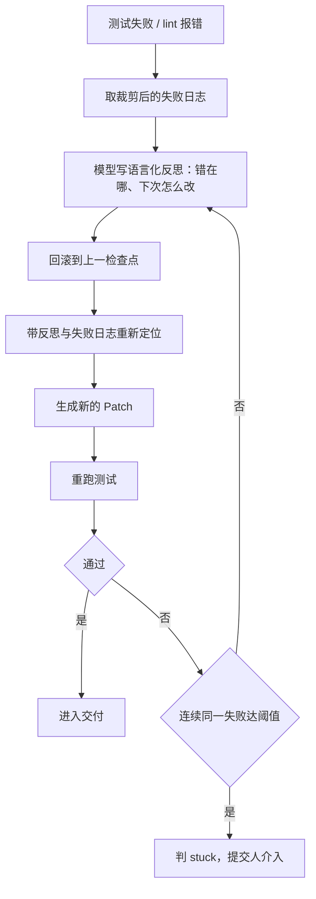
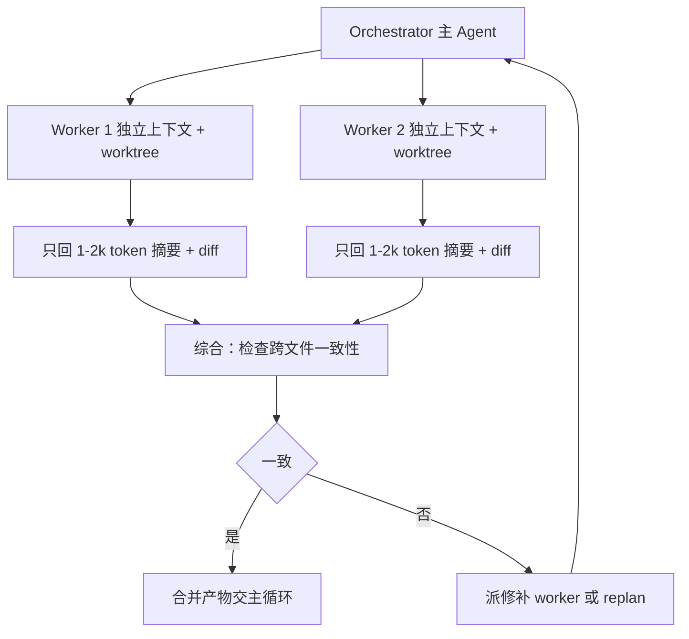

# Verification & Multi-Agent · 验证闭环与子代理

> 验证结果就是交付依据；子代理只在评测证明有收益时才引入。这篇讲验证流水线、错误分类、Repair Loop 与多 Agent 策略。

## 1. 验证流水线

按改动类型选择，不每轮盲目跑全仓库耗时检查；顺序从便宜、反馈快的检查开始：

1. diff / 补丁可应用检查、格式与敏感文件检查；
2. 受影响包的 TypeScript 类型检查；
3. ESLint / 项目 lint；
4. 相关单元测试与回归测试；
5. 构建；
6. UI 任务的 Playwright 冒烟 / E2E（需要时）；
7. 最终全量检查（按风险、时间与规模决定）。

Playwright 优先用可等待的 locator assertion，不靠固定 sleep 判断页面稳定。

```ts
interface ValidationReport {
  status: "passed" | "failed" | "partial" | "not_run";
  checks: Array<{
    id: string;
    command: string[];
    status: "passed" | "failed" | "skipped" | "blocked";
    exitCode?: number;
    durationMs?: number;
    summary: string;
    artifactUri?: string;
  }>;
  acceptance: Array<{
    criterionId: string;
    status: "verified" | "not_verified" | "failed";
    evidence?: string[];
  }>;
}
```

## 2. 项目命令发现

从 `package.json`、workspace 配置、README、CI 配置与现有脚本推断检查命令，形成候选列表并记录来源与置信度。命令必须过 Policy；检测到 monorepo 时优先定位受影响 package，不默认跑全仓库命令。

## 3. 错误分类

统一错误码，分类后才能采取不同恢复策略：

- `MODEL_TIMEOUT` / `MODEL_RATE_LIMIT` / `MODEL_INVALID_OUTPUT`
- `TOOL_TIMEOUT` / `TOOL_PERMISSION_DENIED` / `TOOL_SCHEMA_INVALID`
- `PATCH_CONFLICT` / `PATH_POLICY_VIOLATION`
- `COMMAND_EXIT_NONZERO` / `DEPENDENCY_INSTALL_FAILED` / `NETWORK_BLOCKED`
- `TYPECHECK_FAILED` / `LINT_FAILED` / `TEST_FAILED` / `BUILD_FAILED`
- `BUDGET_EXCEEDED` / `NO_PROGRESS` / `CANCELLED`
- `SANDBOX_FAILURE` / `WORKSPACE_CONFLICT`

例：测试断言失败进入诊断修复；网络受限不应反复让模型重写代码；权限拒绝不能换条命令规避策略。

## 4. Repair Loop（失败自修正）



步骤：

1. 收集失败命令、退出码、精简 stdout/stderr、测试名与相关文件；
2. 日志截断 / 归档，提取可定位的错误摘要，不把超长日志无过滤塞上下文；
3. 先要求 Agent 解释失败与修改的关联，提出可检验假设；
4. 允许有限次修复，每次记录修改文件与测试结果；
5. 错误转变则更新诊断；错误重复或范围持续扩大则停止自动修复；
6. 重跑受影响检查，区分「已通过 / 失败 / 未执行 / 环境无法执行」。

反思（Reflexion）不更新权重，用自然语言把失败教训写进下轮 prompt；它的质量上限就是模型的自我诊断能力，最终判定以确定性测试为准，不信模型自述成功。连续同一失败达阈值即判 stuck，防止 ReAct 单路径贪心死循环。

## 5. 多 Agent 策略

### 5.1 首期单 Agent

对常见新功能与修复，一个能力充足的主 Agent + 确定性验证流程，通常比多个 Agent 互相转交更好调试。多 Agent 会增加上下文传递、协调、工具权限、执行成本与失败归因复杂度。能不用就不用。

### 5.2 何时引入子 Agent

当评测证明某环节有可独立并行的工作、明确输入输出，并能提升成功率或降低成本时，可引入：

- `Repository Analyst`：只读探索，输出带证据的相关文件与调用链；
- `Test Analyst`：分析失败日志，提出最有价值的回归测试；
- `Patch Reviewer`：只读审查 diff、范围、安全与边界条件；
- `Documentation Agent`：生成变更文档 / 发布说明。

子 Agent 默认只给需要的工具——分析型 Agent 不应得到写文件与终端权限。

### 5.3 交接与隔离



- 每个 worker 跑独立上下文窗口，中间工具调用不回流主会话，只回 1–2k token 摘要 + 产物；
- 并行写不同文件用独立 Git Worktree 隔离防冲突；
- 交接必须传递：任务目标、相关证据、候选文件、未确认假设、约束、当前提交、期望输出 Schema、禁止动作——不传无边界长对话作为唯一状态；
- 综合时显式检查跨文件一致性（多 Agent 失败约 44% 源于此），不一致则派修补 worker 或 replan。
