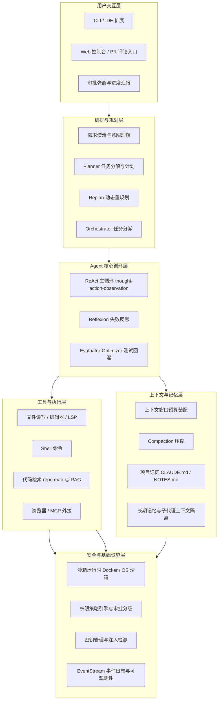
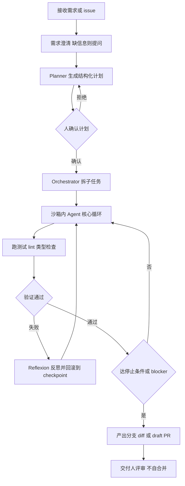
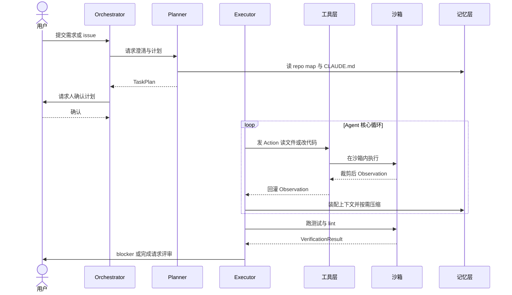
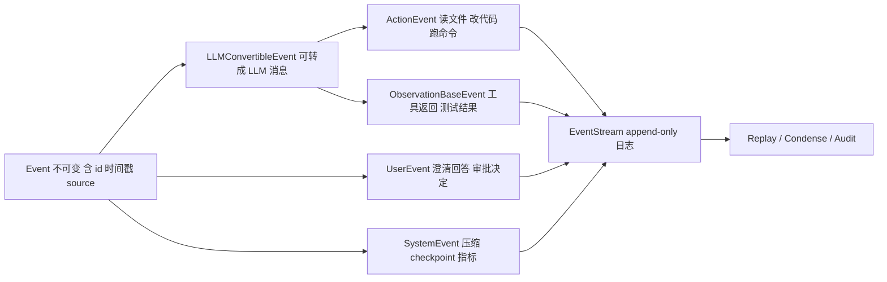
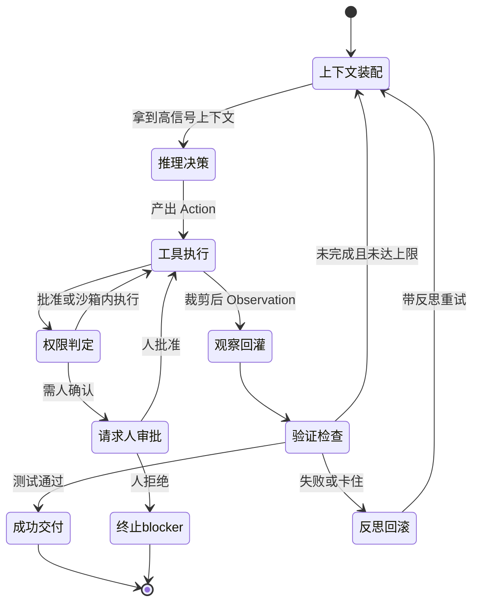
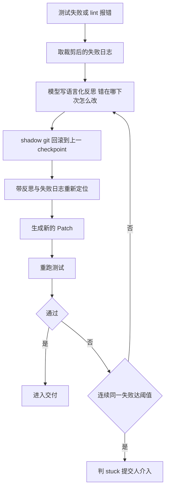
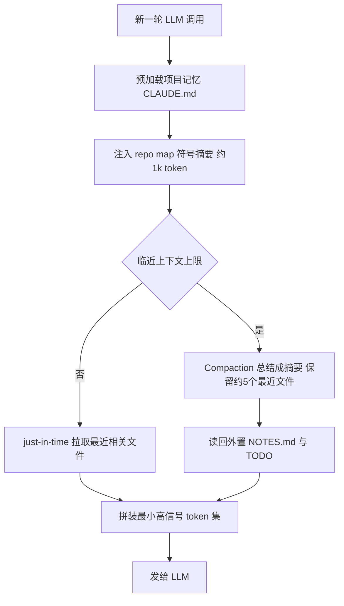
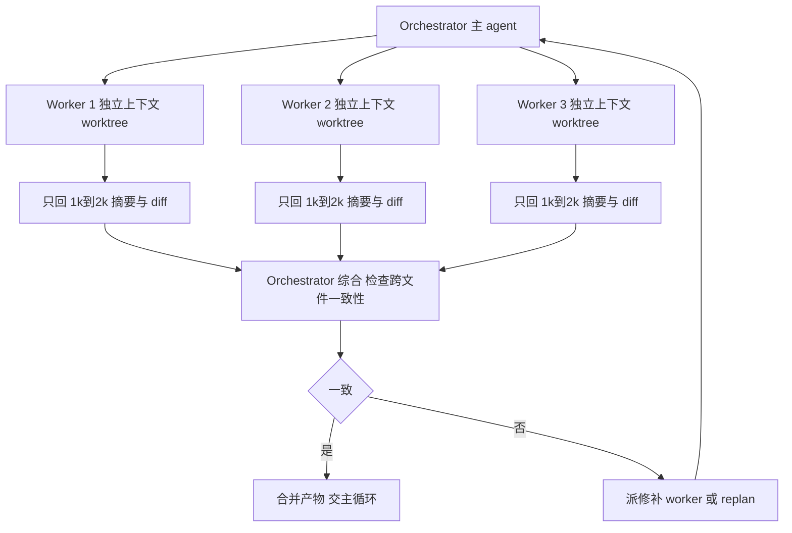

# AI Coding Agent 设计文档（含领域调研综述）

> 版本：v1.0


***

## 0. 文档信息

### 0.1 版本与读者


| 项    | 内容                                            |
| ---- | --------------------------------------------- |
| 版本   | v1.0（初稿）                                      |
| 适用读者 | 负责自研 Coding Agent 的架构师、后端 / 平台工程师、安全工程师、评测工程师 |
| 前置调研 | ①商业产品与评测基准调研；②开源项目与学术方案调研；③核心架构范式、能力边界与安全权限调研 |

### 0.2 术语表


| 术语                      | 含义                                                                                                                                                                                                              |
| ----------------------- | --------------------------------------------------------------------------------------------------------------------------------------------------------------------------------------------------------------- |
| **AI Coding Agent**     | 在循环中自主调用工具、每步从环境拿到 ground truth（测试结果 / 文件内容 / 命令输出）以完成软件工程任务的 LLM 系统。Anthropic 2025 对 agent 的最新简化定义见[来源](https://www.anthropic.com/engineering/effective-context-engineering-for-ai-agents)                     |
| **ACI**                 | Agent-Computer Interface，为 LLM 反向定制的工具 / 环境接口（输出裁剪、命令白名单、结构化报错），见 [SWE-agent 论文](https://arxiv.org/abs/2405.15793)                                                                                              |
| **Scaffolding / 脚手架**   | LLM 与工具之外的编排代码（workflow、审批、回滚、上下文装配）                                                                                                                                                                            |
| **Context Engineering** | 围绕有限且边际递减的上下文窗口，做 "最小高信号 token 集" 的装配、压缩与外置记忆管理，见 [Anthropic](https://www.anthropic.com/engineering/effective-context-engineering-for-ai-agents)                                                                |
| **Subagent**            | 跑在独立上下文窗口、只把最终摘要回传父会话的子 agent，见 [Claude Code 文档](https://code.claude.com/docs/en/sub-agents)                                                                                                                    |
| **EventStream**         | OpenHands 提出的 append-only 不可变事件日志（action + observation），可 replay/condense/audit，见 [OpenHands 论文](https://arxiv.org/pdf/2407.16741v2.pdf)                                                                        |
| **Repo Map**            | Aider 的 tree-sitter 符号级仓库地图：只给 "哪些文件里有哪些符号"，不塞文件全文，见 [Aider 文档](https://aider.chat/docs/git.html)                                                                                                               |
| **Reflexion**           | 不更新权重、用自然语言写 "失败教训" 进情节记忆、下次试验注入 prompt 的自修正机制，见 [arXiv:2303.11366](https://arxiv.org/abs/2303.11366)                                                                                                           |
| **Shadow Git**          | Cline 式与用户项目 git 隔离的独立快照仓库，每次工具调用后 commit，用于任意点回滚，见 [Cline 文档](https://mintlify.wiki/cline/cline/core-workflows/checkpoints)                                                                                    |
| **Rule of Two**         | Microsoft 2026-06 提出的约束：处理不可信输入、访问敏感系统 / 密钥、对外变更 / 通信，三者不可同时具备，见 [Microsoft Security](https://www.microsoft.com/en-us/security/blog/2026/06/05/securing-ci-cd-in-agentic-world-claude-code-github-action-case/) |


***

## 1. 领域调研综述

### 1.1 什么是 AI Coding Agent

**定义**：AI Coding Agent 是一个 "LLM 在一个循环里自主调用工具、每步从环境拿到 ground truth（测试结果、文件内容、命令输出）再决定下一步" 的系统 [来源](https://www.anthropic.com/engineering/effective-context-engineering-for-ai-agents)。其经典循环被 Anthropic 概括为 **"gather context → take action → verify work → repeat"** [来源](https://claude.com/it/blog/building-agents-with-the-claude-agent-sdk)。

**与 Copilot 式补全 / 聊天助手的区别**：


| 维度   | Copilot 式行内补全 / 聊天助手 | AI Coding Agent                                                                                                                                                                                                                 |
| ---- | -------------------- | ------------------------------------------------------------------------------------------------------------------------------------------------------------------------------------------------------------------------------- |
| 决策粒度 | 单段补全、单轮问答，人逐字接受      | 多步自主：读哪些文件、改什么、跑什么测试由模型自决 [Cursor Agent mode](https://cursor.com/help/ai-features/agent)                                                                                                                                        |
| 执行环境 | 人已打开的编辑器内            | 持久沙箱：Devin 的 shell+editor+browser [Cognition](https://cognition.com/blog/introducing-devin)、Copilot 的 GitHub Actions VM [GitHub Blog](https://github.blog/news-insights/product-news/github-copilot-meet-the-new-coding-agent/) |
| 验证闭环 | 无（补全即结束）             | 跑仓库自带测试、读失败输出、再改代码 [Anthropic](https://claude.com/it/blog/building-agents-with-the-claude-agent-sdk)                                                                                                                            |
| 交付物  | 文本 / 代码片段            | 一个分支上的 diff、draft PR、可运行补丁 [GitHub Blog](https://github.blog/news-insights/product-news/github-copilot-meet-the-new-coding-agent/)                                                                                              |
| 自主程度 | 人逐字确认                | 在 Plan / 审批点后人放手，agent 连续跑数小时 [Anthropic Sonnet 4.5](https://www.anthropic.com/news/claude-sonnet-4-5)                                                                                                                          |

**关键判断**：底层范式已收敛为 "自主工具循环 + 确定性测试闭环"；真正决定成败的不是循环里用了哪种心智（ReAct/Reflexion 等），而是 ACI、scaffolding、context engineering 三层工程 [来源](https://www.anthropic.com/engineering/effective-context-engineering-for-ai-agents)。

### 1.2 代表性产品与项目总览

**商业产品**：


| 产品                              | 定位                                                                                                                                           | 形态                       | 核心架构                                                                                                                                                                                               | 工具                                            | 沙箱                                                                                                                                                                         | 关键理念                                                        |
| ------------------------------- | -------------------------------------------------------------------------------------------------------------------------------------------- | ------------------------ | -------------------------------------------------------------------------------------------------------------------------------------------------------------------------------------------------- | --------------------------------------------- | -------------------------------------------------------------------------------------------------------------------------------------------------------------------------- | ----------------------------------------------------------- |
| **Devin** (Cognition)           | "第一个自主 AI 软件工程师"，2024-03-12 发布 [Cognition](https://cognition.com/blog/introducing-devin)                                                     | 云端工作台，输出 PR              | planner + executor 分层（二手拆解），scratchpad 长期记忆，确定性检查捕获失败 [datarekha](https://datarekha.com/blog/devin-architecture-anatomy/)                                                                          | shell、code editor、browser                     | 持久隔离云沙箱，可自装依赖                                                                                                                                                              | 人可观察可接管的完整工作台 + 显式规划 + 测试闭环                                 |
| **Cursor** (Anysphere)          | fork 自 VS Code 的 AI IDE [Cursor](https://cursor.com/help/ai-features/agent)                                                                  | IDE                      | Tab 补全 + Agent/Composer 双梯度；codebase embedding 索引；Plan 模式先出计划人确认 [Cursor](https://cursor.com/cn/blog/agent-best-practices)                                                                         | 多文件编辑、终端、代码库索引                                | 远程隔离环境跑 Background/Cloud Agent；单 prompt 最多并行 8 agent，git worktree 隔离 [Cursor changelog](https://cursor.com/changelog/page/13)                                              | 索引 + `@` 显式取上下文 + Plan/Agent 双模式 + 远程并行                     |
| **Claude Code** (Anthropic)     | 官方 agentic coding CLI，2025 年初随 3.7 Sonnet 推出 [arXiv:2604.26275](https://arxiv.org/html/2604.26275v1)                                         | CLI + IDE 扩展 + 桌面端       | 极简 ReAct loop（stop\_reason=tool\_use 即执行工具回灌）；subagents 独立上下文最多嵌套 5 层 [Claude](https://claude.com/fr/blog/steering-claude-code-skills-hooks-rules-subagents-and-more)                              | Read/Write/Edit、Glob/Grep、Bash、Agent/Task、MCP | 按只读 / Bash / 改文件三档审批；deny 规则屏蔽 secrets [Claude Code](https://code.claude.com/docs/en/permissions)                                                                          | 简单 loop + 分层权限 + 子 agent 隔离 + 按目录 CLAUDE.md + 能不上 agent 就不上 |
| **GitHub Copilot coding agent** | GitHub 第一个异步软件工程 agent，2025-05-19 发布 [GitHub Blog](https://github.blog/news-insights/product-news/github-copilot-meet-the-new-coding-agent/) | 平台原语：issue 分派 → draft PR | 跑在 GitHub Actions VM，用 GitHub code search 理解代码，commit 推到 draft PR [GitHub Blog](https://github.blog/ai-and-ml/github-copilot/assigning-and-completing-issues-with-coding-agent-in-github-copilot/) | code search、git commit                        | Actions VM；`.github/workflows/` 改动需人点 "Approve and run" [GitHub Docs](https://docs.github.com/en/copilot/how-tos/use-copilot-agents/cloud-agent/use-cloud-agent-on-github) | 产物天然是 PR；workflow 改动人审；auto-merge 而非自合                      |

**开源 / 学术项目**：


| 项目                                      | 定位                                                                                                                        | 核心架构                                                                                                         | 工具 / 接口                                                                                               | 关键理念                                                     |
| --------------------------------------- | ------------------------------------------------------------------------------------------------------------------------- | ------------------------------------------------------------------------------------------------------------ | ----------------------------------------------------------------------------------------------------- | -------------------------------------------------------- |
| **SWE-agent** (Princeton, NeurIPS 2024) | 证明性能瓶颈在 agent - 计算机接口 [arXiv:2405.15793](https://arxiv.org/abs/2405.15793)                                                | ACI 三件套：定制 search/replace 编辑器、分页 file viewer、精简 bash                                                         | 命令白名单 + 输出裁剪                                                                                          | 接口为 LLM 弱点反向定制；发布时 SWE-bench 12.47%                      |
| **OpenHands** (原 OpenDevin, ICLR 2025)  | 开源通用 AI 软件开发者平台 [arXiv:2407.16741](https://arxiv.org/abs/2407.16741)                                                      | Agent + **EventStream**（append-only 事件溯源）+ Runtime/Docker + Tool/Action 抽象                                   | CodeAct：所有动作统一成 "写 Python 调 SDK 函数" [OpenHands 文档](https://docs.openhands.dev/openhands/usage/agents) | 事件不可变可 replay/condense/audit；Docker + user-namespace 隔离  |
| **Aider**                               | 终端 pair-programming、git-native [Aider](https://aider.chat/docs/git.html)                                                  | **Repo Map**（tree-sitter 符号索引，默认约 1k token）；architect/editor 双模型                                             | whole/diff/udiff 多编辑格式，解析失败回喂重试                                                                       | 不塞文件全文、塞 "哪些文件有哪些符号"；每次改动自动 commit                       |
| **Cline**                               | 住在 IDE、每步要人批的开源 agent [Marketplace](https://marketplace.visualstudio.com/items?itemName=saoudrizwan.claude-dev)           | Plan/Act 双模式可切；**Shadow Git** 每工具调用后快照 [Cline](https://mintlify.wiki/cline/cline/core-workflows/checkpoints) | 文件 diff、集成终端、headless 浏览器、MCP                                                                         | 人在环上 + 独立 shadow repo 任意回滚                               |
| **Continue**                            | 高度可配置 IDE 助手框架，三种形态 [Continue](https://docs.continue.dev/reference)                                                       | 全配置走 `config.yaml`：models/context/rules/prompts/mcpServers                                                   | `@File/@Code/@Docs/@Commits` 显式 context providers                                                     | 配置即代码；模型按角色（chat/edit/autocomplete/embed）分派              |
| **MetaGPT / ChatDev**                   | 多 agent SOP 流水线 [arXiv:2308.00352](https://arxiv.org/abs/2308.00352) [arXiv:2307.07924](https://arxiv.org/abs/2307.07924) | PM→Architect→PM→Engineer→QA 角色流水线，结构化产物交接                                                                    | Pydantic schema 强校验输出                                                                                 | SOP 编码成 prompt；适合端到端造新软件，不适合修真实 issue                    |
| **Agentless** (UIUC)                    | "反 agent" 固定三阶段流水线 [arXiv:2407.1489](https://arxiv.org/abs/2407.1489)                                                     | 分层定位（文件→类 / 函数→行）→ 生成 patch → 多候选跑测试验证                                                                       | 不让 LLM 自由决定下一步                                                                                        | 任务结构清晰时固定流水线比自由探索更稳更便宜；SWE-bench Lite 32%、单 issue \$0.70 |

### 1.3 评测基准与真实能力水平

**基准对照表**：


| 基准                     | 测什么                                                                                                                  | 规模 / 口径                                       | 关键分数与时间点                                                                                                       | 局限                                                                                                                      |
| ---------------------- | -------------------------------------------------------------------------------------------------------------------- | --------------------------------------------- | -------------------------------------------------------------------------------------------------------------- | ----------------------------------------------------------------------------------------------------------------------- |
| **SWE-bench** (原始)     | 真实 GitHub issue 修复，跑仓库自有测试（FAIL-to-PASS / PASS-to-PASS）判分 [arXiv:2310.06770](https://arxiv.org/pdf/2310.06770v2.pdf) | 12 个 Python 仓库、2,294 实例                       | 2024-03 Devin 25% 子集 unassisted 13.86%（非 Verified 口径）[Cognition](https://cognition.com/blog/introducing-devin) | 混入含糊 / 不可解实例，分数噪声大                                                                                                      |
| **SWE-bench Verified** | 人工筛过的 500 题，问题清晰、测试正确、给定信息下可解 [OpenAI](https://openai.com/index/introducing-swe-bench-verified/)                     | 500 实例；同时收任意 agentic 系统与 mini-SWE-agent 裸模型对比 | 见下方演进表                                                                                                         | 仍限于 12 个 Python 仓库；分数强依赖 harness                                                                                        |
| **HumanEval**          | 函数级功能正确性 pass@k [arXiv:2107.03374](https://arxiv.org/pdf/2107.03374.pdf)                                             | 164 道手工题                                      | Codex 12B pass@1 28.8%、pass@100 77.5%（2021）                                                                    | 小而孤立；易过拟合污染（DS-Inst-1.3B：HumanEval+ 59.8% vs LCB-Easy 26.3%）[LiveCodeBench](https://livecodebench.github.io/index.html) |
| **LiveCodeBench**      | 防污染竞赛题，只取训练截止日后新题 [arXiv:2403.07974](https://arxiv.org/pdf/2403.07974)                                               | LeetCode/AtCoder/Codeforces 滚动采集              | LCB-Hard 约 171 题，frontier pass@1 约 35–58% [arXiv:2605.29116](https://arxiv.org/pdf/2605.29116v1)               | 仍是竞赛风格，不衡量大仓库改 issue                                                                                                    |
| **Terminal-Bench**     | Docker 容器内真实终端 / 运维任务，程序化解判 [tbench.ai](https://www.tbench.ai/)                                                      | 装环境、配服务、跑数据处理                                 | Claude 4 时代约 43.2%（Anthropic, 2025-05）[Anthropic](https://www.anthropic.com/news/claude-4)                     | 证明运维类任务比 issue 修复更难                                                                                                     |

**SWE-bench Verified 分数演进（逐条标注时间、harness 与来源）**：


| 时间点     | 系统 / 模型                                                  | 分数                          | 来源                                                                                             |
| ------- | -------------------------------------------------------- | --------------------------- | ---------------------------------------------------------------------------------------------- |
| 2025-02 | Claude 3.7 Sonnet（extended thinking）                     | 62.3%（自定义 scaffold 70.3%）   | [DataCamp](https://www.datacamp.com/pl/blog/claude-3-7-sonnet)                                 |
| 2025-05 | Claude Opus 4 / Sonnet 4（Claude 4 发布）                    | Opus 4 约 72.5%；区间 70%–72.7% | [Anthropic](https://www.anthropic.com/news/claude-4)                                           |
| 2025-09 | Claude Sonnet 4.5                                        | 77.2%                       | [Anthropic](https://www.anthropic.com/news/claude-sonnet-4-5)                                  |
| 2025-09 | Doubao-Seed-Code（TRAE）                                   | 78.8%                       | \[[swebench.com](https://swebench.com) 榜单，2026-08 抓取]                                          |
| 2025-11 | Gemini 3 Pro Preview                                     | 77.4%                       | \[[swebench.com](https://swebench.com) 榜单，2026-08 抓取]                                          |
| 2025-12 | Claude 4.5 Opus（live-SWE-agent / Sonar Foundation Agent） | 79.2%（avg cost \$0.86）      | [live-swe-agent 榜单](https://live-swe-agent.github.io/)、\[[swebench.com](https://swebench.com)] |
| 2026-02 | Claude 4.5 Opus（mini-SWE-agent high，纯模型口径）               | 76.8%                       | \[[swebench.com](https://swebench.com) 榜单，2026-08 抓取]                                          |

> **口径警告（来自三份调研的反复提醒）**
> ：上述分数分属不同 harness（裸模型 / Claude Code / Devin /live-SWE-agent），只能作 "时间线上能力演进" 参考，不能横向等号归因于底层模型
> [来源](https://www.swebench.com/verified)
> 。mini-SWE-agent 1.x 与 2.x 解析口径不同（1.x 从文本解析动作、2.x 用 tool calling），跨版本不可直接比。

**Terminal-Bench 4.0 最新格局（tbench.ai，2026-08）**：榜首 Opus 5.5 为 64.8%，相较 Claude 4 时代的约 43.2%（Anthropic, 2025-05）显著进步，但仍明显低于同期 SWE-bench Verified 70%+ 的水平 —— 说明 "操作系统 / 运维级任务" 至今仍是比 "修 issue" 更难的一类。

**真实开源社区的合并率（33k 条 agent PR 实证研究，MSR 2026，**[arXiv:2601.15195](https://arxiv.org/pdf/2601.15195)**）**：文档 / CI / 构建类任务合并率最高，性能优化与 bug 修复类最差；未合并 PR 的常见原因为缺乏评审参与、重复 PR、未过 CI、越界功能（maintainer 不想要的功能）。即 agent 的最大失败不是 "代码写错"，而是社会 - 技术层与工程层的失配。

### 1.4 核心架构范式


| 范式                                    | 出处                                                                                                                                                                                     | 循环机制                                                                                          | Coding 适用性                                                                                                                                                                              |
| ------------------------------------- | -------------------------------------------------------------------------------------------------------------------------------------------------------------------------------------- | --------------------------------------------------------------------------------------------- | --------------------------------------------------------------------------------------------------------------------------------------------------------------------------------------- |
| **ReAct**                             | [arXiv:2210.03629](https://arxiv.org/abs/2210.03629)                                                                                                                                   | thought→action→observation 交错在同一轨迹，推理减少盲目试错、行动接地推理                                            | 几乎所有现代 coding agent 的最小内核；缺点是贪心单路径、无回溯，定位错文件就一路错到底                                                                                                                                      |
| **Plan-and-Execute**                  | [arXiv:2305.04091](https://arxiv.org/pdf/2305.04091.pdf)                                                                                                                               | 独立 Planner 先出多步计划，Executor 逐步执行，与环境严重不符时 Replan                                               | 跨多文件、步骤可预知的重构 / 迁移类任务有效；但 bug 根因事前不可知，静态 plan 易 "刻舟求剑"，实际取高层 plan + 动态 replan 折中                                                                                                        |
| **Reflexion**                         | [arXiv:2303.11366](https://arxiv.org/abs/2303.11366)                                                                                                                                   | 失败后用自然语言写 "错在哪、下次怎么改" 进情节记忆，下次试验注入；不更新权重                                                      | 极其贴合 coding：编译器报错 / 测试失败本身就是高质量免费 reward signal；缺点是反思质量上限 = 模型自我诊断能力，可能自欺式反思                                                                                                            |
| **Tree of Thoughts**                  | [arXiv:2305.10601](https://arxiv.org/abs/2305.10601)                                                                                                                                   | 中间状态分叉多条候选，LLM 自评打分，BFS/DFS 搜索回溯                                                              | 思路上适合枚举可疑根因逐一证伪；但 token 成本极高（常 10 倍以上），且中间思考难打分，主流很少完整采用，多以 "并行试 2\~3 方案再投票" 轻量化出现 [Anthropic](https://www.anthropic.com/engineering/building-effective-agents)                         |
| **多 Agent 编排 /orchestrator-worker**   | MetaGPT [arXiv:2308.00352](https://arxiv.org/pdf/2308.00352)、ChatDev [arXiv:2307.07924](https://arxiv.org/pdf/2307.07924)、AutoGen [arXiv:2308.08155](https://arxiv.org/pdf/2308.08155) | 中央 LLM 动态拆子任务、委派独立上下文 worker、综合结果                                                             | Anthropic 点名 orchestrator-workers 是多文件 coding 修改的典型模式；但 agent 间通信引入不一致 ——MetaGPT 失败约 44% 是代码一致性问题 [arXiv:2510.14509](https://arxiv.org/html/2510.14509v1)；Anthropic 告诫 "能不用多 agent 就不用" |
| **ACI**                               | [SWE-agent arXiv:2405.15793](https://arxiv.org/abs/2405.15793)                                                                                                                         | 为 LLM 定制薄接口：命令精简、输出裁剪、报错带修复提示、强制绝对路径                                                          | Anthropic 实测 "改成强制绝对路径后模型再没犯过这类错"，花在工具优化上的时间超过花在 prompt 上的时间 [Anthropic](https://www.anthropic.com/engineering/building-effective-agents)                                               |
| **Anthropic scaffolding 五种 workflow** | [Building effective agents](https://www.anthropic.com/engineering/building-effective-agents)                                                                                           | ①prompt chaining ②routing ③parallelization（分节 / 投票）④orchestrator-workers ⑤evaluator-optimizer | 现代 coding agent = agent 主循环 + workflow 零件混合体：跑测试 /lint/ 评审常被固化成 evaluator-optimizer（生成→评审打分→回灌）                                                                                         |
| **Context engineering**               | [Anthropic 2025-09](https://www.anthropic.com/engineering/effective-context-engineering-for-ai-agents)                                                                                 | just-in-time 检索、compaction 压缩、结构化外置笔记（TODO/NOTES.md）、subagent 隔离、RAG 渐进式披露                    | 长时程 coding 能跑数小时的核心工程；没有 compaction + 外置记忆 + 子 agent 隔离，agent 跑十几轮就 "忘事"（context rot）                                                                                                   |
| **Subagent 分工**                       | [Claude Code](https://code.claude.com/docs/en/sub-agents)                                                                                                                              | 子 agent 独立上下文翻几十个文件，只回 1k\~2k token 摘要；支持 `isolation: worktree`                               | Anthropic 研究系统报告：复杂研究任务上子 agent 架构显著优于单 agent [Anthropic](https://www.anthropic.com/engineering/effective-context-engineering-for-ai-agents)                                            |

### 1.5 能力边界与典型失败模式


| 失败模式               | 实证 / 来源                                                                                                                                                                    |
| ------------------ | -------------------------------------------------------------------------------------------------------------------------------------------------------------------------- |
| 错误定位失败 / 改错文件      | 仓库级 issue 定位研究 File Hit@10 仅约 68%，即三分之一情况一开始就没列对嫌疑文件 [arXiv:2609.31176](https://arxiv.org/html/2609.31176v1)                                                               |
| 多文件不一致 / 跨文件漏改     | 多 agent 框架失败约 44% 是代码一致性问题 [arXiv:2510.14509](https://arxiv.org/html/2510.14509v1)；未合并 PR 平均触碰更多文件、改动更大 [arXiv:2601.15195](https://arxiv.org/pdf/2601.15195)               |
| CI / 测试失败          | 每多一个失败 CI check，合并 odds 约下降 15%；600 条被拒 PR 中 CI/test 失败占 17% [arXiv:2601.15195](https://arxiv.org/pdf/2601.15195)                                                          |
| 上下文丢失 /context rot | 上下文越长模型准确召回越差，需靠 compaction / 外置笔记 / 子 agent 隔离对冲 [Anthropic](https://www.anthropic.com/engineering/effective-context-engineering-for-ai-agents)                           |
| 幻觉 API / 编造不存在的函数  | 行业广泛报告的低级错误；根因与工具集臃肿、工具文档不清直接相关（"连人都说不清该用哪个工具时，别指望模型能分清"）[Anthropic](https://www.anthropic.com/engineering/effective-context-engineering-for-ai-agents)；一手量化 benchmark 未查到 |
| 工具误用 / 相对路径迷路      | Anthropic 记录模型离开根目录后用相对路径反复出错，改成强制绝对路径才根治 [Anthropic](https://www.anthropic.com/engineering/building-effective-agents)                                                     |
| 循环卡死 / 重复无效尝试      | ReAct 单路径贪心 + 错误反思时反复在同一失败动作打转；必须设停止条件（最大迭代、checkpoint 人工介入）[Anthropic](https://www.anthropic.com/engineering/building-effective-agents)                                   |
| 测试造假 / 改测试变绿       | 业界广泛报告；"非功能性 PR（只提交脚手架 / 配置）" 占 2% [arXiv:2601.15195](https://arxiv.org/pdf/2601.15195)；系统性篡改测试比例的一手论文未查到                                                                  |
| 社会 - 技术层失败         | 38% 提了 PR 无人评审被关、23% 重复 PR、4% 越界功能、1% 多轮反馈仍听不懂 reviewer [arXiv:2601.15195](https://arxiv.org/pdf/2601.15195)                                                               |

**自主程度的真实边界（\[分析 / 推断]，结合上述事实）**：高自主可行的前提是任务边界清晰、有可自动执行的验收信号（测试 / CI / 可编译）、改动局部化、环境可沙箱化；自主失效地带是需求模糊或与项目隐含规范冲突、跨大文件重构、需理解社区协作流程、长程不可逆运维。因此当前产品形态一律是 "人在环里"：agent 自主干活、在 checkpoint/blocker 时暂停等人确认，人保留最终 review 与合并权 [Anthropic](https://www.anthropic.com/engineering/building-effective-agents)。

### 1.6 安全与权限边界

**头号风险：prompt injection 是 coding agent 的高危入口**。Agent 天然要读不可信外部内容 ——GitHub issue 正文、PR 描述、代码注释、README、依赖文档 —— 这些内容一旦进上下文就可能夹带隐藏指令 [IssueTrojanBench](https://arxiv.org/html/2607.20759)。

**已由上层独立核验、必须采用的关键事实**：


* **IssueTrojanBench（**[arXiv:2607.20759](https://arxiv.org/html/2607.20759)**）**：**66.5% 的恶意 issue 穿透 Cursor / Claude Code / Codex 的全部 agent 与模型层防护**；且拒绝几乎全部来自 LLM 自身而非 agent 框架。这说明 "靠 prompt 提示模型警惕" 基本无效，防护必须落在框架层（沙箱、审批、密钥隔离）。

* **真实事件**：①Clinejection（2026-02，恶意 issue 标题完成 CI/CD 缓存投毒、外泄 npm/VS Code Marketplace 凭证，2026-02-17 有人真实发布恶意包）[CSA Labs](https://labs.cloudsecurityalliance.org/wp-content/uploads/2026/03/CSA_research_note_clinejection_prompt_injection_cicd_cache_poisoning_20260310-csa-styled-1.pdf)；②RoguePilot（2026-04，GitHub Copilot 被 issue 隐藏 HTML 注释诱导成仓库接管）[报道](https://awesomeagents.ai/news/roguepilot-github-copilot-supply-chain-attack/)；③诱导 agent 写 `.vscode/settings.json` 开 `autoApprove` 实现持久化 [arXiv:2601.17548](https://arxiv.org/html/2601.17548v1)；④诱导读私有仓库再经公开 PR 外送（数据泄露）[UpGuard](https://www.upguard.com/blog/ai-github-agents-issue-leaked-private-repos)。

* **Microsoft 安全研究（2026-06，**[来源](https://www.microsoft.com/en-us/security/blog/2026/06/05/securing-ci-cd-in-agentic-world-claude-code-github-action-case/)**）**：Claude Code GitHub Action 对 Bash 子进程做了 Bubblewrap 沙箱与环境 scrub，但 **Read 工具未受同等沙箱约束**，可读 `/proc/self/environ` 窃取 `ANTHROPIC_API_KEY`；**Claude Code 2.1.128 已修复**。Microsoft 据此提出 **"Agents Rule of Two"**：处理不可信输入、访问敏感系统 / 密钥、对外变更 / 通信，**三者不可同时具备**。

* **主流防护实践**：OpenAI Codex 默认关网络跑、操作系统级沙箱限定可写路径（Windows 用合成 SID `sandbox-write` 限定只能写工作区）、审批策略决定哪些动作必须暂停问人 [OpenAI](https://openai.com/zh-Hans-CN/index/running-codex-safely/) [OpenAI](https://openai.com/ja-JP/index/building-codex-windows-sandbox/)；CI 侧须把 issue/PR 内容当完全不可信 ——secrets 隔离、环境 scrub 覆盖**所有**工具读取路径（不只是 Bash）、最小 OIDC 权限、人工审批闸门 [Microsoft](https://www.microsoft.com/en-us/security/blog/2026/06/05/securing-ci-cd-in-agentic-world-claude-code-github-action-case/)。

### 1.7 典型应用场景与成熟度排序

按 "当前可自主托付的成熟度" 从高到低（\[分析 / 推断]，证据见 1.5 / 1.3）：


1. **文档 / CI 配置 / 构建脚本更新**：真实 PR 研究合并率最高，改动小、可程序化验证、风险低 [arXiv:2601.15195](https://arxiv.org/pdf/2601.15195)。

2. **测试生成 / 小范围 bug 修复**（边界清晰、有现成复现测试）：SWE-bench Verified 70%+ 解决率说明这类 "issue + 测试判分" 任务已较成熟 [Anthropic](https://www.anthropic.com/news/claude-4)。

3. **代码审查 / 多视角投票找 bug**：Anthropic 列为成熟 parallelization/voting 用法，人仍做最终决定 [Anthropic](https://www.anthropic.com/engineering/building-effective-agents)。

4. **新功能开发**（局部、边界清楚、有测试兜底）：可行但需人大量定义验收标准。

5. **多文件重构 / 跨文件一致性修改**：范式上能跑（subagent 并行改各文件），但失败主因是跨文件不一致，需强测试网兜底 [arXiv:2510.14509](https://arxiv.org/html/2510.14509v1)。

6. **遗留系统迁移 / 大规模代码库改造**：长时程任务，依赖 compaction + 外置记忆 + 子 agent 才跑得动 [Anthropic](https://www.anthropic.com/engineering/effective-context-engineering-for-ai-agents)，成熟度落后于前五类。

7. **DevOps / 生产环境运维操作**：Terminal-Bench 顶尖模型仅～43%（Claude 4 时代）/ 64.8%（Opus 5.5，Terminal-Bench 4.0），且涉及密钥、网络、不可逆操作，最需人全程确认 [tbench.ai](https://www.tbench.ai/)。

8. **需社会协作判断的任务**（决定该不该提 PR、跟人对齐、签 CLA）：38% 无人评审被关、1% 多轮听不懂 reviewer，当前最不成熟、最需人主导 [arXiv:2601.15195](https://arxiv.org/pdf/2601.15195)。


***

## 2. 系统总体设计

### 2.1 设计目标与设计原则

**设计目标**：构建一个 "人在环上" 的自研 Coding Agent，能在持久隔离沙箱里接收自然语言需求 /issue，自主完成读代码、改多文件、跑测试、迭代修复，最终产出人可评审的分支 diff /draft PR；同时具备完善的权限审批、密钥隔离、可观测性与回归评测能力。

**设计原则（全部标注来源或【设计建议】）**：


1. **确定性测试做闭环，不叠 LLM 批评家**：验证靠跑仓库自带测试 /lint/ 类型检查（ground truth），而非再叠一个 LLM 评判 [来源](https://claude.com/it/blog/building-agents-with-the-claude-agent-sdk)。

2. **能 workflow 就不上全自主 agent**：主循环自由，但跑测试 /lint/ 评审等子能力固化成 workflow（evaluator-optimizer）[Anthropic](https://www.anthropic.com/engineering/building-effective-agents)。

3. **ACI 反向定制工具接口**：输出裁剪、命令白名单、强制绝对路径、报错带修复提示 [SWE-agent](https://arxiv.org/abs/2405.15793)。

4. **人在环上、在 checkpoint/blocker 暂停**：Plan 先出计划人确认、draft PR 不自合、auto-merge 交给平台 [Cursor](https://cursor.com/cn/blog/agent-best-practices) [GitHub Docs](https://docs.github.com/en/copilot/how-tos/copilot-cli/use-copilot-cli/manage-pull-requests)。

5. **上下文是有限资源，做最小高信号装配**：just-in-time 检索 + compaction + 外置笔记 + 子 agent 隔离 [Anthropic](https://www.anthropic.com/engineering/effective-context-engineering-for-ai-agents)。

6. **执行必须沙箱隔离**：只要跑 `pip install`/`npm install`/`bash` 就在 Docker/OS 沙箱里，不在宿主直接跑 [OpenHands](https://docs.openhands.dev/openhands/usage/architecture/runtime)。

7. **遵循 Agents Rule of Two**：不可信输入、敏感密钥、对外变更 / 通信三者不同时具备 [Microsoft](https://www.microsoft.com/en-us/security/blog/2026/06/05/securing-ci-cd-in-agentic-world-claude-code-github-action-case/)。

8. **配置即代码**：models / 权限 / 工具 / MCP 全部走 YAML 配置，不硬编码 [Continue](https://docs.continue.dev/reference)。

9. **每步可回滚**：起步用 Cline 式 shadow git 快照，比自研 checkpoint 系统便宜 [Cline](https://mintlify.wiki/cline/cline/core-workflows/checkpoints)。

10. **【设计建议】先做 agentless 流水线 baseline，再叠 agent loop**：任务结构清晰时固定三阶段（定位→生成→验证）更稳更便宜 [Agentless](https://arxiv.org/abs/2407.1489)。

### 2.2 总体分层架构

**图 1：分层架构图**




**解读**：图 1 把系统切成六层。**用户交互层**对接 CLI/IDE/Web 三种入口与人机审批点；**编排与规划层**负责 "想清楚做哪几步" 并在执行中动态重规划；**Agent 核心循环层**是自由 ReAct 主循环叠加 Reflexion 与 evaluator-optimizer 两个固化子流程；**工具与执行层**是被 ACI 反向定制过的工具表面；**上下文与记忆层**独立成层，因为长时程 coding 的成败主要由它决定 [Anthropic context engineering](https://www.anthropic.com/engineering/effective-context-engineering-for-ai-agents)；**安全与基础设施层**横切所有下层 —— 沙箱、权限、密钥、事件日志是贯穿性的横切关注点，而不是某个模块的私有职责。这种切法直接对应 OpenHands 的 "Agent + EventStream + Runtime + Tool" 四分 [OpenHands 论文](https://arxiv.org/pdf/2407.16741v2.pdf)，并把 Claude Code 的分层权限与子 agent 隔离落进具体层。

### 2.3 技术选型建议


| 领域        | 推荐                                                           | 备选                            | 依据                                                                                                                                                                                            |
| --------- | ------------------------------------------------------------ | ----------------------------- | --------------------------------------------------------------------------------------------------------------------------------------------------------------------------------------------- |
| LLM 接入    | 结构化 tool calling（OpenAI/Anthropic function calling schema）起步 | CodeAct 统一代码风格（模型能力上来后再迁）     | 结构化 tool calling 生态最成熟 \[Cline/Continue 调研]；CodeAct 统一 action space 但对模型代码能力要求高 [OpenHands](https://docs.openhands.dev/openhands/usage/agents)                                                |
| 多模型角色分派   | 强模型做 chat / 规划 /editor，便宜模型做补全 / Plan 阶段                     | architect/editor 双模型（Aider）   | Continue 的模型角色（chat/edit/autocomplete/embed）[Continue](https://docs.continue.dev/customize/models)；Aider architect 模式 [Aider](https://aider.chat/docs/usage/modes.html)                       |
| 协议        | MCP 接外部工具                                                    | 自研工具注册表                       | Cline/Continue 均支持 MCP Marketplace [Cline](https://marketplace.visualstudio.com/items?itemName=saoudrizwan.claude-dev)                                                                        |
| 沙箱        | Docker 容器 + user-namespace remapping + 网络默认关闭                | Windows OS 级沙箱（合成 SID 限定可写路径） | OpenHands Docker-in-Sandbox [来源](https://docs.openhands.dev/enterprise/docker-in-sandbox)；OpenAI Codex 沙箱 [来源](https://openai.com/ja-JP/index/building-codex-windows-sandbox/)                |
| 编辑器 / LSP | 行内 diff 渲染 + LSP 诊断回灌                                        | tree-sitter 符号解析              | Cline 在 IDE 渲染 diff [Cline](https://docs.cline.bot/core-workflows/plan-and-act)；Aider repo map 用 tree-sitter [Hivebook](https://hivebook.wiki/wiki/aider-ai-pair-programming-in-the-terminal) |
| 索引        | repo map（tree-sitter 符号摘要，默认约 1k token）+ embedding 代码库索引     | 纯 `@` 显式引用                    | Aider repo map [Aider](https://aider.chat/docs/git.html)；Cursor codebase indexing [Cursor](https://docs.cursor.com/en/context/codebase-indexing)                                              |
| 状态 / 记忆   | EventStream append-only 事件溯源 + shadow git 快照                 | 纯消息历史                         | OpenHands EventStream [OpenHands](https://arxiv.org/pdf/2407.16741v2.pdf)；Cline shadow git [Cline](https://mintlify.wiki/cline/cline/core-workflows/checkpoints)                              |
| 可观测性      | 事件日志 replay + token 成本累计 + trace                             | —                             | OpenHands 事件可 replay/condense/audit [OpenHands](https://arxiv.org/pdf/2407.16741v2.pdf)                                                                                                       |
| 回滚        | shadow git 每工具调用后 commit                                     | 自研 checkpoint                 | Cline CheckpointTracker [Cline](https://mintlify.wiki/cline/cline/core-workflows/checkpoints)                                                                                                 |
| 配置        | `config.yaml`（models/context/rules/prompts/mcpServers）       | —                             | Continue 配置即代码 [Continue](https://docs.continue.dev/reference)                                                                                                                                |


***

## 3. 核心模块详细设计

> 以下每个模块统一写：职责、输入、输出、关键接口（Python 风格 Protocol / 函数签名）、核心数据结构（dataclass/TypedDict）、关键算法 / 流程、与其他模块关系、异常与边界。接口签名与字段为【设计建议】，但其设计依据均标注来源。

### 3.1 需求解析与任务规划模块


* **职责**：需求澄清、意图理解、任务分解、计划生成与执行中动态重规划。对应 Plan-and-Execute 的轻量版 + Cursor Plan 模式（先出带文件路径和代码引用的计划、人确认后再动手）[Cursor](https://cursor.com/cn/blog/agent-best-practices)。

* **输入**：自然语言需求 / GitHub issue 正文、仓库快照、repo map。

* **输出**：结构化任务计划（含子任务清单、每个子任务预期改动的文件、验收方式、预估步数）。

* **关键接口**：


```
class Planner(Protocol):
    def clarify(self, raw_request: str, repo_context: RepoMap) -> list[ClarificationQuestion]: ...
    def make_plan(self, clarified: str, repo_context: RepoMap) -> TaskPlan: ...
    def replan(self, remaining: TaskPlan, observed: ExecutionObservation) -> TaskPlan: ...
```


* **核心数据结构**：


```
@dataclass
class ClarificationQuestion:
    qid: str
    question: str
    options: list[str] | None      # None 表示自由文本回答
    blocking: bool                 # 是否阻塞执行

@dataclass
class SubTask:
    tid: str
    goal: str
    expected_files: list[str]      # 预期改动文件（来自 repo map / RAG）
    acceptance: str                # 验收：跑哪个测试 / lint / 可编译
    est_steps: int

@dataclass
class TaskPlan:
    goal: str
    subtasks: list[SubTask]
    max_steps: int                 # 全局停止条件上限 [Anthropic](https://www.anthropic.com/engineering/building-effective-agents)
    replan_policy: str             # "on_mismatch" | "every_n"
```


* **关键算法 / 流程**：①先用 LLM 从需求 + repo map 生成带 `expected_files` 的计划；②在人确认点（Plan 模式）暂停；③执行中若环境反馈与计划严重不符（测试报错指向计划外文件）触发 replan。

* **与其他模块关系**：上游接用户交互层；下游把 `TaskPlan` 交给 Agent 核心循环层与子代理分派；`expected_files` 喂给代码检索模块做 RAG。

* **异常与边界**：需求模糊且 `blocking=True` 的澄清问题未解决时不得进入执行；静态计划不得写成 "刻舟求剑"—— 必须允许 replan \[分析]，因为 bug 根因事前不可知 [来源](https://www.anthropic.com/engineering/building-effective-agents)。

### 3.2 代码生成模块


* **职责**：仓库级多文件编辑策略、编辑格式选择、冲突处理。对应 Aider 多编辑格式 + SWE-agent ACI 编辑器。

* **输入**：定位到的文件片段、issue / 需求、模型生成的编辑指令。

* **输出**：可应用到工作区的 diff，写盘前经过解析与匹配校验。

* **关键接口**：


```
class CodeGenerator(Protocol):
    def format_edit(self, model_output: str, model_tier: str) -> Patch: ...
    def apply_patch(self, patch: Patch, workspace: Workspace) -> ApplyResult: ...
    def resolve_conflict(self, patch: Patch, workspace: Workspace) -> Patch | None: ...
```


* **核心数据结构**：


```
@dataclass
class Patch:
    file_path: str                 # 强制绝对路径 [Anthropic](https://www.anthropic.com/engineering/building-effective-agents)
    edit_format: Literal["whole", "search_replace", "udiff", "diff_fenced"]
    search: str | None              # search/replace 块的搜索锚
    replace: str | None
    whole_content: str | None

@dataclass
class ApplyResult:
    ok: bool
    matched_lines: tuple[int, int] | None
    parse_error: str | None        # 解析失败时回喂 LLM 重试 [Aider](https://aider.chat/docs/more/edit-formats.html)
```


* **关键算法 / 流程**：【设计建议】至少实现 `whole`（fallback，弱模型 / 小文件 / 新建文件）+ `search/replace`（默认，强模型省 token）两种格式 [Aider](https://aider.chat/docs/more/edit-formats.html)；**解析失败时不直接写盘，把 parse\_error 回喂 LLM 重试**；多文件编辑按 `TaskPlan.expected_files` 逐个应用，跨文件 import 一致性由 LSP 诊断回灌检查。

* **与其他模块关系**：上游接 Agent 核心循环（模型输出）；下游写工作区前须经权限模块审批；写盘后触发 shadow git 快照。

* **异常与边界**：禁止用相对路径（强制绝对路径）；禁止让模型直接改测试文件来让测试变绿 —— 测试文件改动须单独标记并在 evaluator 层告警 \[分析]；search 锚不唯一时拒绝应用并回喂。

### 3.3 工具与环境交互模块


* **职责**：Tool 抽象与注册表、shell、文件 / 编辑器 / LSP、浏览器、代码检索、MCP、沙箱运行时。对应 SWE-agent ACI + Cline 工具集 + OpenHands Runtime。

* **输入**：Agent 产出的 Action（工具名 + 参数）。

* **输出**：Observation（裁剪 / 结构化后的工具结果）。

* **关键接口**：


```
class Tool(Protocol):
    name: str
    description: str               # 工具文档要清晰（防幻觉 API）[Anthropic](https://www.anthropic.com/engineering/effective-context-engineering-for-ai-agents)
    def __call__(self, **kwargs) -> Observation: ...

class ToolRegistry(Protocol):
    def register(self, tool: Tool) -> None: ...
    def execute(self, action: Action, ctx: ToolContext) -> Observation: ...  # 内部过权限引擎
```


* **核心数据结构**：


```
@dataclass
class Action:
    tool_name: str
    args: dict
    thought: str | None

@dataclass
class Observation:
    tool_name: str
    content: str                   # 已按 ACI 裁剪（长日志折叠/截断）
    exit_code: int | None
    truncated: bool                # 是否被裁剪（提示模型结果不完整）

@dataclass
class ToolContext:
    workspace: Workspace
    sandbox: SandboxRuntime
    policy: PolicyEngine
```


* **关键算法 / 流程**：①工具输出一律经 ACI 裁剪（分页 file viewer、长 bash 输出折叠、报错结构化带 "你可能想运行…" 提示）[SWE-agent](https://arxiv.org/abs/2405.15793)；②shell 命令在沙箱内执行；③LSP 诊断作为结构化 observation 回灌；④MCP server 外接工具经注册表统一注册。

* **与其他模块关系**：上游接 Agent 核心循环；横接权限模块（每个 Action 执行前过 PolicyEngine）；执行发生在安全层的沙箱运行时内。

* **异常与边界**：只读类工具（文件读、Grep）工作目录内默认不询问；Bash 与文件修改默认要审批（可按命令 "本会话记住"）[Claude Code](https://code.claude.com/docs/en/permissions)；网络默认关闭 [OpenAI Codex](https://openai.com/zh-Hans-CN/index/running-codex-safely/)。

### 3.4 上下文与记忆管理模块


* **职责**：上下文窗口预算与装配、压缩 /compaction、RAG、项目记忆文件、长期记忆、子代理上下文隔离。对应 Anthropic context engineering 五手段 + Aider repo map + Claude Code CLAUDE.md。

* **输入**：当前对话历史、待装配的候选上下文（repo map、记忆文件、工具结果）。

* **输出**：一次 LLM 调用的最终 token 装配（系统提示 + 项目记忆 + 压缩摘要 + 最近窗口）。

* **关键接口**：


```
class ContextManager(Protocol):
    def assemble(self, state: AgentState) -> list[Message]: ...
    def compact(self, state: AgentState) -> AgentState: ...       # 临近上限时压缩
    def retrieve(self, query: str, budget_tokens: int) -> RetrievalResult: ...
```


* **核心数据结构**：


```
@dataclass
class ContextBudget:
    total_tokens: int
    reserved_for_output: int
    used_tokens: int
    high_signal_items: list[ContextItem]   # 最小高信号 token 集

@dataclass
class ContextItem:
    kind: Literal["project_memory", "repo_map", "retrieved_file", "summary", "recent_tool"]
    content: str
    token_cost: int
    source: str                    # 便于溯源与审计
```


* **关键算法 / 流程**（见图 7）：①项目记忆（CLAUDE.md）预加载，子目录作用域的记忆随访问路径注入 [Claude Code](https://claude.com/fr/blog/steering-claude-code-skills-hooks-rules-subagents-and-more)；②repo map 自动给全局视野（默认约 1k token，可 `--map-tokens` 调大）[Aider](https://hivebook.wiki/wiki/aider-ai-pair-programming-in-the-terminal)；③其余用 just-in-time 检索（glob/grep/head/tail）按需读，不预加载全仓 [Anthropic](https://www.anthropic.com/engineering/effective-context-engineering-for-ai-agents)；④临近上限时整段对话交给模型总结成摘要 + 保留最近访问的约 5 个文件，要保留架构决策 / 未解决 bug / 实现细节、丢掉冗余工具输出；⑤agent 定期把进度写到上下文之外的 NOTES.md/TODO，压缩后再读回；⑥"深读十几个文件" 的脏活派给子 agent，主上下文只收 1k\~2k token 摘要。

* **与其他模块关系**：被 Agent 核心循环每轮调用；与子代理模块共享上下文隔离机制；与代码检索模块对接 RAG。

* **异常与边界**：context rot 是所有模型共有梯度，不能靠 "换更大窗口" 根治，必须靠压缩 + 外置记忆对冲 [Anthropic](https://www.anthropic.com/engineering/effective-context-engineering-for-ai-agents)；直接清理过期工具结果是最轻量的压缩手段。

### 3.5 执行反馈与自我修正模块


* **职责**：测试运行、静态检查 /lint/ 类型检查、Reflexion 反思循环、checkpoint 回滚、终止条件。对应 Reflexion + evaluator-optimizer + Cline shadow git。

* **输入**：应用后的 Patch、沙箱内测试 /lint 结果。

* **输出**：成功 / 失败判定、失败根因反思（语言化）、回滚指令。

* **关键接口**：


```
class FeedbackLoop(Protocol):
    def run_verification(self, workspace: Workspace) -> VerificationResult: ...
    def reflect(self, trajectory: list, feedback: VerificationResult) -> str: ...
    def checkpoint(self, workspace: Workspace) -> str: ...     # 返回 checkpoint id
    def rollback(self, checkpoint_id: str) -> None: ...
    def should_terminate(self, state: AgentState) -> TerminationReason | None: ...
```


* **核心数据结构**：


```
@dataclass
class VerificationResult:
    passed: bool
    failing_tests: list[str]      # FAIL-to-PASS / PASS-to-PASS [SWE-bench](https://www.swebench.com/original.html)
    lint_issues: list[str]
    type_errors: list[str]
    raw_log: str                   # 裁剪后回喂模型的日志

@dataclass
class TerminationReason:
    kind: Literal["success", "max_steps", "stuck", "blocker_needs_human"]
    detail: str
```


* **关键算法 / 流程**（见图 6）：①跑仓库自有测试 + lint + 类型检查，结果作为 ground truth；②失败时让模型基于反馈写一段 "根因 + 下次避免" 的反思，注入下一轮 prompt（Reflexion）[arXiv:2303.11366](https://arxiv.org/abs/2303.11366)；③每次工具调用后 shadow git commit，可回滚到任意点 [Cline](https://mintlify.wiki/cline/cline/core-workflows/checkpoints)；④终止条件：成功 / 达最大步数 / 连续 N 次同一失败动作判定 stuck /blocker 需人介入。

* **与其他模块关系**：上游接代码生成模块；下游把判定回灌 Agent 核心循环决定是否再改；stuck/blocker 触发用户交互层的人工暂停。

* **异常与边界**：反思可能 "自欺"（把错因反思成对的），须用确定性测试判定而非相信模型自述成功 \[分析]；连续同一失败动作达阈值即判 stuck，防止 ReAct 单路径贪心死循环 [Anthropic](https://www.anthropic.com/engineering/building-effective-agents)。

### 3.6 子代理与多代理协作


* **职责**：orchestrator-worker 任务分派、worktree 隔离、并行 worker 结果综合。对应 Claude Code subagents + Anthropic orchestrator-workers + Cursor 并行 8 agent。

* **输入**：主循环派来的子任务（一个要深读 / 深改的范围）。

* **输出**：每个 worker 只回传浓缩摘要（1k\~2k token）+ 产物（diff / 结论），中间工具调用不回流主会话。

* **关键接口**：


```
class Orchestrator(Protocol):
    def spawn_worker(self, task: SubTask, isolation: str) -> WorkerHandle: ...
    def wait_all(self, handles: list[WorkerHandle]) -> list[WorkerResult]: ...
    def merge_results(self, results: list[WorkerResult]) -> MergeReport: ...
```


* **核心数据结构**：


```
@dataclass
class WorkerHandle:
    worker_id: str
    worktree_path: str | None      # isolation="worktree" 时为独立 git worktree [Claude Code](https://code.claude.com/docs/en/sub-agents)
    context_window: str            # 独立上下文，与父会话隔离

@dataclass
class WorkerResult:
    worker_id: str
    summary: str                   # 只回摘要，不回中间工具调用
    patch: Patch | None
    references: list[str]          # 引用的文件/符号

@dataclass
class MergeReport:
    consistent: bool               # 跨文件一致性（改了 A 是否同步改 B）
    conflicts: list[str]
```


* **关键算法 / 流程**（见图 8）：①orchestrator 动态拆子任务（不是预先固定）[Anthropic](https://www.anthropic.com/engineering/building-effective-agents)；②每个 worker 跑在独立上下文窗口、可选独立 git worktree，互不污染主 checkout [Claude Code](https://code.claude.com/docs/en/sub-agents)；③并行处理 "同一模式要在多文件同步修改" 类任务；④综合时检查跨文件一致性 —— 这是多 agent 失败的重灾区（MetaGPT 失败约 44% 是一致性问题）[arXiv:2510.14509](https://arxiv.org/html/2510.14509v1)。

* **与其他模块关系**：编排层派生；worker 复用工具层、上下文层、反馈层；合并冲突回主循环 replan。

* **异常与边界**：Anthropic 告诫 "能不用多 agent 就不用，start simple" [Anthropic](https://www.anthropic.com/engineering/building-effective-agents)；worker 上下文隔离意味着主会话看不到 worker 的试错，须要求 worker 回传足够定位的 references；并行写同一文件必须用 worktree 隔离防冲突 [Cursor](https://cursor.com/changelog/page/13)。

### 3.7 权限与安全模块


* **职责**：策略引擎、审批分级、注入检测、密钥管理、Rule of Two 落地。对应 Claude Code 三档权限 + OpenAI Codex 沙箱审批 + Microsoft Rule of Two。

* **输入**：每个待执行的 Action。

* **输出**：允许 / 要求审批 / 拒绝 的判定，及审批请求。

* **关键接口**：


```
class PolicyEngine(Protocol):
    def evaluate(self, action: Action, ctx: ToolContext) -> PolicyDecision: ...
    def request_approval(self, action: Action) -> ApprovalDecision: ...
    def scan_injection(self, untrusted_content: str) -> InjectionReport: ...
```


* **核心数据结构**：


```
@dataclass
class PolicyDecision:
    action: Literal["allow", "require_approval", "deny"]
    reason: str
    scope: str                     # "read_only" | "bash" | "file_edit" [Claude Code](https://code.claude.com/docs/en/permissions)
    remember: str | None           # "session" 本会话记住该类

@dataclass
class InjectionReport:
    suspicious: bool
    indicators: list[str]          # 隐藏 HTML 注释指令、autoApprove 诱导等 [arXiv:2601.17548](https://arxiv.org/html/2601.17548v1)

@dataclass
class RuleOfTwo:
    untrusted_input: bool          # 是否在读不可信内容（issue/PR/README）
    sensitive_access: bool         # 是否访问密钥/敏感系统
    outbound_change: bool          # 是否对外变更/通信
    # 三者不可同时为 True [Microsoft](https://www.microsoft.com/en-us/security/blog/2026/06/05/securing-ci-cd-in-agentic-world-claude-code-github-action-case/)
```


* **关键算法 / 流程**：①三档审批 —— 只读类（文件读 / Grep）工作目录内默认不询问；Bash 默认要审批（内置只读命令除外）；文件修改默认要审批，"本会话不再问" 仅本会话生效 [Claude Code](https://code.claude.com/docs/en/permissions)；②deny 规则屏蔽敏感文件（如 `Read(./.env)`）、用忽略文件排除路径；③注入检测：对 issue/PR/README 等不可信内容扫隐藏指令模式（如诱导开 autoApprove、诱导外送数据）[arXiv:2601.17548](https://arxiv.org/html/2601.17548v1)；④密钥管理：沙箱内环境 scrub 必须覆盖**所有**工具读取路径（不只是 Bash）—— 这是 Claude Code GitHub Action 漏洞的核心教训（Read 工具读 `/proc/self/environ` 窃取 key）[Microsoft](https://www.microsoft.com/en-us/security/blog/2026/06/05/securing-ci-cd-in-agentic-world-claude-code-github-action-case/)；⑤Rule of Two 硬约束：当 `untrusted_input=True` 时强制 `sensitive_access=False` 或 `outbound_change=False`。

* **与其他模块关系**：横切工具层每个 Action 执行前；与沙箱运行时配合（沙箱定义技术边界、审批定义何时问人）[OpenAI](https://openai.com/zh-Hans-CN/index/running-codex-safely/)。

* **异常与边界**：**拒绝几乎全部来自 LLM 而非框架**——IssueTrojanBench 显示 66.5% 恶意 issue 穿透模型与框架防护 [arXiv:2607.20759](https://arxiv.org/html/2607.20759)，因此防护必须落在框架层（沙箱 / 审批 / 密钥隔离），不能靠 prompt 提示模型警惕；`--dangerously-skip-permissions` 等价全绕过，仅在隔离沙箱内且人值守时可用 [Claude Code](https://code.claude.com/docs/en/cli-reference)。

### 3.8 可观测性与评测模块


* **职责**：事件日志 /trace、指标、回归评测。对应 OpenHands EventStream + SWE-bench/LiveCodeBench 评测口径。

* **输入**：所有 Action/Observation 事件、token 成本、验收结果。

* **输出**：可 replay 的事件日志、运行指标、回归评测报告。

* **关键接口**：


```
class Observability(Protocol):
    def emit(self, event: Event) -> None: ...     # append-only [OpenHands](https://arxiv.org/pdf/2407.16741v2.pdf)
    def replay(self, run_id: str) -> list[Event]: ...
    def metrics(self, run_id: str) -> RunMetrics: ...

class EvalRunner(Protocol):
    def run_swebench_verified(self, harness: str) -> float: ...
    def run_livecodebench(self) -> float: ...
```


* **核心数据结构**：


```
@dataclass
class Event:
    event_id: str
    timestamp: str
    source: str                    # agent / tool / user / system
    kind: str                      # 见 4.3 事件类型
    payload: dict
    token_cost: int

@dataclass
class RunMetrics:
    steps: int
    total_tokens: int
    total_cost_usd: float
    success: bool
    verification: VerificationResult
```


* **关键算法 / 流程**：①所有状态 = 按时间排序的事件序列（action+observation），不可变 append-only，可 replay/condense/audit [OpenHands](https://arxiv.org/pdf/2407.16741v2.pdf)；②评测口径：同时看 SWE-bench Verified（工程能力，强依赖 harness）与 LiveCodeBench（防污染竞赛泛化）；HumanEval 已近饱和且易过拟合，只作烟雾测试 [LiveCodeBench](https://livecodebench.github.io/index.html)。

* **与其他模块关系**：横切所有模块；评测结果用于回归对比。

* **异常与边界**：SWE-bench 分数强依赖 harness，不同 agent 分数不能只归因于底层模型 [SWE-bench Verified](https://www.swebench.com/verified)；报告分数必须标明 harness 与时间点。


***

## 4. 关键交互与数据流转

### 4.1 端到端主流程

**图 2：端到端主流程图**




**解读**：图 2 是一条带两个回路的主流程。上游是 "接收需求→澄清→规划→人确认"（Plan 模式）[Cursor](https://cursor.com/cn/blog/agent-best-practices)；中段是 "沙箱内循环→验证→失败反思回滚→再循环" 的迭代闭环（Reflexion + shadow git）[arXiv:2303.11366](https://arxiv.org/abs/2303.11366)；下游是 "产出 diff/draft PR→交人评审、不自合并"[GitHub Docs](https://docs.github.com/en/copilot/how-tos/copilot-cli/use-copilot-cli/manage-pull-requests)。关键设计是**两个暂停点**：计划确认点与 blocker / 停止条件点，保证人保留最终控制权。

### 4.2 端到端时序图

**图 3：端到端时序图**




**解读**：图 3 把六个角色的消息时序拉直。注意三条关键边：①Planner 在出计划前先向记忆层取 repo map/CLAUDE.md，保证计划的 `expected_files` 有依据 [Aider](https://hivebook.wiki/wiki/aider-ai-pair-programming-in-the-terminal)；②Agent 主循环里每次工具调用都经过 "工具层→沙箱→裁剪 observation→回灌"，observation 被 ACI 裁剪而不是把原始输出塞回模型 [SWE-agent](https://arxiv.org/abs/2405.15793)；③执行器每轮都向记忆层申请上下文装配（含压缩），这是长时程任务不跑偏的关键 [Anthropic context engineering](https://www.anthropic.com/engineering/effective-context-engineering-for-ai-agents)。

### 4.3 事件流与消息数据模型

**图 5：事件流模型**




**解读**：图 5 的事件类型层次直接取自 OpenHands SDK 论文的形式化：`Event`（不可变 ID / 时间戳 / 来源）→ `LLMConvertibleEvent`（能转成 LLM 消息）→ `ActionEvent` / `ObservationBaseEvent` [OpenHands SDK 论文](https://arxiv.org/pdf/2511.03690v2)。UserEvent（澄清回答、审批决定）与 SystemEvent（压缩、checkpoint、指标）同样 append-only，使整条轨迹可 replay、condense、audit。事件字段定义见 3.8 的 `Event` dataclass：`event_id / timestamp / source / kind / payload / token_cost`。

### 4.4 Agent 核心循环状态机

**图 4：Agent 循环状态机**




**解读**：图 4 是把 "gather context → take action → verify work → repeat"[来源](https://claude.com/it/blog/building-agents-with-the-claude-agent-sdk) 展开成状态机。关键状态转换：①每次行动前过权限判定，需人确认时挂起（不自主越权）[Claude Code](https://code.claude.com/docs/en/permissions)；②观察回灌后必过验证检查，失败走 "反思回滚" 分支（Reflexion + checkpoint）[arXiv:2303.11366](https://arxiv.org/abs/2303.11366)；③终止有三个出口 —— 成功交付、blocker 需人、达到停止条件 ——Anthropic 强调必须设最大迭代数防卡死 [Anthropic](https://www.anthropic.com/engineering/building-effective-agents)。

### 4.5 典型失败 - 自修正子流程

**图 6：失败自修正子流程**




**解读**：图 6 演示 "测试失败→定位→修复→重测" 的自修正闭环。它的理论原型是 Reflexion—— 不更新权重、用自然语言把失败教训写进下次 prompt [arXiv:2303.11366](https://arxiv.org/abs/2303.11366)；工程上依赖 shadow git 回滚（每工具调用后快照）[Cline](https://mintlify.wiki/cline/cline/core-workflows/checkpoints)。最右侧的 "连续同一失败达阈值即判 stuck" 是必须的安全阀：防止 ReAct 单路径贪心 + 错误反思导致的死循环 [Anthropic](https://www.anthropic.com/engineering/building-effective-agents)。反思质量上限等于模型自我诊断能力，因此最终判定以确定性测试为准，不信模型自述成功 \[分析]。

### 4.6 上下文装配流程（补图 7）

**图 7：上下文装配流程**




**解读**：图 7 把上下文工程五手段落到一次装配流程 [Anthropic](https://www.anthropic.com/engineering/effective-context-engineering-for-ai-agents)。预加载的只有 CLAUDE.md 与 repo map（轻量指针），其余靠 just-in-time 检索；临近上限触发 compaction（摘要 + 最近约 5 个文件，保留架构决策 / 未解决 bug / 实现细节、丢冗余工具输出）；外置 NOTES.md/TODO 在压缩后读回，保证数千步后目标连贯。

### 4.7 子代理协作（补图 8）

**图 8：子代理协作**




**解读**：图 8 是 orchestrator-worker 的协作形态 [Anthropic](https://www.anthropic.com/engineering/building-effective-agents)。核心三条：①每个 worker 跑独立上下文窗口，中间工具调用不回流主会话，只回 1k\~2k token 摘要 [Claude Code](https://code.claude.com/docs/en/sub-agents)；②并行写不同文件用 git worktree 隔离防冲突 [Cursor](https://cursor.com/changelog/page/13)；③综合时必须检查跨文件一致性 —— 这是多 agent 失败重灾区（约 44% 失败源于一致性）[arXiv:2510.14509](https://arxiv.org/html/2510.14509v1)，不一致就派修补 worker 或 replan。Anthropic 的告诫是能不用多 agent 就不用。


***

## 5. 主要技术挑战与应对方向


| 挑战             | 成因                                                                                                                                                                                                                                                                 | 应对方向（问题 - 成因 - 应对）                                                                                                                                                                                |
| -------------- | ------------------------------------------------------------------------------------------------------------------------------------------------------------------------------------------------------------------------------------------------------------------ | ------------------------------------------------------------------------------------------------------------------------------------------------------------------------------------------------- |
| **幻觉与 API 误用** | 工具集臃肿、工具文档不清；模型凭印象写不存在的方法名 [Anthropic](https://www.anthropic.com/engineering/effective-context-engineering-for-ai-agents)                                                                                                                                          | 精简工具白名单 + 每个工具文档写清楚；LSP 诊断即时回灌纠正签名错误；ACI 反向定制 [SWE-agent](https://arxiv.org/abs/2405.15793)                                                                                                       |
| **长上下文与记忆**    | context rot：上下文越长准确召回越差 [Anthropic](https://www.anthropic.com/engineering/effective-context-engineering-for-ai-agents)                                                                                                                                             | compaction 压缩 + 外置 NOTES.md/TODO + 子 agent 隔离上下文；just-in-time 检索而非预加载全仓                                                                                                                           |
| **环境隔离与安全**    | prompt injection 穿透率高（IssueTrojanBench 66.5%）；Read 工具曾绕过 Bash 沙箱窃取 key [arXiv:2607.20759](https://arxiv.org/html/2607.20759) [Microsoft](https://www.microsoft.com/en-us/security/blog/2026/06/05/securing-ci-cd-in-agentic-world-claude-code-github-action-case/) | 防护落框架层（沙箱 / 审批 / 密钥隔离）而非靠 prompt；环境 scrub 覆盖所有工具读取路径；Rule of Two；网络默认关闭                                                                                                                           |
| **多文件一致性**     | 改了 A 没同步改 B、import 对不上（多 agent 失败约 44% 源于此）[arXiv:2510.14509](https://arxiv.org/html/2510.14509v1)                                                                                                                                                                 | LSP 诊断回灌 + 强测试网兜底；orchestrator 综合时显式检查跨文件一致性；worktree 隔离并行写                                                                                                                                       |
| **错误定位**       | 找 bug 根因最难（File Hit@10 仅约 68%）[arXiv:2609.31176](https://arxiv.org/html/2609.31176v1)                                                                                                                                                                              | 分层定位（文件→类 / 函数→行）+ repo map + spectrum-based 测试日志定位（Agentless 路线）[Agentless](https://arxiv.org/abs/2407.1489)；定位是瓶颈，优先投入                                                                          |
| **可观测性**       | 长轨迹难复现、难审计                                                                                                                                                                                                                                                         | EventStream append-only 事件溯源，可 replay/condense/audit [OpenHands](https://arxiv.org/pdf/2407.16741v2.pdf)                                                                                          |
| **成本与延迟**      | ReAct token 随步数线性膨胀；并行多方案 token 成本高 10 倍以上 [ToT](https://arxiv.org/abs/2305.10601)                                                                                                                                                                                 | 模型按角色分派（Plan / 补全用便宜模型，editor 用强模型）[Continue](https://docs.continue.dev/customize/models)；观测到 live-SWE-agent 榜单 avg cost 约 \$0.86 / 题 [live-swe-agent](https://live-swe-agent.github.io/)，以此为成本锚点 |
| **评测体系**       | HumanEval 易过拟合；SWE-bench 分数强依赖 harness [LiveCodeBench](https://livecodebench.github.io/index.html) [SWE-bench Verified](https://www.swebench.com/verified)                                                                                                         | 同时看 SWE-bench Verified（工程）+ LiveCodeBench（防污染泛化）+ Terminal-Bench（运维）；报告分数必须标 harness 与时间点；HumanEval 仅作烟雾测试                                                                                        |


***

## 6. 分阶段落地路线


| 阶段            | 目标                  | 功能清单                                                                                                                                 | 验收标准                                                         | 评测口径                                                                              |
| ------------- | ------------------- | ------------------------------------------------------------------------------------------------------------------------------------ | ------------------------------------------------------------ | --------------------------------------------------------------------------------- |
| **MVP（最小可用）** | 人在环上、单文件 / 小范围修 bug | 结构化 tool calling 主循环（ReAct）；file edit/bash 两工具 + ACI 输出裁剪；三档审批；shadow git 回滚；跑仓库测试闭环；config.yaml                                     | 能在隔离沙箱里读完 issue、改对一个有复现测试的 bug、跑出测试通过                        | SWE-bench Verified 子集 + HumanEval 烟雾测试；记录每步 token 成本                              |
| **增强**        | 仓库级多文件编辑 + 上下文工程    | repo map（tree-sitter 符号索引）；CLAUDE.md 分层记忆；compaction 压缩；search/replace 编辑格式；Reflexion 反思循环；Plan/Act 双模式；MCP 外接工具                     | 能跨 3\~5 个文件做边界清晰的功能 / 重构，测试通过、跨文件 import 一致                  | SWE-bench Verified 全量（标 harness）+ LiveCodeBench；对比 MVP 的修复率与成本                    |
| **进阶**        | 并行子代理 + 服务化 + 安全加固  | orchestrator-worker（worktree 隔离）；子 agent 只回摘要；EventStream 事件溯源与 replay；沙箱 user-namespace 隔离 + 网络默认关闭；注入检测；Rule of Two 落地；draft PR 交付 | 多文件并行修改不冲突；长任务（数小时）靠 compaction + 外置记忆不跑偏；不可信 issue 不会窃密钥或外送 | SWE-bench Verified + Terminal-Bench + 安全红队（参照 IssueTrojanBench 口径）；事件日志可完整 replay |

**路线选择依据**：【设计建议】MVP 先做 "能跑测试闭环的最小 ReAct"（Anthropic 的 gather→act→verify）[来源](https://claude.com/it/blog/building-agents-with-the-claude-agent-sdk)，并可先用 Agentless 三阶段流水线作 baseline [Agentless](https://arxiv.org/abs/2407.1489)；增强阶段补上下文工程（长时程任务的核心）[Anthropic](https://www.anthropic.com/engineering/effective-context-engineering-for-ai-agents)；进阶阶段才上多 agent（Anthropic 告诫能不用就不用）[Anthropic](https://www.anthropic.com/engineering/building-effective-agents)。安全能力从 MVP 的三档审批起步，到进阶阶段对齐 Microsoft Rule of Two 与 OpenAI Codex 沙箱口径 [Microsoft](https://www.microsoft.com/en-us/security/blog/2026/06/05/securing-ci-cd-in-agentic-world-claude-code-github-action-case/) [OpenAI](https://openai.com/zh-Hans-CN/index/running-codex-safely/)。


***

## 7. 附录：汇总参考来源清单

> 合并三份调研报告去重，保留全部关键 URL；编号为本文内部引用号。


| #  | 标题                                                                                      | URL                                                                                                                                                                                                                                                                                                                                           | 类型 / 时间            |
| -- | --------------------------------------------------------------------------------------- | --------------------------------------------------------------------------------------------------------------------------------------------------------------------------------------------------------------------------------------------------------------------------------------------------------------------------------------------- | ------------------ |
| 1  | Introducing Devin, the first AI software engineer — Cognition                           | [https://cognition.com/blog/introducing-devin](https://cognition.com/blog/introducing-devin)                                                                                                                                                                                                                                                  | 官方博客，2024-03-12    |
| 2  | Devin 简介（Shell/IDE 组件）— Devin Docs                                                      | [https://docs.devin.ai/zh/get-started/devin-intro](https://docs.devin.ai/zh/get-started/devin-intro)                                                                                                                                                                                                                                          | 文档，2026-09 更新      |
| 3  | Devin's architecture, anatomised — datarekha                                            | [https://datarekha.com/blog/devin-architecture-anatomy/](https://datarekha.com/blog/devin-architecture-anatomy/)                                                                                                                                                                                                                              | 二手拆解，2026-05-17    |
| 4  | Devin Desktop                                                                           | [https://devin.ai/desktop](https://devin.ai/desktop)                                                                                                                                                                                                                                                                                          | 官方，2026-08 更新      |
| 5  | Cognition Blog（Devin 2.1/2.2 列表）                                                        | [https://cognition.com/blog](https://cognition.com/blog)                                                                                                                                                                                                                                                                                      | 官方，2026-09 更新      |
| 6  | Devin 词条（含 SWE-1.5 SWE-Bench Pro 40.08%）— AI Wiki                                       | [https://www.aiwiki.ai/wiki/devin/edit](https://www.aiwiki.ai/wiki/devin/edit)                                                                                                                                                                                                                                                                | 词条，2026-07         |
| 7  | Agent mode — Cursor Docs                                                                | [https://cursor.com/help/ai-features/agent](https://cursor.com/help/ai-features/agent)                                                                                                                                                                                                                                                        | 文档，2026-09 更新      |
| 8  | Tab completion — Cursor Docs                                                            | [https://cursor.com/help/ai-features/tab](https://cursor.com/help/ai-features/tab)                                                                                                                                                                                                                                                            | 文档，2026-08 更新      |
| 9  | Codebase Indexing — Cursor Docs                                                         | [https://docs.cursor.com/en/context/codebase-indexing](https://docs.cursor.com/en/context/codebase-indexing)                                                                                                                                                                                                                                  | 文档，2025-08         |
| 10 | 使用智能体编码的最佳实践（Plan 模式）— Cursor Blog                                                      | [https://cursor.com/cn/blog/agent-best-practices](https://cursor.com/cn/blog/agent-best-practices)                                                                                                                                                                                                                                            | 博客，2026-01-09      |
| 11 | Composer / Overview（最多 25 次工具调用）— Cursor Docs                                           | [https://docs.cursor.com/composer/overview](https://docs.cursor.com/composer/overview)                                                                                                                                                                                                                                                        | 文档，2025-02         |
| 12 | Cursor Changelog（并行 8 agent、Composer、Cloud Agents）                                      | [https://cursor.com/changelog/page/13](https://cursor.com/changelog/page/13)                                                                                                                                                                                                                                                                  | 日志，2025-12-18      |
| 13 | Changelog（Background Agent 预览）                                                          | [https://cursor.com/en/changelog?v=1.0](https://cursor.com/en/changelog?v=1.0)                                                                                                                                                                                                                                                                | 日志，2025-07-29      |
| 14 | Changelog（PR indexing、Slack/GitHub @Cursor）                                             | [https://cursor.com/en/changelog?ref=lookdeeper.com](https://cursor.com/en/changelog?ref=lookdeeper.com)                                                                                                                                                                                                                                      | 日志，2025-08-06      |
| 15 | Agent Planning, Better Context & Faster Tab（Agent To-dos）                               | [https://cursor.com/changelog/1-2](https://cursor.com/changelog/1-2)                                                                                                                                                                                                                                                                          | 日志，2025-07-03      |
| 16 | Configure permissions（权限分档）— Claude Code Docs                                           | [https://code.claude.com/docs/en/permissions](https://code.claude.com/docs/en/permissions)                                                                                                                                                                                                                                                    | 文档，2026-08 更新      |
| 17 | CLI reference（--dangerously-skip-permissions）                                           | [https://code.claude.com/docs/en/cli-reference](https://code.claude.com/docs/en/cli-reference)                                                                                                                                                                                                                                                | 文档，2026-08 更新      |
| 18 | Tools reference — Claude Code Docs                                                      | [https://code.claude.com/docs/en/tools-reference](https://code.claude.com/docs/en/tools-reference)                                                                                                                                                                                                                                            | 文档，2026-08 更新      |
| 19 | Steering Claude Code: skills, hooks, subagents and more                                 | [https://claude.com/fr/blog/steering-claude-code-skills-hooks-rules-subagents-and-more](https://claude.com/fr/blog/steering-claude-code-skills-hooks-rules-subagents-and-more)                                                                                                                                                                | 博客，2026-06-18      |
| 20 | Create custom subagents（skills 预注入 /worktree）                                           | [https://code.claude.com/docs/en/sub-agents](https://code.claude.com/docs/en/sub-agents)                                                                                                                                                                                                                                                      | 文档，2026-08 更新      |
| 21 | Building agents with the Claude Agent SDK（gather→act→verify loop）                       | [https://claude.com/it/blog/building-agents-with-the-claude-agent-sdk](https://claude.com/it/blog/building-agents-with-the-claude-agent-sdk)                                                                                                                                                                                                  | 博客，2025-09-29      |
| 22 | Building effective agents — Anthropic                                                   | [https://www.anthropic.com/engineering/building-effective-agents](https://www.anthropic.com/engineering/building-effective-agents)                                                                                                                                                                                                            | 博客，2024-12-19/20   |
| 23 | Harness design for long-running application development（planner/generator/evaluator）    | [https://www.anthropic.com/engineering/harness-design-long-running-apps](https://www.anthropic.com/engineering/harness-design-long-running-apps)                                                                                                                                                                                              | 工程博客，2026-03-24    |
| 24 | Effective context engineering for AI agents — Anthropic                                 | [https://www.anthropic.com/engineering/effective-context-engineering-for-ai-agents](https://www.anthropic.com/engineering/effective-context-engineering-for-ai-agents)                                                                                                                                                                        | 博客，2025-09-29      |
| 25 | How and when to use subagents in Claude Code                                            | [https://claude.com/blog/subagents-in-claude-code](https://claude.com/blog/subagents-in-claude-code)                                                                                                                                                                                                                                          | 博客，2026-04-07      |
| 26 | GitHub Copilot: Meet the new coding agent                                               | [https://github.blog/news-insights/product-news/github-copilot-meet-the-new-coding-agent/](https://github.blog/news-insights/product-news/github-copilot-meet-the-new-coding-agent/)                                                                                                                                                          | 官方，2025-05-19      |
| 27 | Assigning and completing issues with coding agent                                       | [https://github.blog/ai-and-ml/github-copilot/assigning-and-completing-issues-with-coding-agent-in-github-copilot/](https://github.blog/ai-and-ml/github-copilot/assigning-and-completing-issues-with-coding-agent-in-github-copilot/)                                                                                                        | 官方，2025-06-06      |
| 28 | Copilot Workspace（技术预览 2025-05-30 下线）                                                   | [https://githubnext.com/projects/copilot-workspace](https://githubnext.com/projects/copilot-workspace)                                                                                                                                                                                                                                        | 项目页，2025-08 更新     |
| 29 | Using Copilot cloud agent on GitHub（workflow 审批）                                        | [https://docs.github.com/en/copilot/how-tos/use-copilot-agents/cloud-agent/use-cloud-agent-on-github](https://docs.github.com/en/copilot/how-tos/use-copilot-agents/cloud-agent/use-cloud-agent-on-github)                                                                                                                                    | 文档，2026-08 更新      |
| 30 | Integrating Copilot coding agent with Teams                                             | [https://docs.github.com/en/copilot/how-tos/use-copilot-agents/coding-agent/integrate-coding-agent-with-teams](https://docs.github.com/en/copilot/how-tos/use-copilot-agents/coding-agent/integrate-coding-agent-with-teams)                                                                                                                  | 文档，2025-09 更新      |
| 31 | Managing pull requests with /pr command（auto-merge 循环）                                  | [https://docs.github.com/en/copilot/how-tos/copilot-cli/use-copilot-cli/manage-pull-requests](https://docs.github.com/en/copilot/how-tos/copilot-cli/use-copilot-cli/manage-pull-requests)                                                                                                                                                    | 文档，2026-09 更新      |
| 32 | SWE-bench（Overview：2294 题 / 12 仓库 / Docker）                                             | [https://www.swebench.com/original.html](https://www.swebench.com/original.html)                                                                                                                                                                                                                                                              | 官网，2026-08 更新      |
| 33 | SWE-bench 论文 (arXiv:2310.06770)                                                         | [https://arxiv.org/pdf/2310.06770v2.pdf](https://arxiv.org/pdf/2310.06770v2.pdf)                                                                                                                                                                                                                                                              | 论文，ICLR 2024       |
| 34 | SWE-bench Verified（500 题人工筛）                                                            | [https://www.swebench.com/verified](https://www.swebench.com/verified)                                                                                                                                                                                                                                                                        | 官网，2026-08 更新      |
| 35 | Introducing SWE-bench Verified — OpenAI                                                 | [https://openai.com/index/introducing-swe-bench-verified/](https://openai.com/index/introducing-swe-bench-verified/)                                                                                                                                                                                                                          | 官方，2024-08/2025-02 |
| 36 | live-SWE-agent Leaderboard（Claude Opus 4.5 79.2%）                                       | [https://live-swe-agent.github.io/](https://live-swe-agent.github.io/)                                                                                                                                                                                                                                                                        | 榜单，2026-05 更新      |
| 37 | Introducing Claude 4（SWE-bench 72.5%, Terminal-Bench 43.2%）— Anthropic                  | [https://www.anthropic.com/news/claude-4](https://www.anthropic.com/news/claude-4)                                                                                                                                                                                                                                                            | 官方，2025-05-22      |
| 38 | Introducing Claude Sonnet 4.5（SWE-bench 77.2%）— Anthropic                               | [https://www.anthropic.com/news/claude-sonnet-4-5](https://www.anthropic.com/news/claude-sonnet-4-5)                                                                                                                                                                                                                                          | 官方，2025-09-29      |
| 39 | Terminal-Bench 官方站                                                                      | [https://www.tbench.ai/](https://www.tbench.ai/)                                                                                                                                                                                                                                                                                              | 官网，2025-05 发布      |
| 40 | Evaluating Large Language Models Trained on Code（HumanEval, arXiv:2107.03374）           | [https://arxiv.org/pdf/2107.03374.pdf](https://arxiv.org/pdf/2107.03374.pdf)                                                                                                                                                                                                                                                                  | 论文，2021-07-07      |
| 41 | LiveCodeBench: Holistic and Contamination Free Evaluation (arXiv:2403.07974)            | [https://arxiv.org/pdf/2403.07974](https://arxiv.org/pdf/2403.07974)                                                                                                                                                                                                                                                                          | 论文，2024-03         |
| 42 | LiveCodeBench 官网（HumanEval 过拟合分析）                                                       | [https://livecodebench.github.io/index.html](https://livecodebench.github.io/index.html)                                                                                                                                                                                                                                                      | 官网，2026-07 更新      |
| 43 | LCB-Hard 171 题、frontier pass@1 35–58% (arXiv:2605.29116)                                | [https://arxiv.org/pdf/2605.29116v1](https://arxiv.org/pdf/2605.29116v1)                                                                                                                                                                                                                                                                      | 论文                 |
| 44 | SWE-agent: Agent-Computer Interfaces (arXiv:2405.15793)                                 | [https://arxiv.org/abs/2405.15793](https://arxiv.org/abs/2405.15793)                                                                                                                                                                                                                                                                          | 论文，NeurIPS 2024    |
| 45 | SWE-agent 官方文档                                                                          | [https://swe-agent.com/](https://swe-agent.com/)                                                                                                                                                                                                                                                                                              | 文档                 |
| 46 | OpenHands 论文 (arXiv:2407.16741)                                                         | [https://arxiv.org/abs/2407.16741](https://arxiv.org/abs/2407.16741)                                                                                                                                                                                                                                                                          | 论文，ICLR 2025       |
| 47 | The OpenHands Software Agent SDK (arXiv:2511.03690)                                     | [https://arxiv.org/abs/2511.03690](https://arxiv.org/abs/2511.03690)                                                                                                                                                                                                                                                                          | 论文，2025-11         |
| 48 | OpenHands CodeAct Agent 文档                                                              | [https://docs.openhands.dev/openhands/usage/agents](https://docs.openhands.dev/openhands/usage/agents)                                                                                                                                                                                                                                        | 文档，2026-08 更新      |
| 49 | OpenHands Runtime Architecture 文档                                                       | [https://docs.openhands.dev/openhands/usage/architecture/runtime](https://docs.openhands.dev/openhands/usage/architecture/runtime)                                                                                                                                                                                                            | 文档，2026-08 更新      |
| 50 | OpenHands Enterprise Docker-in-Sandbox 文档                                               | [https://docs.openhands.dev/enterprise/docker-in-sandbox](https://docs.openhands.dev/enterprise/docker-in-sandbox)                                                                                                                                                                                                                            | 文档，2026-09 更新      |
| 51 | Aider Edit formats 官方文档                                                                 | [https://aider.chat/docs/more/edit-formats.html](https://aider.chat/docs/more/edit-formats.html)                                                                                                                                                                                                                                              | 文档，2026-07 更新      |
| 52 | Aider Git integration 文档                                                                | [https://aider.chat/docs/git.html](https://aider.chat/docs/git.html)                                                                                                                                                                                                                                                                          | 文档，2026-08 更新      |
| 53 | Aider Chat modes 文档                                                                     | [https://aider.chat/docs/usage/modes.html](https://aider.chat/docs/usage/modes.html)                                                                                                                                                                                                                                                          | 文档，2026-07 更新      |
| 54 | Hivebook: Aider AI Pair Programming（repo map 说明）                                        | [https://hivebook.wiki/wiki/aider-ai-pair-programming-in-the-terminal](https://hivebook.wiki/wiki/aider-ai-pair-programming-in-the-terminal)                                                                                                                                                                                                  | 词条，2026-08 更新      |
| 55 | Cline Plan & Act Mode 官方文档                                                              | [https://docs.cline.bot/core-workflows/plan-and-act](https://docs.cline.bot/core-workflows/plan-and-act)                                                                                                                                                                                                                                      | 文档，2026-08 更新      |
| 56 | Cline Checkpoints 文档                                                                    | [https://mintlify.wiki/cline/cline/core-workflows/checkpoints](https://mintlify.wiki/cline/cline/core-workflows/checkpoints)                                                                                                                                                                                                                  | 文档，2026-07 更新      |
| 57 | DeepWiki: Cline Safety and Control（CheckpointTracker）                                   | [https://deepwiki.com/cline/cline/10-safety-and-control](https://deepwiki.com/cline/cline/10-safety-and-control)                                                                                                                                                                                                                              | 文档，2026-05         |
| 58 | Cline VS Marketplace 条目                                                                 | [https://marketplace.visualstudio.com/items?itemName=saoudrizwan.claude-dev](https://marketplace.visualstudio.com/items?itemName=saoudrizwan.claude-dev)                                                                                                                                                                                      | 市场页，2026-08 更新     |
| 59 | Continue config.yaml Reference                                                          | [https://docs.continue.dev/reference](https://docs.continue.dev/reference)                                                                                                                                                                                                                                                                    | 文档，2026-08 更新      |
| 60 | Continue Context Providers 文档                                                           | [https://docs.continue.dev/customize/deep-dives/custom-providers](https://docs.continue.dev/customize/deep-dives/custom-providers)                                                                                                                                                                                                            | 文档，2026-08 更新      |
| 61 | Continue Models 文档                                                                      | [https://docs.continue.dev/customize/models](https://docs.continue.dev/customize/models)                                                                                                                                                                                                                                                      | 文档，2026-07 更新      |
| 62 | MetaGPT (arXiv:2308.00352)                                                              | [https://arxiv.org/abs/2308.00352](https://arxiv.org/abs/2308.00352)                                                                                                                                                                                                                                                                          | 论文，ICLR 2024       |
| 63 | ChatDev (arXiv:2307.07924)                                                              | [https://arxiv.org/abs/2307.07924](https://arxiv.org/abs/2307.07924)                                                                                                                                                                                                                                                                          | 论文，ACL 2024        |
| 64 | AutoGen (arXiv:2308.08155)                                                              | [https://arxiv.org/pdf/2308.08155](https://arxiv.org/pdf/2308.08155)                                                                                                                                                                                                                                                                          | 论文，2023-08         |
| 65 | Agentless (arXiv:2407.1489)                                                             | [https://arxiv.org/abs/2407.1489](https://arxiv.org/abs/2407.1489)                                                                                                                                                                                                                                                                            | 论文，2024-07         |
| 66 | ReAct (arXiv:2210.03629)                                                                | [https://arxiv.org/abs/2210.03629](https://arxiv.org/abs/2210.03629)                                                                                                                                                                                                                                                                          | 论文，2022-10         |
| 67 | Plan-and-Solve Prompting (arXiv:2305.04091)                                             | [https://arxiv.org/pdf/2305.04091.pdf](https://arxiv.org/pdf/2305.04091.pdf)                                                                                                                                                                                                                                                                  | 论文，2023-05         |
| 68 | Reflexion (arXiv:2303.11366)                                                            | [https://arxiv.org/abs/2303.11366](https://arxiv.org/abs/2303.11366)                                                                                                                                                                                                                                                                          | 论文，NeurIPS 2023    |
| 69 | Tree of Thoughts (arXiv:2305.10601)                                                     | [https://arxiv.org/abs/2305.10601](https://arxiv.org/abs/2305.10601)                                                                                                                                                                                                                                                                          | 论文，2023-05         |
| 70 | IssueTrojanBench (arXiv:2607.20759)                                                     | [https://arxiv.org/html/2607.20759](https://arxiv.org/html/2607.20759)                                                                                                                                                                                                                                                                        | 论文，2026            |
| 71 | Where Do AI Coding Agents Fail? 33k Agentic PRs (arXiv:2601.15195)                      | [https://arxiv.org/pdf/2601.15195](https://arxiv.org/pdf/2601.15195)                                                                                                                                                                                                                                                                          | 论文，MSR 2026        |
| 72 | CSA Labs — Clinejection: Prompt Injection in GitHub Issue Titles                        | [https://labs.cloudsecurityalliance.org/wp-content/uploads/2026/03/CSA\_research\_note\_clinejection\_prompt\_injection\_cicd\_cache\_poisoning\_20260310-csa-styled-1.pdf](https://labs.cloudsecurityalliance.org/wp-content/uploads/2026/03/CSA_research_note_clinejection_prompt_injection_cicd_cache_poisoning_20260310-csa-styled-1.pdf) | 研究报告，2026-03       |
| 73 | Microsoft Security — Securing CI/CD in an agentic world: Claude Code GitHub Action case | [https://www.microsoft.com/en-us/security/blog/2026/06/05/securing-ci-cd-in-agentic-world-claude-code-github-action-case/](https://www.microsoft.com/en-us/security/blog/2026/06/05/securing-ci-cd-in-agentic-world-claude-code-github-action-case/)                                                                                          | 安全博客，2026-06-05    |
| 74 | UpGuard — AI GitHub Agents: How One Issue Leaked Private Repos                          | [https://www.upguard.com/blog/ai-github-agents-issue-leaked-private-repos](https://www.upguard.com/blog/ai-github-agents-issue-leaked-private-repos)                                                                                                                                                                                          | 博客，2026-08         |
| 75 | Prompt Injection Attacks on Agentic Coding Assistants (arXiv:2601.17548)                | [https://arxiv.org/html/2601.17548v1](https://arxiv.org/html/2601.17548v1)                                                                                                                                                                                                                                                                    | 论文，2026            |
| 76 | OpenAI — Running Codex safely                                                           | [https://openai.com/zh-Hans-CN/index/running-codex-safely/](https://openai.com/zh-Hans-CN/index/running-codex-safely/)                                                                                                                                                                                                                        | 官方，2026-05         |
| 77 | OpenAI — Building a safe sandbox for Codex on Windows                                   | [https://openai.com/ja-JP/index/building-codex-windows-sandbox/](https://openai.com/ja-JP/index/building-codex-windows-sandbox/)                                                                                                                                                                                                              | 官方，2026-05         |
| 78 | RoguePilot 事件报道（Orca Security）                                                          | [https://awesomeagents.ai/news/roguepilot-github-copilot-supply-chain-attack/](https://awesomeagents.ai/news/roguepilot-github-copilot-supply-chain-attack/)                                                                                                                                                                                  | 报道，2026-04         |
| 79 | 对 MetaGPT 失败模式的实证分析 (arXiv:2510.14509)                                                  | [https://arxiv.org/html/2510.14509v1](https://arxiv.org/html/2510.14509v1)                                                                                                                                                                                                                                                                    | 论文，2025-10         |
| 80 | SemNav: 仓库级 issue 定位 (arXiv:2609.31176)                                                 | [https://arxiv.org/html/2609.31176v1](https://arxiv.org/html/2609.31176v1)                                                                                                                                                                                                                                                                    | 论文，2026            |

> 备注：
> [swebench.com](https://swebench.com)
